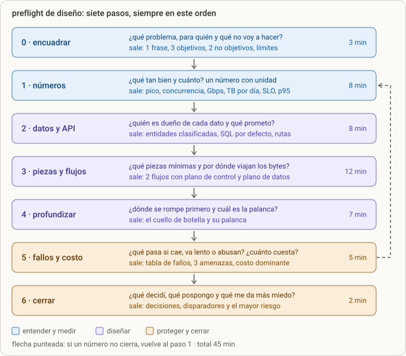
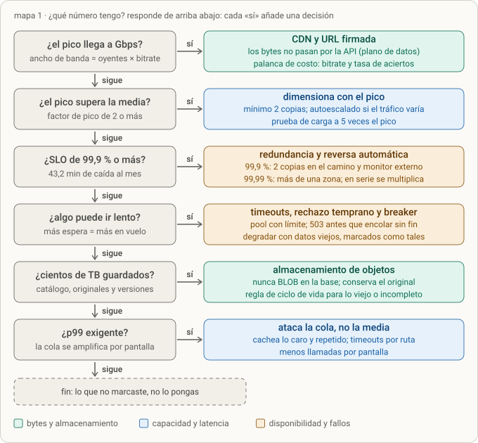
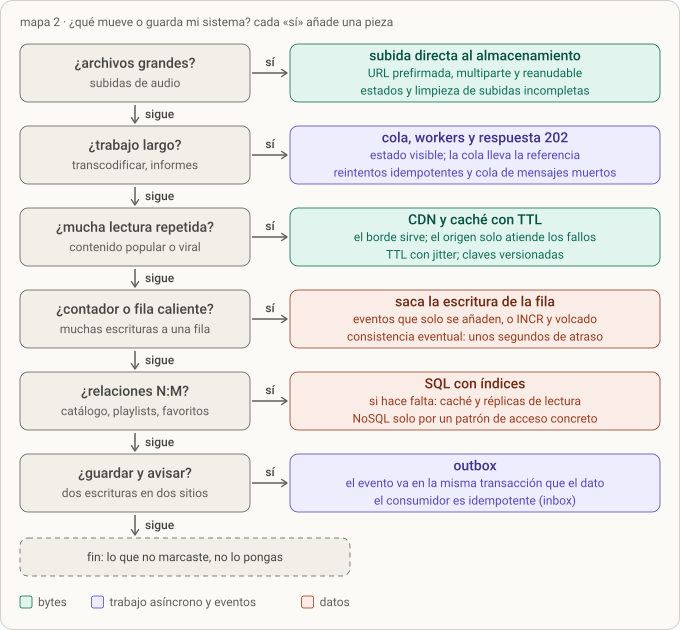
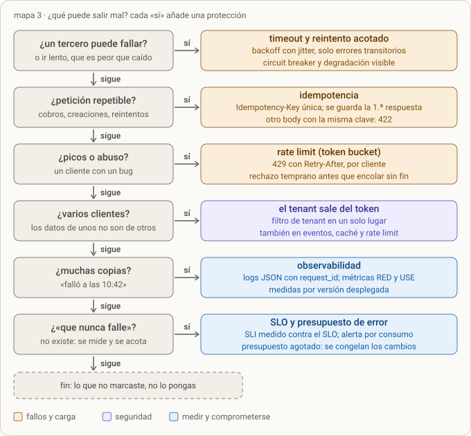
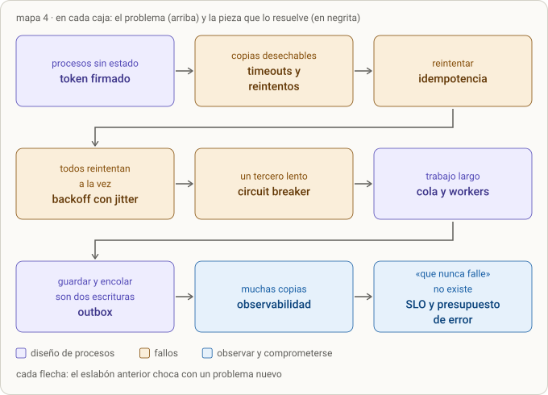

# Design 0 · Preflight de diseño (la memoficha)

> **Objetivo:** un protocolo de una página que aplicas ante cualquier «diséñame X»: siete pasos en orden fijo, cada uno con una pregunta y una salida concreta. Memorizas la ficha (§1); el resto (§2–§8) son las tablas de apoyo y §10 es el mapa que las une.
>
> **Versión v2, tras la Ronda 0, el mapa de decisiones (§10) y la Ronda 1.** Crece con cada lección del bloque de diseño ([[design-1]] añade los números; las siguientes, datos y API, piezas y flujos, profundizar, fallos y costo). Está construida con los cuatro documentos de tu Vault (`01` protocolo del backend corporativo, `02` los 15 factores, `04` protocolos de diseño, `05` resiliencia, seguridad y capacidad) y con lo que acertaste y fallaste en la Ronda 0. No necesitas abrirlos para usarla.

---

## 0. Cómo usarla

- **Regla madre: no se eligen piezas antes de tener números y dueños de datos.** Sin números cualquier arquitectura parece buena y se elige por gusto; sin dueños de datos, las fronteras salen del framework y no del negocio.
- **En una entrevista (pizarra o papel):** dices el paso en voz alta, escribes su salida y pasas al siguiente. Si una cuenta no cierra, vuelves al paso 1 (flecha punteada del dibujo).
- **Ante un sistema que ya existe (diagnóstico):** recorres los mismos pasos mirando qué falta. ¿Hay números? ¿Cada dato tiene dueño? ¿Los bytes pasan por donde no deben? ¿Qué ve el usuario cuando algo cae?
- **Para formular un brief propio:** los pasos 0 y 1 son el documento de encuadre; 2–4 la propuesta; 5–6 el riesgo y la decisión.
- **Cada pieza responde a un problema.** Si no puedes nombrar el problema (una fila de requisitos o de flujos), no pones la pieza.
- **Cuando no sepas qué pieza toca:** recorre las escaleras de §10; cada pregunta de sí o no te lleva a la pieza o te dice que no la pongas.

**Frases ancla** (te dan tiempo y muestran método):

- «Antes de dibujar, fijo requisitos y hago las cuentas.»
- «Supongo X; si es distinto, cambia esto.»
- «Diseño para el pico, no para la media. Estimo el pico con un factor de 3 y te digo por qué.»
- «Esa pieza no tiene todavía un problema que la justifique; la pospongo hasta que [disparador medible].»
- «Lo que más me preocupa es X, y lo ataco primero así.»

---

## 1. La ficha (memorízala)

*Figura · el preflight. Azul: entender y medir. Morado: diseñar. Ámbar: proteger y cerrar. Los minutos suman 45.*

**Cómo leerlo.** Cada caja tiene una pregunta (arriba) y lo que debe quedar escrito en la pizarra (abajo). El orden no se negocia: la topología (paso 3) nunca se decide antes de los números (paso 1) y los dueños de los datos (paso 2). La flecha punteada existe porque es normal que, al llegar a fallos y costo, un número de antes no cierre y haya que rehacerlo.

| Paso | Qué haces | Qué dejas escrito | Trampa típica (ya te pasó o casi) |
| --- | --- | --- | --- |
| **0 · Encuadrar** (3 min) | Preguntas de aclaración (§3) y delimitas el problema | 1 frase de problema, 3 objetivos medibles, 2 no objetivos, restricciones (equipo, plazo, presupuesto) | Empezar a dibujar cajas sin saber qué se pide |
| **1 · Números** (8 min) | Una cuenta con unidades por atributo (§2) | Usuarios, tasa media y de pico, concurrencia, Gbps, TB por día y almacenados, SLO, latencia p95/p99, costo | Bits con bytes, volumen con tasa, media con pico, multiplicar en vez de dividir |
| **2 · Datos y API** (8 min) | Entidades, dueño de cada dato, clase (verdad, derivado, caché, mensaje), patrón de acceso, rutas clave | Modelo en 5–8 entidades, SQL por defecto, binarios grandes a almacenamiento de objetos, contadores con su política | «NoSQL porque escala» y audio como BLOB en la base |
| **3 · Piezas y flujos** (12 min) | Arquitectura mínima (monolito modular salvo razón escrita) y **dos flujos**: una escritura larga y una lectura masiva | Diagrama de contexto, estados de la escritura larga, **plano de control y plano de datos** marcados, mapa a la nube (§6) | Los bytes pasan por tu API; cajas sin problema que las justifique |
| **4 · Profundizar** (7 min) | Eliges lo primero que se rompe (lo dicen los números) y aplicas la palanca correcta (§4) | El cuello de botella y su palanca | Escalar el componente equivocado (más contenedores cuando el límite son los bytes) |
| **5 · Fallos y costo** (5 min) | Tabla de fallos (§5), tres amenazas, el costo dominante | 3–5 filas de fallos, quién abusa, qué ve el usuario, dónde está el dinero | Decir «alta disponibilidad» sin decir qué ve el usuario |
| **6 · Cerrar** (2 min) | Resumes | 3 decisiones caras de cambiar, lo que pospones con su disparador, el mayor riesgo y cómo lo atacas primero | Terminar en silencio o con «se puede escalar horizontalmente» |

**Lo caro de cambiar se decide ya; lo barato se pospone con un disparador escrito.** «Lo añadimos cuando haga falta» no es un plan; «separo el servicio de recomendaciones cuando su p95 pase de 2 s con la carga del escenario» sí lo es. El disparador es lo que distingue a un mid+.

---

## 2. Números de bolsillo

| Qué calculas | Fórmula | Ejemplo (1 M de usuarios activos × 20 reproducciones, 128 kbps, 4 min) |
| --- | --- | --- |
| Bits a bytes | ÷ 8 (kbps ÷ 8 = KB/s) | 128 kbps = 16 KB/s |
| Tasa media | eventos por día ÷ 86.400 | 20 M ÷ 86.400 = **231 por s** |
| Factor de pico | (fracción del tráfico ÷ horas de la ventana) × 24; siempre entre 1 y 24 ÷ horas | (0,5 ÷ 4) × 24 = **3** (máximo 6) |
| Tasa de pico | media × factor | 231 × 3 = **694 por s** |
| Concurrencia (ley de Little) | L = λ × W (un conteo, no «por s») | 694 × 240 s = **166.667** a la vez |
| Ancho de banda | L × tasa por oyente | 166.667 × 128 kbps = **21,3 Gbps** |
| Volumen que sale por día | eventos × MB por evento | 20 M × 3,84 MB = **76,8 TB** |
| Almacenamiento | ítems × tamaño de todas sus versiones | 10 M × 43 MB = **434 TB** |
| Tiempo de descarga | volumen ÷ tasa de la línea | 5.000 × 86 MB = 430 GB ÷ 1,25 GB/s = **344 s** |
| Percentil p | el valor bajo el que queda el p % de las peticiones | 98 % en 80 ms y 2 % en 4 s: p95 = 80 ms, p99 = **4 s** |
| Caída permitida al mes | 43.200 min × (1 − SLO) | 99,9 % → **43,2 min** · 99,99 % → **4,32 min** |
| Disponibilidad en serie | producto de las disponibilidades | 99,9 % × 99,9 % = 99,8 % → 86 min |
| Peticiones en vuelo | λ × W (un conteo, no «por s») | 500 por s × 0,12 s = **60** peticiones (si W sube a 3 s: 1.500) |
| Costo del egreso | TB × 1.000 × precio por GB | 2.304 TB al mes: decenas de miles de USD (ver [[design-1]]) |

**Cuatro chequeos de 10 segundos antes de dar un número:**

1. **Escribe las unidades en cada línea.** Si no se cancelan, la cuenta está mal (kbps no son KB/s; un total no es una tasa).
2. **¿Te piden una tasa (por segundo) o un volumen (total)?** Volumen ÷ tiempo = tasa; tasa × tiempo = volumen.
3. **Compáralo con una referencia que sepas:** 1 día ≈ 10⁵ s (86.400) · 1 mes ≈ 2,6 M de s · 1 Gbps = 125 MB/s · 1 TB por día ≈ 93 Mbps sostenidos.
4. **¿Es posible?** Cruza el resultado con un límite que ya sabes: la línea (1 Gbps = 125 MB/s), el número de usuarios, y que un factor de pico esté entre 1 y 24 ÷ horas de la ventana. Si no pasa, tu confianza máxima es 2, aunque la cuenta «salga» ([[design-1]] §8.4).

Y el recordatorio de latencia: se habla de **percentiles** (p95, p99), no de la media; la media esconde la cola.

---

## 3. Antes de dibujar: diez preguntas

Cada pregunta debe cambiar una decisión; si no cambia nada, no la hagas.

1. ¿Quién lo usa y cuántos (usuarios activos al día, picos, crecimiento)?
2. ¿Qué hace exactamente: solo leer o escuchar, o también crear, subir, compartir?
3. ¿Cuánto se lee y cuánto se escribe, y qué tamaño tiene cada objeto?
4. ¿Qué pesa más: disponibilidad, latencia, consistencia o costo?
5. ¿Qué latencia es aceptable (p95, p99) y qué tolera el usuario (esperar, datos viejos)?
6. ¿Dónde están los usuarios (una región o varias)?
7. ¿Hay restricciones legales, licencias o datos sensibles?
8. ¿Qué ya existe (stack, nube, equipo, plazo, presupuesto)?
9. ¿Qué queda fuera de alcance?
10. ¿Qué sería un fracaso (el peor incidente imaginable)?

---

## 4. Cuando oigas X, piensa Y

| Si ves… | Piensa… | Sin eso se rompe… |
| --- | --- | --- |
| **Archivos grandes** | URL prefirmada y subida multiparte o reanudable **directa al almacenamiento**; la API solo autoriza y registra; limpieza de subidas incompletas | La API se vuelve tubería de bytes y cae por memoria y ancho de banda |
| **Trabajo largo** (transcodificar, informes) | Cola + workers + respuesta 202 + estado visible; reintentos idempotentes y cola de mensajes muertos | El request se cuelga y el timeout lo corta |
| **Lectura masiva o contenido popular** | CDN y caché: el mismo objeto sale del borde | El origen soporta todo el tráfico; lo viral lo tumba |
| **Contador o fila caliente** | Eventos que solo se añaden, o `INCR` en Redis con volcado periódico (consistencia eventual) | Los `UPDATE` sobre una fila hacen cola por el bloqueo |
| **Tercero lento o caído** | Timeout + reintentos acotados con backoff y jitter + circuit breaker + degradación | Hilos agotados y el fallo se contagia |
| **La petición puede repetirse** | Idempotencia (`Idempotency-Key`) | Cobros o creaciones duplicadas |
| **Guardar y avisar** (dos escrituras) | Outbox: el evento va en la misma transacción que el dato | Evento perdido si el proceso muere en medio |
| **Picos o abuso** | Rate limit (token bucket) con 429 y `Retry-After` | Un cliente tumba a todos |
| **Varios clientes o empresas** | El tenant sale del token, nunca del body | Un cliente lee datos de otro |
| **Muchas copias y «falló a las 10:42»** | Logs JSON con `request_id`, métricas RED, SLO | No se sabe dónde ni por qué falló |
| **Relaciones N:M y lecturas repetidas** | SQL con índices; luego caché y réplicas de lectura | «SQL es lento» casi siempre es un índice que falta |
| **«Microservicios»** | Monolito modular salvo una razón escrita (equipos, ritmo de cambio, carga, aislamiento, seguridad, tecnología) | Pagas la operación distribuida sin el problema que la justifica |
| **Usuarios en varias regiones** | CDN y, solo si hay requisito, réplicas por región | Complejidad y costo sin beneficio |
| **Un dato con dos dueños** | Un dato, un dueño; ninguna base compartida | Cambios que rompen a otros sin aviso |

**La cadena que lo une todo:** procesos sin estado → la sesión va en un token firmado · copias desechables → timeouts y reintentos · reintentar → idempotencia · todos reintentan a la vez → backoff con jitter · un tercero lento → circuit breaker · trabajo largo → cola · guardar y encolar son dos escrituras → outbox · muchas copias → observabilidad · «que nunca falle» no existe → SLO y presupuesto de error. Cada eslabón aparece cuando el anterior choca con un problema.

---

## 5. Tabla de fallos (plantilla y ejemplo)

Una fila por dependencia. **Lo lento es peor que lo caído:** lo caído responde rápido con un error; lo lento retiene hilos y conexiones hasta tumbar a quien lo llama.

| Dependencia | Si se cae | Si se pone lenta | Protección | Qué ve el usuario |
| --- | --- | --- | --- | --- |
| **CDN** | El tráfico va al origen, que puede saturarse | Los segmentos tardan: buffering | Escudo de origen, timeouts cortos, segunda ruta | Cortes o calidad menor |
| **Almacenamiento de objetos** | No hay audio nuevo; lo ya cacheado en el CDN sigue | Subidas y lecturas de origen lentas | Replicación entre zonas, caché en el borde | Lo popular suena; lo raro falla con un mensaje claro |
| **Transcodificador** | Las subidas se aceptan y esperan en la cola; **la reproducción no se afecta** | La cola crece | Cola + reintentos + cola de mensajes muertos + alerta por antigüedad | «Tu canción se está procesando» |
| **Base de datos** | 503 en catálogo y login | Pool agotado | `statement_timeout`, pool con timeout, réplica de lectura, caché del catálogo | Error claro; catálogo desde caché |
| **Redis** | Rate limit abierto (fail-open) y contadores sin actualizar | Timeouts cortos | El contador es derivado: se reconstruye desde los eventos | Todo funciona, sin límites ni contadores al día |

---

## 6. Mapa de la nube (AWS ↔ Azure)

| Pieza | AWS | Azure |
| --- | --- | --- |
| Almacenamiento de objetos | S3 | Blob Storage |
| CDN | CloudFront | Azure Front Door (CDN) |
| Contenedores sin gestionar servidores | ECS Fargate, App Runner | Container Apps |
| Base relacional | RDS PostgreSQL, Aurora | Azure Database for PostgreSQL |
| Redis | ElastiCache | Azure Cache for Redis (en retirada; el sucesor es Azure Managed Redis) |
| Colas y eventos | SQS, SNS, EventBridge | Service Bus, Event Grid |
| Transcodificación | MediaConvert, o FFmpeg en contenedores | FFmpeg en contenedores (Azure Media Services se retiró el 30-jun-2024) |
| Secretos | Secrets Manager | Key Vault |
| Identidad de usuarios | Cognito | Microsoft Entra External ID |
| Observabilidad | CloudWatch, X-Ray | Azure Monitor, Application Insights |
| Infraestructura como código | CloudFormation, CDK, Terraform | Bicep, Terraform |

Regla: **no cites un servicio que no sepas justificar con una fila de números o de flujos.** Los nombres cambian; el problema que resuelve cada pieza, no.

---

## 7. Autoevaluación antes de decir «listo»

1. ¿Cada requisito tiene un número con unidad, y la capacidad cierra **en el pico** (y durante un despliegue, cuando conviven dos versiones)?
2. ¿Algún dato tiene dos dueños? ¿Algún binario grande vive en la base?
3. ¿Los bytes grandes evitan mi API, tanto al subir como al reproducir?
4. ¿Cada pieza responde a una fila de requisitos o de flujos? ¿Cada servicio aparte tiene una razón escrita?
5. ¿Cada dependencia tiene timeout, degradación y fila en la tabla de fallos?
6. ¿Cada pieza pospuesta tiene su disparador medible?
7. ¿Dije qué me da más miedo y qué haría primero para atacarlo?

---

## 8. Antipatrones (los de las Rondas 0 y 1 y los del Vault)

| Antipatrón | Patrón |
| --- | --- |
| Elegir la arquitectura antes de tener números | Escenario y cuentas antes de la topología |
| Multiplicar tamaño por usuarios y llamarlo ancho de banda | Tasa por oyente × oyentes a la vez |
| Dimensionar con la media | Dimensionar con el pico y decir qué factor usas |
| Los bytes pasan por mi API (subida o reproducción) | La API autoriza; el almacenamiento y el CDN mueven los bytes |
| Escalar contenedores cuando el límite es el ancho de banda | CDN y caché para lo caliente |
| NoSQL «porque escala» | SQL por defecto; NoSQL por un patrón de acceso concreto |
| Guardar solo el archivo transcodificado | Conservar el original: la conversión con pérdida no se deshace |
| Solucionar un contador caliente con «vistas» de la base | Eventos o `INCR` en Redis con volcado, o contadores fragmentados |
| «Microservicios porque es mid+» | Monolito modular y una razón escrita por cada servicio |
| «Alta disponibilidad» sin decir qué ve el usuario | Tabla de fallos con la columna «qué ve el usuario» |
| «Lo añadimos cuando haga falta» | «Lo añadimos cuando [métrica] pase de [umbral]» |
| Dar un resultado sin comprobar si es posible | Cruzarlo con un límite físico y bajar la confianza si no pasa |
| Tratar lo que guardo y lo que entrego como una sola cifra | Almacenamiento por lo guardado; egreso por lo entregado (bitrate) |

---

## 9. Cómo crece esta ficha

| Versión | Qué añadió |
| --- | --- |
| **v1** (Ronda 0) | Los siete pasos, los números de bolsillo, las diez preguntas, los disparadores, la tabla de fallos, el mapa de la nube y los antipatrones |
| **v1.1** (mapa de decisiones) | §10: tres escaleras de preguntas (números, datos y bytes, fallos y seguridad) y la cadena de eslabones, con la relación entre las diez preguntas de §3 y los mapas |
| **v2** (Ronda 1, [[design-1]] §8) | Cuarto chequeo «¿es posible?», rango del factor de pico, fórmulas de tiempo de descarga y percentil, y la magnitud de cada fórmula (conteo, tasa o volumen) |
| **siguientes** | Datos y API · piezas y flujos (planos de control y de datos) · profundizar · fallos y costo, cada una afinando su paso |

**Cuándo se revisa la nube:** en el paso 3, al mapear piezas a servicios (§6), y en el paso 5, al calcular el costo dominante. No antes: el servicio se elige cuando ya sabes qué problema resuelve.

---

## 10. Mapa de decisiones: de la pregunta a la pieza

Las diez preguntas de §3 y los disparadores de §4 son lo mismo visto desde dos lados: la pregunta te hace descubrir el problema y el disparador te da la pieza. Aquí van unidos en cuatro mapas. Los tres primeros son **escaleras**: preguntas de sí o no, de arriba abajo. Cada «sí» marca una pieza y **siempre se sigue bajando** (un «sí» no corta la escalera: puedes marcar varias). El cuarto es la **cadena**: por qué las piezas aparecen en ese orden.

### Cómo recorrerlo

1. **Mapa 1, los números**, siempre primero. Sus respuestas salen del paso 1 y deciden cuánto pesa todo lo demás: un pico de 21,3 Gbps (el de la plataforma de ejemplo, [[design-1]] §3.6) hace obligatorias la CDN y la URL firmada.
2. **Mapa 2, datos, bytes y trabajo**, al diseñar datos, piezas y flujos (pasos 2 y 3).
3. **Mapa 3, fallos, abuso y confianza**, al revisar fallos y costo (paso 5). Si hay varios clientes, el tenant ya lo decides con los datos, en el paso 2.
4. **Apunta cada «sí»** con el problema que lo justificó (en la tabla de §5 o junto a la pieza). Si no puedes decir el problema, no era un «sí».
5. **Al final de cada escalera, lo que no marcaste no lo pongas.** Es el antipatrón de §8 al revés: una pieza sin problema es costo sin beneficio.

### Mapa 1 · De los números a las decisiones

Las cuentas de cada casilla están en §2; el «por qué» de cada una, en [[design-1]] §3.3 a §3.8.

### Mapa 2 · Datos, bytes y trabajo

Las dos casillas de datos siguen la regla del SQL por defecto: empiezas en SQL y solo sales cuando un patrón de acceso concreto lo obliga. La casilla del contador es el caso de las reproducciones: cada play es un `UPDATE` sobre la misma fila y los escritores hacen cola por el bloqueo; la salida es sacar la escritura de la fila.

### Mapa 3 · Fallos, abuso y confianza

Cada «sí» de este mapa es una fila candidata de la tabla de fallos (§5): qué se rompe, qué ve el usuario y qué pieza lo contiene.

### Mapa 4 · La cadena: por qué existe cada pieza

Léela como una historia, no como un orden de construcción: cada caja es un problema que aparece **porque** pusiste la pieza anterior. Sirve para recordar por qué existe cada pieza y, al revés, para descartarla: si no tienes el problema de la caja, no necesitas la pieza.

### De las diez preguntas a los mapas

| Pregunta de §3 | Qué casilla alimenta | Qué decide |
| --- | --- | --- |
| 1. ¿Quién y cuántos? | Mapa 1 (Gbps, pico) y Mapa 3 (varios clientes) | CDN, dimensionar con el pico, tenant |
| 2. ¿Qué hace exactamente? | Mapa 2 (archivos, trabajo largo, guardar y avisar) | subida directa, cola, outbox |
| 3. ¿Cuánto se lee y escribe, de qué tamaño? | Mapa 1 (TB guardados) y Mapa 2 (lectura repetida, contador, N:M) | objetos, CDN y caché, contador, SQL |
| 4. ¿Qué pesa más? | Mapa 1 (SLO) y Mapa 3 (que nunca falle) | redundancia, SLO y presupuesto de error |
| 5. ¿Qué latencia es aceptable? | Mapa 1 (lentitud, p99) y Mapa 3 (muchas copias) | timeouts, atacar la cola, observabilidad |
| 6. ¿Dónde están los usuarios? | Mapa 1 (Gbps) y §4 (regiones) | CDN; réplicas por región solo con requisito |
| 7. ¿Hay restricciones legales o datos sensibles? | Mapa 3 (varios clientes) y §5 | tenant y amenazas; una licencia es una restricción, no una pieza |
| 8. ¿Qué ya existe? | ninguna casilla | limita la elección: la pieza se elige con lo que ya tienes (§6) |
| 9. ¿Qué queda fuera de alcance? | el final de cada escalera | lo que no marcaste, no lo pongas |
| 10. ¿Qué sería un fracaso? | Mapa 3 (tercero, repetible, abuso) y §5 | la primera fila de la tabla de fallos |

### Ejemplo: la plataforma de música

- **Mapa 1:** sí en Gbps (21,3 Gbps de pico) → CDN y URL firmada; sí en pico (factor 3) → dimensionar con el pico; sí en TB (originales y segmentos) → almacenamiento de objetos; el SLO de 99,9 % marca la casilla solo si el requisito lo pide.
- **Mapa 2:** sí en archivos grandes (subidas de artistas), en trabajo largo (transcodificar), en lectura repetida (lo viral), en contador (reproducciones) y en N:M (playlists); sí en guardar y avisar (canción lista y evento de aviso).
- **Mapa 3:** sí en tercero lento (por ejemplo, un proveedor de pagos o de licencias), en petición repetible (subidas y pagos) y en picos; **no** en varios clientes: es una sola plataforma sin empresas-cliente, así que no pones el tenant.

### Lo que el mapa no cubre

- Las decisiones de **forma** (monolito modular o microservicios, regiones, un dato con un solo dueño) no tienen escalera: se resuelven con las tres últimas filas de §4.
- Un mapa bien recorrido con números mal estimados da piezas de más o de menos. Por eso el mapa 1 va primero y por eso las cuentas se hacen a mano.

---

## Fuentes

- Tu Vault: `01 · Protocolo del backend corporativo`, `02 · Los 15 factores condensados`, `04 · Protocolos de diseño`, `05 · Resiliencia, seguridad y capacidad`.
- [Anuncio de la retirada de Azure Cache for Redis · Microsoft Tech Community](https://techcommunity.microsoft.com/blog/azure-managed-redis/-/4458721) (las fechas exactas están en el artículo completo).
- Cifras de la plataforma de ejemplo: verificadas por cálculo en [[design-1]] §3.9.

## Diagramas de esta lección

- [Preflight de diseño](diagramas/diseno-preflight.svg)
- [Mapa 1 · de los números a las decisiones](diagramas/diseno-mapa-numeros.svg)
- [Mapa 2 · datos, bytes y trabajo](diagramas/diseno-mapa-datos-bytes.svg)
- [Mapa 3 · fallos, abuso y confianza](diagramas/diseno-mapa-fallos-seguridad.svg)
- [Mapa 4 · la cadena de eslabones](diagramas/diseno-mapa-cadena.svg)
