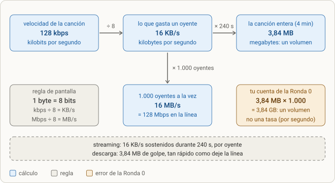
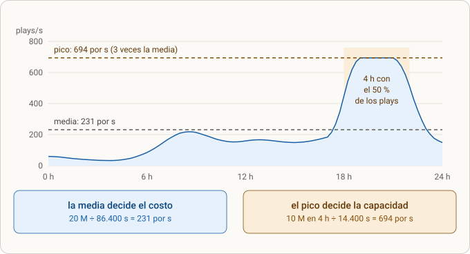
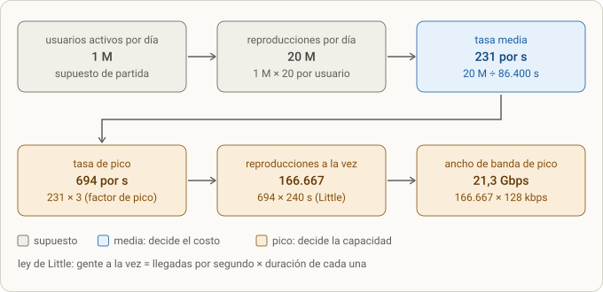
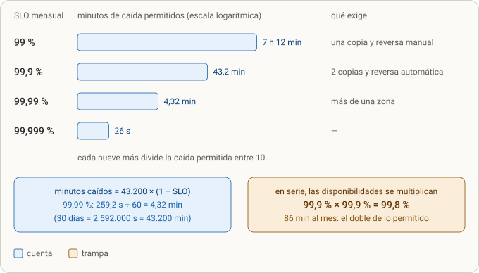

# Design 1 · Requisitos y estimaciones

> **Objetivo:** que puedas sacar, a mano y en menos de diez minutos, los números que deciden una arquitectura (tasa media y de pico, gente a la vez, ancho de banda, volumen, almacenamiento, disponibilidad y latencia) sin equivocarte de unidad. Esta lección es el **paso 1** del protocolo [[design-0]].
>
> **Caso del ejercicio:** plataforma de streaming de música. Supuestos: 1 M de usuarios activos al día, 20 reproducciones cada uno, canción de 4 min a 128 kbps, catálogo de 10 M de canciones.
>
> **Estado:** Ronda 0 diagnosticada (5 de 12). Falta que contestes la Ronda 1 (se plantea en el chat).

---

## 0. Dónde encaja

- Es el segundo carril del repositorio: tras las lecciones 1–9 (el miniproyecto de la API de música), el bloque de **diseño de backend**. Orden: [[design-0]] (protocolo) → **design-1** (requisitos y estimaciones) → datos y API → piezas, flujos y nube → profundizar → fallos, costo y simulacro a mano.
- Cubre el **paso 1** de la ficha de [[design-0]] (números) y la mitad del paso 0 (preguntas de aclaración).
- Es lo primero que se pide en una entrevista de diseño y lo que más se equivoca por prisa: casi todo lo que falló en la Ronda 0 de esta lección era aritmética de unidades, no conceptos difíciles.

## 1. Qué se hizo (resumen)

1. **Ronda 0:** doce preguntas con trampas para medir de dónde partes. Las contestaste sin puntuar la confianza (1–5).
2. **Diagnóstico** (§2): 5 de 12 puntos, con tres causas raíz y una corrección por pregunta.
3. **[[design-0]]:** la ficha de siete pasos que consolida este entrenamiento y los cuatro documentos de protocolos de tu Vault.
4. **Esta lección:** los conceptos del paso 1, con las cuentas verificadas por código, cuatro diagramas, la hoja de capacidad completa de la plataforma y preguntas de entrevista.

> 📝 **Nota sobre las preguntas.** El enunciado literal de las doce preguntas de la Ronda 0 no está en mi registro de la sesión. El *tema* de cada una lo reconstruyo a partir de tus respuestas; está marcado con 📝. Si algún tema no coincide con lo que recuerdas, corrígeme y lo ajusto.

---

## 2. Diagnóstico de la Ronda 0

### 2.1 Marcador

Escala: ✔ = 1 punto · ◐ = 0,5 · ✘ = 0.

| # | Tema 📝 | Veredicto | Idea clave |
| --- | --- | --- | --- |
| 1 | Ancho de banda para N oyentes a la vez | ◐ | Tasa por oyente × oyentes; tamaño × usuarios es un volumen |
| 2 | Tasa media y de pico de reproducciones | ◐ | La media está bien; el pico es *cuándo*, no *quién* |
| 3 | Disponibilidad, latencia y SLO | ◐ | Buena pregunta de negocio y 43,2 min; 99,99 % mal |
| 4 | ¿El audio como BLOB en la base? | ✔ | Correcto: almacenamiento de objetos |
| 5 | Contador de reproducciones (fila caliente) | ◐ | Repartir y consolidar sí; «vistas» de la base no |
| 6 | SQL o NoSQL para el catálogo | ✘ | SQL por defecto; «SQL es lento» es un mito |
| 7 | Flujo de reproducción | ✘ | Los bytes no pasan por la API |
| 8 | Flujo de subida | ◐ | Estados sí; subida directa y limpieza, no *rollback* |
| 9 | ¿Transcodificar durante la subida? | ◐ | Asíncrono sí; conserva el original |
| 10 | Una canción se vuelve viral | ✘ | No son más contenedores: es el CDN |
| 11 | Reparto del costo | ◐ | El egreso manda; el cómputo pesa mucho menos |
| 12 | Qué pasa si cae una pieza | ◐ | Réplicas sí; aislar con una cola, también |

**Total: 5,0 / 12** (1 ✔, 8 ◐, 3 ✘). Es un diagnóstico, no una nota: sirve para saber en qué empezar.

### 2.2 Las tres causas raíz

1. **Los bytes son lo caro y todavía no los has puesto en el mapa** (preguntas 1, 7, 8, 10 y 11). En un sistema que mueve audio, cada decisión empieza por «¿quién carga los bytes?»: en la reproducción, el CDN; en la subida, el almacenamiento, directo; ante lo viral, la caché del borde; en el costo, el egreso. Tu diseño los hacía pasar por la API, por Redis o por más contenedores.
2. **Disciplina de unidades.** Tus derivaciones son rigurosas (la pregunta 2 es un buen ejemplo de método: planteas fórmulas y las explicitas). El fallo cae en el último paso: dividir entre 8 (bits a bytes) o entre 60 (segundos a minutos). Es el error más barato de arreglar: escribir las unidades en cada línea.
3. **«Si es lento, cambia de herramienta»** (preguntas 5, 6 y 10). NoSQL, vistas de base de datos o más contenedores aparecieron para problemas que eran de contención de escritura, de índices o de ancho de banda. Primero se localiza el cuello de botella con números; después se elige la palanca.

**Lo que ya haces bien y hay que conservar:** preguntar la prioridad al negocio antes de fijar el SLO · derivar con fórmulas explícitas · modelar estados (`uploading → uploaded → ready`) · no meter audio en la base · pensar en asincronía · el instinto de «repartir la escritura y consolidar después».

**Un hueco de método:** faltaron las confianzas (1–5). Sin ellas no puedo medir calibración, y lo más valioso de una ronda son las respuestas que fallas **con confianza 4 o 5**: esos son tus puntos ciegos. En la Ronda 1, ponlas.

### 2.3 Pregunta por pregunta

#### Q1 · Ancho de banda para N oyentes simultáneos 📝

- **Tu respuesta:** «no sé calcularlo; diría tamaño del archivo × número de usuarios».
- **Bien:** multiplicar por los oyentes que escuchan *a la vez*.
- **Falla:** tamaño × usuarios da un **volumen** (3,84 MB × 1.000 = 3,84 GB), y el ancho de banda es una **tasa** (bytes por segundo). En streaming cada oyente consume su *bitrate*: 128 kbps ÷ 8 = 16 KB/s. Mil oyentes: 16 MB/s = 128 Mbps.
- **Cuándo tu fórmula sí vale:** si todos *descargan* la canción entera a la vez (modo offline): entonces el tiempo es el volumen dividido por la línea.
- **Referencia:** N × bitrate, y ÷ 8 al pasar de bits a bytes. Detalle en §3.3.

#### Q2 · Tasa media y de pico 📝

- **Tu respuesta:** 20 M ÷ 86.400 s = 231 por s ✔. Para el pico propones sumar a la media un Δ = Q3 − Q2 de la distribución de reproducciones por usuario, y evitas dimensionar con el máximo.
- **Bien:** la media, la derivación explícita y no dimensionar con el máximo absoluto.
- **Falla:** el pico es una cuestión de **cuándo**, no de **quién**. Los cuartiles por usuario dicen quién escucha mucho; no dicen cuánta gente escucha a la vez. Aunque todos tuvieran exactamente 20 reproducciones, habría pico, porque se concentran en las mismas horas.
- **Referencia:** factor de pico declarado (2–5) o el percentil alto de la serie de peticiones por segundo. Con «la mitad de las reproducciones en 4 h»: (0,5 ÷ 4) × 24 = 3 → **694 por s**.
- **Lo que faltó:** pasar de tasa a gente a la vez con la ley de Little: 694 × 240 s = **166.667** reproducciones simultáneas. Detalle en §3.5 y §3.6.

#### Q3 · Disponibilidad, latencia y SLO 📝

- **Tu respuesta:** preguntas al negocio si importa más la disponibilidad o la latencia; 99,9 % = 2.592 s = 43,2 min; 99,99 % → «256 s equivalentes a 15,55 min».
- **Bien:** la pregunta de negocio (es lo que hace un senior), 30 días = 2.592.000 s y los 43,2 min.
- **Falla:** 99,99 % deja **259,2 s** (no 256), y 259,2 s ÷ 60 = **4,32 min**. El 15,55 sale de 259,2 × 60 = 15.552: multiplicaste en vez de dividir. El chequeo que lo habría cazado: 256 s es *menos de cinco minutos* por definición; «256 s = 15,55 min» se contradice a sí mismo.
- **Lo que faltó:** expresar la latencia como percentil (p95, p99) y la disponibilidad con su SLI (qué cuenta como «bien»). Detalle en §3.7 y §3.8.

#### Q4 · ¿Audio como BLOB en la base? ✔

- **Tu respuesta:** no; almacenamiento dedicado; el peso cae sobre el servidor de la base y añade complejidad.
- **Bien:** la decisión y las razones.
- **Añade:** el almacenamiento de objetos cuesta mucho menos por GB; los respaldos y la replicación de la base crecerían con cientos de TB; el CDN no sirve un BLOB de la base con peticiones por rangos. El BLOB solo tiene sentido en archivos **pequeños** que deban guardarse en la misma transacción que su fila.

#### Q5 · Contador de reproducciones (fila caliente) 📝

- **Tu respuesta:** crear vistas de la base por grupo de consumidores, con una política de actualización y consolidación; no concentrar todo el tráfico en un servidor.
- **Bien:** repartir las escrituras y consolidar después es **justo** la idea correcta (contadores fragmentados).
- **Falla:** una *vista* de base de datos es una consulta guardada; no reduce escrituras. El problema es la **contención**: `UPDATE songs SET plays = plays + 1` bloquea la fila, y con 694 reproducciones por s concentradas en pocas canciones populares las escrituras hacen cola.
- **Referencia:** (a) guardar cada reproducción como evento que solo se añade y agregar después; (b) `INCR` en Redis y volcar a la base cada pocos segundos; (c) N subcontadores que se suman al leer. En los tres aceptas **consistencia eventual**: el contador puede ir unos segundos atrasado y nadie lo nota. Se profundiza en el paso 4.

#### Q6 · SQL o NoSQL para el catálogo ✘

- **Tu respuesta:** NoSQL; SQL es más lento; las relaciones N:M exigen tablas puente; cambiarías de opinión si hubiera menos tráfico.
- **Bien:** ves que canción–artista–género–playlist es N:M.
- **Falla:** esa N:M es exactamente lo que SQL hace mejor (joins, integridad referencial, transacciones). «SQL es más lento» es un mito: lo lento suele ser un índice que falta o un N+1. En lectura intensiva se escala con índices, caché y réplicas de lectura. Y el tráfico del catálogo es pequeño: con unas 3 llamadas por reproducción, son ≈ 2.000 peticiones por s en el pico, que un Postgres con índices y una caché soporta.
- **El disparador para NoSQL** no es «mucho tráfico de lectura» sino un **patrón de acceso** concreto: clave-valor a gran escala, o escrituras masivas tipo historial de reproducciones. Se profundiza en datos y API.

#### Q7 · Flujo de reproducción ✘

- **Tu respuesta:** validar el token → actualizar el componente de React → buscar la canción en la base → pedirla al almacenamiento → enviar el archivo a una cola de Redis → servicio de reproducción → audio al usuario. Dices que los bytes pasan por la API.
- **Bien:** el control (token, búsqueda, el componente que reproduce) está bien.
- **Falla:** **los bytes no deben pasar por tu API.** Hay dos planos: el de **control** (la API valida el token, busca los metadatos y devuelve una URL firmada de vida corta o un manifiesto HLS/DASH) y el de **datos** (el reproductor pide los segmentos al CDN, que los saca del almacenamiento). Una cola de Redis tampoco es canal de audio: sirve para tareas pequeñas.
- **Con números:** el pico son 21,3 Gbps; una API no los sostiene, un CDN sí. Se profundiza en piezas y flujos.

#### Q8 · Flujo de subida ◐

- **Tu respuesta:** validar el token; el servidor del frontend recibe el archivo y lo manda al backend; metadatos a la base; estado `uploading → uploaded` cuando termina el almacenamiento; si falla, deshacer la transacción.
- **Bien:** la máquina de estados y el registro de metadatos.
- **Falla (1):** el archivo da dos saltos (frontend → backend → almacenamiento) y cada salto cuesta memoria, ancho de banda y un timeout. Mejor: la API crea el registro en `uploading` y devuelve una **URL prefirmada** (subida multiparte y reanudable) y el navegador sube **directo** al almacenamiento; un evento del almacenamiento pasa el estado a `uploaded`.
- **Falla (2):** «deshacer la transacción» no aplica: una transacción de base de datos no cubre una subida de minutos ni deshace bytes que no están en la base. Lo correcto son **estados + limpieza** (una regla de ciclo de vida que aborte las subidas multiparte incompletas pasados N días, y una tarea que marque como `failed` los `uploading` viejos) + reintentos idempotentes.

#### Q9 · ¿Transcodificar durante la subida? ◐

- **Tu respuesta:** no; procesar después; responder según el estado (`uploading`, `uploaded`, `ready`); conservar solo el archivo final si la conversión es reversible, y aceptar la pérdida si el caso de uso lo permite.
- **Bien:** asíncrono y con estado visible. Es el diseño correcto (cola + workers + respuesta 202 con un enlace de estado).
- **Falla:** la conversión a formatos con pérdida **no es reversible**. Conserva el original (el *master*): si mañana quieres un códec nuevo, otro bitrate o corregir un bug del transcodificador, lo necesitas. Costo: 10 M × 30 MB = 300 TB ≈ 7 k USD al mes de almacenamiento, barato frente al egreso y al riesgo.

#### Q10 · Una canción se vuelve viral 📝

- **Tu respuesta:** paralelizar: más contenedores del servicio de reproducción para esa canción.
- **Bien:** escalar horizontalmente es válido para componentes sin estado.
- **Falla:** el límite no es el cómputo sino los **bytes**: 1 M de oyentes × 128 kbps = 128 Gbps. Más contenedores no crean ancho de banda. Lo viral es el caso **más fácil** para un CDN: todos piden los mismos segmentos, así que casi todo sale de la caché del borde (con un 95 % de aciertos, al origen llegan ≈ 6,4 Gbps); además se precalienta la caché al publicar.
- **Y la fila caliente:** el contador de esa canción es el problema de la Q5, con 10 veces más fuerza.

#### Q11 · Reparto del costo ◐

- **Tu respuesta:** 50 % transferencia, 30 % cómputo, 20 % almacenamiento.
- **Bien:** el egreso es lo mayor.
- **Falla:** el orden de magnitud. Con las cuentas de §3.10, el reparto ronda **70–85 % egreso, 10–20 % almacenamiento y 5–8 % cómputo** (supuesto: unas decenas de instancias pequeñas). Reproducir apenas consume cómputo: lo hace el CDN. El cómputo sirve a la API de control y a la transcodificación de lo nuevo.

#### Q12 · Qué pasa si cae una pieza 📝

- **Tu respuesta:** hablas de la reproducción: crear copias del servicio y, si un contenedor muere, cortarlo y redirigir el tráfico a uno nuevo.
- **Bien:** redundancia y reemplazo automático son lo correcto para piezas sin estado.
- **Falla:** no aislaste el fallo de la pieza por la que se preguntaba (el transcodificador). Con una **cola** entre la subida y el transcodificador, si este cae 2 h: las subidas se siguen aceptando, los trabajos esperan y, al volver, la cola se vacía en backlog ÷ (capacidad − llegada); la reproducción no se entera, porque lee lo ya procesado. Los mensajes que fallan N veces van a una cola de mensajes muertos con alerta.

---

## 3. Conceptos enseñados

### 3.1 Requisitos: una cifra por atributo

**Qué es.** Requisitos *funcionales* (qué hace: escuchar, subir, crear playlists) y *no funcionales* (qué tan bien: cuánta gente, qué latencia, cuánto tiempo caído). La arquitectura la deciden sobre todo los segundos.

**Qué se rompe sin esto.** Un requisito sin número no se puede probar: «tiene que ser rápido y estar siempre disponible» no distingue un sistema de un servidor en un garaje de uno multizona.

**Regla:** un número con unidad por atributo, y cómo se mide. Para el ejercicio, propuesta (en la entrevista los preguntas o los supones en voz alta):

| Atributo | Requisito con número | SLI o cómo se mide |
| --- | --- | --- |
| Escala (tráfico) | 1 M de usuarios activos al día · 20 reproducciones cada uno · pico de 694 por s · se diseña para 5 veces eso | peticiones por segundo; prueba de carga |
| Escala (volumen) | 10 M de canciones · 434 TB · salen 76,8 TB por día | uso de almacenamiento; egreso del CDN |
| Disponibilidad | 99,9 % mensual (43,2 min) sobre «reproducciones que arrancan» | reproducciones que arrancan bien ÷ reproducciones intentadas |
| Latencia de inicio | p95 < 1,5 s y p99 < 3 s hasta el primer audio | medición en el cliente |
| Latencia de la API | p95 < 200 ms y p99 < 500 ms en catálogo y búsqueda | gateway |
| Continuidad | cortes (*rebuffering*) < 0,5 % del tiempo de escucha | cliente |
| Subida | `ready` en p95 < 5 min desde `uploaded` | evento de estado |
| Durabilidad | un archivo subido no se pierde: el original se conserva | restauración verificada |
| Seguridad | audio solo con URL firmada de vida corta; cada artista ve solo lo suyo | tests |
| Costo | egreso dentro del presupuesto mensual, alerta al 80 % | factura proyectada |

**Trampa típica:** medir «el servidor responde» en vez de «el usuario consigue escuchar». El SLI correcto se escribe desde el punto de vista del usuario.

### 3.2 Preguntar antes de calcular

Las diez preguntas están en [[design-0]] §3. Lo importante es que **cada una cambia una decisión**:

| Pregunta | Qué decisión cambia |
| --- | --- |
| ¿Solo streaming o también descargas offline? | Con descargas offline tu fórmula de la Q1 (tamaño × usuarios) sí aplica a ese tráfico |
| ¿Solo móvil o también escritorio? | Bitrate adaptativo y varios bitrates en el catálogo |
| ¿Una región o varias? | CDN regional y, solo con requisito, réplicas por región |
| ¿Qué pesa más, disponibilidad o latencia? | Cuántos nueves y cuánto se paga por ellos; qué se degrada primero |
| ¿Hay licencias o regalías? | Quizá un servicio de cuentas de reproducciones con exactitud (no vale la consistencia eventual) |

**Cómo se pregunta:** tres o cuatro preguntas rápidas y supones el resto en voz alta («supongo 1 M de usuarios activos; si es 10 veces más, esto cambia aquí»). Tu pregunta de la Q3 fue el modelo.

### 3.3 Bits, bytes, tasa y volumen

**Qué se rompe sin esto.** Dimensionas la línea ocho veces mal, o confundes un total (GB) con una velocidad (Gbps).



*Figura · de bits a bytes, y de tasa a volumen.*

**Cómo leerlo.**

- La fila de arriba convierte la velocidad de la canción en lo que gasta *un* oyente (÷ 8) y, multiplicando por la duración, en el peso de la canción entera (× 240 s). Una es una **tasa** (por segundo); la otra, un **volumen** (total).
- Abajo, mil oyentes a la vez = 1.000 × 16 KB/s = 16 MB/s = 128 Mbps. Esa es la cuenta de la Q1.
- La caja ámbar es tu cuenta de la Ronda 0: sale un total (3,84 GB), no una velocidad.

**Reglas:**

- **b** minúscula = bit; **B** mayúscula = byte. 1 byte = 8 bits.
- En redes, **k = mil**, no 1.024: 128 kbps = 128.000 bits/s. Para estimar, la diferencia es irrelevante.
- Tasa = por segundo. Volumen = total. Volumen ÷ tiempo = tasa. Tasa × tiempo = volumen.

| Conversión | Resultado |
| --- | --- |
| 128 kbps | 16 KB/s |
| 320 kbps | 40 KB/s |
| 1 Mbps | 125 KB/s |
| 1 Gbps | 125 MB/s |
| 1 TB por día | ≈ 93 Mbps sostenidos |

**Streaming frente a descarga.** Streaming: 16 KB/s sostenidos durante 240 s por oyente. Descarga: 3,84 MB de golpe, tan rápido como deje la línea. Con 1.000 usuarios descargando a la vez desde una línea de 1 Gbps (125 MB/s), tu fórmula da 3,84 GB ÷ 125 MB/s ≈ 31 s: es la respuesta correcta a *otra* pregunta.

### 3.4 De «por día» a «por segundo»

**Por qué.** Servidores, conexiones y ancho de banda se dimensionan por segundo; las encuestas y las métricas de negocio vienen por día. El puente es 86.400 (≈ 10⁵).

- 20 M por día ÷ 86.400 = **231 por s**.
- Memorízate la regla: **1 M por día ≈ 12 por segundo**. Con ella, 20 M por día son ≈ 240 por s sin calculadora.
- Un mes de 30 días = 2.592.000 s (≈ 2,6 M).

### 3.5 Media y pico

**Qué se rompe sin esto.** Si dimensionas con la media, el sistema se cae cada tarde; si dimensionas con el máximo absoluto, quemas dinero.



*Figura · un día de reproducciones. La media (línea gris) decide cuánto pagas por volumen; el pico (línea ámbar), cuánta capacidad necesitas.*

**Cómo leerlo.**

- La curva es un día típico: poca actividad de noche, un repunte matutino y una meseta de cuatro horas por la tarde-noche con la **mitad** de las reproducciones.
- La media (231 por s) queda muy por debajo de la meseta (694 por s). Un sistema dimensionado para 231 se cae a las 18 h.
- Las dos cajas de abajo resumen la regla: la media decide el costo; el pico, la capacidad.

**Cómo se estima el pico** (de más a menos informado):

1. **Con datos reales:** el percentil alto (p95, p99) de la serie de peticiones por segundo.
2. **Con una ventana:** «la fracción *X* del tráfico ocurre en *H* horas» → factor = (X ÷ H) × 24. Aquí: (0,5 ÷ 4) × 24 = **3**.
3. **Con un factor declarado:** para tráfico de consumo, entre 2 y 5. Dices cuál usas y por qué, y diseñas para tolerar 5 veces (prueba de carga).

**Sobre tu Δ = Q3 − Q2.** Esa cuenta mide la dispersión de *cuánto escucha cada usuario*. El pico depende de *a qué hora* escucha cada usuario. Son dos variables distintas: con un 100 % de usuarios idénticos (cero dispersión) seguiría habiendo pico si todos escuchan por la tarde. Tu instinto de «no sizing con el máximo» era correcto; la alternativa correcta es el percentil de la **serie temporal**, no de la distribución por usuario.

**Matiz:** los costos que dependen del volumen (egreso, almacenamiento) siguen a la **media**; los que dependen de la capacidad (instancias, ancho de banda contratado) siguen al **pico**.

### 3.6 Ley de Little: cuánta gente hay a la vez

**Qué es.** En régimen estable, **L = λ × W**: lo que hay en el sistema a la vez (*L*) es lo que llega por segundo (*λ*) multiplicado por lo que se queda cada uno (*W*).

**Por qué importa.** Conecta tasas con cantidades: reproducciones simultáneas (que dimensionan el ancho de banda), peticiones en vuelo (que dimensionan hilos y pools), conexiones a la base (que dimensionan el límite del servidor).



*Figura · la cadena de estimación de tráfico, paso a paso.*

**Cómo leerlo.**

- Gris: supuestos (1 M de usuarios, 20 reproducciones cada uno). Azul: la tasa media. Ámbar: lo que se calcula con el pico.
- Del azul al ámbar se multiplica por el factor de pico (× 3). De ahí, × 240 s de duración (Little) da 166.667 reproducciones a la vez, y × 128 kbps da el ancho de banda: 21,3 Gbps.

**Segundo ejemplo (API):** 500 peticiones por s con 0,12 s cada una → 500 × 0,12 = **60** en vuelo. Si una dependencia sube *W* a 3 s: 500 × 3 = **1.500**; con un pool de 200 hilos, se agota. Por eso hacen falta **timeouts**, **rechazo temprano** (503) y **circuit breaker**: no son adornos, son la consecuencia directa de Little.

### 3.7 Disponibilidad: nueves, SLO y presupuesto de error

**Vocabulario.**

- **SLI:** lo que mides (reproducciones que arrancan bien ÷ intentadas).
- **SLO:** el objetivo interno (99,9 % en 30 días).
- **SLA:** el contrato con el cliente, con penalización; se firma por debajo del SLO.
- **Presupuesto de error:** 1 − SLO. Es el tiempo (o fracción de peticiones) que puedes «gastar» en fallos y cambios.



*Figura · cada nueve divide entre 10 la caída permitida.*

**Cómo leerlo.**

- Las barras están en escala **logarítmica**: cada nueve más acorta la barra en la misma cantidad porque divide los minutos entre 10.
- La columna derecha es lo que exige cada escalón (según tu Vault): una copia y reversa manual para 99 %; al menos dos copias en el camino de la petición, reversa automática y monitor externo para 99,9 %; más de una zona para 99,99 %.
- La caja ámbar es la trampa: dos componentes de 99,9 % en serie dan 99,8 % y **86 min** al mes, el doble de lo permitido.

**La cuenta, siempre en tres líneas con unidades:**

```text
mes        = 30 d × 86.400 s/d = 2.592.000 s = 43.200 min
caída      = 43.200 min × (1 − SLO)
99,99 %    → 43.200 × 0,0001 = 4,32 min        (= 259,2 s ÷ 60 s/min)
```

| SLO mensual | Caída permitida | Qué exige |
| --- | --- | --- |
| 99 % | 7 h 12 min | una copia, reversa manual |
| 99,9 % | 43,2 min | ≥ 2 copias en el camino, reversa automática, monitor cada 1–5 min |
| 99,95 % | 21,6 min | — |
| 99,99 % | 4,32 min | más de una zona |
| 99,999 % | 26 s | — |

**En serie se multiplica.** Si una petición necesita gateway **y** API **y** base, y ninguno degrada: disponibilidad = a₁ × a₂ × a₃. Para llegar a 99,9 % hacen falta componentes mejores que 99,9 %.

**En paralelo (réplicas independientes) se multiplica la *indisponibilidad*:** dos réplicas de 99 % → 1 − 0,01² = 99,99 %. Es la razón por la que «dos copias» compra tanto, siempre que los fallos sean independientes (si comparten la misma base o la misma zona, no lo son).

**Política del presupuesto de error:** si se agota, se congelan los cambios salvo los urgentes y de seguridad; un incidente que gaste más del 20 % pide un análisis posterior con una acción prioritaria.

**Tu pregunta de la Q3, convertida en método:** «¿disponibilidad o latencia?» → «cada nueve de disponibilidad cuesta redundancia (dinero y complejidad); ¿cuántos nueves vale este producto?». Un reproductor de música tolera estar un poco menos disponible que un sistema de pagos.

### 3.8 Latencia: percentiles y la cola

**Qué se rompe con la media.** La media esconde a los usuarios que esperan mucho.

Ejemplo (otro que el de la ronda): el 95 % de las peticiones tarda 100 ms y el 5 % tarda 1 s.

- **Media** = 0,95 × 100 + 0,05 × 1.000 = **145 ms**: «parece bien».
- **p95** = 100 ms (el 95 % es más rápido o igual) y **p99** = **1 s**: el 1 % peor espera diez veces más.
- Si una pantalla hace **10 llamadas** y espera a la más lenta, la probabilidad de que al menos una caiga en la cola es 1 − 0,95¹⁰ = **40 %**. La cola de cada llamada se amplifica en la pantalla.

**Definición:** el *p95* es el valor por debajo del cual está el 95 % de las peticiones. Se habla de p50 (mediana), p95 y p99, y de p99,9 en sistemas muy exigentes.

**Para streaming**, los SLI de latencia son del lado del usuario: **tiempo hasta el primer audio** (inicio de la reproducción) y **rebuffering** (cortes), no solo el tiempo de respuesta de la API.

### 3.9 Hoja de capacidad completa de la plataforma

Es la cuenta que debes poder rehacer a mano, sin mirar. Cada fila sale de la anterior.

| # | Qué calculas | Cuenta | Resultado |
| --- | --- | --- | --- |
| 1 | Reproducciones por día | 1 M × 20 | 20 M |
| 2 | Tasa media | 20 M ÷ 86.400 s | 231 por s |
| 3 | Factor de pico | (0,5 ÷ 4 h) × 24 | 3 |
| 4 | Tasa de pico | 231 × 3 | 694 por s |
| 5 | Duración de una reproducción | 4 min | 240 s |
| 6 | Reproducciones a la vez (media / pico) | 231 × 240 · 694 × 240 | 55.556 / 166.667 |
| 7 | Tasa por oyente | 128 kbps ÷ 8 | 16 KB/s |
| 8 | Ancho de banda (media / pico) | L × 128 kbps | 7,1 Gbps / 21,3 Gbps |
| 9 | Peso de una canción | 16 KB/s × 240 s | 3,84 MB |
| 10 | Egreso por día | 20 M × 3,84 MB | 76,8 TB |
| 11 | Egreso por mes | 76,8 TB × 30 | 2,3 PB (2.304 TB) |
| 12 | Peso en almacenamiento por canción | 30 MB (original) + 1,9 + 3,8 + 7,7 MB (tres bitrates) | ≈ 43 MB |
| 13 | Almacenamiento del catálogo | 10 M × 43 MB | ≈ 434 TB |
| 14 | Peticiones de control en el pico | 694 por s × 3 llamadas (supuesto) | ≈ 2.100 por s |
| 15 | Peticiones de segmentos al CDN en el pico | 166.667 oyentes ÷ 10 s por segmento | ≈ 16.700 por s |

**Chequeo cruzado:** 7,1 Gbps ÷ 8 = 0,89 GB/s × 86.400 s = 76,8 TB por día ✔ (coincide con la fila 10: dos caminos distintos, el mismo resultado).

**Simplificaciones declaradas:** un único bitrate de 128 kbps (en realidad hay varios), cada reproducción se escucha entera (con saltos, el egreso baja), y un único factor de pico para todo el mundo.

### 3.10 Costo de servilleta

**Idea:** en una plataforma que mueve audio, **el egreso domina**. Las cuentas de abajo son órdenes de magnitud; los precios cambian y se negocian, y los de lista que cito vienen de fuentes secundarias (ver Fuentes): confírmalos en la página oficial antes de citarlos en serio.

| Concepto | Cuenta | Orden de magnitud |
| --- | --- | --- |
| Egreso por CDN | primeros 500 TB a precio de lista (de 0,085 a 0,03 USD por GB según el tramo) ≈ 18 k USD; los 1.804 TB restantes a un precio negociado de 0,01–0,03 USD por GB (supuesto) ≈ 18–54 k USD | **≈ 36–72 k USD al mes** |
| Egreso directo del almacenamiento, sin CDN | 2.304.000 GB × 0,05–0,09 USD por GB (de memoria; confírmalo) | ≈ 115–207 k USD al mes |
| Almacenamiento | 434 TB × 1.000 × 0,023 USD por GB-mes | **≈ 10 k USD al mes** |
| Cómputo | unas decenas de instancias pequeñas (supuesto) | unos pocos miles de USD |

**Lectura:**

- El egreso pesa **de 3 a 7 veces** lo que pesa el almacenamiento, y el cómputo es lo más pequeño.
- Por eso las palancas de costo van donde está el dinero: **bitrate** (códecs más eficientes, bitrate adaptativo), **acuerdo de precio** del CDN, **tasa de aciertos** de la caché y **qué se conserva** en cada nivel de almacenamiento. Cuál de dos palancas pesa más (por ejemplo, comprimir el catálogo almacenado frente a bajar el bitrate) se decide con una cuenta como la de arriba, y la harás tú en la Ronda 1.

---

## 4. Errores cometidos y diagnóstico

| Síntoma | Causa | Arreglo | Lección |
| --- | --- | --- | --- |
| «Ancho de banda = tamaño del archivo × usuarios» | Un volumen tratado como tasa; el bitrate no se convirtió | Tasa por oyente (bitrate ÷ 8) × oyentes a la vez | Tasa frente a volumen (§3.3) |
| «Pico = media + (Q3 − Q2) por usuario» | Se confundió la dispersión entre usuarios con la concentración en el tiempo | Factor de pico o percentil de la serie temporal | El pico es *cuándo*, no *quién* (§3.5) |
| «99,99 % = 15,55 min» | 259,2 s × 60 en vez de ÷ 60 (y «256 s» en vez de 259,2) | 259,2 s ÷ 60 s/min = 4,32 min; escribir las unidades | Unidades y chequeo de sentido (§3.7) |
| «NoSQL porque SQL es más lento» | Creencia sin medir | Índices, caché y réplicas; NoSQL por patrón de acceso | SQL por defecto |
| «Vistas de la base para el contador» | Una vista es una consulta guardada, no reduce escrituras | Eventos que solo se añaden, o `INCR` + volcado | Fila caliente |
| «Los bytes pasan por la API» | No se separó plano de control y de datos | URL firmada + CDN | Plano de control y de datos |
| «Más contenedores para lo viral» | Se atacó el cómputo cuando el límite son los bytes | CDN y caché del borde, precalentada | Cuello de botella primero, palanca después |
| «Deshacer la transacción» en una subida | Se pensó en una transacción de base para algo de minutos y fuera de la base | Estados + limpieza de incompletas + reintentos idempotentes | La subida no es una transacción |
| «Conservo solo el archivo final» | No se vio que la conversión con pérdida no se deshace | Conservar el original | El *master* es barato; perderlo, no |
| Sin confianzas (1–5) | Se omitió la columna de calibración | Puntuar cada respuesta | Los fallos con confianza alta son los puntos ciegos |

---

## 5. Cómo se relaciona con el resto

- **Con [[design-0]]:** esta lección es el **paso 1** de la ficha y rellena su §2 (números de bolsillo). Si en la ficha falta algo de esta lección, dímelo: se corrige la ficha, no solo la nota.
- **Con tu Vault:** la hoja de capacidad sigue el esquema de `05 · Resiliencia, seguridad y capacidad` (§1: tráfico de pico, ley de Little, almacenamiento, costo y techo del SLO); los requisitos con número, la fase *Requisitos y capacidad* de `04 · Protocolos de diseño`.
- **Con el miniproyecto:** la API de música que construiste (catálogo, autenticación con JWT, playlists, Docker) es, en pequeño, el **plano de control** de esta plataforma. Lo que no tiene es el plano de datos (CDN y almacenamiento de objetos), que se diseña en la lección de piezas y flujos.
- **Con la entrevista:** las estimaciones se piden casi siempre en los primeros diez minutos, y suelen ser lo que más se equivoca por nervios. Un resultado con unidades escritas y un chequeo en voz alta («comprobemos: 1 TB por día ≈ 93 Mbps») transmite más seguridad que un resultado exacto sin explicar.

---

## 6. Preguntas de entrevista

1. **¿Por qué diseñas para el pico y no para la media?** Porque el sistema falla en el pico, no en la media. La media decide el costo por volumen; el pico, la capacidad.
2. **¿Cómo estimas el pico si nadie te lo da?** Con una ventana («la mitad del tráfico en 4 h» → factor 3), con un factor declarado de 2 a 5, o con el percentil alto de la serie de peticiones por segundo si hay datos. Digo cuál uso y diseño para tolerar 5 veces.
3. **¿Qué dice la ley de Little y para qué la usas?** L = λ × W: lo que hay a la vez es la tasa de llegadas por la duración. La uso para pasar de reproducciones por segundo a oyentes simultáneos (ancho de banda), y de peticiones por segundo a peticiones en vuelo (hilos, pools, conexiones).
4. **¿Cuánto es 99,9 % y 99,99 % al mes, y qué cambia en el diseño?** 43,2 min y 4,32 min. Con 99,9 % hacen falta al menos dos copias en el camino de la petición, reversa automática y monitor externo; con 99,99 %, más de una zona.
5. **¿Por qué hablar de p99 y no de la media?** Porque la media esconde la cola, y la cola se amplifica: con 10 llamadas por pantalla y un 5 % de lentas, el 40 % de las pantallas ve al menos una.
6. **¿Qué preguntas haces antes de diseñar?** Quién y cuántos, qué hace exactamente, lectura frente a escritura y tamaños, qué pesa más (disponibilidad, latencia, consistencia, costo), latencia aceptable, regiones, restricciones legales, lo que ya existe, lo que queda fuera y qué sería un fracaso.
7. **¿Cómo compruebas que tu cuenta tiene sentido?** Escribo las unidades en cada línea, distingo tasa de volumen, y la cruzo por otro camino (por ejemplo, ancho de banda × tiempo debe dar el volumen diario).
8. **¿Qué domina el costo en una plataforma de audio y qué palancas tienes?** El egreso. Palancas: bitrate y códec, acuerdo de precio del CDN, tasa de aciertos de la caché; el almacenamiento y el cómputo pesan bastante menos.

---

## 7. Checklist / estado

- [x] Ronda 0 contestada (12 respuestas)
- [x] Diagnóstico entregado: 5 de 12, tres causas raíz
- [x] [[design-0]] creado (v1)
- [x] Cuentas verificadas por código (§3.9, §3.10)
- [ ] Leer [[design-0]] §1 y §2, y esta lección §3.3–§3.8
- [ ] Rehacer a mano la hoja de capacidad (§3.9) sin mirarla
- [ ] Contestar la Ronda 1, con confianza (1–5) y unidades escritas en cada línea

---

## Fuentes

Las cifras de precios son de lista y órdenes de magnitud; las fuentes son secundarias, así que confírmalas en las páginas oficiales de AWS antes de citarlas.

- [Precios de transferencia de CloudFront (tramos) · BlazingCDN](https://blog.blazingcdn.com/en-us/cloudfront-data-transfer-pricing-explained) (publicado en nov-2024)
- [Precios de S3 en 2026 · Filebase](https://filebase.com/blog/aws-s3-pricing-in-2026-what-youll-actually-pay/) (0,023 USD por GB-mes, primeros 50 TB)
- Tu Vault: `05 · Resiliencia, seguridad y capacidad` (hoja de capacidad, tabla de nueves) y `04 · Protocolos de diseño`.

## Diagramas de esta lección

- [Unidades: de bits a bytes, tasa frente a volumen](diagramas/diseno-unidades.svg)
- [Cadena de estimación de tráfico](diagramas/diseno-cadena-estimacion.svg)
- [Pico frente a media](diagramas/diseno-pico-vs-media.svg)
- [Nueves de disponibilidad y SLO](diagramas/diseno-slo-nueves.svg)
