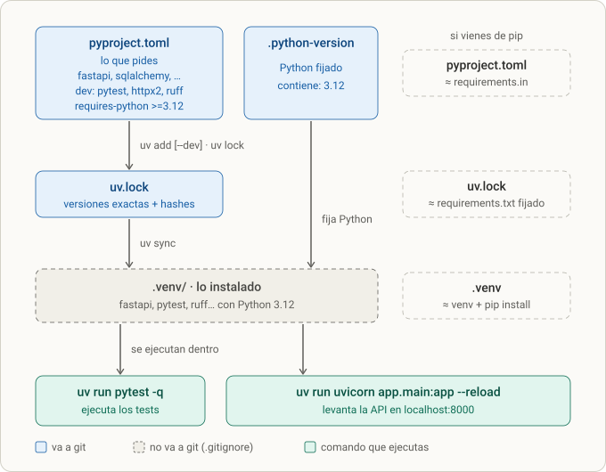

# Lección 1 · Entorno: git, uv, dependencias, pytest y `/health`

> **Objetivo:** dejar el repositorio y el entorno del backend listos para trabajar a mano: git con su `.gitignore`, un proyecto Python 3.12 gestionado con `uv`, las dependencias instaladas, `pytest` configurado y una primera ruta (`GET /health`) con su test en verde.
> **Resultado esperado:** `uv run pytest -q` dice `1 passed` y `curl localhost:8000/health` devuelve `{"status":"ok"}`.

**Leyenda de fiabilidad.** El diálogo original de esta lección ya no está disponible. Lo que sigue sale de cuatro fuentes: tus propias notas (sección 1 y el TEST), el resumen que se guardó al compactar la conversación, el README y los archivos reales del repo, y comprobaciones que repetí en una carpeta temporal (las salidas de `uv`, `pytest` y `uvicorn` que ves son reales, con las versiones de ese momento; las tuyas están fijadas en `uv.lock` y pueden diferir en el número de versión). Todo lo que **no** está literalmente en el diálogo conservado y reconstruyo lo marco con 📝.

---

## 0. Dónde encaja

- Es el **paso 1 de 7** del plan de construcción: **entorno** → [[lesson-2]] contrato → [[lesson-3]] modelos/semilla → [[lesson-4]] autenticación → [[lesson-5]] canciones y artistas → [[lesson-6]] playlists → [[lesson-7]] Dockerfile.
- En el README (el "ritme" del proyecto) cubre estas partes:
  - Stack: "Python 3.12 · FastAPI · Pydantic v2 · SQLAlchemy 2 (síncrono) · SQLite · JWT (PyJWT) · hash de contraseñas con Argon2 (pwdlib) · pytest · uv · React (Vite) · un solo Dockerfile al final."
  - Sección **Cómo correr** (`uv sync`, `uvicorn`, `pytest`).
  - Sección **Estructura** (`backend/app`, `backend/tests`, `backend/data`, `frontend/`).
  - Casilla del checklist: `- [x] Entorno con uv y /health`.
- Contexto de por qué existe este proyecto (📝 desde el resumen): preparas una prueba técnica de ingeniero backend de IA nivel medio (explicar tu experiencia, preguntas básicas de backend y frontend, componente React en vivo, endpoints Python con base de datos y routers, y un diseño de backend de streaming en AWS/Azure). Has programado sobre todo con agentes y quieres **reentrenar la mano**. Con 5 días de plazo, elegimos una app de música (usuarios, artistas, canciones, géneros, playlists) en lugar de una app tipo Pokédex, con pandas y NumPy como extra, y un único Dockerfile sin Compose.

## 1. Qué se hizo (resumen)

1. Se creó la carpeta del proyecto con dos subcarpetas, `backend/` y `frontend/` (monorepo).
2. Se inicializó git con rama `main` y se escribió un `.gitignore`.
3. En `backend/` se creó un proyecto Python con `uv`, se **fijó** Python 3.12 y se instalaron las dependencias de producción y de desarrollo.
4. Se creó la estructura de carpetas de la aplicación (`app/` con `routers`, `services`, `repositories`; más `tests/` y `data/`).
5. Se configuró `pytest` dentro de `pyproject.toml` (`pythonpath` y `testpaths`).
6. Se escribió `app/main.py` con `GET /health`, y `tests/test_health.py` con su test.
7. Se comprobó con `uv run pytest -q` (`1 passed`) y con `uvicorn` + `curl`.

---

## 2. Paso a paso

### 2.1 Decisiones previas (📝 desde el resumen)

- **Monorepo:** una sola carpeta `fullstack-project-music/` con `backend/` y `frontend/`. Un solo repositorio git para ambas partes, porque el proyecto es pequeño y el frontend consume el contrato del backend.
- **Todo a mano:** tú pediste configurarlo todo manualmente ("quiero configurarlo todo a mano"), así que el tutor no generó los archivos por ti.
- **Un solo Dockerfile al final**, sin Compose (queda como [[lesson-7]]).
- **Siete pasos** de construcción, con este orden de recorte si falta tiempo: Dockerfile → pandas/NumPy → playlists.
- El tutor conectó la carpeta `/Users/asorky/Documents/code-projects/katas/fullstack-project-music` para poder leer tus archivos y verificar tu trabajo. Por limitación de las herramientas, **no puede ver la carpeta oculta `.git`**; tú te encargas de los commits.

> Detalle de tus notas: escribiste `cd ruta/a/full-stack-project-music` (con guion entre *full* y *stack*). La carpeta real se llama **`fullstack-project-music`**. No es un error de ejecución (era un ejemplo), pero conviene escribirlo igual que en el disco.

### 2.2 Git y `.gitignore`

Comandos de tus notas (sección 1):

```bash
cd ruta/a/fullstack-project-music
git init -b main          # crea el repositorio con la rama "main" (en vez de "master")

cat > .gitignore <<'EOF'
__pycache__/
*.pyc
.venv/
.env
.pytest_cache/
.ruff_cache/
backend/data/*.db
node_modules/
dist/
.DS_Store
EOF
```

- `cat > archivo <<'EOF' ... EOF` es un *heredoc*: escribe en el archivo todo el texto hasta la línea `EOF`. Las comillas simples en `'EOF'` evitan que el shell intente expandir `$variables` dentro del texto.
- `git init -b main` crea la carpeta oculta `.git/` y nombra la rama inicial `main`. Es la carpeta oculta que mencionaste ("ese ya lo he creado... está oculto").

**El `.gitignore` que existe hoy en el repo** (puede diferir de tus notas, porque se fue ajustando):

```
.venv
.env
__pycache__/
*/__pycache__/
.pytest_cache/
.DS_Store
backend/data/*.db
node_modules/
dist/
```

Qué hace cada regla y por qué:

| Regla | Qué ignora | Por qué |
|---|---|---|
| `.venv` | el entorno virtual de `uv` | Es enorme, se regenera con `uv sync` y es específico de tu máquina (el de macOS no sirve en Linux) |
| `.env` | variables de entorno locales | Pueden contener secretos (`SECRET_KEY`, `DATABASE_URL`) |
| `__pycache__/` y `*/__pycache__/` | bytecode compilado de Python | Es un derivado; cambia solo |
| `.pytest_cache/` | caché de pytest | Derivado |
| `.DS_Store` | metadatos del Finder de macOS | Ruido |
| `backend/data/*.db` | la base SQLite generada | La base se reconstruye con la semilla (`python -m app.seed`, [[lesson-3]]) y no debe subirse por accidente |
| `node_modules/` | dependencias de npm | Para el frontend; se regeneran con `npm install` |
| `dist/` | resultado de `npm run build` | Derivado |

Observaciones sobre el estado real del repo (observadas en tu carpeta, no salen del diálogo):

- El **22 de octubre** el tutor detectó que el `.gitignore` entonces vigente **no tenía regla para `*.db`** y te pidió añadirla para no subir `music.db` sin querer. Hoy está como `backend/data/*.db`.
- Tu `.gitignore` actual no lista `.ruff_cache/`, pero no pasa nada: `ruff`, `pytest` y `uv` crean dentro de sus carpetas (`.ruff_cache/`, `.pytest_cache/`, `.venv/`) un `.gitignore` propio con `*`, que se ignoran a sí mismas. Lo comprobé al reproducir el entorno.
- En la raíz hay tres archivos **vacíos** (`.env`, `requirements.txt`, `secrets.txt`). `requirements.txt` no se usa con `uv` (la fuente de verdad es `pyproject.toml` + `uv.lock`). `.env` está ignorado. `secrets.txt` **no** está en el `.gitignore`: mientras esté vacío da igual, pero si algún día guardas ahí algo real, no lo subas al repositorio (bórralo o añade la regla).

### 2.3 El proyecto Python con `uv`

Comandos de tus notas, ejecutados dentro de `backend/`:

```bash
cd backend

uv init --bare --python 3.12
uv python pin 3.12

uv add fastapi "uvicorn[standard]" sqlalchemy pydantic-settings pyjwt "pwdlib[argon2]"
uv add --dev pytest httpx2 ruff

mkdir -p app/repositories app/routers app/services tests data
touch app/__init__.py app/main.py
```

> **Corrección a tus notas:** escribiste `mkdir -p app/repositories app/routers app/services test data` con `test` en singular. Debe ser **`tests`**: así lo espera la configuración de pytest (`testpaths = ["tests"]`) y todo el resto del proyecto. Más abajo (sección 4) está lo que pasa si te equivocas.

#### Qué hace cada comando

| Comando | Qué hace | Qué verás |
|---|---|---|
| `uv init --bare --python 3.12` | Crea un proyecto **mínimo**: solo `pyproject.toml` (sin `README`, sin `main.py`, sin `.git`). `--python 3.12` escribe `requires-python = ">=3.12"` | Un único archivo nuevo: `pyproject.toml` |
| `uv python pin 3.12` | Escribe el archivo `.python-version` con `3.12`. A partir de ahí `uv` usa esa versión para el `.venv` | `Pinned .python-version to 3.12` |
| `uv add <paquetes>` | Añade los paquetes a `[project].dependencies` de `pyproject.toml`, resuelve versiones, crea/actualiza `uv.lock`, crea `.venv/` si no existe y los instala | Lista de `+ paquete==versión` |
| `uv add --dev <paquetes>` | Igual, pero los guarda en el grupo `[dependency-groups] dev` (herramientas que **no** van a producción) | Idem |
| `mkdir -p ...` | Crea las carpetas (y las intermedias) sin error si ya existen | — |
| `touch app/__init__.py app/main.py` | Crea dos archivos vacíos; `__init__.py` convierte `app/` en un paquete importable | — |

**Por qué `uv python pin 3.12` además de `--python 3.12`.** Lo comprobé reproduciendo los pasos: `uv init --bare --python 3.12` escribe `requires-python = ">=3.12"` pero **no crea `.python-version`**. Sin ese archivo, `uv` es libre de usar la versión más nueva que encuentre (el tutor lo vivió: una primera vez, `uv init --bare` sin fijar nada dejó que `uv` eligiera **Python 3.14**). `requires-python` expresa *qué versiones soporta tu código*; `.python-version` expresa *cuál usa tu entorno*. Son dos cosas distintas y las dos son útiles.

#### El `pyproject.toml` paso a paso

Después de `uv init --bare --python 3.12` (reproducido, 📝 el nombre depende de tu carpeta; el tuyo es `backend`):

```toml
[project]
name = "backend"
version = "0.1.0"
requires-python = ">=3.12"
dependencies = []
```

Esas son "las 3 líneas" por las que preguntaste (nombre, versión, versión mínima de Python), más la lista vacía de dependencias.

Después de los dos `uv add` aparece esto (las versiones de abajo son las que `uv` guardó en tu `pyproject.toml` actual):

```toml
[project]
name = "backend"
version = "0.1.0"
requires-python = ">=3.12"
dependencies = [
    "fastapi>=0.159.1",
    "numpy>=2.5.4",            # añadido en la lección de pandas/NumPy ([[lesson-8]])
    "pandas>=3.1.0",           # idem
    "pwdlib[argon2]>=0.3.1",
    "pydantic-settings>=2.16.1",
    "pyjwt>=2.15.1",
    "sqlalchemy>=2.1.6",
    "uvicorn[standard]>=0.54.0",
]

[dependency-groups]
dev = [
    "httpx2>=2.16.0",
    "pytest>=9.1.1",
    "ruff>=0.17.1",
]
```

Y al final, el bloque que añades **a mano** (siguiente apartado):

```toml
[tool.pytest.ini_options]
pythonpath = ["."]
testpaths = ["tests"]
```

#### Los archivos que crea `uv`

| Archivo / carpeta | Qué es | ¿Se sube a git? |
|---|---|---|
| `pyproject.toml` | **Lo que pides**: dependencias con una versión mínima, versión de Python, configuración de herramientas | Sí |
| `uv.lock` | **Lo que se instaló exactamente**: cada paquete (incluidas las dependencias de las dependencias), con su versión fija y su *hash*. Es lo que hace que otra máquina instale lo mismo que tú | Sí |
| `.python-version` | La versión de Python del entorno (`3.12`) | Sí |
| `.venv/` | El entorno virtual: una copia aislada de Python con los paquetes instalados | **No** (está en `.gitignore`) |

Primeras líneas reales de un `uv.lock` (el tuyo pesa unos 258 KB):

```toml
version = 1
revision = 3
requires-python = ">=3.12"
resolution-markers = [
    "python_full_version >= '3.14' and sys_platform == 'win32'",
    ...
]

[[package]]
name = "annotated-doc"
version = "0.0.5"
source = { registry = "https://pypi.org/simple" }
sdist = { url = "...", hash = "sha256:...", size = 10758, ... }
```

No se edita a mano: lo regenera `uv` cuando cambias dependencias.

#### Qué se instaló y para qué sirve cada paquete

Al hacer `uv add` no solo bajaron tus 6 paquetes sino unos 30 (dependencias transitivas). Los importantes:

| Paquete | Papel en el proyecto | Lección donde se usa |
|---|---|---|
| `fastapi` | Framework web: rutas, validación, documentación automática. Trae `starlette` (la base ASGI) y `pydantic` (validación) | todas |
| `uvicorn[standard]` | Servidor **ASGI** que ejecuta la app. El extra `[standard]` añade `uvloop`, `httptools`, `watchfiles` (para `--reload`), `websockets`, `python-dotenv` y `pyyaml` | desde hoy |
| `sqlalchemy` | ORM y toolkit SQL | [[lesson-3]] |
| `pydantic-settings` | Leer configuración (`DATABASE_URL`, `SECRET_KEY`...) desde variables de entorno | [[lesson-3]] (`config.py`) |
| `pyjwt` | Crear y verificar tokens JWT | [[lesson-4]] |
| `pwdlib[argon2]` | Hash de contraseñas; el extra `[argon2]` instala `argon2-cffi` | [[lesson-4]] |
| `pytest` (dev) | Ejecutar los tests | desde hoy |
| `httpx2` (dev) | Cliente HTTP que usa `TestClient` por debajo (ver §3.9) | desde hoy |
| `ruff` (dev) | Linter (detecta nombres no definidos, imports sin usar...) | [[lesson-5]] en adelante (`uvx ruff check --select F,E9 app tests`) |

La sintaxis `"uvicorn[standard]"` y `"pwdlib[argon2]"` va **entre comillas** porque los corchetes tienen significado especial para algunos shells (zsh, el de macOS, intenta interpretarlos como patrón de archivos). Un *extra* es un conjunto opcional de dependencias que el paquete declara.

#### Árbol resultante

```
fullstack-project-music/
├── .git/                    (oculta)
├── .gitignore
├── README.md
├── backend/
│   ├── .python-version
│   ├── pyproject.toml
│   ├── uv.lock
│   ├── .venv/               (ignorada)
│   ├── app/
│   │   ├── __init__.py
│   │   ├── main.py
│   │   ├── repositories/
│   │   ├── routers/
│   │   └── services/
│   ├── data/
│   └── tests/
└── frontend/
```

### 2.4 Configurar `pytest` en `pyproject.toml`

Añades al final de `backend/pyproject.toml`:

```toml
[tool.pytest.ini_options]    # sección de configuración de pytest ("tool.X" = ajustes de la herramienta X)
pythonpath = ["."]           # agrega la carpeta backend/ al path de Python
testpaths = ["tests"]        # dónde buscar tests cuando ejecutas `pytest` sin argumentos
```

- `pythonpath = ["."]`: añade a `sys.path` la carpeta donde está el `pyproject.toml` (`backend/`). Sin esto, Python no sabe encontrar el paquete `app`, y `from app.main import app` falla con `ModuleNotFoundError: No module named 'app'`. (Lo reproduje: ver sección 4.)
- `testpaths = ["tests"]`: cuando ejecutas `pytest` sin decirle dónde, mira solo en `tests/` en vez de recorrer todo el proyecto (incluido `.venv`).
- Es la manera de decirle a una herramienta cómo comportarse sin crear otro archivo (`pytest.ini`): todas las herramientas pueden vivir en `pyproject.toml` bajo `[tool.<nombre>]`.

### 2.5 La primera ruta: `GET /health`

`backend/app/main.py`:

```python
from fastapi import FastAPI

app = FastAPI(title="Music API")

@app.get("/health")
def health():
    return {"status": "ok"}
```

Línea por línea:

1. `FastAPI(title="Music API")` crea **la aplicación**, un objeto que es a la vez el router raíz, el generador de documentación y el punto de entrada del servidor ASGI. `title` aparece en `/docs` y en el JSON de OpenAPI.
2. `@app.get("/health")` es un **decorador**: registra la función de abajo para el par *(método GET, ruta `/health`)*. No ejecuta nada todavía, solo apunta la ruta en una tabla.
3. `def health():` es el **endpoint**. FastAPI lo llama cuando llega esa petición.
4. `return {"status": "ok"}`: FastAPI convierte el `dict` en JSON, con código **200** y cabecera `Content-Type: application/json`.

Hoy el `main.py` real del repo es mucho más grande (routers, CORS, manejadores de errores), pero el `/health` sigue siendo exactamente este. El título actual es `"Music-api"`.

Para qué sirve un endpoint de salud (`/health`):

- Comprobar rápido que el proceso arrancó y responde (lo primero que pruebas al levantar la app).
- Es lo que usan los balanceadores, Kubernetes o un `HEALTHCHECK` de Docker para saber si el contenedor está vivo ([[lesson-7]]).
- Es el único endpoint sin dependencias: si falla, el problema está en el arranque, no en la base de datos ni en la autenticación.

### 2.6 El primer test: `tests/test_health.py`

La versión de tus notas tenía dos errores en la primera línea (ver tabla de la sección 4):

```python
form fastapi import TestClient          # ✗ "form" y módulo equivocado
from app.main import app

client = TestClient(app)

def test_health():
		assert client.get("/health").json() == {"status":"ok"}
```

La versión correcta, la que hay hoy en el repo:

```python
from fastapi.testclient import TestClient

from app.main import app

client = TestClient(app)

def test_health():
    assert client.get("/health").json() == {"status": "ok"}
```

Cómo se lee:

1. `TestClient(app)` crea un **cliente HTTP falso** conectado directamente a tu app: no abre ningún puerto, no hace falta levantar `uvicorn`. Envía la petición *dentro del mismo proceso* y te devuelve la respuesta.
2. `client.get("/health")` devuelve un objeto respuesta (con `.status_code`, `.json()`, `.text`, `.headers`).
3. `assert ... == {...}` es la comprobación. En pytest basta con `assert`; si la condición es falsa, pytest explica la diferencia.
4. `pytest` encuentra el test por convención: archivos `test_*.py`, funciones `test_*`.

(Este test solo comprueba el cuerpo JSON. Si quisieras comprobar también el código de estado, añadirías `assert client.get("/health").status_code == 200`.)

### 2.7 Ejecutar y comprobar

Desde `backend/`:

```bash
uv run pytest -q                          # debe decir: 1 passed
uv run uvicorn app.main:app --reload      # en otra terminal: curl localhost:8000/health
```

**Salida esperada de pytest** (reproducida):

```
.                                                                        [100%]
1 passed in 0.21s
```

- Cada `.` es un test que pasó (`F` = falló, `E` = error al recoger o preparar, `s` = saltado).
- Con `-v` (verbose) ves el nombre: `tests/test_health.py::test_health PASSED [100%]`. Con `-q` (quiet) solo los puntos y el resumen.

**Salida esperada de `uvicorn`** (reproducida; el puerto por defecto es 8000):

```
INFO:     Started server process [782]
INFO:     Waiting for application startup.
INFO:     Application startup complete.
INFO:     Uvicorn running on http://127.0.0.1:8000 (Press CTRL+C to quit)
INFO:     127.0.0.1:38842 - "GET /health HTTP/1.1" 200 OK
```

**Salida de `curl`**:

```bash
$ curl -i localhost:8000/health
HTTP/1.1 200 OK
server: uvicorn
content-length: 15
content-type: application/json

{"status":"ok"}
```

Otras dos URLs que ya funcionan sin haber escrito nada más:

- `http://localhost:8000/docs` abre la documentación interactiva (Swagger UI), generada a partir de tus rutas.
- `http://localhost:8000/openapi.json` es la descripción de la API en formato OpenAPI. En [[lesson-2]] el test del contrato lee precisamente este JSON.

**Una duda tuya (📝 desde el resumen):** "¿por qué `uv run pytest -q` ejecutó un test de health?" Porque pytest descubre y ejecuta **todo** lo que encuentra en `tests/` que cumpla la convención `test_*`. No hace falta indicarle qué archivo; tu `test_health.py` ya estaba allí.

### 2.8 Cierre de la lección

- Marcar en el README: `- [x] Entorno con uv y /health`.
- Commit (lo haces tú; ejemplo 📝): `git add . && git commit -m "chore: entorno uv, health y test"`.
- Estado: 1 test en verde. Siguiente: [[lesson-2]] (el contrato).

---

## 3. Conceptos enseñados

### 3.1 Git, rama `main` y `.gitignore`

- **Git** guarda el historial de cambios de los archivos. Un **commit** es una foto con mensaje; una **rama** (`main`) es una línea de commits.
- **`.gitignore`** lista patrones que git no rastrea. Regla práctica: se ignora todo lo que **se puede regenerar** (`.venv`, `__pycache__`, `node_modules`, `dist`, bases de datos generadas) y todo lo que **es secreto o local** (`.env`).
- Contra-regla: **sí** se sube `uv.lock`. Es lo que garantiza que otra persona (o el Dockerfile) instale exactamente las mismas versiones.

### 3.2 Entorno virtual (`.venv`)

Es una carpeta con un intérprete de Python y sus propios paquetes. Cada proyecto tiene el suyo, así que no chocan versiones entre proyectos y no ensucias el Python del sistema. Con `uv` casi nunca lo "activas" a mano: `uv run <comando>` ejecuta el comando dentro de `.venv` (y antes lo crea o sincroniza si hace falta).

### 3.3 `uv`: qué es y qué comandos usamos

`uv` es un gestor de proyectos y paquetes de Python (escrito en Rust, muy rápido) que reemplaza a la combinación `python -m venv` + `pip` + `pip-tools`. Comandos de esta lección y de las siguientes:

| Comando | Para qué |
|---|---|
| `uv init --bare --python 3.12` | Crear un proyecto vacío con solo `pyproject.toml` |
| `uv python pin 3.12` | Fijar la versión de Python del proyecto (`.python-version`) |
| `uv add <paquete>` | Añadir una dependencia (edita `pyproject.toml`, actualiza `uv.lock`, instala) |
| `uv add --dev <paquete>` | Añadir una dependencia solo de desarrollo (grupo `dev`) |
| `uv sync` | Dejar `.venv` exactamente como dicen `pyproject.toml` + `uv.lock` (lo que haces al clonar el repo en otra máquina) |
| `uv lock` | Regenerar `uv.lock` sin instalar |
| `uv run <cmd>` | Ejecutar un comando dentro del entorno (y sincronizarlo antes si hace falta) |
| `uvx <herramienta>` | Ejecutar una herramienta suelta sin añadirla al proyecto (por ejemplo `uvx ruff check ...`) |

Diferencia clave que se explicó: **`pyproject.toml` es lo que pides** ("quiero `fastapi` versión 0.159.1 o superior") y **`uv.lock` es lo que obtuviste** (versión exacta de cada paquete y de sus dependencias, con hash). Lo primero lo escribes tú; lo segundo lo escribe `uv`.



*Figura 1.1 · Del `pyproject.toml` al `.venv`: qué archivo declara, cuál fija y cuál se instala.*

**Cómo leerlo.**

- Los tres cuadros azules son los archivos que van a git: `pyproject.toml` (lo que pides), `.python-version` (qué Python) y `uv.lock` (lo que `uv` resolvió: versiones exactas y hashes).
- `uv add [--dev]` edita `pyproject.toml` y actualiza `uv.lock`; `uv sync` instala en `.venv` exactamente lo que dice el lock. El cuadro gris punteado es `.venv/`: se puede borrar y recrear con `uv sync`, por eso no va a git.
- `uv run ...` (cuadros verdes) ejecuta el comando **dentro** del `.venv`, sincronizándolo antes si hace falta: no activas el entorno a mano.
- A la derecha, el equivalente mental si vienes de pip: `pyproject.toml` ≈ `requirements.in`, `uv.lock` ≈ `requirements.txt` fijado, `.venv` ≈ el entorno donde hacías `pip install`.
- Qué se rompe sin cada pieza: sin `uv.lock` dos máquinas pueden instalar versiones distintas; sin `.python-version` cada una puede usar otro Python; sin `.venv` no hay dónde ejecutar nada.

### 3.4 Dependencias de producción frente a dependencias de desarrollo

`pytest`, `httpx2` y `ruff` están en `[dependency-groups] dev` porque la API en producción no los necesita. En la imagen Docker ([[lesson-7]]) se instalará solo el grupo de producción (`uv sync --no-dev`), con lo que la imagen pesa menos y tiene menos superficie de ataque.

### 3.5 Estructura de carpetas y paquetes Python

- `app/__init__.py` (vacío) convierte la carpeta en un **paquete**: por eso se puede escribir `from app.main import app`.
- La estructura en capas que vas a rellenar en las lecciones siguientes:

| Carpeta | Responsabilidad | Se rellena en |
|---|---|---|
| `app/routers/` | HTTP: rutas, parámetros, códigos de estado | [[lesson-2]] |
| `app/services/` | Reglas de negocio (sin conocer HTTP) | [[lesson-5]] y [[lesson-6]] |
| `app/repositories/` | Consultas SQL | [[lesson-5]] |
| `app/models.py`, `app/db.py` | Tablas y conexión | [[lesson-3]] |
| `data/` | La base SQLite y el `seed.json` | [[lesson-3]] |
| `tests/` | Los tests | todas |

### 3.6 ASGI, `uvicorn` y `app.main:app`

- **ASGI** es el estándar que define cómo habla un servidor web con una aplicación Python *asíncrona* (el sucesor de **WSGI**, que es el de Flask clásico). FastAPI y Starlette son aplicaciones ASGI.
- **`uvicorn`** es un servidor ASGI: abre el puerto, recibe peticiones HTTP, las convierte al formato ASGI y llama a tu app.
- **`app.main:app`** se lee "en el módulo `app.main` (archivo `app/main.py`), el objeto llamado `app`". Es la dirección que le das a `uvicorn`.
- **`--reload`** vigila los archivos (con `watchfiles`) y reinicia el servidor al guardar. Solo para desarrollo; no se usa en producción.
- Detalles para más adelante ([[lesson-7]]): por defecto `uvicorn` escucha en `127.0.0.1` (solo tu máquina); dentro de un contenedor hay que usar `--host 0.0.0.0`.

### 3.7 FastAPI: la mínima aplicación

- El **decorador** `@app.get(ruta)` asocia (método, ruta) con una función.
- El valor de retorno se serializa a JSON automáticamente.
- FastAPI genera sola la documentación (`/docs`, `/redoc`) y el esquema OpenAPI (`/openapi.json`) a partir de tus rutas y tipos. Esa documentación es la base de la que cuelga todo el contrato de [[lesson-2]].

### 3.8 pytest: descubrimiento, `assert` y opciones útiles

- **Descubrimiento:** archivos `test_*.py` (o `*_test.py`), funciones `test_*`.
- **`assert`** normal de Python; pytest reescribe los `assert` para mostrar los valores cuando fallan.
- Opciones que usarás sin parar:

| Opción | Efecto |
|---|---|
| `-q` | Salida corta |
| `-v` | Muestra el nombre de cada test |
| `-x` | Se detiene en el primer fallo |
| `-k "texto"` | Ejecuta solo los tests cuyo nombre contenga el texto |
| `archivo.py::nombre` | Ejecuta un test concreto |
| `-rf` / `-rs` | Resume los fallados / los saltados al final |

- **`uv run pytest` frente a `python -m pytest`:** el segundo añade el directorio actual al path de Python; el primero no, por eso hace falta `pythonpath = ["."]` en la configuración.

### 3.9 `TestClient` y por qué `httpx2`

- `TestClient` (de `fastapi.testclient`, que viene de Starlette) permite llamar a la app como si fuera un cliente HTTP, **sin servidor**: más rápido y sin puertos.
- Por debajo usa una librería de cliente HTTP. En las versiones que tienes, Starlette importa `httpx2`; si solo está `httpx`, Starlette avisa de que ese uso está obsoleto (📝 lo vi en el código de `starlette/testclient.py` instalado: "The starlette.testclient module requires the httpx2 package to be installed" y "Using `httpx` with `starlette.testclient` is deprecated; install `httpx2` instead."). Por eso `httpx2` está en el grupo `dev`.
- Importante: se importa desde `fastapi.testclient`, **no** desde `fastapi` a secas.

### 3.10 `ruff`

Un linter y formateador muy rápido. En este proyecto lo usas como red de seguridad: `uvx ruff check --select F,E9 app tests` detecta nombres sin definir, imports sin usar y errores de sintaxis (reglas `F` de pyflakes y `E9`). No detecta, por ejemplo, un atributo mal escrito (`groupvy`) ni un argumento con nombre equivocado; para eso están los tests.

---

## 4. Errores cometidos y diagnóstico

Todos salen de tus notas (sección 1 y TEST). Las salidas son reales, reproducidas.

| # | Lo que escribiste / pasó | Síntoma exacto | Causa | Arreglo | Lección |
|---|---|---|---|---|---|
| 1 | `uv init --base --python 3.12` | `error: unexpected argument '--base' found` y `tip: a similar argument exists: '--bare'` | La opción se llama `--bare` | `uv init --bare --python 3.12` | `uv` te sugiere la corrección en el `tip:`: léelo |
| 2 | `uv pin python 3.12` | `error: unrecognized subcommand 'pin'` | `pin` no es un subcomando de `uv`; vive dentro de `python` | `uv python pin 3.12` | El orden es `uv <grupo> <acción>`: *python* → *pin* |
| 3 | `form fastapi import TestClient` | `SyntaxError: invalid syntax` (apunta a `fastapi`) | `form` en vez de `from` | `from ...` | Un `SyntaxError` se detecta al importar el archivo, antes de ejecutar nada |
| 4 | (el mismo import, ya con `from`): `from fastapi import TestClient` | `ImportError: cannot import name 'TestClient' from 'fastapi'` | `TestClient` no está en el paquete `fastapi`, sino en el submódulo `fastapi.testclient` | `from fastapi.testclient import TestClient` | `ImportError` = el módulo existe pero no tiene ese nombre |
| 5 | `mkdir ... test` (singular) | Con `testpaths = ["tests"]` y sin carpeta `tests/`: el test **sí** se ejecuta pero sale `PytestConfigWarning: No files were found in testpaths; consider removing or adjusting your testpaths configuration. Searching recursively from the current directory instead.` | La carpeta no coincide con la configuración | Renombrar a `tests/` | Un aviso (`warning`) no es un error, pero señala que la configuración no se está usando |
| 6 | (si faltara `pythonpath = ["."]`) | `ModuleNotFoundError: No module named 'app'` al importar `from app.main import app` | `app/` no está en `sys.path` porque `uv run pytest` no añade el directorio actual | Añadir `pythonpath = ["."]` en `[tool.pytest.ini_options]` | `pytest` solo conoce los módulos de su `sys.path` |
| 7 | (error del tutor, 📝 desde el resumen) `uv init --bare` sin fijar versión | `uv` eligió Python 3.14 | `--bare` no crea `.python-version` | `uv python pin 3.12` | Fija siempre la versión |
| 8 | En tus notas, `cd ruta/a/full-stack-project-music` | (no ejecutado literalmente) | La carpeta real es `fullstack-project-music` | — | Copia las rutas tal cual del disco |

### Cómo se lee una traza de pytest (útil desde el día uno)

Cuando algo falla en la importación, pytest dice `ERROR collecting` o `ImportError while importing test module`. Lee **de abajo hacia arriba**:

1. La línea que empieza por **`E`** (última) es el error: tipo + mensaje.
2. La línea justo encima (`archivo.py:LÍNEA: in <module>`) es el último archivo **tuyo** que se estaba ejecutando: ahí está el problema (o desde ahí se importó el culpable).
3. Un error de colección **aborta toda la ejecución** (`Interrupted: 1 error during collection`): no se ejecuta ningún test.

---

## 5. Cómo se relaciona con el ritme

**Con el README (lo que cubre esta lección):**

| Parte del README | Qué hiciste aquí |
|---|---|
| Stack (Python 3.12, FastAPI, pytest, uv) | Instalaste y fijaste todo eso |
| Cómo correr (`uv sync`, `uvicorn`, `pytest`) | Son literalmente los comandos que ejecutaste |
| Estructura (`backend/app`, `backend/tests`, `backend/data`) | Creaste las carpetas |
| Checklist: "Entorno con uv y `/health`" | Marcada |
| Criterio de "hecho": "Los tests pasan..." | Primer test verde |

**Con el resto del proyecto:**

- [[lesson-2]] reutiliza `TestClient` para el test del contrato (`test_contract.py`) y rellena `routers/`.
- [[lesson-3]] usa `pydantic-settings` (`config.py`), `sqlalchemy` y la carpeta `data/`.
- [[lesson-4]] usa `pyjwt` y `pwdlib`.
- [[lesson-7]] reutiliza `pyproject.toml`, `uv.lock` y `.python-version` para construir la imagen Docker.

**Con la entrevista:** el "setup desde cero" es una pregunta frecuente en pruebas en vivo ("crea un proyecto FastAPI y un test"). Poder hacerlo sin ayuda en 5–10 minutos te da margen para el resto.

---

## 6. Preguntas de entrevista

1. **¿Qué es un entorno virtual y por qué se usa?** Un intérprete de Python aislado con sus propios paquetes por proyecto: evita conflictos de versiones y no ensucia el Python del sistema.
2. **¿Qué diferencia hay entre `pyproject.toml` y `uv.lock`?** El primero declara lo que *pides* (con rangos); el segundo fija lo que *se instaló* (versión exacta y hash de cada paquete). Con el lock, el despliegue es reproducible.
3. **¿Por qué se commitea `uv.lock` y no `.venv`?** El lock es pequeño y portable; `.venv` es enorme, regenerable y específico del sistema operativo.
4. **¿Qué es una dependencia de desarrollo y cómo se declara?** Una que solo hace falta para desarrollar o probar (pytest, ruff). En `uv`: `uv add --dev` → grupo `[dependency-groups] dev`. En producción se instala sin ese grupo.
5. **¿Qué es ASGI y qué hace `uvicorn`?** ASGI es la interfaz entre servidor y aplicación asíncrona; `uvicorn` es el servidor que recibe HTTP y llama a la app.
6. **¿Qué significa `uvicorn app.main:app`?** Módulo `app.main`, objeto `app`.
7. **¿Cómo pruebas una API FastAPI sin levantar un servidor?** Con `TestClient(app)`: llama a la app dentro del mismo proceso.
8. **¿Para qué sirve un endpoint `/health`?** Comprobar que el proceso responde; lo usan balanceadores, orquestadores y `HEALTHCHECK` de Docker.
9. **¿Por qué `pythonpath = ["."]` en pytest?** Para que `import app...` funcione: pytest no añade la raíz del proyecto al `sys.path`.
10. **¿Por qué no usar `--reload` en producción?** Reinicia por cambios de archivos (innecesario y con coste) y no escala; en producción se despliega una versión fija.

---

## 7. Checklist / estado

- [x] `git init -b main` y `.gitignore` con `.venv`, `.env`, `__pycache__`, `backend/data/*.db`, `node_modules`, `dist`
- [x] `uv init --bare --python 3.12` y `uv python pin 3.12` (`.python-version` = 3.12)
- [x] Dependencias de producción y de desarrollo instaladas (`uv.lock` generado)
- [x] Estructura `app/{routers,services,repositories}`, `tests/`, `data/`
- [x] `[tool.pytest.ini_options]` con `pythonpath` y `testpaths`
- [x] `GET /health` y `tests/test_health.py` (`1 passed`)
- [x] Corregidas las erratas de las notas (`--bare`, `uv python pin`, `from fastapi.testclient`, `tests/`)
- [x] README: "Entorno con uv y `/health`" marcado
- [x] `.gitignore` incluye `secrets.txt` (verificado el 24 oct)
- [ ] (opcional) Borrar los archivos vacíos de la raíz del repo: `requirements.txt` (0 bytes; el proyecto usa `pyproject.toml` y `uv.lock`) y `secrets.txt` si no lo vas a usar

## Diagramas de esta lección

- [Figura 1.1 · `pyproject.toml`, `uv.lock`, `.python-version` y `.venv`](diagramas/entorno-uv.svg): qué declara cada archivo, qué instala `uv sync` y dónde corre `uv run`.

---

## Apéndice A · Rehacerlo de cero (ejercicio de memoria, 10 minutos)

Sin mirar las notas, en una carpeta nueva:

```bash
mkdir -p mi-proyecto/backend mi-proyecto/frontend && cd mi-proyecto
git init -b main
# (crea .gitignore con: .venv, .env, __pycache__/, .pytest_cache/, backend/data/*.db, node_modules/, dist/, .DS_Store)

cd backend
uv init --bare --python 3.12
uv python pin 3.12
uv add fastapi "uvicorn[standard]" sqlalchemy pydantic-settings pyjwt "pwdlib[argon2]"
uv add --dev pytest httpx2 ruff
mkdir -p app/repositories app/routers app/services tests data
touch app/__init__.py
```

Añade a `pyproject.toml`:

```toml
[tool.pytest.ini_options]
pythonpath = ["."]
testpaths = ["tests"]
```

`app/main.py`:

```python
from fastapi import FastAPI

app = FastAPI(title="Music API")


@app.get("/health")
def health():
    return {"status": "ok"}
```

`tests/test_health.py`:

```python
from fastapi.testclient import TestClient

from app.main import app

client = TestClient(app)


def test_health():
    assert client.get("/health").json() == {"status": "ok"}
```

Comprobar:

```bash
uv run pytest -q                       # 1 passed
uv run uvicorn app.main:app --reload   # y en otra terminal: curl localhost:8000/health
```

Si lo logras sin consultar nada, esta lección está dominada.

## Apéndice B · Glosario rápido

| Término | Significado en una línea |
|---|---|
| Monorepo | Un repositorio con varias partes (aquí backend y frontend) |
| Heredoc | Texto multilínea que el shell envía a un comando (`<<'EOF'`) |
| Dependencia transitiva | Paquete que instalas sin pedirlo porque otro lo necesita |
| Extra (`pkg[extra]`) | Conjunto opcional de dependencias de un paquete |
| Hash (en `uv.lock`) | Huella del archivo descargado; garantiza que es el mismo que la última vez |
| Linter | Herramienta que revisa el código sin ejecutarlo |
| Descubrimiento (pytest) | La búsqueda automática de tests por convención de nombres |
| Colección (pytest) | Fase previa en que pytest importa los archivos de test; si falla, no corre ninguno |
