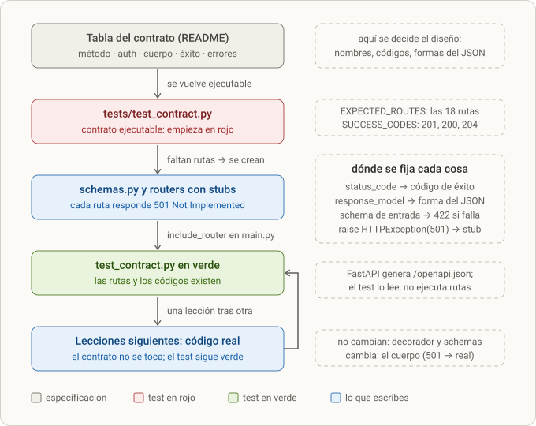

# Lección 2 · El contrato de la API: README, schemas y rutas que responden 501

> **Objetivo:** escribir *primero* el contrato de la API (qué rutas existen, qué entra, qué sale, con qué códigos) sin implementar nada: schemas de Pydantic, routers con funciones que lanzan `501 Not Implemented`, y un test (`tests/test_contract.py`) que comprueba que el contrato está completo.
> **Resultado esperado:** `uv run pytest -q` en verde con `test_contract.py`; `/docs` muestra las 18 rutas con sus schemas y códigos; llamar a cualquier ruta (salvo `/health`) devuelve 501.

**Leyenda de fiabilidad.** El diálogo original de esta lección ya no está disponible. Lo que sigue sale de: tus notas (secciones 1, 2 y el TEST), el resumen que se guardó al compactar la conversación, el README, los archivos reales del repo, la conversación del 22 de octubre que sí se conservó (mapa mental de API/FastAPI/router/endpoint y el código de los routers en esa fecha) y comprobaciones que repetí en una carpeta temporal (las salidas de `pytest` y los códigos de estado que verás son reales). Lo que reconstruyo, y no está literalmente en el diálogo conservado, lleva 📝.

---

## 0. Dónde encaja

- **Paso 2 de 7.** Viene de [[lesson-1]] (entorno y `/health`) y desemboca en [[lesson-3]] (modelos, base de datos y semilla). Todo lo que hagas después se limita a **rellenar** funciones cuyo contrato ya está fijado.
- En el README (el "ritme"), esta lección **es** la sección *Contrato de la API* (tabla de rutas), la tabla de *Schemas*, las *Reglas transversales* y el ítem del checklist `- [x] Contrato: schemas y rutas que responden 501 (tests/test_contract.py)`.
- Se escribió el contrato antes que el código por una razón de método (**contract-first**): el contrato es lo único que el frontend y los tests necesitan saber, y no cambia aunque cambie la implementación.

## 1. Qué se hizo (resumen)

1. El tutor escribió el **README** con el alcance, el modelo de datos de 7 tablas, la tabla del contrato (18 filas), la tabla de schemas y las reglas transversales.
2. El tutor escribió `tests/test_contract.py` (3 tests). Al empezar estaba **en rojo**: no existía ninguna ruta.
3. Te enseñó **cómo se hace una ruta** y tú hiciste el resto: `schemas.py` y un router por recurso (`auth`, `users`, `genres`, `artists`, `songs`, `playlists`).
4. Cada función lanza `HTTPException(status_code=501, detail="Not implemented")`, pero declara su ruta, su `status_code` de éxito, sus parámetros y su `response_model`.
5. Registraste los routers en `main.py` con `include_router`.
6. Iteraste con el tutor sobre las erratas (rutas sin `/`, `min_lenght`, `details=`, `Literal`...) hasta que `test_contract.py` quedó en verde.
7. Se actualizó el README para que los nombres de los schemas coincidieran con tu código (en plural: `ArtistsOut`, `SongsOut`...).
8. Cerraste con un **test de 10 preguntas** (uv, Pydantic, stubs de `POST` y `GET`).

---

## 2. Paso a paso

### 2.1 Qué significa "contract-first" y por qué los stubs devuelven 501

Un **contrato de API** es la lista de rutas con, para cada una: método HTTP, si exige autenticación, qué recibe (cuerpo o parámetros), qué devuelve cuando va bien y qué errores puede dar. Se escribe **antes** del código porque:

- Obliga a decidir el diseño (nombres, códigos, formas del JSON) cuando cambiarlo es gratis.
- El frontend puede trabajar contra `/docs` sin esperar al backend.
- Los tests pueden empezar en rojo y pasar a verde **conforme implementas** (el ciclo rojo → verde que verás en todas las lecciones).
- Un **stub** que responde `501 Not Implemented` es honesto: la ruta existe en el contrato, pero aún no hace nada. Es mejor que devolver datos falsos con 200.

El orden de trabajo de esta lección fue:

```
README (contrato en prosa)  →  test_contract.py (contrato ejecutable, en rojo)
        →  schemas.py  →  routers con stubs 501  →  main.py (include_router)  →  verde
```



*Figura 2.1 · El ciclo "contrato primero": del README al test en verde, y cómo cada lección posterior lo respeta.*

**Cómo leerlo.**

- De arriba abajo es el orden de trabajo de esta lección: la tabla del README es la especificación (gris); `test_contract.py` la convierte en comprobaciones ejecutables y empieza en rojo; `schemas.py` y los routers con stubs, cableados en `main.py`, lo ponen en verde (azul = lo que escribes).
- La columna de notas dice dónde se fija cada cosa: el `status_code` del decorador fija el código de éxito (201, 200, 204), `response_model` la forma del JSON de salida, el schema de entrada genera el 422 automático si el cuerpo no lo cumple y el `raise HTTPException(501)` marca que la ruta aún no hace nada.
- El test no llama a las rutas: lee `/openapi.json`, que FastAPI genera a partir del código, y comprueba que las 18 rutas existen y que declaran sus códigos de éxito.
- La flecha de retorno es el punto del método: en cada lección posterior solo cambia el cuerpo de la función (de 501 a código real). Decorador, schemas y rutas no se tocan, así que el test del contrato sigue en verde y avisa si alguien los rompe sin querer.

### 2.2 El README como especificación

El README tiene estas secciones; las tres que importan para esta lección están en negrita:

| Sección | Contenido |
|---|---|
| Alcance | Qué entra (registro/login, canciones con varios artistas, listados con filtros, playlists, estadísticas) y qué no (audio real, Redis, Alembic, Compose, pagos). "Cargar una canción" = registrar su **metadato**; subir el archivo queda como extra tras un adaptador `Storage` |
| Stack | Python 3.12 · FastAPI · Pydantic v2 · SQLAlchemy 2 síncrono · SQLite · PyJWT · Argon2 · pytest · uv · React (Vite) · un Dockerfile |
| Modelo de datos | 7 tablas (`users`, `artists`, `genres`, `songs`, `song_artists`, `playlists`, `playlist_songs`) → [[lesson-3]] |
| **Contrato de la API** | Tabla con 18 rutas |
| **Schemas** | Tabla de clases Pydantic con sus campos |
| **Reglas transversales** | Sobre de errores, `password_hash` nunca sale, Argon2, 404 y no 403 para playlist ajena, `playlist_count` agregado |
| Cómo correr / Estructura / Orden de construcción / Criterio de "hecho" | El `uv sync`, `uvicorn`, `pytest`; el árbol de carpetas; el checklist; "docker run levanta la API" |

### 2.3 Cómo se lee la tabla del contrato

Encabezado de la tabla (de tus notas, sección 2):

```
| Método y ruta | Auth | Cuerpo o query | Éxito | Errores |
```

Se lee de izquierda a derecha, **una fila = un endpoint**. Ejemplo decodificado:

```
| `POST /playlists/{playlist_id}/songs` | sí, dueño | `PlaylistAddSong` | 201 `PlaylistDetail` | 401, 404, 409 ya está |
```

- **Método y ruta:** `POST` a `/playlists/{playlist_id}/songs`. `{playlist_id}` es un **parámetro de ruta**: un trozo variable de la URL (`/playlists/7/songs`).
- **Auth:** "sí, dueño": hace falta token **y** la playlist debe ser del usuario del token.
- **Cuerpo o query:** el JSON que envía el cliente debe tener la forma del schema `PlaylistAddSong` (`{"song_id": 12}`).
- **Éxito:** si va bien, código **201** y el cuerpo tiene la forma de `PlaylistDetail`.
- **Errores:** puede dar 401 (sin token o token malo), 404 (playlist no existe o es de otro) y 409 (la canción ya estaba).

Dos convenciones del contrato que importan:

- "Autenticación con JWT en la cabecera `Authorization: Bearer <token>`".
- "Los parámetros de ruta se llaman `{artist_id}`, `{song_id}` y `{playlist_id}`": no es capricho, porque el test compara las rutas **por su texto exacto** (con esos nombres entre llaves).

La tabla completa, con la función que la implementa (📝 los nombres de función salen de los routers que hay hoy en el repo y de las capturas del 22 de octubre) y la lección donde se rellena:

| # | Ruta | Auth | Entra | Sale (éxito) | Errores | Archivo · función | Se implementa en |
|---|---|---|---|---|---|---|---|
| 1 | `POST /auth/register` | no | `UserCreate` | 201 `UserOut` | 409, 422 | `routers/auth.py` · `register_user` | [[lesson-4]] |
| 2 | `POST /auth/login` | no | `UserCreate` | 200 `Token` | 401 | `routers/auth.py` · `login_user` | [[lesson-4]] |
| 3 | `GET /me` | sí | — | 200 `UserOut` | 401 | `routers/users.py` · `get_current_user` | [[lesson-4]] |
| 4 | `GET /genres` | no | — | 200 `list[GenreOut]` | — | `routers/genres.py` · `list_genres` | [[lesson-5]] |
| 5 | `POST /artists` | sí | `ArtistsCreate` | 201 `ArtistsOut` | 401, 422 | `routers/artists.py` · `create_artist` | [[lesson-5]] |
| 6 | `GET /artists` | no | `q`, `limit`, `offset` | 200 `list[ArtistsOut]` | — | `list_artists` | [[lesson-5]] |
| 7 | `GET /artists/{artist_id}` | no | — | 200 `ArtistsOut` | 404 | `get_artist` | [[lesson-5]] |
| 8 | `GET /artists/{artist_id}/songs` | no | — | 200 `list[SongsOut]` | 404 | `get_artist_songs` | [[lesson-5]] |
| 9 | `GET /artists/{artist_id}/stats` | no | — | 200 `ArtistStats` | 404 | `get_artist_stats` | [[lesson-5]] |
| 10 | `POST /songs` | sí | `SongCreate` | 201 `SongsOut` | 401, 404 artista o género, 422 | `routers/songs.py` · `create_song` | [[lesson-5]] |
| 11 | `GET /songs` | no | `genre_id`, `artist_id`, `q`, `limit`, `offset` | 200 `list[SongsOut]` | — | `list_songs` | [[lesson-5]] |
| 12 | `GET /songs/{song_id}` | no | — | 200 `SongsOut` | 404 | `get_song` | [[lesson-5]] |
| 13 | `POST /playlists` | sí | `PlaylistsCreate` | 201 `PlaylistOut` | 401, 422 | `routers/playlists.py` · `create_playlist` | [[lesson-6]] |
| 14 | `GET /playlists` | sí | — | 200 `list[PlaylistOut]` (las mías) | 401 | `get_playlists` | [[lesson-6]] |
| 15 | `GET /playlists/{playlist_id}` | sí, dueño | — | 200 `PlaylistDetail` | 401, 404 | `get_playlist` | [[lesson-6]] |
| 16 | `POST /playlists/{playlist_id}/songs` | sí, dueño | `PlaylistAddSong` | 201 `PlaylistDetail` | 401, 404, 409 | `add_song_to_playlist` | [[lesson-6]] |
| 17 | `DELETE /playlists/{playlist_id}/songs/{song_id}` | sí, dueño | — | 204 | 401, 404 | `remove_song_from_playlist` | [[lesson-6]] |
| 18 | `GET /health` | no | — | 200 `{"status": "ok"}` | — | `main.py` · `health` | [[lesson-1]] |

Más tarde se añadieron dos rutas fuera de esta lista: `GET /stats/top-genres` y `GET /songs/{song_id}/similar` ([[lesson-8]]).

**Paginación (regla del README):** `limit` por defecto 20, máximo 100; `offset` por defecto 0. `GET /artists` ordena por nombre y las demás listas por `id`.

### 2.4 Códigos de estado del contrato

| Código | Nombre | Cuándo se usa en este proyecto |
|---|---|---|
| **200** OK | Éxito con cuerpo | Lecturas y `login` |
| **201** Created | Se creó un recurso | `POST` de registro, artista, canción, playlist, y añadir canción a playlist |
| **204** No Content | Éxito sin cuerpo | `DELETE` de una canción de una playlist |
| **401** Unauthorized | Falta token, es inválido, o credenciales mal | Rutas protegidas; `login` con datos incorrectos |
| **404** Not Found | El recurso no existe (o no es tuyo) | `GET /songs/{id}` inexistente; playlist ajena |
| **409** Conflict | Choca con el estado actual | Email ya registrado; canción ya en la playlist |
| **422** Unprocessable Content | El cuerpo/parámetros no cumplen el schema | Lo genera **FastAPI/Pydantic solo**, antes de entrar a tu función |
| **501** Not Implemented | Ruta declarada, aún sin implementación | Los stubs de esta lección |

Sobre **422** (una de tus preguntas, 📝 respuesta reconstruida): es el error de validación automático. Antes de ejecutar tu función, FastAPI valida con Pydantic el cuerpo, los parámetros de ruta y de query; si algo no cumple (falta un campo, un número fuera de rango, un texto que no es entero...) responde 422 y **tu código ni se ejecuta**. Así se ve (real, de una petición `GET /albums?limit=0`):

```json
{"detail":[{"type":"greater_than_equal","loc":["query","limit"],"msg":"Input should be greater than or equal to 1", ... }]}
```

`loc` dice **dónde** (`query`, `body`, `path`) y en qué campo; `type` es el tipo de fallo; `msg`, el mensaje. En la [[lesson-5]] ese formato se envuelve en el sobre de errores del proyecto (`{"error": {"code": "validation_error", "message": "query.limit: Input should be ..."}}`).

### 2.5 El test del contrato (`tests/test_contract.py`)

Código actual en el repo:

```python
from fastapi.testclient import TestClient

from app.main import app

client = TestClient(app)

EXPECTED_ROUTES = {
    ("post", "/auth/register"),
    ("post", "/auth/login"),
    ("get", "/me"),
    ("get", "/genres"),
    ("post", "/artists"),
    ("get", "/artists"),
    ("get", "/artists/{artist_id}"),
    ("get", "/artists/{artist_id}/songs"),
    ("get", "/artists/{artist_id}/stats"),
    ("post", "/songs"),
    ("get", "/songs"),
    ("get", "/songs/{song_id}"),
    ("post", "/playlists"),
    ("get", "/playlists"),
    ("get", "/playlists/{playlist_id}"),
    ("post", "/playlists/{playlist_id}/songs"),
    ("delete", "/playlists/{playlist_id}/songs/{song_id}"),
    ("get", "/health"),
}

SUCCESS_CODES = {
    ("post", "/auth/register"): "201",
    ("post", "/auth/login"): "200",
    ("post", "/artists"): "201",
    ("post", "/songs"): "201",
    ("post", "/playlists"): "201",
    ("post", "/playlists/{playlist_id}/songs"): "201",
    ("delete", "/playlists/{playlist_id}/songs/{song_id}"): "204",
}


def openapi_paths():
    return client.get("/openapi.json").json()["paths"]


def test_all_routes_exist():
    actual = {(m, p) for p, ops in openapi_paths().items() for m in ops}
    assert EXPECTED_ROUTES <= actual, f"faltan: {sorted(EXPECTED_ROUTES - actual)}"


def test_declared_success_codes():
    paths = openapi_paths()
    for (method, path), code in SUCCESS_CODES.items():
        responses = paths.get(path, {}).get(method, {}).get("responses", {})
        assert code in responses, f"{method.upper()} {path} debe declarar {code}"
```

Hay un **tercer test** que ya no existe:

```python
#def test_stubs_answer_501():
    # Pendientes de las lecciones de auth y playlists. Borrar este test al terminarlas.
    #assert client.get("/playlists").status_code == 501
    #assert client.get("/me").status_code == 501
```

#### Cómo funciona

1. **No llama a las rutas, lee el contrato.** `client.get("/openapi.json")` devuelve la descripción OpenAPI que FastAPI genera a partir de tus decoradores. Es la misma que alimenta `/docs`. Es un buen sitio para comprobar el contrato porque no depende de que la ruta esté implementada.
2. **Forma del JSON de OpenAPI.** `["paths"]` es un diccionario `{ruta: {método: {..., "responses": {"201": {...}}}}}`. Los métodos van en minúscula (`get`, `post`, `delete`) y los códigos de respuesta son **cadenas** (`"201"`, no `201`): por eso `SUCCESS_CODES` tiene `"201"` entre comillas.
3. **`actual = {(m, p) for p, ops in ....items() for m in ops}`** es una *set comprehension* con dos bucles: para cada ruta `p` y para cada método `m` de esa ruta construye la pareja `(m, p)`. Es la tabla de rutas reales de tu app.
4. **`EXPECTED_ROUTES <= actual`** es la comprobación "subconjunto": **todas** las esperadas están dentro de las reales. Con `<=` (y no `==`) se permiten rutas **extra** (tú añadiste `DELETE /auth/logout`, por ejemplo) sin que falle el test.
5. **El mensaje de fallo** `f"faltan: {sorted(EXPECTED_ROUTES - actual)}"` calcula la diferencia de conjuntos (esperadas menos reales) y te dice exactamente cuáles faltan. Es una buena práctica: un `assert` con mensaje.
6. **`test_declared_success_codes`** recorre cada (método, ruta) esperado y comprueba que el JSON de OpenAPI tiene declarado el código de éxito. El encadenado `paths.get(path, {}).get(method, {}).get("responses", {})` evita un `KeyError` si la ruta no existe y deja que el `assert` dé un mensaje claro.
7. Detalle que importa: el código de éxito sólo aparece en OpenAPI si lo declaraste en el decorador (`status_code=201`). Si olvidas `status_code=201` en un `POST`, FastAPI declara `200` y este test falla con `POST /artists debe declarar 201`.

#### Cómo se veía en rojo (salida real, con una app que solo tenía `/health`)

```
E       AssertionError: faltan: [('get', '/genres'), ('post', '/auth/register')]
E       assert {('get', '/ge...th/register')} <= {('get', '/health')}
...
E       AssertionError: POST /auth/register debe declarar 201
E       assert '201' in {}

FAILED tests/test_contract.py::test_all_routes_exist - AssertionError: faltan...
FAILED tests/test_contract.py::test_declared_success_codes - AssertionError: ...
2 failed, 1 passed in 0.29s
```

(El `1 passed` es el `test_health` de [[lesson-1]].) Con tus 18 rutas y los códigos declarados pasa a verde.

#### La historia del tercer test: `test_stubs_answer_501`

📝 Reconstruido desde los resúmenes:

1. **Primera versión:** comprobaba que `/genres` y `/songs` respondían 501:

   ```python
   def test_stubs_answer_501():
       assert client.get("/genres").status_code == 501
       assert client.get("/songs").status_code == 501
   ```

2. **Segunda versión** (al empezar a implementar las lecturas de catálogo en [[lesson-5]], `/genres` y `/songs` dejaron de ser stubs): pasó a comprobar dos que seguían siendo stubs, `/playlists` y `/me`, con el comentario "Pendientes de las lecciones de auth y playlists. Borrar este test al terminarlas".
3. **Final:** al implementar `GET /me` ([[lesson-4]]) y `GET /playlists` ([[lesson-6]]) el test falla por diseño (`GET /playlists` ya responde 401, no 501). Hay que **borrarlo**: hoy está comentado en el repo. *(El tutor se equivocó una vez al aconsejar dejarlo hasta el final de la lección de playlists: ya fallaba desde el paso 1 de esa lección.)*

Lo que enseña: un test de "esto todavía es un stub" tiene **fecha de caducidad**; si no lo borras, se convierte en un falso rojo.

### 2.6 Cómo se hace una ruta (el "enséñame y yo hago el resto")

Tu petición fue literal: *"Enséñame a hacer una ruta y yo haré el resto."* El tutor te mostró **una** ruta completa y su anatomía; las otras 16 las escribiste tú copiando el patrón. (📝 La ruta de ejemplo exacta no se conserva; esto es el patrón, con el código real de los routers de ese día.)

**Un router de un recurso** (`routers/genres.py` en su forma de stub 📝):

```python
from fastapi import APIRouter, HTTPException

from app.schemas import GenreOut

router = APIRouter(prefix="/genres", tags=["genres"])


@router.get("", response_model=list[GenreOut])
def list_genres():
    raise HTTPException(status_code=501, detail="Not implemented")
```

Anatomía:

| Pieza | Qué hace |
|---|---|
| `APIRouter(prefix="/genres", tags=["genres"])` | Un **grupo de rutas**: todas heredan el prefijo `/genres` y se agrupan bajo la etiqueta `genres` en `/docs` |
| `@router.get("", ...)` | Ruta `GET` + el prefijo + `""` = `GET /genres`. La cadena vacía significa "la ruta raíz del router" |
| `response_model=list[GenreOut]` | El schema (o lista de schemas) de la **salida**: se documenta en OpenAPI y filtra campos al responder |
| `status_code=201` (en los `POST`) | El código de **éxito** que se documenta (y se usa cuando la función responde bien) |
| `def list_genres():` | La función endpoint |
| `raise HTTPException(status_code=501, detail="Not implemented")` | El stub: se **lanza** (no se devuelve) la excepción |

**Código real de los routers de canciones y artistas tal como estaban el 22 de octubre** (capturados ese día; es el resultado de esta lección):

```python
# routers/songs.py
from fastapi import APIRouter, HTTPException, Query

from app.schemas import SongCreate, SongsOut


router = APIRouter(prefix="/songs", tags=["songs"])


@router.post("", status_code=201, response_model=SongsOut)
def create_song(body: SongCreate):
    raise HTTPException(status_code=501, detail="Not implemented")


@router.get("", response_model=list[SongsOut])
def list_songs(
    genre_id: int | None = None,
    artist_id: int | None = None,
    q: str | None = None,
    limit: int = Query(20, ge=1, le=100),
    offset: int = Query(0, ge=0),
):
    raise HTTPException(status_code=501, detail="Not implemented")


@router.get("/{song_id}", response_model=SongsOut)
def get_song(song_id: int):
    raise HTTPException(status_code=501, detail="Not implemented")
```

```python
# routers/artists.py
from fastapi import APIRouter, HTTPException, Query

from app.schemas import ArtistsCreate, ArtistsOut, ArtistStats, SongsOut


router = APIRouter(prefix="/artists", tags=["artists"])


@router.post("", status_code=201, response_model=ArtistsOut)
def create_artist(body: ArtistsCreate):
    raise HTTPException(status_code=501, detail="Not implemented")


@router.get("", response_model=list[ArtistsOut])
def list_artists(
    q: str | None = None,
    limit: int = Query(20, ge=1, le=100),
    offset: int = Query(0, ge=0),
):
    raise HTTPException(status_code=501, detail="Not implemented")


@router.get("/{artist_id}", response_model=ArtistsOut)
def get_artist(artist_id: int):
    raise HTTPException(status_code=501, detail="Not Implemented")


@router.get("/{artist_id}/songs", response_model=list[SongsOut])
def get_artist_songs(artist_id: int):
    raise HTTPException(status_code=501, detail="Not Implemented")


@router.get("/{artist_id}/stats", response_model=ArtistStats)
def get_artist_stats(artist_id: int):
    raise HTTPException(status_code=501, detail="Not Implemented")
```

(En ambos archivos tenías además, comentados, `delete_song` y `delete_artist`: rutas que **no** están en el contrato; está bien dejarlas fuera hasta que decidas añadirlas al README.)

Y las otras tres piezas, 📝 reconstruidas a partir del contrato y de los nombres de función de los routers actuales:

```python
# routers/auth.py
router = APIRouter(prefix="/auth", tags=["auth"])

@router.post("/register", status_code=201, response_model=UserOut)
def register_user(body: UserCreate): raise HTTPException(status_code=501, detail="Not implemented")

@router.post("/login", response_model=Token)
def login_user(body: UserCreate): raise HTTPException(status_code=501, detail="Not implemented")

@router.delete("/logout", response_model=None, status_code=204)     # extra tuyo, fuera del contrato
def logout_user(): raise HTTPException(status_code=501, detail="Not implemented")
```

```python
# routers/users.py
router = APIRouter(prefix="/me", tags=["users"])

@router.get("", response_model=UserOut)
def get_current_user(): raise HTTPException(status_code=501, detail="Not implemented")
```

```python
# routers/playlists.py
router = APIRouter(prefix="/playlists", tags=["playlists"])

@router.post("", status_code=201, response_model=PlaylistOut)
def create_playlist(body: PlaylistsCreate): ...

@router.get("", response_model=list[PlaylistOut])
def get_playlists(): ...

@router.get("/{playlist_id}", response_model=PlaylistDetail)
def get_playlist(playlist_id: int): ...

@router.post("/{playlist_id}/songs", status_code=201, response_model=PlaylistDetail)
def add_song_to_playlist(playlist_id: int, body: PlaylistAddSong): ...

@router.delete("/{playlist_id}/songs/{song_id}", status_code=204, response_model=None)
def remove_song_from_playlist(playlist_id: int, song_id: int): ...
# (cada cuerpo: raise HTTPException(status_code=501, detail="Not implemented"))
```

#### De dónde sale cada tipo de parámetro (la regla que más se pregunta)

FastAPI decide dónde mirar según cómo declares el parámetro:

| Cómo lo declaras | De dónde viene | Ejemplo en el proyecto |
|---|---|---|
| Aparece en la ruta entre llaves (`{song_id}`) | **Ruta** | `get_song(song_id: int)` → `/songs/7` |
| Tipo simple (`int`, `str`...) que **no** está en la ruta | **Query string** | `list_songs(genre_id: int | None = None)` → `/songs?genre_id=3` |
| Tipo que es una clase Pydantic | **Cuerpo JSON** | `create_song(body: SongCreate)` |

Y el valor por defecto decide si es obligatorio:

- Sin valor por defecto (`artist_id: int`) → **obligatorio**. Si falta, 422.
- Con valor por defecto (`q: str | None = None`, o `limit: int = Query(20, ...)`) → **opcional**.

`Query(20, ge=1, le=100)` es un valor por defecto *con reglas*: por defecto 20, mínimo 1 (`ge` = *greater or equal*), máximo 100 (`le` = *less or equal*). Si el cliente envía `limit=0` o `limit=101`, 422 antes de entrar en la función.

### 2.7 Los schemas (`schemas.py`)

#### La duda de partida: "¿qué clase tiene `AuthOut`?" (📝 reconstruido)

Pediste una pista sobre cómo diseñar los schemas de **salida** y después dijiste que no seguías el planteamiento ("No entiendo qué tendría que tener la clase `AuthOut`") y preguntaste si había que crear **una clase por cada endpoint**. La respuesta que fija el criterio:

> **No hay una clase por endpoint: hay una clase por *forma de JSON*.** Dos endpoints que entran o salen con el mismo JSON comparten clase.

Aplicado al contrato:

- `POST /auth/register` y `POST /auth/login` reciben el mismo JSON (`email` y `password`) → **una sola** clase de entrada, `UserCreate`.
- `register` y `GET /me` devuelven el mismo JSON de usuario (`id`, `email`, `created_at`, **sin** contraseña) → **una sola** clase de salida, `UserOut`.
- `login` devuelve algo distinto (el token) → `Token`. No hace falta "AuthOut": el JSON de salida de login es el `Token`.
- Las listas no tienen clase propia: se escriben `list[GenreOut]`, `list[SongsOut]`.
- `GET /playlists/{id}` y `POST /playlists/{id}/songs` devuelven lo mismo (la playlist con sus canciones) → `PlaylistDetail`.

Y la otra pregunta ("¿cómo relaciono ahí los artistas con sus canciones? ¿debo crear una clase?"): **no hace falta otra clase.** `ArtistsOut` no lleva canciones. Las canciones de un artista se piden por otra ruta, `GET /artists/{artist_id}/songs`, que devuelve `list[SongsOut]`. Y una canción lleva sus artistas **dentro**: `SongsOut.artists` es una `list[SongsArtistOut]` (con `artist_id`, `name` y `role`). La relación se expresa con **anidamiento**, no con más clases por endpoint.

#### Por qué separar "entrada" y "salida"

| Dirección | Qué debe cumplir | Ejemplo |
|---|---|---|
| **Entrada** (`...Create`, `...In`) | Solo los campos que el cliente puede decidir | `UserCreate` no tiene `id` ni `created_at`: los pone el servidor |
| **Salida** (`...Out`) | Solo los campos que el cliente puede ver | `UserOut` **no** tiene `password` ni `password_hash` (regla transversal) |

Por eso `response_model=UserOut` funciona como filtro: aunque la función devolviera un objeto con más campos, solo salen los del schema.

#### El `schemas.py` de esta lección

(Campos tal cual están en tu archivo. En lecciones posteriores se añadieron `GenreStats` y `SimilarSong` ([[lesson-8]]) y el validador de `SongCreate` ([[lesson-5]]); no son de esta lección.)

```python
from datetime import datetime
from typing import Literal

from pydantic import BaseModel, Field


class UserCreate(BaseModel):
    email: str
    password: str = Field(min_length=8)


class UserOut(BaseModel):
    id: int
    email: str
    created_at: datetime


class Token(BaseModel):
    access_token: str
    token_type: str = "bearer"


class GenreCreate(BaseModel):                  # no la usa ninguna ruta del contrato
    name: str = Field(min_length=1)


class GenreOut(BaseModel):
    id: int
    name: str
    created_at: datetime


class ArtistsCreate(BaseModel):
    name: str = Field(min_length=1)


class ArtistsOut(BaseModel):
    id: int
    name: str
    genres: list[str]                          # calculado: no es una columna de artists
    created_at: datetime


class ArtistStats(BaseModel):
    artist_id: int
    song_count: int
    playlist_count: int


class SongArtistIn(BaseModel):
    artist_id: int
    role: Literal["main", "featured", "producer", "writer"]


class SongsArtistOut(BaseModel):
    artist_id: int
    name: str
    role: Literal["main", "featured", "producer", "writer"]


class SongsOut(BaseModel):
    id: int
    title: str
    duration_s: int = Field(gt=0)
    genre: GenreOut                            # anidado
    created_at: datetime
    artists: list[SongsArtistOut]              # lista de anidados


class SongCreate(BaseModel):
    title: str = Field(min_length=1)
    duration_s: int = Field(gt=0)
    genre_id: int
    artists: list[SongArtistIn] = Field(min_length=1)


class PlaylistsCreate(BaseModel):
    name: str = Field(min_length=1)


class PlaylistOut(BaseModel):
    id: int
    name: str
    created_at: datetime


class PlaylistDetail(BaseModel):
    id: int
    name: str
    songs: list[SongsOut]


class PlaylistAddSong(BaseModel):
    song_id: int
```

Mapa endpoint → schema de entrada → schema de salida:

| Endpoint | Entra | Sale |
|---|---|---|
| `POST /auth/register` | `UserCreate` | `UserOut` |
| `POST /auth/login` | `UserCreate` | `Token` |
| `GET /me` | — | `UserOut` |
| `GET /genres` | — | `list[GenreOut]` |
| `POST /artists` | `ArtistsCreate` | `ArtistsOut` |
| `GET /artists`, `/artists/{id}` | — (query) | `list[ArtistsOut]`, `ArtistsOut` |
| `GET /artists/{id}/songs` | — | `list[SongsOut]` |
| `GET /artists/{id}/stats` | — | `ArtistStats` |
| `POST /songs` | `SongCreate` (con `SongArtistIn` dentro) | `SongsOut` (con `GenreOut` y `SongsArtistOut` dentro) |
| `GET /songs`, `/songs/{id}` | — (query) | `list[SongsOut]`, `SongsOut` |
| `POST /playlists` | `PlaylistsCreate` | `PlaylistOut` |
| `GET /playlists` | — | `list[PlaylistOut]` |
| `GET /playlists/{id}` | — | `PlaylistDetail` |
| `POST /playlists/{id}/songs` | `PlaylistAddSong` | `PlaylistDetail` |
| `DELETE /playlists/{id}/songs/{song_id}` | — | (204, sin cuerpo) |

#### Las herramientas de Pydantic que aparecieron (tus preguntas, 📝 respuestas reconstruidas)

| Tu pregunta | Respuesta |
|---|---|
| "¿Cómo seteo no nulo en una clase de Pydantic?" | Dos cosas distintas. **Que exista y no sea `None`:** declara el campo sin valor por defecto y sin `| None` (`name: str`); si falta, 422, y `None` también se rechaza. **Que no esté vacío:** `name: str = Field(min_length=1)` |
| "¿Cómo seteo un conjunto de valores?" | `Literal["main", "featured", "producer", "writer"]`. Se importa de **`typing`** (`from typing import Literal`), no de `pydantic`. Cualquier otro valor da 422 con `type: literal_error` |
| "¿Qué significa `Field(gt=0)`?" | `gt` = *greater than*: mayor que 0. Familia: `ge` (≥), `gt` (>), `le` (≤), `lt` (<), `min_length`/`max_length` (texto o lista), `pattern` (expresión regular) |
| "¿Qué es `Field(min_length=1)` en una lista?" | Que la lista tenga **al menos un elemento**: `artists: list[SongArtistIn] = Field(min_length=1)` rechaza `[]` |

Reglas adicionales que salieron:

- Los campos de fecha son **`datetime`**, no `str`. Con `datetime`, Pydantic acepta objetos `datetime` de la base y los serializa a JSON como texto ISO 8601 (`"2026-10-22T17:01:00"`). Con `created_at: str` (un error tuyo, ver §4), al devolver un `datetime` real Pydantic responde `string_type | Input should be a valid string` y la respuesta falla.
- `Field` **no avisa** si te equivocas en el nombre de un argumento: `Field(min_lenght=1)` (con la errata) solo emite un `PydanticDeprecatedSince20: Using extra keyword arguments on Field is deprecated...` y **no valida nada**: el texto vacío pasaba. Mira los avisos de pytest (`warnings summary`).
- Los schemas de **salida** necesitarán leer objetos de SQLAlchemy (`from_attributes`) en [[lesson-5]]; en esta lección todavía no.

### 2.8 Cablear los routers en `main.py`

Un router no existe para la app hasta que lo registras. En esta lección `main.py` quedó, en esencia, así (📝 forma aproximada: el resumen solo dice que registraba los seis routers, que tenía `GET /health` y que `FastAPI()` iba sin título; el bucle puede haber sido seis llamadas seguidas a `include_router`):

```python
from fastapi import FastAPI

from app.routers import artists, auth, genres, playlists, songs, users

app = FastAPI()

router_list = [artists, auth, genres, playlists, songs, users]
for r in router_list:
    app.include_router(r.router)


@app.get("/health")
def health():
    return {"status": "ok"}
```

(El de hoy añade `stats`, CORS y los manejadores de errores; el título pasó a `"Music-api"`.)

- `app.include_router(r.router)` **copia la tabla de rutas** del router a la de la app. Si olvidas registrar un router, todas sus rutas faltan y `test_all_routes_exist` lo dice: `faltan: [...]`.
- Cada módulo de router expone una variable llamada `router`; por eso `r.router`.
- El bucle `for r in router_list` evita repetir seis llamadas.
- Aviso para más adelante (lo vivirás en [[lesson-4]] y [[lesson-5]]): si dos funciones registran el **mismo (método, ruta)**, gana la que se registró **primero**. Si dejas un stub 501 olvidado, tapa a la implementación real (le ocurrió a `/me` y `POST /songs`).

### 2.9 Cronología de la lección (📝 reconstruida)

| Fase | Qué pasó |
|---|---|
| 1 | El tutor entregó README + `test_contract.py` en rojo |
| 2 | Pediste que te enseñaran una ruta; el tutor mostró el patrón |
| 3 | Dudas de diseño de schemas (`AuthOut`, una clase por endpoint, artistas↔canciones) |
| 4 | Primer `schemas.py` tuyo; primera traza de pytest con `ImportError ... Literal` (tu pregunta: "¿en qué parte de la traza leíste el error?") |
| 5 | Escribiste los routers; revisión del tutor con una lista de erratas (ver §4) |
| 6 | "Revisa los archivos de routers": añadiste rutas extra (`logout`, `delete`...) que no estaban en el contrato; el tutor confirmó que `<=` las permite |
| 7 | Pregunta sobre cómo "cuadrar el router" para recibir el modelo de entrada en los `POST` (respuesta: parámetro tipado con la clase Pydantic, `body: SongCreate`) |
| 8 | "Tenemos verde en los tests" |
| 9 | Pediste cómo comentar un bloque de código y reescribir las firmas de `list_songs` / `list_artists` con `Query` |
| 10 | Pregunta "¿qué es 422?" |
| 11 | README alineado con tu código: plurales (`ArtistsCreate`, `ArtistsOut`, `SongsOut`, `SongsArtistOut`, `PlaylistsCreate`), `ArtistsOut.genres` como lista de texto **calculada**, campos `created_at`, 4 roles en lugar de 2 |
| 12 | Test de 10 preguntas y repaso |

Una pregunta práctica (📝 respuesta): *"¿cómo comento todo un bloque?"* Python **no tiene** comentario de bloque. En VS Code, selecciona las líneas y pulsa `Cmd + /` (macOS) o `Ctrl + /`: antepone `#` a cada una; repetir quita los `#`. (Una cadena entre triples comillas `"""..."""` no es un comentario: es un texto que Python evalúa y descarta; sirve como docstring, no para desactivar código.)

### 2.10 Ajustes que se hicieron al README

- Nombres en **plural** donde tu código los usa (`ArtistsCreate`, `ArtistsOut`, `SongsOut`, `SongsArtistOut`, `PlaylistsCreate`); `SongCreate` y `SongArtistIn` siguen en singular.
- `ArtistsOut.genres` pasa a ser `list[str]` **calculado** (los géneros distintos de las canciones del artista), no se guarda en la tabla `artists` ni se envía al crear.
- Los `created_at` son `datetime` (salen en JSON como texto ISO 8601).
- Se añadió la regla de ordenación: `GET /artists` ordena por nombre; las demás listas, por `id`.
- Observación sobre el README de hoy (no es de esta lección, pero está en el contrato): las dos filas de `GET /stats/top-genres` y `GET /songs/{song_id}/similar` están **separadas de la tabla por una línea en blanco**, así que no se pintan como parte de la tabla; y en la tabla de schemas `GenreStats` y `SimilarSong` aparecen **duplicados**. Quedan por arreglar (quitar la línea en blanco y uno de cada par).

### 2.11 Aclaración posterior: API, FastAPI, router, endpoint (22 de octubre, conversación conservada)

Preguntaste (resumido): *"¿el router es quien ejecuta la operación y la API lo que ve el cliente?"* La respuesta:

| Pieza | Qué es | En tu proyecto |
|---|---|---|
| **API** | El **contrato**: las rutas y formatos que ve el cliente | Los 18 pares (método, ruta) de `test_contract.py` y lo que documenta `/docs` |
| **FastAPI (`app`)** | El framework que recibe la request y decide a qué función va | `app = FastAPI()` en `main.py` |
| **Router** | Un **grupo de rutas** con prefijo, para organizar por recurso | `APIRouter(prefix="/songs")` y `include_router` |
| **Endpoint** | La función que se ejecuta | `def list_songs(...)` |

La corrección clave: **el router no ejecuta nada, registra.** Es una tabla que dice "esta ruta y este verbo van a esta función". `include_router` copia esa tabla a la de la app, y quien despacha cada request es FastAPI. La clave del enrutado es el par **(método, ruta)**, no la ruta sola: `GET /songs` y `POST /songs` tienen la misma URL y van a funciones distintas.

Qué pasa con `GET /songs?limit=5`:

1. FastAPI busca `(GET, /songs)` en su tabla y encuentra `list_songs`.
2. Pydantic valida `limit`. Si falla → 422 y tu función ni se ejecuta.
3. Se ejecuta `list_songs`.
4. FastAPI serializa lo que devuelve según el `response_model`.

Frase para la entrevista: *"FastAPI enruta cada par (método, path) a una función. Los routers agrupan esas rutas por recurso. La función endpoint solo orquesta y delega la lógica en la capa de servicio."*

### 2.12 El test de 10 preguntas (TEST de tus notas)

Al cerrar la lección hiciste un test de 10 preguntas (📝 las preguntas 1–6 no se conservan; se corrigieron en el momento). Se conservan tus respuestas a las 7–10, que están en tus notas. Aquí van con su corrección, y con las salidas **reales** de ejecutar la solución corregida.

#### Pregunta 7 · Comandos de `uv`

Enunciado (de tus notas):

- (a) crear un proyecto vacío con solo `pyproject.toml`, para Python 3.12;
- (b) fijar Python 3.12 para el proyecto;
- (c) agregar `fastapi`;
- (d) agregar `pytest` solo para desarrollo.

| Apartado | Tu respuesta | Respuesta correcta | Veredicto |
|---|---|---|---|
| (a) | `cd Documents/code-projects`, `mkdir my_project`, `mkdir -p my_project/backend my_project/frontend` | `uv init --bare --python 3.12` | ✗ Escribiste la preparación de carpetas, no el comando de `uv` |
| (b) | `uv init --base --python 3.12` y `uv pin python 3.12` | `uv python pin 3.12` | ✗ El `uv init` era el (a); y `--base` → `--bare`, `uv pin python` → `uv python pin` |
| (c) | `uv add fastapi` | `uv add fastapi` | ✓ |
| (d) | `uv add --dev pytest httpx2 ruff` | `uv add --dev pytest` | ✓ (instalas de más, pero `--dev` es lo correcto) |

Salidas reales de las erratas:

```
$ uv init --base --python 3.12
error: unexpected argument '--base' found
  tip: a similar argument exists: '--bare'

$ uv pin python 3.12
error: unrecognized subcommand 'pin'
  tip: some similar subcommands exist: 'init', 'pip'
```

Nota: `uv init --bare` crea **solo** `pyproject.toml` (sin `README`, `main.py`, `.python-version` ni `.git`), que es justo lo que pedía el apartado (a).

#### Pregunta 8 · Clase de Pydantic

Enunciado: escribe la clase `AlbumCreate` con estas reglas (📝 las reglas (b)–(d) se infieren de tu respuesta): (a) `title`: texto no vacío; (b) `year`: entero entre 1900 y 2100; (c) `kind`: solo `"album"`, `"single"` o `"ep"`; (d) `artist_ids`: lista de enteros con al menos un elemento.

Tu respuesta (con `Literal` bien importado de `typing`: lo habías aprendido con el `ImportError` de esta misma lección):

```python
from typing import Literal
from pydantic import BaseModel, Field

class AlbumCreate(BaseModel):
        title: str = Field(min_length=1)
         year: int = Field(ge=1900, le=2100)
         kind: Literal["album", "single", "ep"]
         artist_ids: list[int] = Field(min_length=1)
```

Veredicto: **la lógica es correcta**, las cuatro reglas están bien expresadas. Solo hay un problema de formato en el texto de tus notas: las líneas `year`, `kind` y `artist_ids` tienen un espacio de más delante (mezcla de tabuladores y espacios). Si ejecutaras el archivo así, Python da `IndentationError: unexpected indent`. Probablemente es un artefacto del editor al pegar en las notas, pero conviene comprobarlo. Versión limpia:

```python
from typing import Literal

from pydantic import BaseModel, Field


class AlbumCreate(BaseModel):
    title: str = Field(min_length=1)
    year: int = Field(ge=1900, le=2100)
    kind: Literal["album", "single", "ep"]
    artist_ids: list[int] = Field(min_length=1)
```

Cómo se comporta (real, `POST /albums` con cuerpo inválido; todos dan 422 **antes** de entrar en la función):

| Cuerpo | Resultado | Por qué |
|---|---|---|
| `title: ""` | 422 `string_too_short` en `body.title` | `min_length=1` |
| `year: 1800` | 422 `greater_than_equal` en `body.year` | `ge=1900` |
| `kind: "lp"` | 422 `literal_error` ("Input should be 'album', 'single' or 'ep'") | `Literal` |
| `artist_ids: []` | 422 `too_short` ("List should have at least 1 item") | `Field(min_length=1)` en lista |
| sin cuerpo | 422 `missing` en `body` | falta el cuerpo entero |

#### Pregunta 9 · Ruta de creación

Enunciado: suponiendo que `AlbumCreate` y `AlbumOut` existen y que el router ya tiene `prefix="/albums"`, escribe el stub de `POST /albums`.

Tu respuesta:

```python
@router.post("", status_code=201, response_model=AlbumOut)
def create_album(body: AlbumCreate):
    raise HTTPException(status_code=501, detail="non implemented")
```

Veredicto: **correcto.** Los cuatro aciertos que buscaba la pregunta: ruta `""` (el prefijo ya pone `/albums`), `status_code=201` (es una creación), `response_model=AlbumOut` (un solo objeto, no una lista) y `body: AlbumCreate` como parámetro (clase Pydantic = cuerpo). Detalle menor: la convención del proyecto para el mensaje es `"Not implemented"`, no `"non implemented"`; el test no lo mira, pero queda en los mensajes de `/docs`. Y recuerda importar `APIRouter` y `HTTPException`.

Comportamiento real: un cuerpo válido da **501**; uno inválido da **422** (la validación va antes que tu función). OpenAPI declara `['201', '422']` para esta ruta.

#### Pregunta 10 · Ruta de listado

Enunciado (de tus notas):

- filtros **opcionales** `artist_id` (entero) y `q` (texto);
- `limit`: por defecto 20, mínimo 1, máximo 100;
- `offset`: por defecto 0, nunca negativo;
- la respuesta es una lista de `AlbumOut`;
- lanza un 501.

Tu respuesta:

```python
@router.get("", response_model=list[AlbumsOut])
def get_albums(
        artist_id:int,
         q: str | None = None
         limit: int = Query(20, ge=1, le=100),
         offset: int = Query(0, ge=0)
):
    raise HTTPException(status_code=501, detail="non implemented")
```

Errores, con las trazas **reales** que produce cada uno:

| # | Dónde | Qué falla | Qué ocurre exactamente |
|---|---|---|---|
| 1 | `artist_id:int` | Sin valor por defecto → es **obligatorio**; el enunciado pedía un filtro **opcional** | `GET /albums` sin `artist_id` → `422 {"detail":[{"type":"missing","loc":["query","artist_id"],"msg":"Field required"}]}`. Es el mismo error que rompió `GET /songs` en esta lección cuando los filtros no tenían default |
| 2 | `q: str \| None = None` + salto de línea | Falta la **coma** | `SyntaxError: invalid syntax. Perhaps you forgot a comma?` (apunta a `None`). El archivo no se puede importar y **toda** la colección de pytest se aborta |
| 3 | `response_model=list[AlbumsOut]` | Clase mal escrita (`AlbumsOut` en vez de `AlbumOut`) | `NameError: name 'AlbumsOut' is not defined. Did you mean: 'AlbumOut'?` **al importar el módulo**: los argumentos del decorador se evalúan al definir la función, no al llamarla |
| 4 | (indentación) | Mezcla de tabuladores y espacios en tus notas | Misma advertencia que en la pregunta 8 |

Un matiz sobre el error 1 que conviene saber: **no** es un error de sintaxis tener un parámetro *sin* default antes de otros *con* default (eso es lo normal). Lo que sí es `SyntaxError` es lo contrario: un parámetro sin default **después** de uno con default.

```python
def get_albums(q: str | None = None, artist_id: int): ...
# SyntaxError: parameter without a default follows parameter with a default
```

Por eso, en cuanto un filtro es opcional (`= None`), todos los que vienen después también necesitan valor por defecto (aquí lo cumplen `limit` y `offset`, que usan `Query(...)`).

Solución correcta:

```python
@router.get("", response_model=list[AlbumOut])
def list_albums(
    artist_id: int | None = None,
    q: str | None = None,
    limit: int = Query(20, ge=1, le=100),
    offset: int = Query(0, ge=0),
):
    raise HTTPException(status_code=501, detail="Not implemented")
```

Comportamiento real de la solución:

| Petición | Resultado |
|---|---|
| `GET /albums` | 501 |
| `GET /albums?artist_id=1&q=x&limit=5&offset=0` | 501 |
| `GET /albums?limit=0` | 422 (`greater_than_equal`) |
| `GET /albums?limit=101` | 422 (`less_than_equal`) |
| `GET /albums?offset=-1` | 422 (`greater_than_equal`) |
| `GET /albums?artist_id=abc` | 422 (`int_parsing`: "Input should be a valid integer...") |

OpenAPI declara para esos parámetros: `artist_id` (opcional, sin default), `q` (opcional), `limit` (opcional, default 20), `offset` (opcional, default 0).

**Pendiente prometido (📝):** reescribir de memoria el stub de `GET /albums` como calentamiento. Queda como ejercicio en el Apéndice B.

---

## 3. Conceptos enseñados

### 3.1 Contract-first y OpenAPI

El contrato en prosa (README) se convierte en contrato ejecutable (tests sobre `/openapi.json`) y en documentación (`/docs`). **OpenAPI** es el formato estándar para describir una API REST (rutas, parámetros, cuerpos, respuestas); FastAPI lo genera solo a partir de tu código. Un cliente (el frontend, otro servicio, un generador de SDK) puede leer el mismo JSON.

### 3.2 HTTP: método, ruta, cabeceras, cuerpo, códigos

- **Método** (verbo): `GET` leer, `POST` crear, `DELETE` borrar (también `PUT`/`PATCH` actualizar).
- **Ruta**: la parte de la URL tras el dominio. Puede tener **parámetros de ruta** (`/songs/7`) y **query string** (`/songs?genre_id=3&limit=5`).
- **Cuerpo (body)**: los datos de un `POST` (aquí JSON).
- **Cabecera `Authorization: Bearer <token>`**: cómo se envía el JWT ([[lesson-4]]).
- **Código de estado**: ver tabla de §2.4.

### 3.3 Schemas (Pydantic): validar entrada y filtrar salida

- Un schema es una clase `BaseModel` con campos tipados. Pydantic **valida y convierte** (por ejemplo `"5"` → `5` en un `int`) y rechaza lo que no cumple.
- Entrada: FastAPI lo usa para el cuerpo; salida: `response_model` para documentar y filtrar.
- Anidamiento: un schema puede contener otro (`SongsOut.genre: GenreOut`) o una lista (`artists: list[SongsArtistOut]`).
- Una clase por **forma de JSON**, no una por endpoint (§2.7).

### 3.4 `Field`, `Literal`, `Optional` y defaults

| Herramienta | Uso | Ejemplo |
|---|---|---|
| `Field(min_length=1)` | Texto o lista no vacíos | `name`, `artists` |
| `Field(gt=0)`, `ge`, `lt`, `le` | Rango numérico | `duration_s`, `year` |
| `Literal[...]` (de `typing`) | Conjunto cerrado de valores | `role`, `kind` |
| `X \| None = None` | Opcional | `q`, `artist_id` |
| `Query(20, ge=1, le=100)` | Valor por defecto con reglas, para parámetros de query | `limit` |

Trampas:

- `from pydantic import Literal` → `ImportError`: `Literal` es de `typing`.
- Una errata en el nombre de un argumento de `Field` (`min_lenght`) **no falla**: solo avisa y no valida.

### 3.5 `APIRouter`, `prefix`, `tags` e `include_router`

Ver §2.6 y §2.11. En una línea: el router agrupa rutas de un recurso; `include_router` las pasa a la app; el prefijo se antepone; la ruta `""` significa la raíz del router y `"/{id}"` añade un parámetro.

Trampa vivida: una ruta **sin barra inicial** (`@router.get("{song_id}")`) no da error al arrancar, pero con `prefix="/songs"` crea la ruta `/songs{song_id}` (real, comprobado). El test `test_all_routes_exist` la delata (`faltan: [('get', '/songs/{song_id}')]`).

### 3.6 `HTTPException` y los códigos 4xx/5xx

- Se **lanza** (`raise HTTPException(status_code=..., detail=...)`), no se devuelve. Un `return HTTPException(...)` no corta el flujo y se serializa como si fuera un dato.
- El argumento se llama **`detail`**, no `details` (la errata en singular/plural da `TypeError: HTTPException.__init__() got an unexpected keyword argument 'details'`, y como ocurre al ejecutar el stub, la petición termina en **500**).
- En la lección 5 el `detail` pasará a ser el `message` del sobre de errores; los códigos 401/404/409/422 se traducen a `unauthorized`/`not_found`/`conflict`/`validation_error`, y cualquier otro (incluido el 501) a `internal_error`.

### 3.7 `response_model`, `status_code` y el 204 sin cuerpo

- `status_code=201` en el decorador es el código de éxito (queda documentado en OpenAPI).
- `response_model=X` en un `POST` debe ser **un objeto**, no una lista, salvo que de verdad devuelvas una lista. Con `response_model=list[Out]` y una función que devuelve un `dict`, FastAPI lanza `ResponseValidationError` cuando la función ya funcione (error latente que revisó el tutor).
- Para **204**: `status_code=204, response_model=None`. Si pones un `response_model` con 204 FastAPI lanza al arrancar `AssertionError: Status code 204 must not have a response body` (real). Un 204 no lleva cuerpo.

### 3.8 Orden y unicidad de rutas

El enrutado se decide por (método, ruta). Si dos funciones comparten ese par, gana la registrada antes (§2.8). Las rutas con parámetros (`/songs/{song_id}`) y las estáticas (`/songs/search`) pueden pisarse entre sí si la de parámetros se registra antes; el proyecto evita ese caso.

### 3.9 Tests de contrato

Comprobar la estructura sin ejecutar la lógica: existencia de rutas y códigos declarados, leyendo `/openapi.json`. Complementa a los tests de comportamiento que vendrán después.

### 3.10 Conjuntos (`set`) en Python

`EXPECTED_ROUTES <= actual` (subconjunto) y `EXPECTED_ROUTES - actual` (diferencia) son operaciones de conjunto. Los conjuntos de tuplas son una buena estructura para comparar "lo esperado" con "lo real" sin importar el orden.

---

## 4. Errores cometidos y diagnóstico

Fuente: el resumen de la conversación (erratas del ejercicio del contrato, 📝 el orden exacto no se conserva) y tus notas (TEST). Las trazas indicadas como "real" las reproduje.

| # | Síntoma | Causa | Arreglo | Lección |
|---|---|---|---|---|
| 1 | `ImportError: cannot import name 'Literal' from 'pydantic'` (traza real: `app/schemas.py:1: in <module>` y última línea con `E   ImportError`; `Interrupted: 1 error during collection`) | `Literal` está en `typing` | `from typing import Literal` | Lee la traza de abajo hacia arriba: la `E` final dice el error; la línea de encima, en qué archivo tuyo. Un error de colección aborta toda la suite |
| 2 | Rutas sin `/` inicial en el router (`"{song_id}"`) | La ruta resultante es `/songs{song_id}` | `"/{song_id}"` | Una ruta que empieza por parámetro necesita barra |
| 3 | `Field(min_lenght=1)` | Errata silenciosa (solo `DeprecationWarning`) | `min_length` | Lee el resumen de warnings de pytest |
| 4 | `HTTPException(status_code=501, details=...)` | Argumento inexistente | `detail=` | En la ejecución del stub, `TypeError`, y la petición acaba en 500 |
| 5 | `response_model=list[...]` en rutas `POST` | Esos `POST` devuelven un objeto, no una lista | `response_model=Objeto` | Latente: fallaría al implementarlo |
| 6 | Falta `status_code=201` en `POST` | FastAPI declara 200 | `status_code=201` | `test_declared_success_codes` lo detecta |
| 7 | `/me` dentro del router `/auth` (`/auth/me`) | Prefijo equivocado | Router con `prefix="/me"` y ruta `""` | `test_all_routes_exist`: `faltan: [('get', '/me')]` |
| 8 | Router sin `include_router` | Sus rutas no existen en la app | Registrarlo en `main.py` | Mismo test, con muchas rutas faltantes |
| 9 | `created_at: str` | La base devolverá `datetime` | `created_at: datetime` | Latente: `string_type` al responder |
| 10 | Parámetros de query obligatorios en `GET /songs` | Sin valor por defecto | `X \| None = None` y `Query(...)` con default | Un listado sin filtros debe responder sin ellos |
| 11 | Carpeta `test/` en vez de `tests/` | No coincide con `testpaths` | Renombrar | Solo avisa (ver [[lesson-1]]) |
| 12 | (Quiz) `--base`, `uv pin python 3.12` | Erratas de `uv` | `--bare`, `uv python pin 3.12` | Lee el `tip:` de `uv` |
| 13 | (Quiz) `artist_id: int` sin default, falta de coma tras `q`, `AlbumsOut` | Ver §2.12, pregunta 10 | Solución en §2.12 | |
| 14 | (Tutor) dejar `test_stubs_answer_501` hasta el final de playlists | Fallaba desde el primer paso | Borrarlo al implementar las rutas que vigilaba | Un test de "sigue siendo stub" caduca |

---

## 5. Cómo se relaciona con el ritme

**Con el README:**

| Parte del README | Qué cubre esta lección |
|---|---|
| Tabla *Contrato de la API* (18 filas) | Cada fila = una función de router con su `status_code` y su `response_model` |
| Tabla *Schemas* | `schemas.py` completo (excepto lo añadido después) |
| *Reglas transversales* | El diseño ya prepara "`password_hash` nunca sale" (no está en `UserOut`) y el 404-no-403 (se implementa en [[lesson-6]]) |
| *Orden de construcción* | `- [x] Contrato: schemas y rutas que responden 501 (tests/test_contract.py)` |
| *Criterio de "hecho"* | "`/docs` muestra el contrato" |

**Con el resto del proyecto:**

- [[lesson-3]]: los schemas no son las tablas (`UserCreate` trae `password`, la tabla guarda `password_hash`; `ArtistsOut.genres` no es una columna). Esa diferencia justifica la capa intermedia de servicios/repositorios.
- [[lesson-4]], [[lesson-5]], [[lesson-6]]: cada una **sustituye stubs** por implementación, respetando el contrato. Los tests de esas lecciones asumen estos nombres de ruta y estos schemas.
- [[lesson-9]]: el frontend React consume este contrato (`GET /songs`, `POST /auth/login`...).

**Con la entrevista:** diseñar rutas, códigos y schemas es la primera mitad de cualquier ejercicio "construye una API". Saber justificar 201 frente a 200, 404 frente a 403 y 409, y distinguir entrada de salida, se pregunta casi siempre.

---

## 6. Preguntas de entrevista

1. **¿Qué es diseñar "contract-first"?** Definir rutas, formatos y códigos antes de implementar; permite trabajar en paralelo (frontend/backend) y probar con tests desde el principio.
2. **¿Diferencia entre 200, 201 y 204?** 200 éxito con cuerpo; 201 recurso creado; 204 éxito sin cuerpo (por ejemplo un borrado).
3. **¿Cuándo 401, 403 y 404?** 401: no autenticado o token inválido. 403: autenticado pero sin permiso. 404: no existe. En este proyecto una playlist ajena responde **404** para no revelar que existe.
4. **¿Qué es un 422 y quién lo genera?** Fallo de validación del cuerpo/parámetros; lo genera FastAPI con Pydantic antes de ejecutar tu función.
5. **¿Qué es un 409?** Conflicto con el estado actual (email ya registrado, canción ya en la playlist).
6. **¿Qué es un 501 y para qué lo usamos?** "No implementado": un stub que ya está en el contrato.
7. **¿Por qué separar schemas de entrada y de salida?** El cliente no debe poder enviar campos del servidor (`id`, `created_at`), y el servidor no debe exponer campos privados (`password_hash`).
8. **¿Parámetro de ruta, de query y cuerpo en FastAPI?** Ruta: aparece en la URL entre llaves. Query: tipo simple fuera de la ruta. Cuerpo: clase Pydantic.
9. **¿Cómo haces opcional un parámetro de query?** Con valor por defecto (`q: str | None = None`).
10. **¿Qué hace `Query(20, ge=1, le=100)`?** Default 20 y validación: entre 1 y 100.
11. **¿Qué es un router y qué hace `include_router`?** Un grupo de rutas con prefijo; `include_router` las registra en la app.
12. **¿Cómo pruebas que tu API cumple el contrato?** Con un test que lee `/openapi.json` y comprueba rutas y códigos declarados.
13. **¿Qué es OpenAPI?** El estándar que describe la API; FastAPI lo genera y sirve `/docs`.
14. **¿Cómo se paginan los listados?** `limit` y `offset` (con máximo para proteger el servidor).

---

## 7. Checklist / estado

- [x] README con alcance, modelo de datos, contrato (18 rutas), schemas y reglas transversales
- [x] `tests/test_contract.py` con `test_all_routes_exist` y `test_declared_success_codes`
- [x] `schemas.py` con todas las clases de entrada y salida
- [x] Un router por recurso con stubs 501 y `status_code` / `response_model` correctos
- [x] Routers registrados en `main.py`
- [x] `/docs` muestra el contrato
- [x] README alineado con los nombres reales (plurales, `genres` calculado, `created_at`, 4 roles)
- [x] Test de 10 preguntas corregido (uv, Pydantic, stubs `POST` y `GET`)
- [x] `test_stubs_answer_501` retirado al implementar las rutas (hoy comentado)
- [x] README: marcados Entorno, Contrato, Modelos, Autenticación, Canciones y artistas, Playlists y pandas/NumPy (verificado el 24 oct; `React` y `Dockerfile` siguen sin marcar)
- [ ] Reescribir de memoria el stub de `GET /albums` (calentamiento prometido)
- [ ] Arreglar el README: quitar la línea en blanco que separa las filas de `/stats/top-genres` y `/songs/{id}/similar` de la tabla, y eliminar las filas duplicadas de `GenreStats` / `SimilarSong` (verificado el 24 oct: sigue pendiente; la línea en blanco está antes de `/stats/top-genres` y las filas duplicadas en las líneas 94–97 del README)
- [x] Import sin uso de `GenreCreate` retirado (verificado el 24 oct: ningún router lo importa; la clase sigue definida en `schemas.py` sin usarse)
- [ ] (opcional) Decidir si se mantiene el stub extra `DELETE /auth/logout` (sigue en `routers/auth.py` y no está en el contrato)

## Diagramas de esta lección

- [Figura 2.1 · El ciclo "contrato primero"](diagramas/contrato-primero.svg): del README al test en verde y cómo cada lección posterior respeta el contrato.

---

## Apéndice A · Plantilla de stub para memorizar

```python
from fastapi import APIRouter, HTTPException, Query

from app.schemas import XCreate, XOut

router = APIRouter(prefix="/xs", tags=["xs"])


@router.post("", status_code=201, response_model=XOut)          # crear
def create_x(body: XCreate):
    raise HTTPException(status_code=501, detail="Not implemented")


@router.get("", response_model=list[XOut])                       # listar con filtros opcionales
def list_xs(
    q: str | None = None,
    limit: int = Query(20, ge=1, le=100),
    offset: int = Query(0, ge=0),
):
    raise HTTPException(status_code=501, detail="Not implemented")


@router.get("/{x_id}", response_model=XOut)                      # uno por id
def get_x(x_id: int):
    raise HTTPException(status_code=501, detail="Not implemented")


@router.delete("/{x_id}", status_code=204, response_model=None)  # borrar, sin cuerpo
def delete_x(x_id: int):
    raise HTTPException(status_code=501, detail="Not implemented")
```

Lista de comprobación mental, en este orden: prefijo → `""` o `"/{id}"` con barra → método → `status_code` de éxito → `response_model` (objeto o lista) → parámetros (ruta, query con default, cuerpo) → `raise` y `detail=`.

## Apéndice B · Autocomprobación del ejercicio de los álbumes

Guarda esto en un archivo suelto (por ejemplo `albums_check.py`, fuera de `app/`) y ejecútalo con `uv run python albums_check.py` dentro de `backend/`. Cambia el stub de `GET` por tu versión de memoria y mira si las respuestas coinciden con las de la tabla de §2.12.

```python
from typing import Literal

from fastapi import APIRouter, FastAPI, HTTPException, Query
from fastapi.testclient import TestClient
from pydantic import BaseModel, Field


class AlbumCreate(BaseModel):
    title: str = Field(min_length=1)
    year: int = Field(ge=1900, le=2100)
    kind: Literal["album", "single", "ep"]
    artist_ids: list[int] = Field(min_length=1)


class AlbumOut(BaseModel):
    id: int
    title: str


router = APIRouter(prefix="/albums", tags=["albums"])


@router.post("", status_code=201, response_model=AlbumOut)
def create_album(body: AlbumCreate):
    raise HTTPException(status_code=501, detail="Not implemented")


@router.get("", response_model=list[AlbumOut])
def list_albums(
    artist_id: int | None = None,
    q: str | None = None,
    limit: int = Query(20, ge=1, le=100),
    offset: int = Query(0, ge=0),
):
    raise HTTPException(status_code=501, detail="Not implemented")


app = FastAPI()
app.include_router(router)
c = TestClient(app)

ok = {"title": "A", "year": 2000, "kind": "ep", "artist_ids": [1]}
checks = [
    ("GET /albums", c.get("/albums"), 501),
    ("GET /albums?limit=0", c.get("/albums?limit=0"), 422),
    ("GET /albums?limit=101", c.get("/albums?limit=101"), 422),
    ("GET /albums?offset=-1", c.get("/albums?offset=-1"), 422),
    ("POST válido", c.post("/albums", json=ok), 501),
    ("POST title vacío", c.post("/albums", json={**ok, "title": ""}), 422),
    ("POST kind=lp", c.post("/albums", json={**ok, "kind": "lp"}), 422),
    ("POST artist_ids=[]", c.post("/albums", json={**ok, "artist_ids": []}), 422),
]
for label, r, expected in checks:
    print(("OK  " if r.status_code == expected else "FAIL"), label, r.status_code)
```

Resultado esperado: todas las líneas empiezan por `OK`.
