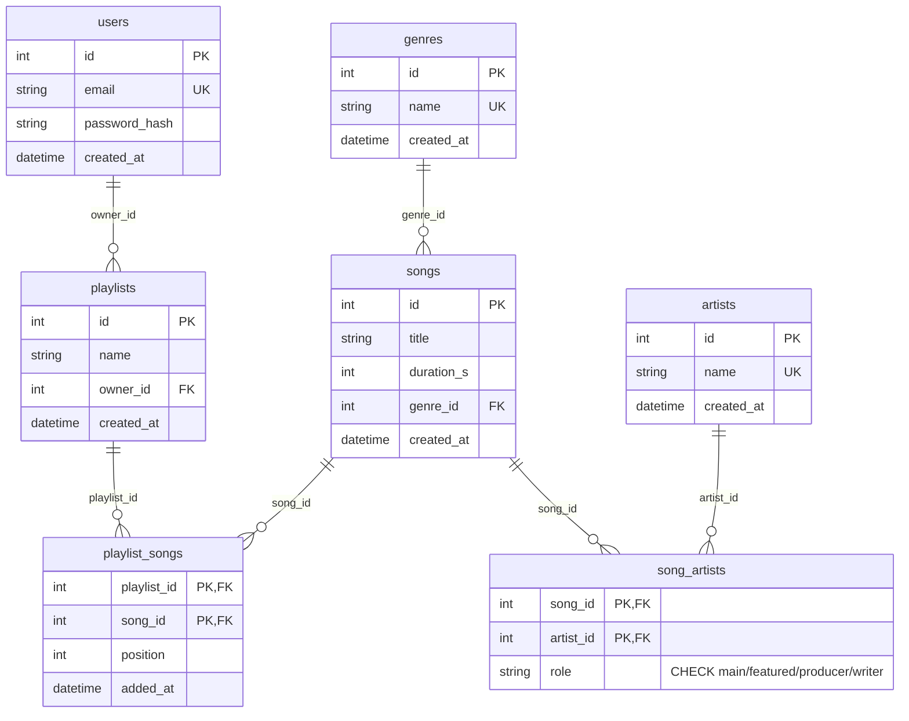
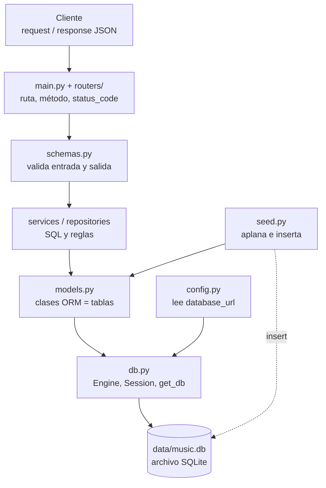

# Lección 3 · Modelos, base de datos y semilla

> **Objetivo:** pasar del contrato (rutas que responden 501) a datos reales. Escribir a mano `config.py`, `db.py`, `models.py` y `seed.py` para tener 7 tablas en SQLite, con las restricciones que protegen la integridad, y cargarlas con un catálogo anidado (`seed.json`) que hay que **aplanar**.
> **Resultado:** `tests/test_models.py` → **14 passed**; `tests/test_seed.py` → **8 passed, 1 skipped** (el bonus); toda la suite de ese momento → **26 passed, 1 skipped**; `uv run python -m app.seed` → `sembrada` y la segunda vez `ya estaba sembrada`.

**Leyenda.** 📝 = no es literal del diálogo: lo reconstruí desde el resumen de la sesión, el repo o lo añadí para completar. El resto sale del diálogo del 22 de octubre de 2026 y del código real del repo.

---

## 0. Dónde encaja

- **Es el paso 3 de 7** del plan de construcción: entorno ([[lesson-1]]) → contrato ([[lesson-2]]) → **modelos, base y semilla** → autenticación ([[lesson-4]]) → canciones y artistas con SQL ([[lesson-5]]) → playlists ([[lesson-6]]) → Dockerfile ([[lesson-7]]).
- **Ojo con la numeración del diálogo.** Ese día la llamábamos "lección 1" (era la primera del día) y a canciones y artistas, "lección 3". En estas notas los archivos siguen el paso de construcción: esta es `lesson-3`, canciones y artistas es `lesson-5`.
- **Orden real en el tiempo:** modelos → lectura de canciones y artistas (parte A de [[lesson-5]]) → autenticación ([[lesson-4]]) → escrituras protegidas (parte B de [[lesson-5]]) → playlists. Tras esta lección propuse hacer canciones/artistas antes que auth (ver §2.9).
- **Qué parte del README cubre ("el ritme"):**
  - La sección **Modelo de datos (7 tablas)** (diagrama de relaciones + tabla de columnas + la regla "cada canción tiene exactamente un artista `main`").
  - La línea de **Stack**: "La URL de la base sale de la variable `DATABASE_URL`, así que pasar a Postgres es cambiar una línea".
  - El ítem del checklist `- [x] Modelos, base de datos y semilla (aplanar el JSON anidado)`.
- **Duración:** unas 2 horas y media (lo dijo el propio usuario al cerrar). Se fue sobre todo en las tablas puente y en el aplanado.
- **Origen de la kata de la semilla:** es la kata "aplanar JSON anidado" de las notas de AdmitLens (nota 07 §0.4) que el usuario pidió retomar para practicar a mano.

---

## 1. Qué se hizo (resumen)

1. Se escribieron **tres archivos de infraestructura**: `app/config.py` (ajustes con `pydantic-settings`), `app/db.py` (`Base`, `make_engine`, `SessionLocal`, `get_db`) y `app/models.py` (7 clases = 7 tablas).
2. `db.py` activa la **integridad referencial en SQLite** con un evento `connect` que ejecuta `PRAGMA foreign_keys=ON`. Es la pieza más delicada y salió bien a la primera.
3. `models.py` necesitó **cuatro rondas de corrección**. Los errores se concentraron en las **tablas puente** (`song_artists`, `playlist_songs`): sin PK, FK a tablas con nombre equivocado, un `id` sustituto que permite duplicados, una columna `added_by` que sobraba y una FK que apuntaba a `song_artists` en lugar de `songs`.
4. Se escribió `app/seed.py`: `flatten_catalog` (pura, aplana el JSON anidado en 4 listas) y `seed_database` (idempotente, inserta en orden de dependencia), más un punto de entrada `python -m app.seed`.
5. Se cerró con un **repaso conceptual**: el usuario resumió lo aprendido, corregí lo impreciso y dibujé un mapa de la request hasta la base. Además aclaramos la diferencia entre API, FastAPI, router y endpoint.

---

## 2. Paso a paso

### 2.1 Punto de partida

Estado del repo al empezar (📝 reconstruido desde el resumen de la sesión):

- Entorno `uv` listo, `/health` verde, contrato con rutas 501 (`test_contract.py`), README con el modelo de datos.
- Yo había dejado en el repo, **sin tocar la app del usuario**:
  - `backend/data/seed.json` — 44 canciones, 11 artistas de primer nivel, 8 géneros, con listas `featuring` (incluye dos artistas que solo aparecen como invitados: *Rosa Delgado* e *Iván Cobre*).
  - `backend/tests/conftest.py` — fixture `session`.
  - `backend/tests/test_models.py` (14 tests) y `backend/tests/test_seed.py` (9 tests). Ambos usan `pytest.importorskip(...)`, así que **se saltan solos hasta que el módulo exista**. Sin solución: *4 passed, 2 skipped*.
- El usuario dijo que no sabía arrancar la lección solo y pidió **guía de proceso, no la respuesta**. Por eso se hizo con esqueletos con huecos (`...`) y tests.

Forma de `seed.json` (real):

```json
{
  "artists": [
    {
      "name": "Aurora Vega",
      "songs": [
        { "title": "Luces de Neón", "duration_s": 313, "genre": "Pop" },
        { "title": "Casi Verano", "duration_s": 156, "genre": "Electrónica",
          "featuring": ["Cobalto"] }
      ]
    }
  ]
}
```

Reglas del catálogo (comentario de `test_seed.py`): la canción anidada bajo un artista es **suya con rol `main`**; los nombres en `featuring` son colaboradores con rol `featured`; los ids van de 1 en adelante **por orden de primera aparición**.

### 2.2 Paso A · `config.py` (guiado con esqueleto 📝)

Esqueleto que se dio (📝 reconstruido; el literal no se conserva):

```python
from pydantic_settings import BaseSettings

class Settings(BaseSettings):
    database_url: str = ...        # por defecto: un archivo SQLite en ./data/
    ...

settings = Settings()
```

Versión final del usuario (correcta desde el primer intento, sin errores):

```python
from pydantic_settings import BaseSettings


class Settings(BaseSettings):
    database_url: str = "sqlite:///./data/music.db"
    secret_key: str = "dev-only-secret-change-me-via-env-0123456789"
    algorithm: str = "HS256"
    access_token_minutes: int = 60


settings = Settings()
```

Los campos `secret_key`, `algorithm` y `access_token_minutes` se añadieron después, para [[lesson-4]] (autenticación). En esta lección solo importaba `database_url`.

**Cómo se comprueba:** `uv run python -c "from app.config import settings; print(settings.database_url)"` imprime `sqlite:///./data/music.db`. Y con una variable de entorno la cambia: `DATABASE_URL=sqlite:///./otra.db uv run python -c "..."` imprime `sqlite:///./otra.db` (📝 comprobación añadida; es el comportamiento estándar de `BaseSettings`).

### 2.3 Paso B · `db.py` (guiado con esqueleto 📝)

Esqueleto (📝 reconstruido):

```python
from sqlalchemy import create_engine, event
from sqlalchemy.orm import DeclarativeBase, sessionmaker
from app.config import settings

class Base(DeclarativeBase):
    pass

def make_engine(url: str):
    engine = create_engine(url, connect_args=...)     # ¿qué necesita SQLite con hilos?

    @event.listens_for(engine, "connect")
    def _foreign_keys_on(dbapi_connection, _record):
        ...                                           # ¿qué PRAGMA activa las FK?

    return engine

engine = make_engine(settings.database_url)
SessionLocal = sessionmaker(bind=engine, ...)

def get_db():
    ...                                               # generador: una sesión por request
```

Versión final del usuario (revisada y aprobada en la primera revisión):

```python
from sqlalchemy import create_engine, event
from sqlalchemy.orm import DeclarativeBase, sessionmaker

from app.config import settings


class Base(DeclarativeBase):
    pass


def make_engine(url: str):
    engine = create_engine(
        url,
        connect_args={"check_same_thread": False}
    )

    @event.listens_for(engine, "connect")
    def _foreign_keys_on(dbapi_connection, _record):
        dbapi_connection.execute("PRAGMA foreign_keys=ON")

    return engine


engine = make_engine(settings.database_url)
SessionLocal = sessionmaker(bind=engine, expire_on_commit=False)


def get_db():
    with SessionLocal() as session:
        yield session
```

Lo que dije en la revisión sobre este archivo: **es la parte más delicada y la hiciste bien**. El `PRAGMA` en el evento `connect` es lo que hace pasar `test_song_needs_an_existing_genre` y `test_playlist_needs_an_existing_owner`, "los dos tests que más cuestan en una entrevista". `expire_on_commit=False` y el `get_db` con `with` + `yield` también estaban bien. Detalle menor: `check_same_thread` y el `PRAGMA` son específicos de SQLite; con Postgres se harían condicionales según el tipo de URL (ver §3.10).

**Cómo se comprueba:** `uv run python -c "from app.db import engine; print(engine)"` imprime algo como `Engine(sqlite:///./data/music.db)`. Es el "cuando `print(engine)` funcione" de la guía.

### 2.4 Paso C · `models.py`, la parte larga

#### 2.4.1 Cómo se guió (📝)

- Se explicó el patrón con un **ejemplo análogo** (una biblioteca: libros, autores y una tabla puente `book_authors`) y se pidió traducir el modelo de datos del README tabla por tabla.
- Se fue **tabla por tabla con `-k`**, para no mezclar errores:

```bash
uv run pytest tests/test_models.py -k test_user_email_is_unique -q
uv run pytest tests/test_models.py -k test_invalid_role_is_rejected -q
uv run pytest tests/test_models.py -q       # al final, el archivo entero: 14 passed
```

#### 2.4.2 Qué pide el README (la especificación)

| Tabla | Columnas |
|---|---|
| `users` | id, email (único), password_hash, created_at |
| `artists` | id, name |
| `genres` | id, name (único) |
| `songs` | id, title, duration_s, genre_id → genres, created_at |
| `song_artists` | song_id → songs, artist_id → artists, role (`main` / `featured` / `producer` / `writer`). **PK (song_id, artist_id)** |
| `playlists` | id, name, owner_id → users, created_at |
| `playlist_songs` | playlist_id → playlists, song_id → songs, position, added_at. **PK (playlist_id, song_id)** |

Diagrama (📝 hecho desde el código; corresponde a la imagen pegada en las notas del usuario):



(`genres.created_at` no estaba en esta lección: se añadió en [[lesson-5]] porque `GenreOut` lo exige. Aquí lo dibujo con el estado final del repo.)

#### 2.4.3 Ronda 1 · el primer `models.py` del usuario: cinco fallos, tres capas

El usuario escribió `config.py`, `db.py` y `models.py` y preguntó *"por qué unos errores del test_models.py fallan"*. Reproduje en una **copia temporal** (sus archivos no se tocaron) aplicando los arreglos por etapas:

| Etapa | Arreglo aplicado en la copia | Resultado |
|---|---|---|
| 1 | `SongArtist` con PK compuesta | `ArgumentError: Mapper Mapper[PlaylistSong(playlist_songs)] could not assemble any primary key columns` (ahora falta la de `PlaylistSong`) |
| 2 | `PlaylistSong` con PK compuesta | `NoReferencedTableError: ... could not find table 'playlist'` → **13 errores** y `1 passed` |
| 3 | Nombres de tabla en las FK: `playlists.id`, `songs.id`, `users.id` | **3 failed, 11 passed** |
| 4 | `unique=True` en `genres.name` | bajan los fallos |
| 5 | `CheckConstraint` en `role` | con los cinco arreglos: **14 passed** |

Los errores aparecen en **tres capas**, y cada arreglo destapa el siguiente:

| Capa | Cuándo salta | Qué pasaba |
|---|---|---|
| Al **importar** | `import app.models` | `SongArtist` (línea 37) y `PlaylistSong` (línea 52) no tenían clave primaria. SQLAlchemy lo detecta al construir los mappers, así que **ningún test del archivo corre** (el `importorskip` revienta antes de probar nada). |
| Al **crear tablas** | `create_all` en el fixture | Las FK de `PlaylistSong` apuntaban a `playlist.id`, `song.id` y `user.id`, que no existen. |
| Al **insertar** | dentro del test | Faltaban restricciones, o sobraba una columna NOT NULL. |

Los cinco fallos, concretos:

1. **Sin PK en las tablas puente.** SQLAlchemy exige una PK en cada tabla mapeada. En una tabla puente la PK es **compuesta**: `primary_key=True` en las dos columnas FK. Eso además impide repetir el par.
2. **Nombres de tabla mal escritos en las FK.** `ForeignKey("tabla.columna")` usa el valor de `__tablename__`, no el nombre de la clase ni el singular.
3. **`added_by` sobraba.** El README define `playlist_songs` como `playlist_id, song_id, position, added_at`. La columna era NOT NULL y el test no la rellena → `IntegrityError: NOT NULL constraint failed: playlist_songs.added_by`. (Si se quisiera, tendría que ser nullable y habría que cambiar el contrato.)
4. **`genres.name` no era único.** Síntoma: `test_genre_name_is_unique` falla con `DID NOT RAISE IntegrityError` (la base aceptó el duplicado).
5. **`role` sin restricción.** Entraba `"dj"`. Solución: `CheckConstraint` dentro de `__table_args__`:

```python
__table_args__ = (
    CheckConstraint("role IN ('main', 'featured', 'producer', 'writer')", name="ck_song_artists_role"),
)
```

Aviso que di: **la coma final** — sin ella `__table_args__` no es una tupla.

Detalles menores señalados: los `unique=True` sobre las PK sobran (una PK ya es única, no rompen nada), y la ruta `./data/music.db` es relativa al directorio de ejecución, así que el seed se corre desde `backend/`.

#### 2.4.4 Ronda 2 · la "versión corregida" (resultado: 12 de 14)

El usuario envió esta versión y preguntó *"si ahora sí está bien y por qué `SongArtist` está mal"*:

```python
class SongArtist(Base):
    __tablename__ = "song_artists"
    __table_args__ = (
        CheckConstraint("role IN ('main', 'featured', 'producer', 'writer')", name="ck_song_artists_role"),
    )
    id: Mapped[int] = mapped_column(Integer, primary_key=True, unique=True, nullable=False)
    song_id: Mapped[int] = mapped_column(Integer, ForeignKey("songs.id"))
    artist_id: Mapped[int] = mapped_column(Integer, ForeignKey("artists.id"))
    role: Mapped[str] = mapped_column(String, nullable=False)

...

class PlaylistSong(Base):
    __tablename__ = "playlist_songs"
    id: Mapped[int] = mapped_column(Integer, primary_key=True, unique=True, nullable=False)
    playlist_id: Mapped[int] = mapped_column(Integer, ForeignKey("playlists.id"), nullable=False)
    song_id: Mapped[int] = mapped_column(Integer, ForeignKey("song_artists.id"), nullable=False)
    position: Mapped[int] = mapped_column(Integer, nullable=False)
    added_at: Mapped[datetime] = mapped_column(DateTime, server_default=func.now())
    added_by: Mapped[int] = mapped_column(Integer, ForeignKey("users.id"), nullable=False)
```

Estado: **2 failed, 12 passed** (`test_song_artist_pair_is_unique` y `test_playlist_song_pair_is_unique`). Ya estaban bien `genres.name` único, el `CheckConstraint` y las FK de `songs` y `playlists`.

**Por qué `SongArtist` está mal: el `id` autoincremental.** *La PK es lo que define cuándo dos filas son "la misma".* Con `id` autoincremental, cada insert recibe un id nuevo, así que la base acepta:

| id | song_id | artist_id | role |
|---|---|---|---|
| 1 | 7 | 3 | main |
| 2 | 7 | 3 | main |

El mismo artista duplicado en la misma canción: en la API sería un artista repetido en `SongsOut.artists` y, en las consultas "canciones por artista", conteos inflados. El test falla con `DID NOT RAISE` porque la base aceptó el duplicado.

**Una tabla puente no es una entidad** como `Song` o `Artist`: solo guarda el hecho "este artista participa en esta canción", que se identifica por el par `(song_id, artist_id)`. Por eso la PK es el par: se quita `id` y se marca `primary_key=True` en las dos FK.

Alternativa válida (se dijo): dejar `id` y añadir `UniqueConstraint(song_id, artist_id)`. Se hace en proyectos reales cuando **otra tabla tiene que apuntar a esa fila**. Aquí nada referencia `song_artists` y el README ya define la PK como el par, así que la PK compuesta es lo más simple.

Frase para la entrevista (dada textualmente): *"En una tabla de asociación uso una clave primaria compuesta por las dos FK, así la base de datos impide duplicados y no necesito un id que nadie referencia."*

Además en `PlaylistSong`: (a) mismo problema de PK, (b) **`song_id` apuntaba a `song_artists.id`** — una playlist contiene canciones, no créditos de artista, (c) `added_by` seguía ahí. Y `CheckConstraint` estaba importado dos veces en la línea 2.

#### 2.4.5 Ronda 3 · `NoReferencedColumnError` (13 errores idénticos)

El usuario pegó una traza y preguntó *"qué sucedió aquí y qué sigue mal"*. Ya había quitado el `id` de `SongArtist` (bien), pero `PlaylistSong.song_id` seguía así:

```python
song_id: Mapped[int] = mapped_column(Integer, ForeignKey("song_artists.id"), nullable=False, primary_key=True)
```

La última línea `E` lo decía todo:

```
NoReferencedColumnError: ... ForeignKey 'song_artists.id' on table 'playlist_songs':
table 'song_artists' has no column named 'id'
```

Antes el error no se veía porque `song_artists.id` existía; al borrarla **afloró**. Cómo leer esta traza:

- **`ERROR at setup`, no `FAILED`**: el fallo ocurre en el fixture `session` (`conftest.py`, el `create_all`), antes de que corra cada test. `create_all` resuelve todas las FK para ordenar las tablas y una sola FK rota hace caer a todos los tests que usan el fixture.
- **`1 passed`** = el único test que no usa ese fixture (`test_get_db_yields_a_session`).
- **13 trazas idénticas**: basta leer la primera (la línea `E` y el `self = ForeignKey('song_artists.id')` con `parenttable = Table('playlist_songs'...`).

#### 2.4.6 Ronda 4 · `foreign key mismatch`

El usuario cambió a `ForeignKey("song_artists.song_id")` y preguntó *"¿es esta la forma correcta de PlaylistSong?"*. Estado: **1 failed, 13 passed**:

```
sqlalchemy.exc.OperationalError: (sqlite3.OperationalError)
foreign key mismatch - "playlist_songs" referencing "song_artists"
```

Esta vez `create_all` sí funciona (la columna existe) y el error salta **al insertar**, ya con `PRAGMA foreign_keys=ON`. Dos razones:

1. **Mecánica:** una FK solo puede apuntar a una columna que identifique **una única fila del padre** (una PK o una `UNIQUE`). En `song_artists`, `song_id` es solo la mitad de una PK compuesta: una misma canción aparece una vez por cada artista → no es única → SQLite lo rechaza con "mismatch".
2. **Conceptual:** aunque la base lo aceptara, `playlist_songs.song_id` estaría validando contra **créditos de artistas**; no podrías meter en una playlist una canción que aún no tenga artista. La entidad "canción" vive en `songs`.

**Regla general:** una FK apunta a la tabla de la **entidad**, a su PK (`songs.id`, `playlists.id`, `users.id`), y casi nunca a una tabla puente.

**Método de diagnóstico que di:** los últimos tres intentos fallaron por lo mismo — ir cambiando la línea hasta dar con una columna que existiera. La pregunta que ayuda a acertar es: *"¿qué **cosa** es este id?"* Aquí es el id de una canción → va a `songs`.

El usuario dijo que iba fuera de tiempo y pidió la solución con una explicación corta. Se la di:

```python
class PlaylistSong(Base):
    __tablename__ = "playlist_songs"
    playlist_id: Mapped[int] = mapped_column(Integer, ForeignKey("playlists.id"), nullable=False, primary_key=True)
    song_id: Mapped[int] = mapped_column(Integer, ForeignKey("songs.id"), nullable=False, primary_key=True)
    position: Mapped[int] = mapped_column(Integer, nullable=False)
    added_at: Mapped[datetime] = mapped_column(DateTime, server_default=func.now())
```

Respuesta del usuario: *"entendí!"* → **14 passed**.

#### 2.4.7 `models.py` final (estado del repo)

```python
from datetime import datetime

from sqlalchemy import CheckConstraint, DateTime, ForeignKey, Integer, String, func
from sqlalchemy.orm import Mapped, mapped_column

from app.db import Base


class Genre(Base):
    __tablename__ = "genres"
    id: Mapped[int] = mapped_column(Integer, primary_key=True, nullable=False, unique=True)
    name: Mapped[str] = mapped_column(String, nullable=False, unique=True)
    created_at: Mapped[datetime] = mapped_column(DateTime, server_default=func.now())   # añadida en lesson-5

class User(Base):
    __tablename__ = "users"
    id: Mapped[int] = mapped_column(Integer, primary_key=True, unique=True)
    email: Mapped[str] = mapped_column(String, unique=True)
    password_hash: Mapped[str]
    created_at: Mapped[datetime] = mapped_column(DateTime, server_default=func.now())


class Artist(Base):
    __tablename__ = "artists"
    id: Mapped[int] = mapped_column(Integer, primary_key=True, unique=True)
    name: Mapped[str] = mapped_column(String, nullable=False, unique=True)
    created_at: Mapped[datetime] = mapped_column(DateTime, server_default=func.now())


class Song(Base):
    __tablename__ = "songs"
    id: Mapped[int] = mapped_column(Integer, primary_key=True, unique=True, nullable=False)
    title: Mapped[str] = mapped_column(String, nullable=False)
    duration_s: Mapped[int] = mapped_column(Integer, nullable=False)
    genre_id: Mapped[int] = mapped_column(Integer, ForeignKey("genres.id"), nullable=False)
    created_at: Mapped[datetime] = mapped_column(DateTime, server_default=func.now())


class SongArtist(Base):
    __tablename__ = "song_artists"
    __table_args__ = (
        CheckConstraint("role IN ('main', 'featured', 'producer', 'writer')", name="ck_song_artists_role"),
    )
    song_id: Mapped[int] = mapped_column(Integer, ForeignKey("songs.id"), primary_key=True)
    artist_id: Mapped[int] = mapped_column(Integer, ForeignKey("artists.id"), primary_key=True)
    role: Mapped[str] = mapped_column(String, nullable=False)


class Playlist(Base):
    __tablename__ = "playlists"
    id: Mapped[int] = mapped_column(Integer, primary_key=True, nullable=False, unique=True)
    name: Mapped[str] = mapped_column(String, nullable=False)
    owner_id: Mapped[int] = mapped_column(Integer, ForeignKey("users.id"), nullable=False)
    created_at: Mapped[datetime] = mapped_column(DateTime, server_default=func.now())


class PlaylistSong(Base):
    __tablename__ = "playlist_songs"
    playlist_id: Mapped[int] = mapped_column(Integer, ForeignKey("playlists.id"), nullable=False, primary_key=True)
    song_id: Mapped[int] = mapped_column(Integer, ForeignKey("songs.id"), nullable=False, primary_key=True)
    position: Mapped[int] = mapped_column(Integer, nullable=False)
    added_at: Mapped[datetime] = mapped_column(DateTime, server_default=func.now())
```

#### 2.4.8 El DDL que `create_all` genera de verdad (📝 comprobado en una copia al preparar estas notas)

Esto es lo que SQLAlchemy emite para SQLite con el `models.py` final (útil para ver que cada decisión del modelo acaba en una línea de SQL):

```sql
CREATE TABLE songs (
    id INTEGER NOT NULL,
    title VARCHAR NOT NULL,
    duration_s INTEGER NOT NULL,
    genre_id INTEGER NOT NULL,
    created_at DATETIME DEFAULT CURRENT_TIMESTAMP NOT NULL,
    PRIMARY KEY (id),
    UNIQUE (id),
    FOREIGN KEY(genre_id) REFERENCES genres (id)
)

CREATE TABLE song_artists (
    song_id INTEGER NOT NULL,
    artist_id INTEGER NOT NULL,
    role VARCHAR NOT NULL,
    PRIMARY KEY (song_id, artist_id),
    CONSTRAINT ck_song_artists_role CHECK (role IN ('main', 'featured', 'producer', 'writer')),
    FOREIGN KEY(song_id) REFERENCES songs (id),
    FOREIGN KEY(artist_id) REFERENCES artists (id)
)

CREATE TABLE playlist_songs (
    playlist_id INTEGER NOT NULL,
    song_id INTEGER NOT NULL,
    position INTEGER NOT NULL,
    added_at DATETIME DEFAULT CURRENT_TIMESTAMP NOT NULL,
    PRIMARY KEY (playlist_id, song_id),
    FOREIGN KEY(playlist_id) REFERENCES playlists (id),
    FOREIGN KEY(song_id) REFERENCES songs (id)
)
```

Observaciones: `UNIQUE (id)` junto a `PRIMARY KEY (id)` es la redundancia señalada; `Mapped[str]` sin `Optional` produce `NOT NULL` aunque no escribas `nullable=False`; `server_default=func.now()` produce `DEFAULT CURRENT_TIMESTAMP`; el `CheckConstraint` lleva el nombre que le diste. El orden en que `create_all` crea las tablas (`artists, genres, users, playlists, songs, playlist_songs, song_artists`) es el de dependencias: los padres antes que los hijos.

### 2.5 Los tests de modelos (`tests/test_models.py`, 14 tests)

Escritos por mí. Protegen **las restricciones de la base**, no la lógica de la app. Helpers del archivo:

```python
def make_song(session, title="Uno"):
    genre = models.Genre(name=f"Genero de {title}")
    session.add(genre); session.flush()
    song = models.Song(title=title, duration_s=200, genre_id=genre.id)
    session.add(song); session.flush()
    return song

def make_artist(session, name="Ana"):
    artist = models.Artist(name=name)
    session.add(artist); session.flush()
    return artist
```

| Test | Qué protege | Qué falla si el modelo está mal |
|---|---|---|
| `test_tables_exist` | las 7 tablas existen con esos nombres (`inspect(...).get_table_names()`) | nombre de `__tablename__` mal |
| `test_get_db_yields_a_session` | `get_db()` es un generador que entrega una `Session` y se cierra con `gen.close()` | `get_db` no es generador |
| `test_created_at_is_filled` | `server_default=func.now()` rellena `created_at` | sin default |
| `test_user_email_is_unique` | `users.email` único | falta `unique=True` |
| `test_genre_name_is_unique` | `genres.name` único | falta `unique=True` (`DID NOT RAISE`) |
| `test_song_needs_an_existing_genre` | FK activa: `genre_id=999` → `IntegrityError` | falta el `PRAGMA` |
| `test_valid_roles_are_accepted` (×4) | `main/featured/producer/writer` entran | `CheckConstraint` demasiado estricto |
| `test_invalid_role_is_rejected` | `"dj"` → `IntegrityError` | falta el `CheckConstraint` |
| `test_song_artist_pair_is_unique` | el par `(song_id, artist_id)` no se repite | `id` sustituto en vez de PK compuesta |
| `test_playlist_needs_an_existing_owner` | FK `owner_id` aplicada | falta el `PRAGMA` |
| `test_playlist_song_pair_is_unique` | una canción no se repite en la misma playlist | PK mal / FK mal / `added_by` |

Detalles de cómo están escritos (y por qué):

- **`session.flush()`** (no `commit`) en los tests de restricciones: manda el SQL dentro de la transacción y dispara la restricción sin consolidar. `with pytest.raises(IntegrityError): session.flush()`.
- **`pytest.importorskip("app.models")`** al principio: mientras `models.py` no exista, el archivo entero se *salta* en lugar de reventar la colección.
- **`DID NOT RAISE IntegrityError`** significa "esperaba que la base rechazara esto y lo aceptó": la restricción falta.

**Validación de los tests por mutación (hecha por mí antes de dárselos):** con una solución de referencia y tres mutaciones comprobé que los tests *atrapan* los errores de verdad:

| Mutación en la solución de referencia | Tests que fallan |
|---|---|
| Quitar el `PRAGMA foreign_keys=ON` | 2 (los dos de FK) |
| Quitar el `CheckConstraint` | 1 (`invalid_role`) |
| Cambiar el rol `featured` por `main` en el seed | 2 |

### 2.6 La fixture `session` (`tests/conftest.py`)

```python
@pytest.fixture
def session():
    """Base SQLite en memoria, con las tablas creadas, nueva para cada test."""
    from sqlalchemy.orm import sessionmaker

    import app.models  # noqa: F401  (registra las tablas en Base)
    from app.db import Base, make_engine

    engine = make_engine("sqlite://")
    Base.metadata.create_all(engine)
    with sessionmaker(bind=engine)() as s:
        yield s
    engine.dispose()
```

Puntos clave:

- **Se importa dentro de la fixture** (`import app.models`, `from app.db import ...`) para que un error de importación aparezca como *error del fixture* y no rompa toda la colección de pytest.
- **`import app.models  # noqa: F401`**: el import "sin usar" es necesario: al importarse, cada clase se registra en `Base.metadata`; sin él, `create_all` no crearía ninguna tabla.
- **`make_engine("sqlite://")`** = base **en memoria**, nueva en cada test (aislamiento). Pasa por `make_engine`, así que **también tiene el `PRAGMA`**; por eso los tests de FK funcionan.
- La sesión se entrega con `yield` y el `with` la cierra al terminar.

**Por qué `:memory:` solo vale aquí.** Con `TestClient` (API, desde [[lesson-5]]) los endpoints corren en **otro hilo**, y cada conexión a una base en memoria es **otra base distinta y vacía**. Por eso, más adelante, se añadió la fixture `db_factory`, con **SQLite en un archivo temporal** (`tmp_path`), y `client`, que sustituye `get_db` con `app.dependency_overrides`:

```python
@pytest.fixture
def db_factory(tmp_path):
    from sqlalchemy.orm import sessionmaker
    import app.models  # noqa: F401
    from app.db import Base, make_engine

    engine = make_engine(f"sqlite:///{tmp_path / 'test.db'}")
    Base.metadata.create_all(engine)
    yield sessionmaker(bind=engine, expire_on_commit=False)
    engine.dispose()

@pytest.fixture
def client(db_factory):
    from fastapi.testclient import TestClient
    from app.db import get_db
    from app.main import app

    def override_get_db():
        with db_factory() as s:
            yield s

    app.dependency_overrides[get_db] = override_get_db
    yield TestClient(app)
    app.dependency_overrides.clear()
```

En esta lección solo existía `session`; `db_factory` y `client` llegaron con [[lesson-5]] (están aquí porque son la otra mitad de la historia de "base para tests").

### 2.7 Paso D · `seed.py`

#### 2.7.1 Por qué falla todo `test_seed.py` al principio

Tras cerrar `models.py`: **8 failed, 18 passed, 1 skipped**. Los 8 fallos eran `AttributeError: module 'app.seed' has no attribute 'flatten_catalog'` / `'seed_database'`: no había nada roto, `app/seed.py` estaba vacío.

#### 2.7.2 Los tests de la semilla (`tests/test_seed.py`, 9 tests)

Catálogo pequeño del test y la respuesta exacta esperada:

```python
CATALOG = {
    "artists": [
        {"name": "Ana", "songs": [
            {"title": "Uno", "duration_s": 200, "genre": "Rock", "featuring": ["Beto"]},
            {"title": "Dos", "duration_s": 180, "genre": "Pop"},
        ]},
        {"name": "Beto", "songs": [{"title": "Tres", "duration_s": 240, "genre": "Rock"}]},
    ]
}

EXPECTED = {
    "genres": [{"id": 1, "name": "Rock"}, {"id": 2, "name": "Pop"}],
    "artists": [{"id": 1, "name": "Ana"}, {"id": 2, "name": "Beto"}],
    "songs": [
        {"id": 1, "title": "Uno", "duration_s": 200, "genre_id": 1},
        {"id": 2, "title": "Dos", "duration_s": 180, "genre_id": 2},
        {"id": 3, "title": "Tres", "duration_s": 240, "genre_id": 1},
    ],
    "song_artists": [
        {"song_id": 1, "artist_id": 1, "role": "main"},
        {"song_id": 1, "artist_id": 2, "role": "featured"},
        {"song_id": 2, "artist_id": 1, "role": "main"},
        {"song_id": 3, "artist_id": 2, "role": "main"},
    ],
}
```

| Test | Qué comprueba |
|---|---|
| `test_flatten_small_catalog` | el aplanado del catálogo pequeño es **exactamente** `EXPECTED` (ids por primera aparición) |
| `test_flatten_does_not_modify_its_input` | `flatten_catalog` no muta su entrada (compara con un `copy.deepcopy`) |
| `test_real_seed_has_enough_data` | el `seed.json` real da ≥5 géneros, ≥10 artistas, ≥30 canciones |
| `test_names_are_unique` | no hay nombres repetidos en géneros ni artistas |
| `test_every_song_has_exactly_one_main_artist` | cada canción tiene **un solo** `main` (regla del README) |
| `test_foreign_keys_point_to_existing_rows` | todas las FK de las filas apuntan a ids que existen |
| `test_featured_only_artists_are_created` | *Rosa Delgado* e *Iván Cobre* (solo invitados) existen como artistas |
| `test_titles_by_artist` | **bonus**: volver a anidar; se salta si `titles_by_artist` no existe (esperado: `{"Ana": ["Uno","Dos"], "Beto": ["Uno","Tres"]}`) |
| `test_seed_database_inserts_once` | primera llamada → `True` con 2/2/3/4 filas; segunda → `False` y todo igual (idempotencia) |

Los tests sobre el `seed.json` real comprueban **propiedades**, no valores concretos: así sirven aunque se cambien los datos.

#### 2.7.3 Cómo se guió `flatten_catalog`

**1. Traza a mano el catálogo pequeño.** Tabla de la traza (la "trampa" es que *Beto* aparece primero como invitado de "Uno", así que recibe su id ahí, y cuando llega como artista de primer nivel ya existe y no se crea otra vez; con los géneros pasa lo mismo: *Rock* se crea con "Uno" y se reutiliza con "Tres"):

| Paso | Qué ocurre | Artistas (ids) | Géneros (ids) | Canciones | `song_artists` |
|---|---|---|---|---|---|
| 1 | artista de 1er nivel **Ana** | Ana=1 | | | |
| 2 | canción **Uno**, género Rock | | Rock=1 | Uno=1 (genre 1) | (1, Ana, main) |
| 3 | `featuring` **Beto** | Beto=2 | | | (1, Beto, featured) |
| 4 | canción **Dos**, género Pop | | Pop=2 | Dos=2 (genre 2) | (2, Ana, main) |
| 5 | artista de 1er nivel **Beto** | ya existe → 2 | | | |
| 6 | canción **Tres**, género Rock | | Rock ya es 1 | Tres=3 (genre 1) | (3, Beto, main) |

**2. La pieza clave:** un diccionario `nombre → id` para artistas y otro para géneros, y un helper "asegura que este nombre tiene id".

**3. Esqueleto que se dio** (rellena los `...`):

```python
def flatten_catalog(catalog: dict) -> dict:
    rows = {"genres": [], "artists": [], "songs": [], "song_artists": []}
    genre_ids, artist_ids = {}, {}

    def ensure(name, ids, table):
        ...  # devuelve el id, creándolo si es nuevo

    for artist in catalog["artists"]:
        artist_id = ensure(...)
        for song in artist["songs"]:
            genre_id = ensure(...)
            song_id = ...                 # id nuevo para la canción
            rows["songs"].append({...})
            rows["song_artists"].append({... "main"})
            for name in song.get("featuring", []):   # ojo: la clave puede no existir
                ...                                  # "featured"
    return rows
```

**4. Dos detalles con test:** no modificar `catalog`, y `song.get("featuring", [])` para evitar `KeyError` en canciones sin colaboradores.

#### 2.7.4 La pregunta del usuario sobre `ensure(name, ids, table)`

*"¿Por qué hay un parámetro `ids` ahí adentro? Pensé que la función verificaba que la tabla tuviera ids."* Respuesta: el nombre confunde. **No comprueba nada: "dame el id de este nombre y, si todavía no tiene uno, créalo". Devuelve siempre un id.**

- **`ids`** = diccionario `nombre → id`, p. ej. `{"Rock": 1, "Pop": 2}`. Es la **memoria** de lo ya visto: responde "¿ya existe?" y "¿qué id tiene?" sin recorrer nada, y da el id nuevo: `len(ids) + 1`.
- **`table`** = la lista de filas que se devolverá (`[{"id": 1, "name": "Rock"}, ...]`). Solo se le añade una fila cuando el nombre es nuevo.
- Se podría buscar dentro de `table`, pero habría que recorrer la lista cada vez; `ids` es esa búsqueda ya hecha.
- Los recibe como parámetros porque **el mismo helper sirve para géneros y para artistas**, cada uno con su propio par: `ensure("Rock", genre_ids, rows["genres"])`, `ensure("Ana", artist_ids, rows["artists"])`.

| Llamada | ¿Está en `ids`? | Qué hace | Devuelve |
|---|---|---|---|
| `ensure("Rock", genre_ids, rows["genres"])` | no | id = 1, lo guarda, añade `{"id":1,"name":"Rock"}` | 1 |
| `ensure("Pop", ...)` | no | id = 2, igual | 2 |
| `ensure("Rock", ...)` (canción "Tres") | sí | no toca nada | 1 |

Truco de Python que se explicó: **un `dict` y una `list` son mutables**, así que el helper modifica los mismos objetos que tiene `flatten_catalog`; no hace falta devolverlos, solo devuelve el id.

#### 2.7.5 La propuesta del usuario y su bug

Versión del usuario:

```python
def flatten_catalog(catalog: dict) -> dict:
    rows = {"genres": [], "artists": [], "songs": [], "song_artists": []}
    genre_ids, artist_ids, song_ids = {}, {}, {}

    def ensure(name, ids, table):
        if name not in ids:
            ids[name] = len(ids) + 1
            table.append({"id": ids[name], "name":name})
        return ids[name]

    for artist in catalog["artists"]:
        artist_id = ensure(artist["name"], artist_ids, rows["artists"])
        for song in artist["songs"]:
            genre_id = ensure(song["genre"], genre_ids, rows["genres"])
            song_id  = ensure(song["title"], song_ids, rows["songs"])      # ← el problema
            rows["song_artists"].append({"song_id": song_id, "artist_id": artist_id, "role": "main"})

            for name in song.get("featuring", []):
                feat_id = ensure(name, artist_ids, rows["artists"])
                rows["song_artists"].append({"song_id": song_id, "artist_id": feat_id, "role": "featured"})

    return rows
```

Probé la propuesta en una copia: **2 failed, 5 passed** (de los 7 tests que probé). Bien: `ensure` reutilizado, el artista que aparece primero como invitado no se duplica, roles correctos, `.get("featuring", [])`, no muta `catalog`.

El fallo:

```
{'songs': [{'id': 1, 'name': 'Uno'}, ...]}  !=  {'songs': [{'id': 1, 'title': 'Uno', 'duration_s': 200, 'genre_id': 1}, ...]}
KeyError: 'genre_id'
```

- **`songs` no es "buscar o crear".** `ensure` solo sabe construir filas `{"id","name"}` (sirven para géneros y artistas). Una canción tiene `title`, `duration_s` y `genre_id`.
- **Pista en su propio código:** calculaba `genre_id` y no lo usaba en ninguna parte. *Una variable que se calcula y no se usa casi siempre indica una pieza que falta.*
- **Bug latente:** géneros y artistas se identifican por **nombre**, así que "si existe, reutiliza el id" es correcto. Una canción **no** se identifica por su título: si dos artistas tienen una canción llamada "Intro", `ensure` las fundiría en una sola. Su `seed.json` no tiene títulos repetidos (lo verifiqué: *ninguno*), por eso no se veía. En el JSON, **cada canción es una fila nueva, siempre**.

Arreglo (el usuario lo aplicó; `song_ids` quedó como resto sin usar en la línea 3 y se le dijo que lo borrara):

```python
song_id = len(rows["songs"]) + 1
rows["songs"].append({"id": song_id, "title": song["title"],
                      "duration_s": song["duration_s"], "genre_id": genre_id})
```

Resultado: los 7 tests de aplanado en verde; lo que quedaba rojo era `seed_database` (inexistente).

#### 2.7.6 `seed_database`: los cuatro pasos

El usuario pegó el fallo `AttributeError: module 'app.seed' has no attribute 'seed_database'`. No era un error suyo: la función **no existía**. Qué pedía el test:

```python
assert seed.seed_database(session, CATALOG) is True    # 1ª vez: inserta y devuelve True
# cuenta: 2 géneros, 2 artistas, 3 canciones, 4 song_artists
assert seed.seed_database(session, CATALOG) is False   # 2ª vez: no inserta nada
```

Función **idempotente**: se puede ejecutar cien veces y la base queda igual (que cada arranque no duplique datos). Los cuatro pasos:

1. Comprobar si ya hay datos (basta una tabla: `select(func.count())` sobre `Song`) y, si los hay, `return False`.
2. Aplanar: `rows = flatten_catalog(catalog)`.
3. Insertar **en orden de dependencia**: géneros y artistas → canciones → `song_artists`; cada fila ya trae ids y FK, así que se pasa como `models.Genre(**fila)` y `session.add_all([...])`.
4. `session.commit()` y `return True`.

El usuario dijo que se les había acabado el tiempo (*"¿Qué nombres? No la conocí..."*) y pidió el script final para "ver cómo se genera esta conexión". Se lo di (probado en copia: **26 passed, 1 skipped**).

#### 2.7.7 `seed.py` final (estado del repo)

```python
import json
from pathlib import Path

from sqlalchemy import func, select

from app import models
from app.db import Base, SessionLocal, engine

SEED_PATH = Path(__file__).resolve().parent.parent / "data" / "seed.json"


def flatten_catalog(catalog: dict) -> dict:
    rows = {"genres": [], "artists": [], "songs": [], "song_artists": []}
    genre_ids, artist_ids = {}, {}

    def ensure(name, ids, table):
        if name not in ids:
            ids[name] = len(ids) + 1
            table.append({"id": ids[name], "name": name})
        return ids[name]

    for artist in catalog["artists"]:
        artist_id = ensure(artist["name"], artist_ids, rows["artists"])
        for song in artist["songs"]:
            genre_id = ensure(song["genre"], genre_ids, rows["genres"])
            song_id = len(rows["songs"]) + 1
            rows["songs"].append({"id": song_id, "title": song["title"],
                                  "duration_s": song["duration_s"], "genre_id": genre_id})
            rows["song_artists"].append({"song_id": song_id, "artist_id": artist_id, "role": "main"})

            for name in song.get("featuring", []):
                feat_id = ensure(name, artist_ids, rows["artists"])
                rows["song_artists"].append({"song_id": song_id, "artist_id": feat_id, "role": "featured"})

    return rows


def seed_database(session, catalog: dict) -> bool:
    """Carga el catálogo en la base. Devuelve False si ya estaba sembrada."""
    if session.scalar(select(func.count()).select_from(models.Song)) > 0:
        return False

    rows = flatten_catalog(catalog)
    session.add_all([models.Genre(**r) for r in rows["genres"]])
    session.add_all([models.Artist(**r) for r in rows["artists"]])
    session.add_all([models.Song(**r) for r in rows["songs"]])
    session.add_all([models.SongArtist(**r) for r in rows["song_artists"]])
    session.commit()
    return True


if __name__ == "__main__":
    Base.metadata.create_all(engine)
    catalog = json.loads(SEED_PATH.read_text(encoding="utf-8"))
    with SessionLocal() as session:
        print("sembrada" if seed_database(session, catalog) else "ya estaba sembrada")
```

#### 2.7.8 Cómo funciona "la conexión" (explicación dada)

- **`models.Genre(**r)`** es el truco principal. `r` es un dict como `{"id": 1, "name": "Rock"}`; el `**` lo desempaqueta: las claves pasan a ser los **nombres de los argumentos** del constructor. Es lo mismo que `Genre(id=1, name="Rock")`. Por eso **las claves de `flatten_catalog` deben llamarse igual que las columnas de `models.py`**.
- **`session.add_all(...)`** deja los objetos *pendientes* en la sesión; no toca la base hasta el `commit()`.
- **`session.commit()`** manda todo a la base en **una transacción**. SQLAlchemy ordena los inserts según las FK (📝 lo comprobé: añadir primero una canción y luego su género dentro del mismo commit también funciona), pero conviene escribirlos en el orden lógico.
- **El `count` inicial** es lo que hace idempotente a la función.
- **`if __name__ == "__main__":`** se ejecuta solo al lanzar el archivo directamente, no cuando otro módulo hace `import app.seed`. Por eso el test importa `seed` sin sembrar nada. El bloque crea las tablas con `create_all`, abre una sesión real con `SessionLocal` y llama a `seed_database`.
- **`SEED_PATH`** se calcula con `Path(__file__)` (relativo al archivo, no al directorio desde el que ejecutas): `app/seed.py` → `.parent` = `app/` → `.parent.parent` = `backend/` → `/ "data" / "seed.json"`.

#### 2.7.9 Ejecutar y comprobar la semilla real

Desde `backend/`:

```bash
uv run python -m app.seed      # 1ª vez   → sembrada
uv run python -m app.seed      # 2ª vez   → ya estaba sembrada
```

Comprobación de lo que hay en la base (el script de comprobación que usé; `sqlite3` desde Python):

```python
import sqlite3
c = sqlite3.connect("data/music.db")
for t in ["genres", "artists", "songs", "song_artists", "playlists"]:
    print(t, c.execute(f"select count(*) from {t}").fetchone()[0])
```

Salida esperada (verificada también al preparar estas notas):

```
genres 8
artists 13
songs 44
song_artists 58
playlists 0
```

Por qué esas cifras: 11 artistas de primer nivel + 2 artistas que solo son invitados (*Rosa Delgado*, *Iván Cobre*) = **13**; **58** = 44 créditos `main` (uno por canción) + 14 `featured`; `playlists`/`users` empiezan vacías.

> Importante: `Base.metadata.create_all` **no modifica tablas que ya existen**. Si cambias un modelo (como pasó con `Genre.created_at` en [[lesson-5]]), hay que borrar `data/music.db` y volver a sembrar. En un proyecto real eso lo resuelve una herramienta de migraciones (Alembic), que está fuera de alcance del README.

Cierre práctico dado: **ignora la base en git** (el `.gitignore` no tenía regla para `*.db`; añadir `data/*.db` o `backend/data/*.db` para no subir `music.db`), marca el ítem en el README y haz el commit.

### 2.8 El repaso del usuario y la corrección (qué estaba bien y qué no)

Al terminar el usuario escribió un resumen con sus palabras (por dictado salió "SID" = *seed*) y pidió: *qué está correcto, qué no y, si no, una salvedad corta*, más un mapa. Veredicto que le di:

| Lo que dijiste | Veredicto | Salvedad |
|---|---|---|
| `config.py` centraliza las variables y el backend las consume | Correcto | La app no "hereda" las variables: `Settings` hereda de `BaseSettings`, que sabe leer variables de entorno; el resto del código importa la instancia `settings`. (📝 `.env` solo se lee si se configura `env_file`; aquí no está configurado.) |
| SQLite local y temporal | Parcial | Local sí, **temporal no**: es el archivo `data/music.db` y los datos persisten. Solo es temporal (en memoria, `sqlite://`) dentro de los tests. |
| El `engine` es el backend o servidor de la base | **Incorrecto** | SQLite **no tiene servidor**: es un archivo que lee tu propio proceso. El `engine` es el objeto que sabe cómo conectarse (dialecto y conexiones). Por eso tampoco hay "cliente-servidor". |
| `SessionLocal` es el cliente | Parcial | `SessionLocal` es la **fábrica**. Cada `Session` es una unidad de trabajo que acumula cambios y los confirma con `commit()`. `get_db` entrega una por request y la cierra. |
| `models.py` ejecuta el papel del DDL y crea el esquema | Parcial | Los models solo **describen** las tablas. El `CREATE TABLE` lo emite `Base.metadata.create_all(engine)`. Además, los models sirven para leer y escribir filas como objetos. |
| Seed: aplanar y función idempotente | Correcto | Son dos funciones: `flatten_catalog` es **pura** (no toca la base) y `seed_database` inserta y es idempotente. No corre al arrancar la app; se lanza con `python -m app.seed`. |
| `models` y contrato API se relacionan, pero no directamente | Correcto | — |
| Los routers validan el parsing con los schemas | Parcial | La validación no la hace el router: la hacen **FastAPI y Pydantic antes de entrar a tu función** (si falla, 422 y tu código ni corre). El router define ruta, método y `status_code`, y declara qué schema entra y cuál sale. |
| `schemas` = modelo que espera la API; `models` = el que espera la base | **Correcto** (la idea clave) | No son copias: `UserCreate` trae `password`, pero la tabla guarda `password_hash`; y `ArtistsOut.genres` es calculado, no hay columna en `artists`. Por eso hace falta una capa que traduzca. |

**El mapa** (mostrado como diagrama en la sesión; aquí en Mermaid). La request baja (↓) y la respuesta sube (↑) por la misma ruta:



Cómo leerlo: `schemas` es la "aduana" del lado API; `models` + `db.py` son el lado de la base. La caja `services / repositories` estaba **pendiente** (los routers eran stubs 501 y esos directorios estaban vacíos): es lo que se construyó en [[lesson-5]]. Los carriles laterales: `config.py` alimenta a `db.py` con la URL; `seed.py` usa los `models` para insertar filas en `music.db`.

Ejercicio mental para repasar: cierra los ojos y recorre **router → schema → service → model → Session → archivo SQLite**; si puedes decir qué traduce cada paso, tienes el modelo mental que se pregunta en entrevista.

### 2.9 Aclaración API / FastAPI / router / endpoint, y siguiente paso

El usuario preguntó si "el router es el que ejecuta la operación". Tenía bien la idea central (**la URL más el verbo HTTP deciden qué función se ejecuta**) pero mezclaba cuatro piezas:

| Pieza | Qué es | En tu proyecto |
|---|---|---|
| **API** | El contrato: las rutas y formatos que ve el cliente | los 18 pares (método, ruta) de `test_contract.py` y lo que documenta `/docs` |
| **FastAPI (`app`)** | El framework que recibe la request y decide a qué función va | `app = FastAPI()` en `main.py` |
| **Router** | Un grupo de rutas con prefijo, para organizar por recurso | `APIRouter(prefix="/songs")` + `include_router` |
| **Endpoint** | La función que se ejecuta | `def list_songs(...)` |

**Corrección:** el router **no ejecuta nada: registra**. Es una tabla "esta ruta + este verbo → esta función"; `include_router` copia esa tabla a la de la app. Quien despacha es FastAPI. Por eso la clave es **(método, ruta)**: `GET /songs` y `POST /songs` tienen la misma URL y van a funciones distintas.

Qué pasa con `GET /songs?limit=5`: (1) FastAPI busca (`GET`, `/songs`) y encuentra `list_songs`; (2) Pydantic valida `limit` (si falla, 422 y la función ni se ejecuta); (3) se ejecuta `list_songs`; (4) FastAPI serializa lo devuelto según el `response_model`. Y la función endpoint debe ser **delgada**: recibe datos ya validados, llama a la capa de abajo (`services`/`repositories`) y devuelve el resultado.

Frase para la entrevista (dada): *"FastAPI enruta cada par (método, path) a una función. Los routers agrupan esas rutas por recurso. La función endpoint solo orquesta y delega la lógica en la capa de servicio."*

**Siguiente paso.** El usuario creyó que tocaba autenticación. Recomendé **canciones y artistas primero** ([[lesson-5]]), por tres razones: (1) son lecturas públicas, nada las bloquea; (2) construyen el patrón `Depends(get_db)` → repositorio → model → schema, que `current_user` reutiliza; (3) es el SQL típico de entrevista (joins canciones/artistas/rol, conteos por artista). Plan ajustado (la lección de modelos tomó más de lo previsto):

| Día | Qué |
|---|---|
| 3 (23 oct) | canciones y artistas ([[lesson-5]]) y autenticación ([[lesson-4]]) |
| 4 (24 oct) | playlists ([[lesson-6]]) y React |
| 5 (25 oct) | simulacro de 90 min, diseño del sistema de streaming, narrativa de experiencia |

Recortes si falta tiempo: Dockerfile → pandas/NumPy → playlists. Y antes de cerrar: marcar en el README los tres primeros ítems (entorno, contrato, modelos) y hacer el commit.

### 2.10 Cronología de la sesión (22 de octubre de 2026)

| Hora | Qué pasó |
|---|---|
| 17:01 | Revisión de `config.py`, `db.py`, `models.py`: 5 fallos en tres capas |
| 17:12 | 2ª versión de `models.py`: 12 de 14; el `id` sustituto en las tablas puente |
| 17:19 | `NoReferencedColumnError` por `song_artists.id` (13 errores en el fixture) |
| 17:23–17:25 | `foreign key mismatch`; el usuario pide la solución; "entendí"; 14 de 14 |
| 17:25 | `test_seed.py`: 8 fallos solo por `seed.py` vacío; guía de `flatten_catalog` |
| 17:51 | Pregunta sobre `ensure(name, ids, table)` |
| 18:08 | Propuesta de `flatten_catalog`; bug de las canciones con `ensure` |
| 18:12 | Falta `seed_database`; los cuatro pasos |
| 18:29–18:30 | Script final y ejecución de `python -m app.seed` ×2; 26 passed, 1 skipped |
| 18:36–18:44 | Resumen del usuario, veredicto, mapa; aclaración API/router |
| 20:18 | Siguiente paso: se decide canciones y artistas antes que auth |

---

## 3. Conceptos enseñados

### 3.1 ORM, `DeclarativeBase` y `Base.metadata`

Un ORM (SQLAlchemy 2) traduce **clases de Python ↔ tablas**. `class Base(DeclarativeBase): pass` es la clase raíz; cada modelo que hereda de ella se registra en `Base.metadata` (el catálogo de tablas). `Base.metadata.create_all(engine)` recorre ese catálogo y emite los `CREATE TABLE`. Por eso **el modelo tiene que estar importado antes** de llamar a `create_all` (el `import app.models  # noqa: F401` de la fixture).

### 3.2 `Mapped[...]` y `mapped_column`

```python
email: Mapped[str] = mapped_column(String, unique=True)
```

- `Mapped[str]` es la anotación de tipo en Python (para el editor) **y** le dice a SQLAlchemy la nulabilidad: `Mapped[str]` → `NOT NULL`; `Mapped[str | None]` → admite NULL. `password_hash: Mapped[str]` sin `mapped_column` ya es NOT NULL.
- `mapped_column(...)` añade la configuración de la columna: tipo SQL (`Integer`, `String`, `DateTime`), `primary_key`, `unique`, `nullable`, `ForeignKey`, `server_default`.
- Redundancias que se señalaron (inofensivas): `nullable=False` cuando ya es `Mapped[str]`, y `unique=True` sobre una PK.

### 3.3 Claves primarias

La **PK identifica una fila**. Entidades (`Song`, `Artist`, `User`...) usan `id` entero que SQLite autoincrementa. Las tablas puente usan **PK compuesta** (varias columnas con `primary_key=True`). 📝 Con PK compuesta no hay autoincremento: tienes que dar tú ambos ids (en el seed ya vienen en cada fila).

### 3.4 Claves foráneas

`ForeignKey("songs.id")` = "esta columna solo puede contener valores que existan en `songs.id`". Tres reglas aprendidas:

1. El string usa **`__tablename__`** y el nombre de la columna (`"songs.id"`), no el nombre de la clase ni el singular.
2. La FK debe apuntar a una **columna única del padre** (PK o `UNIQUE`); si no, `foreign key mismatch`.
3. Debe apuntar a la **entidad**, no a una tabla puente. Pregunta de control: *"¿qué cosa es este id?"*.

Y una trampa de SQLite que ya conoces: **por defecto no las aplica** (§3.11).

### 3.5 Tablas de asociación (relación N:M)

`song_artists` y `playlist_songs` resuelven relaciones muchos a muchos y **llevan datos propios** (`role`; `position`, `added_at`). Dos diseños:

| Diseño | Cuándo |
|---|---|
| **PK compuesta** `(song_id, artist_id)` (el elegido) | nadie más referencia la fila; la unicidad del par sale gratis |
| `id` sustituto + `UniqueConstraint(song_id, artist_id)` | otra tabla necesita apuntar a esa fila concreta |

Sin la unicidad del par se cuela el duplicado (tabla de 2 filas iguales del §2.4.4). Una tabla puente **no es una entidad**.

### 3.6 Restricciones (constraints) y defensa en profundidad

| Restricción | Dónde | Efecto |
|---|---|---|
| `unique=True` | `users.email`, `artists.name`, `genres.name` | `IntegrityError` al duplicar |
| `nullable=False` / `Mapped[str]` | casi todo | `NOT NULL constraint failed` |
| `ForeignKey` (+ `PRAGMA`) | `songs.genre_id`, `playlists.owner_id`, tablas puente | no hay filas huérfanas |
| `CheckConstraint` | `song_artists.role` | solo 4 valores válidos |
| PK compuesta | tablas puente | sin duplicados |

`CheckConstraint("role IN (...)", name="ck_song_artists_role")` va en `__table_args__` (**tupla**, con la coma final). Ponerle `name` hace legible el error y permite eliminarla luego.

**Defensa en profundidad:** en la API el rol se valida con `Literal["main","featured","producer","writer"]` en Pydantic (da 422), y además la base lo vuelve a comprobar. Si alguien escribe en la base sin pasar por la API (un script, el seed, otra app), la base sigue protegiendo los datos. 📝 La regla "cada canción tiene exactamente un `main`" **no** la impone la base ni `POST /songs` hoy: solo la verifica el test del seed. Se podría reforzar con un índice único parcial (`CREATE UNIQUE INDEX ... ON song_artists(song_id) WHERE role = 'main'`, que garantiza *como máximo uno*); es una deuda conocida que puedes mencionar en entrevista.

### 3.7 `server_default=func.now()`

`created_at: Mapped[datetime] = mapped_column(DateTime, server_default=func.now())` hace que sea **la base** quien rellene la fecha (`DEFAULT CURRENT_TIMESTAMP`) en el `INSERT`; no hay que pasarla desde Python. Frente a `default=` (que lo rellena Python antes de insertar), el `server_default` también funciona con SQL manual o scripts. 📝 En SQLite `CURRENT_TIMESTAMP` es UTC. `test_created_at_is_filled` lo protege.

### 3.8 `create_all` y sus límites

- Crea las tablas que **no existen**, en orden de dependencias (padres primero; 📝 lo verifiqué: `artists, genres, users, playlists, songs, playlist_songs, song_artists`).
- **No hace `ALTER`**: si cambias un modelo, la tabla existente no cambia → borrar `data/music.db` y volver a sembrar (en desarrollo) o usar **migraciones (Alembic)** (fuera de alcance, README).
- Las FK rotas también se descubren aquí (`NoReferencedTableError`, `NoReferencedColumnError`), no al arrancar la app.

### 3.9 Engine, dialecto, URL y "SQLite no tiene servidor"

- **`create_engine(url)`** devuelve el `Engine`: sabe el **dialecto** (SQLite, Postgres...) y gestiona un pool de conexiones. **No es un servidor**; SQLite es un archivo que lee tu propio proceso. (Corrección al usuario, §2.8.)
- Formato de URL: `sqlite:///./data/music.db` (tres barras + ruta relativa), `sqlite:////ruta/absoluta.db` (cuatro barras), `sqlite://` (en memoria). Una ruta relativa depende del directorio de ejecución → el seed y la app se lanzan desde `backend/`.
- `DATABASE_URL` en el entorno sobreescribe el valor por defecto de `Settings`: pasar a Postgres es cambiar una variable (README). Con Postgres, `check_same_thread` y el `PRAGMA` hay que hacerlos condicionales (📝 por ejemplo `if url.startswith("sqlite")`), porque solo existen en SQLite.

### 3.10 `check_same_thread=False`

El driver `sqlite3` de Python, por defecto, **prohíbe usar una conexión desde un hilo distinto** al que la creó. FastAPI ejecuta los endpoints síncronos (`def`) en un pool de hilos, así que la conexión puede cruzar hilos → `connect_args={"check_same_thread": False}` lo permite. Es seguro aquí porque cada request usa **su propia `Session`** (una por request) y no se comparte entre hilos.

### 3.11 `PRAGMA foreign_keys=ON` y el evento `connect`

- SQLite **no aplica las claves foráneas por defecto** (compatibilidad histórica): sin el `PRAGMA`, una canción con `genre_id=999` se guarda sin protestar. (📝 lo comprobé: con un engine sin el evento, la canción huérfana se guarda.)
- El `PRAGMA` es **por conexión**, no global ni por archivo. Por eso se engancha al evento `connect` del engine: se ejecuta **cada vez que el pool abre una conexión nueva**.
- `@event.listens_for(engine, "connect")` registra la función; recibe la conexión del driver (`dbapi_connection`) y el registro del pool (`_record`, sin usar → guion bajo).
- Todos los engines (app y tests) pasan por `make_engine`, por eso los tests de FK funcionan.

### 3.12 `sessionmaker`, `Session` y la unidad de trabajo

- **`sessionmaker(bind=engine, ...)`** es una **fábrica**; `SessionLocal()` crea una `Session` nueva. (Corrección al usuario: no es "el cliente", es la fábrica.)
- Una `Session` es una **unidad de trabajo**: acumulas cambios con `add` / `add_all`, y se confirman juntos con `commit()` en **una transacción** (o se deshacen con `rollback`).
- **`flush` vs `commit`:** `flush()` envía el SQL pendiente dentro de la transacción (dispara restricciones, asigna ids) sin consolidarla; `commit()` flushea y consolida. Los tests de restricciones usan `flush()`.
- **`expire_on_commit=False`:** por defecto, tras `commit()` SQLAlchemy "caduca" los atributos de los objetos y vuelve a leer la base al accederlos. Con `False` los objetos conservan sus valores tras el commit; evita consultas extra y errores de objetos "desconectados" cuando se devuelven fuera de la sesión (p. ej. al serializar la respuesta).

### 3.13 `get_db`: dependencia con `yield`

```python
def get_db():
    with SessionLocal() as session:
        yield session
```

Es un **generador**: lo anterior al `yield` se ejecuta al empezar la request, el valor cedido se inyecta en el endpoint (`db: Session = Depends(get_db)`) y lo posterior (el cierre del `with`) corre al terminar. Resultado: **una sesión por request**, siempre cerrada. Se prueba con `gen = get_db(); next(gen); gen.close()`. En los tests se sustituye con `app.dependency_overrides[get_db] = ...` (ver §2.6).

### 3.14 `pydantic-settings`

`class Settings(BaseSettings)` lee cada campo desde una **variable de entorno** con el mismo nombre (sin distinguir mayúsculas; `database_url` ↔ `DATABASE_URL`) y, si no está, usa el valor por defecto. Se instancia **una vez** (`settings = Settings()`) y el resto del código importa esa instancia. Beneficios: configuración fuera del código (principio *12-factor*), tipado y validación, y poder cambiar de base sin editar código. 📝 `secret_key` tiene un valor de desarrollo por defecto: **no debe llegar a producción**.

### 3.15 Lo que NO se usó (pero conviene saber) 📝

- **`relationship()` y `back_populates`.** Este proyecto **no declara relaciones ORM**: los models solo tienen columnas y las consultas se escriben con `select(...).join(...)` en los repositorios ([[lesson-5]]). Qué serían:

  ```python
  class Genre(Base):
      songs: Mapped[list["Song"]] = relationship(back_populates="genre")

  class Song(Base):
      genre: Mapped["Genre"] = relationship(back_populates="songs")
  ```

  Dan navegación (`song.genre`, `genre.songs`) y carga perezosa, que si no cuidas produce el **problema N+1**. Aquí se prefirió SQL explícito (más cercano a lo que preguntan en entrevista) y se resolvió el N+1 a mano con un `IN`.
- **`ondelete` / `cascade`.** Las FK actuales no declaran qué pasa al borrar el padre: con `PRAGMA foreign_keys=ON`, borrar una canción referenciada por `playlist_songs` falla (`IntegrityError`). Dos mecanismos distintos para cambiarlo: a nivel de base, `ForeignKey("songs.id", ondelete="CASCADE")`; a nivel de ORM, `relationship(cascade="all, delete-orphan")`. No se necesitaron porque la API no borra entidades (solo quita canciones de una playlist).

### 3.16 La semilla: ideas de programación que se tocaron

- **Función pura vs con efectos.** `flatten_catalog` solo transforma datos (sin base, sin mutar la entrada) → se testea con un diccionario en memoria. `seed_database` tiene el efecto (escribir en la base).
- **Ids por primera aparición** con un diccionario `nombre → id`: `len(ids) + 1`.
- **Objetos mutables** (dict, list) compartidos con una función interna.
- **`dict.get(clave, valor_por_defecto)`** para claves opcionales (`featuring`).
- **No mutar la entrada** (el test la compara con una copia profunda).
- **`Model(**dict)`**: desempaquetado de diccionario en argumentos con nombre.
- **Orden de inserción** por dependencia: padres → hijos.
- **Idempotencia**: ejecutar N veces = ejecutar 1 vez. Aquí con un `count` previo. 📝 Es suficiente para desarrollo; en un sistema con varios procesos arrancando a la vez haría falta un `INSERT ... ON CONFLICT DO NOTHING` o una migración.
- **`python -m app.seed`** vs `python app/seed.py`: con `-m` el directorio actual entra en `sys.path` y `from app import ...` funciona; 📝 con la ruta del archivo, `sys.path[0]` sería `app/` y la importación fallaría.

### 3.17 Capas: schemas vs models, y quién hace qué

| Archivo | Representa | Ejemplo |
|---|---|---|
| `schemas.py` | el **contrato de la API** (JSON que entra y sale) | `UserCreate` trae `password`; `ArtistsOut.genres` es una lista calculada |
| `models.py` | las **tablas** de la base | `User.password_hash`; no existe `artists.genres` |
| `db.py` | cómo conectarse y crear sesiones | `Engine`, `SessionLocal`, `get_db` |
| `config.py` | de dónde salen los ajustes | `database_url`, `secret_key` |
| `seed.py` | cargar datos iniciales | `flatten_catalog`, `seed_database` |

No son copias: hace falta una capa que **traduzca** entre ellos (services/repositories, [[lesson-5]]).

### 3.18 Técnicas de testing y depuración que aparecieron

- **`pytest.importorskip`** para tests por adelantado.
- **Colección vs ejecución:** un error al importar (`ArgumentError` al construir mappers; `ImportError`) aborta todo; un fallo de test aparece como `FAILED`; un fallo en un fixture aparece como `ERROR at setup` y se repite en cada test que lo use.
- **Leer una traza:** la línea `E` (la excepción), el último frame de *tu* código y `self = ...`/`parenttable = ...` para saber qué objeto falla. Con 13 trazas idénticas, leer la primera.
- **`-k`** para ejecutar un test concreto; **`-rf`** / **`-rs`** para ver fallos / saltos.
- **Aislar con copias temporales:** el tutor reproduce en una copia (`tar --exclude=.venv ...`, `uv sync`, `uv run pytest`) sin tocar el repo del usuario.
- **Validar los tests por mutación:** romper a propósito la solución de referencia y comprobar que los tests lo detectan.
- **Una variable calculada y no usada** casi siempre indica una pieza que falta.
- **`DID NOT RAISE`** = la restricción que esperabas no existe.

---

## 4. Errores cometidos y diagnóstico

| # | Síntoma / traza | Causa | Arreglo | Lección |
|---|---|---|---|---|
| 1 | `ArgumentError: Mapper ... could not assemble any primary key columns for mapped table 'playlist_songs'` al importar | tablas puente sin PK | `primary_key=True` en las dos FK | SQLAlchemy exige PK en toda tabla mapeada; el error salta al importar y para toda la colección |
| 2 | `NoReferencedTableError: ... could not find table 'playlist'` (13 errores en setup) | `ForeignKey("playlist.id")`, `"song.id"`, `"user.id"` en singular | usar los `__tablename__`: `playlists.id`, `songs.id`, `users.id` | el string de la FK usa `__tablename__` |
| 3 | `NOT NULL constraint failed: playlist_songs.added_by` | columna `added_by` NOT NULL que no está en el contrato | borrarla | el modelo debe ceñirse al README |
| 4 | `test_genre_name_is_unique`: `DID NOT RAISE` | falta `unique=True` | añadirlo | `DID NOT RAISE` = restricción ausente |
| 5 | `test_invalid_role_is_rejected`: `DID NOT RAISE` | `role` aceptaba cualquier texto | `CheckConstraint` en `__table_args__` (tupla con coma final) | validar también en la base |
| 6 | `test_song_artist_pair_is_unique` y `test_playlist_song_pair_is_unique`: `DID NOT RAISE` | `id` autoincremental como PK en la tabla puente | quitar `id`; PK compuesta | la PK define cuándo dos filas son la misma |
| 7 | `NoReferencedColumnError: table 'song_artists' has no column named 'id'` | `PlaylistSong.song_id` → `song_artists.id`, que se acababa de borrar | apuntar a `songs.id` | el error ya existía; el cambio anterior lo destapó |
| 8 | `OperationalError: foreign key mismatch - "playlist_songs" referencing "song_artists"` | FK a `song_artists.song_id` (mitad de una PK compuesta, no única) | apuntar a `songs.id` | la FK debe apuntar a una columna única y a la entidad |
| 9 | `CheckConstraint` importado dos veces en la línea 2 | descuido | borrar uno | detalle menor |
| 10 | `AttributeError: module 'app.seed' has no attribute 'flatten_catalog'` (8 tests) | `seed.py` vacío | escribir las funciones | no era un error del código del usuario |
| 11 | `{'songs': [{'id': 1, 'name': 'Uno'}...]} != ...` y `KeyError: 'genre_id'` | `ensure` usado también para canciones | `song_id = len(rows["songs"]) + 1` y fila con `title`, `duration_s`, `genre_id` | `ensure` solo vale para entidades identificadas por nombre |
| 12 | `genre_id` calculado y sin usar; `song_ids` sin usar | restos de la versión anterior | usar `genre_id`; borrar `song_ids` | variable sin usar = pieza que falta / código muerto |
| 13 | (concepto) "el `engine` es el servidor" | confusión cliente-servidor | el `engine` gestiona dialecto y conexiones; SQLite es un archivo | SQLite no tiene servidor |
| 14 | (concepto) "los routers validan con los schemas" / "el router ejecuta" | mezcla de piezas | valida FastAPI+Pydantic; el router registra; el endpoint es la función | API ≠ FastAPI ≠ router ≠ endpoint |

Errores del tutor en esta lección: en el primer diagnóstico agrupé los arreglos de forma que el usuario pudo no ver que arreglar `SongArtist` destapaba el error de `PlaylistSong` (ver la tabla de capas del §2.4.3, que se añadió precisamente para explicarlo).

---

## 5. Cómo se relaciona con el ritme (README · proyecto · entrevista)

**Con el README**

- Esta lección materializa la sección **"Modelo de datos (7 tablas)"**: cada fila de la tabla del README es una clase de `models.py`, incluidas las PK compuestas y la regla de `role`.
- Cumple la línea de Stack **"La URL de la base sale de `DATABASE_URL`"** (`Settings.database_url`).
- Marca `- [x] Modelos, base de datos y semilla (aplanar el JSON anidado)` y sirve de base al criterio de "hecho" (*"un script con `curl` recorre el flujo completo"* necesita una base con datos).
- Las tablas de **schemas** del README (`GenreOut`, `SongsOut`...) describen el JSON; los models describen la base: la distinción de §3.17.

**Con el resto del proyecto**

- [[lesson-4]] (auth) escribe en `users` y usa `get_db`, `Settings.secret_key` y el `PRAGMA`.
- [[lesson-5]] usa `get_db`, las fixtures `db_factory`/`client`, las tablas `songs`/`artists`/`song_artists`/`genres`, y **añade `Genre.created_at`** (hay que reiniciar la base).
- [[lesson-6]] usa `playlists`/`playlist_songs` y su PK compuesta para el `409 ya está` (la unicidad real la da la base).
- [[lesson-8]] (pandas/NumPy) lee estas mismas tablas con `read_sql` y construye la matriz de similitud con `songs`, `genres` y `artists`.
- [[lesson-7]] (Dockerfile): decidir si `data/music.db` vive en el contenedor o en un volumen, y que `DATABASE_URL` se inyecte por entorno.

**Con la entrevista**

- Te piden modelar entidades y relaciones, explicar PK/FK, N:M y las restricciones, y por qué SQLite necesita `PRAGMA`.
- Te piden separar *schemas* (contrato de la API) de *models* (tablas).
- Te piden explicar idempotencia, `get_db`/inyección de dependencias y qué es una sesión.

---

## 6. Preguntas de entrevista

1. **¿Cómo modelas una relación muchos a muchos con datos propios?** — Con una tabla puente cuya PK es compuesta por las dos FK (así el par no se repite), y las columnas propias (`role`, `position`). Solo añado un `id` sustituto si otra tabla debe referenciar esa fila.
2. **¿Qué es una clave foránea y a qué puede apuntar?** — Una columna cuyos valores deben existir en otra tabla; solo puede apuntar a una columna única (PK o `UNIQUE`) del padre. Si no, SQLite da `foreign key mismatch`.
3. **¿Por qué en SQLite hay que ejecutar `PRAGMA foreign_keys=ON` y dónde lo haces?** — Porque por defecto no aplica las FK; el pragma es por conexión, así que lo ejecuto en el evento `connect` del engine.
4. **¿Qué diferencia hay entre Engine, `sessionmaker` y Session?** — El Engine sabe cómo conectar (dialecto + pool); `sessionmaker` es la fábrica; la Session es la unidad de trabajo que acumula cambios y los confirma con `commit` en una transacción.
5. **¿Qué hace `get_db` y por qué usa `yield`?** — Es una dependencia que abre una sesión por request, la inyecta en el endpoint y la cierra al terminar, gracias al `yield` (código antes = setup; después = limpieza).
6. **¿Qué es `check_same_thread=False` y cuándo es seguro?** — Permite usar una conexión SQLite desde otro hilo (FastAPI ejecuta los `def` en un pool de hilos). Es seguro mientras cada request use su propia sesión.
7. **¿Diferencia entre `flush` y `commit`?** — `flush` envía el SQL dentro de la transacción (asigna ids, dispara restricciones) sin consolidarla; `commit` consolida (y hace flush antes).
8. **¿Por qué `schemas.py` y `models.py` por separado?** — Los schemas son el contrato de la API (lo que ve el cliente); los models, las tablas. No son iguales (`password` ≠ `password_hash`; campos calculados), y una capa los traduce.
9. **¿Qué hace `create_all` y qué no?** — Crea tablas que no existen; no altera las existentes. Para cambios de esquema se usan migraciones (Alembic).
10. **¿Qué significa que una operación sea idempotente? ¿Cómo lo logras en el seed?** — Ejecutarla varias veces deja el mismo estado. Compruebo si ya hay datos (un `count` sobre `songs`) y salgo con `False`; en producción usaría `ON CONFLICT DO NOTHING` o migraciones.
11. **¿Por qué validar el rol en Pydantic y también con un `CheckConstraint`?** — Defensa en profundidad: la API devuelve un 422 claro y la base sigue protegida ante escrituras que no pasan por la API.
12. **(Frase lista)** *"En una tabla de asociación uso una clave primaria compuesta por las dos FK, así la base de datos impide duplicados y no necesito un id que nadie referencia."*

---

## 7. Checklist / estado

- [x] `config.py` con `Settings` y `database_url`
- [x] `db.py`: `Base`, `make_engine` (con `check_same_thread` y `PRAGMA foreign_keys=ON`), `SessionLocal`, `get_db`
- [x] `models.py`: 7 tablas, PK compuestas en las tablas puente, `unique`, `CheckConstraint` de `role`
- [x] `tests/test_models.py` → 14 passed
- [x] `seed.py`: `flatten_catalog` (pura) y `seed_database` (idempotente) + `python -m app.seed`
- [x] `tests/test_seed.py` → 8 passed, 1 skipped (bonus `titles_by_artist` sin escribir)
- [x] Suite completa en ese momento: 26 passed, 1 skipped
- [x] Base real sembrada: 8 géneros · 13 artistas · 44 canciones · 58 `song_artists`
- [x] Resumen del usuario revisado y mapa de la request dibujado
- [ ] Bonus: escribir `titles_by_artist(rows)` (volver a anidar) — opcional
- [ ] Borrar `song_ids` si quedara en `flatten_catalog` (ya no está en el repo actual)
- [ ] Mejora opcional: hacer condicional `check_same_thread`/`PRAGMA` según el tipo de URL (para Postgres)
- [ ] Mejora opcional: reforzar "como máximo un `main` por canción" con un índice único parcial
- [x] Marcar los 3 primeros ítems del README y commit (lo hace el usuario)
