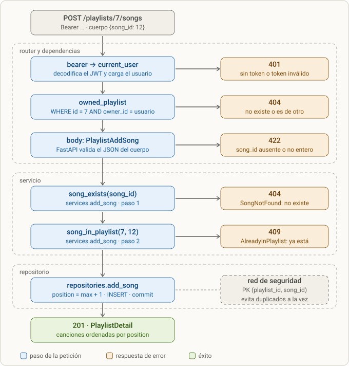
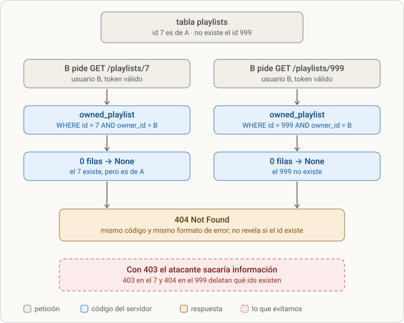
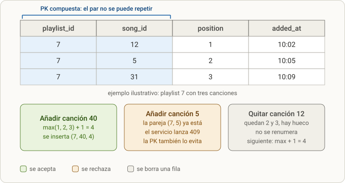

# Lección 6 · Playlists (dueño, orden, 404 para ajenas, 409 y 204)

> **Objetivo:** que cada usuario cree y vea *sus* playlists, les añada y quite canciones en un orden estable, y que una playlist ajena sea indistinguible de una inexistente (404). Aquí se practica la **dependencia con parámetro de ruta** (`owned_playlist`) y se repite la **capa de servicio** donde hay reglas de negocio.

> **Nota de numeración.** En el diálogo esta lección se llamaba "Lección 8" (y el docstring de `tests/test_playlists_api.py` todavía dice "Lección 8"). En estas notas es `lesson-6.md`, el sexto paso de construcción del proyecto. Lo que en el diálogo se llamó "Lección 9" (CORS + React) está en [[lesson-9]].

## 0. Dónde encaja

- Es el **sexto paso de construcción** del README: entorno ([[lesson-1]]) → contrato ([[lesson-2]]) → modelos/semilla ([[lesson-3]]) → autenticación ([[lesson-4]]) → canciones y artistas ([[lesson-5]]) → **playlists** → Dockerfile ([[lesson-7]]).
- **Depende de lo anterior:**
  - `current_user` y `HTTPBearer` de [[lesson-4]] (quién soy).
  - El sobre de errores `{"error": {"code", "message"}}` y los códigos `not_found` / `conflict` / `unauthorized` de [[lesson-5]].
  - `to_out` (antes `_to_out`) de `repositories/songs.py`, que carga géneros y artistas por lotes (evita el N+1) — [[lesson-5]].
  - El patrón *router → servicio → repositorio* y las excepciones propias (`RelatedNotFound`) de [[lesson-5]].
  - El modelo `Playlist` / `PlaylistSong` de [[lesson-3]].
- **Lo que viene después y se apoya en esto:** la agregación `playlist_count` por género de [[lesson-8]] (pandas) cuenta filas de `playlist_songs`; el flujo `curl` del "criterio de hecho" del README ("crear playlist, añadir canción") recorre exactamente estos endpoints.
- **Plan de recortes:** playlists era lo último que se recortaba (orden de recortes: Dockerfile → pandas/NumPy → playlists). Se hizo completa.

## 1. Qué se hizo (resumen)

1. Leí el modelo, el stub y las reglas transversales del README, y escribí **24 tests** en tu repo (`tests/test_playlists_api.py`) divididos en 4 pasos con su filtro `-k`.
2. Los validé con una implementación de referencia en una copia (24 passed, suite completa 115 passed + 1 skipped) y con **8 mutaciones** (rompo una regla a propósito y compruebo que algún test falla).
3. **Paso 1:** crear y listar *mis* playlists (`repositories/playlists.py` nuevo + 2 endpoints).
4. Antes del Paso 2 aparecieron **tres arreglos** en tu repo ajenos a playlists (404 vs 422 en `POST /songs`, `SongCreate` duplicada, test de stubs).
5. **Paso 2:** `owned_playlist` (dependencia con el `playlist_id` de la URL) y el detalle `GET /playlists/{id}`. Dos trazas por pasar el objeto `Playlist` donde iba un id.
6. **Paso 3:** añadir canción con **capa de servicio** (`services/playlists.py`): 404 si la canción no existe, 409 si ya está, posición `max + 1`. Un `NameError` por olvidar `func`.
7. **Paso 4:** quitar canción (`remove_song -> bool`, 204 sin cuerpo, 404 si no estaba). Dos errores en el router (`playlist_repo` vs `playlists_repo`, `playlist=` vs `playlist_id=`).
8. Estado final: **115 passed, 1 skipped**, ruff limpio, `[x] Playlists` marcado en el README. (Con los 4 tests de CORS de [[lesson-9]] son 119 passed, 1 skipped.)

### Contrato que cubre esta lección (README)

| Método y ruta | Auth | Cuerpo | Éxito | Errores |
|---|---|---|---|---|
| `POST /playlists` | sí | `PlaylistsCreate` | 201 `PlaylistOut` | 401, 422 |
| `GET /playlists` | sí | — | 200 `list[PlaylistOut]` (las mías) | 401 |
| `GET /playlists/{playlist_id}` | sí, dueño | — | 200 `PlaylistDetail` | 401, 404 |
| `POST /playlists/{playlist_id}/songs` | sí, dueño | `PlaylistAddSong` | 201 `PlaylistDetail` | 401, 404, 409 ya está |
| `DELETE /playlists/{playlist_id}/songs/{song_id}` | sí, dueño | — | 204 | 401, 404 |

Schemas (en `app/schemas.py`):

| Schema | Campos |
|---|---|
| `PlaylistsCreate` | `name` (no vacío: `Field(min_length=1)`) |
| `PlaylistOut` | `id`, `name`, `created_at` — **sin `owner_id`**, no se expone |
| `PlaylistDetail` | `id`, `name`, `songs: list[SongsOut]` |
| `PlaylistAddSong` | `song_id: int` |

## 2. Paso a paso

### 2.1 Punto de partida

El estado inicial que leí (comando de reconocimiento en tu repo):

```bash
cd $HOME/mnt/fullstack-project-music/backend
sed -n 98,118p ../README.md           # reglas transversales
grep -n "class Playlist" -A12 app/models.py
cat app/routers/playlists.py          # los 5 stubs
grep -n "playlists" tests/test_contract.py
```

**Modelo** (`app/models.py`, creado en [[lesson-3]]):

```python
class Playlist(Base):
    __tablename__ = "playlists"
    id: Mapped[int] = mapped_column(Integer, primary_key=True, nullable=False, unique=True)
    name: Mapped[str] = mapped_column(String, nullable=False)
    owner_id: Mapped[int] = mapped_column(Integer, ForeignKey("users.id"), nullable=False)
    created_at: Mapped[datetime] = mapped_column(DateTime, server_default=func.now())


class PlaylistSong(Base):
    __tablename__ = "playlist_songs"
    playlist_id: Mapped[int] = mapped_column(Integer, ForeignKey("playlists.id"), nullable=False, primary_key=True)
    song_id: Mapped[int] = mapped_column(Integer, ForeignKey("songs.id"), nullable=False, primary_key=True)
    position: Mapped[int] = mapped_column(Integer, nullable=False)
    added_at: Mapped[datetime] = mapped_column(DateTime, server_default=func.now())
```

**Stub inicial del router** (los 5 respondían `501 Not Implemented`, de [[lesson-2]]):

```python
router = APIRouter(prefix="/playlists", tags=["playlists"])

@router.post("", status_code=201, response_model=PlaylistOut)
def create_playlist(body: PlaylistsCreate):
    raise HTTPException(status_code=501, detail="Not implemented")

@router.get("", response_model=list[PlaylistOut])
def get_playlists():
    raise HTTPException(status_code=501, detail="Not implemented")

@router.get("/{playlist_id}", response_model=PlaylistDetail)
def get_playlist(playlist_id: int):
    raise HTTPException(status_code=501, detail="Not implemented")

@router.post("/{playlist_id}/songs", status_code=201, response_model=PlaylistDetail)
def add_song_to_playlist(playlist_id: int, body: PlaylistAddSong):
    raise HTTPException(status_code=501, detail="Not implemented")

@router.delete("/{playlist_id}/songs/{song_id}", status_code=204)
def remove_song_from_playlist(playlist_id: int, song_id: int):
    raise HTTPException(status_code=501, detail="Not implemented")
```

La suite antes de empezar: **92 passed, 1 skipped**. Con el archivo de tests nuevo contra los stubs: **23 failed, 1 passed**.

> 📝 *Inferencia mía:* el único que pasa contra los stubs es casi seguro `test_create_playlist_empty_name_is_422`. FastAPI valida el cuerpo (**422**) **antes** de ejecutar la función, así que el stub `raise 501` nunca llega a correr. Lo mismo explica que, más tarde, `test_add_song_missing_song_id_is_422` aparezca como pasado cuando aún no existía el endpoint. Un 422 de validación no demuestra que tu lógica funcione.

### 2.2 Los diseños acordados (los tests ya los asumen)

| Decisión | Qué significa |
|---|---|
| **Dueño** | `Playlist.owner_id`. Todo endpoint de playlist exige token y mira si la playlist es tuya. |
| **404, no 403** | Una playlist ajena responde **404 igual que una inexistente**. README: "para no confirmar que existe". |
| **Orden por `position`** | Cada canción tiene una `position`. La nueva va al final (`max + 1`). El detalle se ordena por `position`, **no por id de canción**. |
| **Quitar deja hueco** | Quitar una canción **no reordena** el resto (no hay renumeración). |
| **Dependencia con parámetro de ruta** | `owned_playlist` lee `{playlist_id}` de la URL, comprueba que es tuya y la entrega. La reutilizan tres endpoints. |
| **Capa de servicio** | Solo para *añadir canción*, porque ahí hay reglas (existe la canción, no está repetida). Crear y listar no necesitan servicio. |

Plan de la lección (estimado 1 h 45 min – 2 h) y los filtros `-k` que lo dividen:

| Paso | Qué haces | Comando de tests | Esperado | Tiempo |
|---|---|---|---|---|
| 1 | Crear y listar *mis* playlists | `-k "create_playlist or list_playlists"` | 6 passed | 20 min |
| 2 | `owned_playlist` y detalle | `-k "playlist_detail"` | 4 passed | 30 min |
| 3 | Añadir canciones (servicio) | `-k "add_song or artist_playlist_count"` | 9 passed | 35 min |
| 4 | Quitar canciones | `-k "remove_song or remove_then_add"` | 5 passed | 15 min |

> Regla del time-box de todo el entrenamiento: si un paso pasa de ~40 min, pides la solución. En esta lección la pediste en el Paso 3 ("tengo que acelerar un poco este ejercicio, dame las respuestas de b, c y d").

### 2.3 Los tests (`tests/test_playlists_api.py`, 24 tests)

Los escribí yo, tú no los tocas. Ayudantes y fixture del archivo:

```python
PASSWORD = "supersecret1"

def auth_header(client, email="ana@example.com"):
    client.post("/auth/register", json={"email": email, "password": PASSWORD})
    token = client.post("/auth/login", json={"email": email, "password": PASSWORD}).json()["access_token"]
    return {"Authorization": f"Bearer {token}"}

@pytest.fixture
def songs(db_factory):
    """Canciones S1..S4 (todas de Ana; S1 con Beto como featured)."""
    with db_factory() as db:
        db.add_all([models.Genre(id=1, name="Rock"), models.Artist(id=1, name="Ana"), models.Artist(id=2, name="Beto")])
        db.commit()
        db.add_all([models.Song(id=i, title=f"S{i}", duration_s=100 + i, genre_id=1) for i in range(1, 5)])
        db.commit()
        db.add_all([models.SongArtist(song_id=i, artist_id=1, role="main") for i in range(1, 5)])
        db.add(models.SongArtist(song_id=1, artist_id=2, role="featured"))
        db.commit()

def make_playlist(client, headers, name="Mix"):
    return client.post("/playlists", json={"name": name}, headers=headers).json()["id"]

def add(client, headers, playlist_id, song_id):
    return client.post(f"/playlists/{playlist_id}/songs", json={"song_id": song_id}, headers=headers)

def titles(response):
    return [s["title"] for s in response.json()["songs"]]
```

- `auth_header` registra y hace login por la API real (usa lo construido en [[lesson-4]]), y devuelve el header `Authorization: Bearer ...`. Con dos correos distintos (`ana@…`, `beto@…`) se simulan **dos usuarios**, imprescindible para probar propiedad.
- `songs` siembra 4 canciones (S1–S4, todas de Ana; S1 con Beto como *featured*) usando la sesión `db_factory` de `conftest.py` (SQLite en archivo temporal, ver [[lesson-3]]).
- `client` (de `conftest.py`) sustituye `get_db` con `app.dependency_overrides[get_db]`, para que la API use la base temporal y no `data/music.db`.

Qué protege cada grupo:

| Paso | Test | Qué asegura |
|---|---|---|
| 1 | `test_create_playlist_requires_auth` | sin token → 401 con `error.code == "unauthorized"` |
| 1 | `test_create_playlist` | 201; `id == 1`, `name == "Mix"`, `created_at` presente |
| 1 | `test_create_playlist_empty_name_is_422` | `name: ""` → 422 |
| 1 | `test_list_playlists_requires_auth` | `GET /playlists` sin token → 401 |
| 1 | `test_list_playlists_empty` | sin playlists → `[]` (200, no 404) |
| 1 | `test_list_playlists_returns_only_mine` | Ana y Beto crean cada uno; cada uno ve solo las suyas, en orden de creación |
| 2 | `test_playlist_detail_requires_auth` | 401 |
| 2 | `test_playlist_detail_empty` | respuesta exacta `{"id": pid, "name": "Mix", "songs": []}` |
| 2 | `test_playlist_detail_of_unknown_is_404` | `/playlists/99` → 404 `not_found` |
| 2 | `test_playlist_detail_of_someone_else_is_404` | **404 y no 403** |
| 3 | `test_add_song_requires_auth` | 401 |
| 3 | `test_add_song_returns_detail_with_full_song` | 201; la canción trae `genre.name` y `artists` con `role` (main/featured) |
| 3 | `test_add_song_keeps_position_order_not_id_order` | añadir 3, 1, 4 → el detalle sale `["S3","S1","S4"]` (por posición, no por id) |
| 3 | `test_add_song_twice_is_409` | segunda vez → 409 `conflict`, y la playlist sigue con 1 canción |
| 3 | `test_add_song_unknown_song_is_404` | canción 99 → 404, y `"99"` aparece en el mensaje |
| 3 | `test_add_song_to_unknown_playlist_is_404` | playlist 99 → 404 |
| 3 | `test_add_song_to_someone_elses_playlist_is_404` | Beto no puede escribir en la de Ana, **y no se escribió nada** |
| 3 | `test_add_song_missing_song_id_is_422` | body `{}` → 422 |
| 3 | `test_artist_playlist_count_sums_all_users` | `playlist_count` del artista cuenta playlists de *todos* los usuarios, y una playlist con dos canciones del mismo artista cuenta **una vez** → 2 |
| 4 | `test_remove_song_requires_auth` | 401 |
| 4 | `test_remove_song` | 204 con `r.content == b""`; queda solo `["S2"]` |
| 4 | `test_remove_song_not_in_playlist_is_404` | quitar una canción que no está → 404 `not_found` |
| 4 | `test_remove_song_from_someone_elses_playlist_is_404` | Beto no puede quitar nada; la lista de Ana intacta |
| 4 | `test_remove_then_add_appends_at_the_end` | añado 3,1,4; quito 1; añado 2 → `["S3","S4","S2"]` (justifica `max+1`) |

### 2.4 Cómo validé los tests (lado del tutor)

No tocaba tu código: copié el backend a una carpeta temporal (sin `.venv`, caches ni `*.db`), instalé con `uv sync -q` y apliqué una **implementación de referencia**:

```bash
d=$(mktemp -d); mkdir "$d/backend"
tar --exclude=.venv --exclude=__pycache__ --exclude=.pytest_cache --exclude='*.db' -cf - . | tar -xf - -C "$d/backend"
cd "$d/backend" && uv sync -q
uv run pytest -q --no-header -p no:cacheprovider tests/test_playlists_api.py
```

Resultados:

| Comprobación | Resultado |
|---|---|
| Tus tests contra los stubs | 23 failed, 1 passed |
| Con la referencia | **24 passed** |
| `-k` por pasos | Paso 1: 6 · Paso 2: 4 · Paso 3: 9 · Paso 4: 5 (suman 24) |
| Suite completa con referencia (tras borrar `test_stubs_answer_501`) | **115 passed, 1 skipped** |

Un primer intento de suite completa dio "1 error" de colección y un segundo script falló al buscar la carpeta temporal (mi `find` no encontró el directorio; no tocó nada). Lo rehice como un solo comando autocontenido. La causa del "1 error" era el test de stubs de `test_contract.py`, que ya no se cumplía (ver 2.6).

**Las 8 mutaciones** (rompo una regla y compruebo que los tests la detectan):

| Mutación | Resultado |
|---|---|
| `list_playlists` sin filtrar por dueño | 1 failed |
| `get_playlist` sin filtrar por dueño | 3 failed |
| posición = `count + 1` en vez de `max + 1` | 1 failed |
| orden por id de canción en vez de por `position` | 2 failed |
| sin chequeo de duplicada (409) | 1 failed |
| sin chequeo de canción existente (404) | 1 failed |
| `remove` no comprueba pertenencia (borra aunque no esté) | 1 failed |
| detalle sin canciones completas (lista vacía) | 6 failed |

Las 8 sobreviven si los tests son flojos; aquí **las 8 mueren**, es decir, cada regla del contrato está vigilada por al menos un test.

### 2.5 Paso 1 — Crear y listar mis playlists

**Archivo nuevo `app/repositories/playlists.py`** (esqueleto que te di con huecos `...`):

```python
from sqlalchemy import select
from sqlalchemy.orm import Session

from app import models


def create_playlist(db: Session, owner_id: int, name: str) -> models.Playlist:
    playlist = models.Playlist(name=..., owner_id=...)
    db.add(playlist)
    db.commit()
    db....(playlist)             # recarga id y created_at, igual que en create_user
    return playlist


def list_playlists(db: Session, owner_id: int) -> list[models.Playlist]:
    stmt = select(models.Playlist).where(models.Playlist.owner_id == ...).order_by(models.Playlist.id)
    return list(db.scalars(stmt))
```

**Router** (imports + los dos primeros endpoints). Regla: **reemplaza el stub, no lo dejes arriba**: si hay dos funciones con el mismo método y ruta, gana la primera registrada y todo sigue respondiendo 501 (ya te pasó con `/me` y con `POST /songs`).

```python
from fastapi import APIRouter, Depends, HTTPException
from sqlalchemy.orm import Session

from app import models
from app.db import get_db
from app.depends import current_user
from app.repositories import playlists as playlists_repo
from app.schemas import PlaylistAddSong, PlaylistDetail, PlaylistOut, PlaylistsCreate


@router.post("", status_code=201, response_model=PlaylistOut)
def create_playlist(body: PlaylistsCreate, user: models.User = Depends(current_user),
                    db: Session = Depends(get_db)):
    return playlists_repo.create_playlist(db, ..., body.name)


@router.get("", response_model=list[PlaylistOut])
def get_playlists(user: models.User = Depends(current_user), db: Session = Depends(get_db)):
    return playlists_repo.list_playlists(db, ...)
```

**Tu versión (verde):**

```python
def create_playlist(db: Session, owner_id: int, name: str) -> models.Playlist:
    playlist = models.Playlist(name=name, owner_id=owner_id)
    db.add(playlist)
    db.commit()
    db.refresh(playlist)
    return playlist


def list_playlists(db: Session, owner_id: int) -> list[models.Playlist]:
    smtm = select(models.Playlist).where(models.Playlist.owner_id == owner_id).order_by(models.Playlist.id)
    return list(db.scalars(smtm))
```

```python
@router.post("", status_code=201, response_model=PlaylistOut)
def create_playlist(body: PlaylistsCreate, user: models.User = Depends(current_user),
                    db: Session = Depends(get_db)):
    return playlists_repo.create_playlist(db=db, owner_id=user.id, name=body.name)


@router.get("", response_model=list[PlaylistOut])
def get_playlists(user: models.User = Depends(current_user), db: Session = Depends(get_db)):
    return playlists_repo.list_playlists(db=db, owner_id=user.id)
```

Observación menor: la variable `smtm` es un typo de `stmt`; funciona igual.

**Comprobación (siempre en este orden, ruff primero porque tarda un segundo):**

```bash
cd backend
uvx ruff check --select F,E9 app tests      # nombres sin definir, imports sobrantes
uv run python -c "import app.main"           # imports rotos
uv run pytest tests/test_playlists_api.py -k "create_playlist or list_playlists" -q
```

Esperado: **6 passed**. Tu mensaje: "tenemos verde".

### 2.6 Tres arreglos que aparecieron antes del Paso 2

Al validar el Paso 2 sobre tu repo corrí la **suite completa** y no estaba en verde aunque los 6 del Paso 1 pasaran: `4 failed, 88 passed, 1 skipped` (ignorando el archivo de playlists) y ruff con 1 aviso. Eran tres cosas, ninguna de playlists:

| # | Síntoma | Causa | Arreglo |
|---|---|---|---|
| 1 | `test_create_song_unknown_genre_is_404`, `…unknown_artist_is_404`, `test_failed_create_leaves_no_song_behind`: `assert 422 == 404` | En `routers/songs.py`, `except songs_service.RelatedNotFound` levantaba `HTTPException(status_code=422, …)` | Cambiar a `404`. El contrato dice 404 (`not_found`) cuando el género/artista no existe; el 422 es para un cuerpo mal formado |
| 2 | Ruff `F811 Redefinition of unused SongCreate` (`schemas.py:97`) | `SongCreate` estaba definida **dos veces** (línea 55 sin validador; línea 97 con `@field_validator("artists")`). La segunda pisaba a la primera, por eso el validador funcionaba | Borrar la segunda y meter el validador dentro de la primera, tras el campo `artists` |
| 3 | `tests/test_contract.py::test_stubs_answer_501` falla | **Error mío.** Te había dicho que dejaras ese test hasta el final de la lección, pero `GET /playlists` ya no es un stub (devuelve 401 sin token), así que falla desde el Paso 1 | Borrar la función **entera**. Si dejas solo el comentario, la función queda sin cuerpo → `SyntaxError` y toda la suite deja de cargar |

> En tu repo final el test está **comentado** (`#def test_stubs_answer_501(): …`) en lugar de borrado. Funciona igual (la suite carga y pasa); es solo menos limpio.

También anoté que en `list_songs` seguía el bloque muerto `if songs is None or []: raise 404 "No songs found"`: nunca se cumple (la expresión `songs is None or []` es siempre falsa/vacía) y contradice el contrato (lista vacía = 200 `[]`). Se cerró al final de la lección (ver 2.10).

Tras los tres arreglos: **91 passed, 1 skipped** (suite sin el archivo de playlists) y ruff limpio.

### 2.7 Paso 2 — `owned_playlist` y el detalle

**La idea.** Los tres endpoints que llevan `{playlist_id}` (detalle, añadir, quitar) necesitan lo mismo: *"carga la playlist, pero solo si es mía; si no, 404"*. En vez de repetirlo tres veces se convierte en una **dependencia que lee el parámetro de la URL**. Como su parámetro se llama igual que el de la ruta (`playlist_id`), FastAPI lo rellena solo desde la URL.

**A. `repositories/songs.py`: renombrar `_to_out` → `to_out`** (la definición y su uso en `list_songs`). El guion bajo significa "interno de este módulo"; ahora lo importa otro módulo, así que pasa a ser público.

**B. `repositories/playlists.py`**: añadir `from app.repositories import songs as songs_repo`, y:

```python
def get_playlist(db: Session, playlist_id: int, owner_id: int) -> models.Playlist | None:
    stmt = select(models.Playlist).where(
        models.Playlist.id == playlist_id, models.Playlist.owner_id == ...
    )
    return db.scalar(stmt)


def get_detail(db: Session, playlist: models.Playlist) -> dict:
    stmt = (
        select(models.Song)
        .join(models.PlaylistSong, models.PlaylistSong.song_id == models.Song.id)
        .where(models.PlaylistSong.playlist_id == playlist.id)
        .order_by(models.PlaylistSong....)      # ¿por qué columna se ordena una playlist?
    )
    songs = list(db.scalars(stmt))
    return {"id": playlist.id, "name": playlist.name, "songs": songs_repo.to_out(db, songs)}
```

**C. `depends.py`**: import del repositorio y la dependencia:

```python
def owned_playlist(
    playlist_id: int,
    user: models.User = Depends(current_user),
    db: Session = Depends(get_db),
) -> models.Playlist:
    playlist = playlists_repo.get_playlist(db, playlist_id, user.id)
    if playlist is None:
        raise HTTPException(status_code=..., detail=f"Playlist {playlist_id} not found")
    return playlist
```

**D. Router**: `from app.depends import current_user, owned_playlist` y:

```python
@router.get("/{playlist_id}", response_model=PlaylistDetail)
def get_playlist(playlist: models.Playlist = Depends(owned_playlist), db: Session = Depends(get_db)):
    return playlists_repo.get_detail(db, playlist)
```

**Qué mirar:**

- El endpoint **ya no declara `playlist_id`**: lo recibe `owned_playlist` desde la URL y te entrega la playlist ya cargada. Tu función trabaja con el objeto.
- Una playlist **ajena y una inexistente dan el mismo 404**: el filtro `owner_id == user.id` hace que, para la consulta, la de otro simplemente no exista. Es la regla del README.
- **El 401 sale gratis**: `owned_playlist` depende de `current_user`; sin token se corta antes de buscar nada.
- **`current_user` y `get_db` se resuelven una sola vez por petición** aunque varias dependencias los pidan (caché de dependencias por petición).

Comprobación:

```bash
uvx ruff check --select F,E9 app tests
uv run python -c "import app.main"
uv run pytest tests/test_playlists_api.py -k "playlist_detail" -q          # 4 passed
uv run pytest -q --ignore=tests/test_playlists_api.py                      # en verde
```

#### Las dos trazas del Paso 2

Primero fallaba **1 de los 4** (`attachment 2f96eb3e`: "¿qué significa este error?"). El mensaje final era:

```
SQL expression element or literal value expected, got <app.models.Playlist object>
```

Las dos líneas **tuyas** de la traza (las que empiezan por `app/`) eran lo único que importaba:

```
app/routers/playlists.py:27    → playlists_repo.get_detail(db=db, playlist_id=playlist_id)
app/repositories/playlists.py:36 → .where(models.PlaylistSong.playlist_id == playlist_id)
```

**Diagnóstico:** en tu router la variable `playlist_id` **no contenía un id**, contenía lo que devuelve `Depends(owned_playlist)`: la playlist cargada (un objeto). SQLAlchemy comparaba la columna entera `playlist_id` con un objeto `Playlist` y no sabe convertirlo. Las anotaciones de tipo (`: int`) **no se comprueban en ejecución**, por eso Python no avisó.

Por qué fallaba 1 de 4: los otros tres (sin token, ajena, inexistente) cortan en la dependencia con 401/404 y nunca llegan a `get_detail`; solo el caso que sí encuentra la playlist ejecuta esa línea.

**Arreglo:** nombre coherente con el contenido (`playlist`, no `playlist_id`) y pasar el objeto; en el repositorio usar `playlist.id`. (Alternativa válida pero peor: dejar `get_detail(db, playlist_id)` y pasar `playlist.id`; funciona, pero el repositorio re-consultaría algo que `owned_playlist` ya cargó.)

Segunda traza (`attachment 663e0865`: "¿qué significa esta traza?"). El router ya estaba bien (`get_detail(db=db, playlist=playlist)`), pero en el repositorio quedaba:

```
app/repositories/playlists.py:36 → .where(models.PlaylistSong.playlist_id == playlist)
```

Faltaba `.id`: `== playlist.id`. Y revisar también el `return` de `get_detail`: debe usar `playlist.id` y `playlist.name`. Tras eso: **4 passed**, "listo, estamos en verde".

**Estado de `get_detail` y `to_out` en tu código final** (con tus argumentos con nombre):

```python
def get_detail(db: Session, playlist: models.Playlist) -> dict:
    stmt = (
        select(models.Song)
        .join(models.PlaylistSong, models.PlaylistSong.song_id == models.Song.id)
        .where(models.PlaylistSong.playlist_id == playlist.id)
        .order_by(models.PlaylistSong.position)
    )
    songs = list(db.scalars(stmt))
    return {
        "id": playlist.id,
        "name": playlist.name,
        "songs": songs_repo.to_out(db=db, songs=songs)
    }
```

### 2.8 Paso 3 — Añadir canciones (con capa de servicio)

Estado al empezar: tu suite limpia (**91 passed, 1 skipped**), ruff sin avisos, los 11 tests de playlists que ya tocaban pasaban (los 6 del Paso 1, los 4 del Paso 2 y `test_add_song_missing_song_id_is_422`, que pasa por el 422 de validación antes del stub — ver 2.1). Faltaban 13.

**Qué pide el Paso 3.** `POST /playlists/{id}/songs` con `{"song_id": N}`:

- **201** con el detalle de la playlist; la canción nueva va al final.
- **404** si la canción no existe (el mensaje debe incluir el id: `"99" in message`).
- **409** si la canción ya está en la playlist.
- **404** si la playlist es ajena o no existe (ya lo resuelve `owned_playlist`).



*Figura 1 · Por dónde pasa `POST /playlists/7/songs` y dónde nace cada código de estado.*

**Cómo leerlo.**

- Se lee de arriba abajo. La petición se detiene en la **primera** caja que falla, y la caja ámbar de esa fila es la respuesta. Si las pasa todas, llega al `201`.
- **Zona "router y dependencias":** `bearer → current_user` y `owned_playlist` son dependencias (`Depends`), y FastAPI las ejecuta *antes* de mirar el cuerpo. Por eso el orden real es **401 → 404 → 422**: con un cuerpo inválido y sin token recibes 401, y con un cuerpo inválido en una playlist ajena recibes 404. 📝 *Lo comprobé al redactar esta figura con un FastAPI mínimo; no se hizo en clase.*
- **Zona "servicio":** `services.add_song` hace las dos comprobaciones de negocio. No devuelve códigos HTTP: lanza `SongNotFound` y `AlreadyInPlaylist`, y el `try/except` del router las traduce a 404 y 409. Las consultas (`song_exists`, `song_in_playlist`) son funciones de repositorio, pero las llama el servicio.
- **Zona "repositorio":** `add_song` solo hace SQL: calcula `position = max + 1`, inserta y hace `commit`. La caja punteada recuerda que la PK `(playlist_id, song_id)` es la red de seguridad si dos peticiones pasan el `if` a la vez (ver 3.8). Hoy ese caso no se traduce a 409 y acabaría en un error del servidor.
- Los dos 404 se parecen pero nacen en sitios distintos. El de `owned_playlist` habla de la **playlist** y sale de una dependencia. El de `SongNotFound` habla de la **canción** y sale del servicio; el test exige que su mensaje incluya el id (`"99" in message`).

Hay **dos reglas de negocio** (existe, no está repetida) → **capa de servicio**, como `services/songs.py`: el router solo traduce a HTTP.

**A. `repositories/songs.py`**: `song_exists(db, song_id) -> bool`, copia de `genre_exists` con `models.Song`:

```python
def song_exists(db: Session, song_id: int) -> bool:
    return db.get(models.Song, song_id) is not None
```

**B. `repositories/playlists.py`** (esqueleto con huecos que te di primero):

```python
def song_in_playlist(db: Session, playlist_id: int, song_id: int) -> bool:
    # la PK de PlaylistSong es compuesta: db.get acepta una tupla
    return db.get(models.PlaylistSong, (..., ...)) is not None


def add_song(db: Session, playlist_id: int, song_id: int) -> None:
    last = db.scalar(
        select(func.max(models.PlaylistSong....))
        .where(models.PlaylistSong.playlist_id == ...)
    )
    # playlist vacía → max devuelve None
    db.add(models.PlaylistSong(playlist_id=playlist_id, song_id=song_id, position=...))
    db.commit()
```

**C. `services/playlists.py`** (archivo nuevo):

```python
from sqlalchemy.orm import Session

from app import models
from app.repositories import playlists as playlists_repo
from app.repositories import songs as songs_repo


class SongNotFound(Exception):
    """La canción no existe."""


class AlreadyInPlaylist(Exception):
    """La canción ya está en la playlist."""


def add_song(db: Session, playlist: models.Playlist, song_id: int) -> dict:
    if not songs_repo.song_exists(db, song_id):
        raise SongNotFound(f"Song {song_id} not found")
    if playlists_repo.song_in_playlist(db, playlist.id, song_id):
        raise AlreadyInPlaylist(f"Song {song_id} is already in playlist {playlist.id}")
    playlists_repo.add_song(db, playlist.id, song_id)
    return playlists_repo.get_detail(db, playlist)
```

**D. Router**: `from app.services import playlists as playlists_service` y:

```python
@router.post("/{playlist_id}/songs", status_code=201, response_model=PlaylistDetail)
def add_song_to_playlist(
    body: PlaylistAddSong,
    playlist: models.Playlist = Depends(owned_playlist),
    db: Session = Depends(get_db),
):
    try:
        return playlists_service.add_song(db, playlist, body.song_id)
    except playlists_service.SongNotFound as e:
        raise HTTPException(status_code=404, detail=str(e))
    except playlists_service.AlreadyInPlaylist as e:
        raise HTTPException(status_code=409, detail=str(e))
```

Tras pedirme "las respuestas de b, c y d" te di B, C y D completos (la referencia validada), recordando que necesitabas también A (`song_exists`) y que `last or 0` cubre la playlist vacía, donde `max` devuelve `None`.

**Qué mirar (explicado en clase):**

- La posición es **`max + 1`, no `count + 1`**. El Paso 4 quita canciones y deja huecos; con `count` podrías repetir posiciones. Si quitas la canción de la posición 2 de `[1,2,3]` y calculas la siguiente con `count + 1 = 3`, choca con la posición 3 que ya existe. Por eso el test se llama `keeps_position_order_not_id_order` y `remove_then_add` lo justifica.
- El **servicio no importa FastAPI**: lanza excepciones propias y el router decide el código HTTP (mismo patrón que `RelatedNotFound` en `songs.py`).
- `test_artist_playlist_count_sums_all_users` pasa solo cuando funciona el POST. Tu `get_stats` de [[lesson-5]] ya contaba `distinct(playlist_id)`:

  ```python
  playlist_count = db.scalar(
      select(func.count(distinct(models.PlaylistSong.playlist_id)))
      .select_from(models.PlaylistSong)
      .join(models.SongArtist, models.SongArtist.song_id == models.PlaylistSong.song_id)
      .where(models.SongArtist.artist_id == artist_id)
  )
  ```

  Dos canciones de Ana en la **misma** playlist cuentan una sola vez; las playlists de otros usuarios se suman, pero sin revelar de quién son (regla del README).
- **Para la entrevista:** "comprobar y luego insertar" tiene una **condición de carrera** si dos peticiones llegan a la vez. La garantía real es la **PK compuesta `(playlist_id, song_id)`**. El `if` da el 409 amable; la PK evita el duplicado de verdad.

Comprobación:

```bash
cd backend
uvx ruff check --select F,E9 app tests
uv run python -c "import app.main"
uv run pytest tests/test_playlists_api.py -k "add_song or artist_playlist_count" -q   # 9 passed
uv run pytest tests/test_playlists_api.py -k "not remove" -q                          # 19 passed
```

#### El error de este paso: `NameError: name 'func' is not defined`

Tu mensaje: "están fallando 4 tests, ¿qué corrijo?". Corrí los tests y ruff sobre una copia de tu repo:

```
E   NameError: name 'func' is not defined       (app/repositories/playlists.py:55)
FAILED test_add_song_returns_detail_with_full_song
FAILED test_add_song_keeps_position_order_not_id_order
FAILED test_add_song_twice_is_409
FAILED test_artist_playlist_count_sums_all_users
4 failed, 5 passed
```

Y ruff ya lo marcaba: `F821 Undefined name 'func'`. **Causa:** usabas `func.max(...)` en `add_song`, pero la primera línea del archivo seguía siendo `from sqlalchemy import select`. **Arreglo:** `from sqlalchemy import func, select`. Los 4 que fallaban son los que llegan a `add_song` (los que añaden una canción de verdad); los otros 5 cortan antes con 401/404.

Lección: **corre ruff antes que pytest**, tarda un segundo y este error lo habría dado sin ejecutar nada.

Tu resultado: 9 passed. Tu mensaje: "creo que ya he entendido la lógica de estos asuntos. Evidentemente tendremos que validar los conceptos más adelante" y me pediste un reporte del entrenamiento. En ese momento: **lección 3 de 4 pasos hechos, 110 de 115 tests en verde**, los 5 que faltaban eran los del Paso 4.

### 2.9 Paso 4 — Quitar canciones

`DELETE /playlists/{id}/songs/{song_id}` debe responder **204 sin cuerpo**; **404** si la canción no está en esa playlist (y también si la playlist es ajena: lo cubre `owned_playlist`); **401** sin token.

**Repositorio** (con huecos primero):

```python
def remove_song(db: Session, playlist_id: int, song_id: int) -> bool:
    link = db.get(models.PlaylistSong, (..., ...))
    if link is None:
        return False
    db.delete(link)
    db.commit()
    return True
```

**Router** (reemplaza el stub):

```python
@router.delete("/{playlist_id}/songs/{song_id}", status_code=204)
def remove_song_from_playlist(
    song_id: int,
    playlist: models.Playlist = Depends(owned_playlist),
    db: Session = Depends(get_db),
):
    if not playlists_repo.remove_song(db, playlist.id, song_id):
        raise HTTPException(status_code=..., detail=f"Song {song_id} is not in playlist {playlist.id}")
```

La función **no devuelve nada**; con `status_code=204` FastAPI responde sin cuerpo.

#### Cinco fallos que "no eran bugs"

Tu mensaje: "revisa el estado del repositorio y cuéntame de dónde vienen los 5 errores". Resultado: `5 failed, 110 passed, 1 skipped`, ruff limpio. Eran exactamente los 5 tests del Paso 4, que aún no tenían código:

| Test | Espera | Recibe |
|---|---|---|
| `remove_song_requires_auth` | 401 | 501 |
| `remove_song` | 204 | 501 |
| `remove_song_not_in_playlist_is_404` | 404 | 501 |
| `remove_song_from_someone_elses_playlist_is_404` | 404 | 501 |
| `remove_then_add_appends_at_the_end` | `['S3','S4','S2']` | `['S3','S1','S4','S2']` |

El último es el más ilustrativo: como el `DELETE` no borra nada (sigue siendo el stub), la canción 1 sigue en la playlist y la lista sale con una de más. El `DELETE` seguía siendo el stub y `remove_song` no existía en el repositorio. (Nota: no pude consultar git desde la carpeta montada, así que no revisé qué había sin commitear.)

#### Tu primer intento de router

```python
@router.delete("/{playlist_id}/songs/{song_id}", status_code=204)
def remove_song(playlist: models.Playlist = Depends(owned_playlist), db: Session = Depends(get_db)):
    try:
        playlist_repo.remove_song(playlist)
    except Exception as e:
        raise HTTPException(status_code=204, detail="Song not found in playlist")
    return None
```

"¿Estará esto bien?" — **No**. Cuatro problemas, los dos primeros impiden que funcione:

1. **Falta `song_id` en los parámetros.** `playlist_id` lo consume `owned_playlist`, pero `song_id` hay que declararlo en la función; si no, el endpoint no sabe qué canción quitar.
2. **La llamada al repositorio no coincide.** `playlist_repo` no existe (el módulo se importa como `playlists_repo`, con *s*) y la función necesita tres argumentos `(db, playlist.id, song_id)`.
3. **`except Exception` esconde el fallo.** El `NameError` por el nombre mal escrito caería en tu `except` y el endpoint respondería "Song not found" siempre, sin decir nada del error real. Además "la canción no estaba en la playlist" **no es una excepción, es un resultado esperado**: por eso `remove_song` devuelve `bool` y se decide con un `if`.
4. **El código del error es `204`, debe ser `404`.** Un 204 significa "OK, sin contenido" y **no puede llevar cuerpo**; no es un código de error. El test espera 404 con `error.code == "not_found"`.

(Y `return None` sobra: una función sin `return` ya devuelve `None`.)

#### Segunda vuelta: "aún tenemos dos errores"

Resultado: `3 failed, 112 passed, 1 skipped`, y ruff: `F821 Undefined name 'playlist_repo'`. Tu línea 54:

```python
if not playlist_repo.remove_song(db=db, playlist=playlist, song_id=song_id):
```

Dos errores en una línea:

1. **El nombre del módulo:** `playlists_repo` (con *s*), como lo importas arriba. Ruff lo marca (`F821`) y es el `NameError` de los tres tests.
2. **El argumento no coincide:** pasas `playlist=playlist`, pero tu `remove_song` recibe `playlist_id` (un entero). **Ruff no detecta esto**; habría salido como `TypeError: unexpected keyword argument 'playlist'` al arreglar el primero.

Línea correcta: `playlists_repo.remove_song(db=db, playlist_id=playlist.id, song_id=song_id)`. El repositorio estaba bien. Los dos tests que ya pasaban (`requires_auth` y `from_someone_elses_playlist`) cortan antes en `current_user` / `owned_playlist` y nunca llegan a esa línea.

Tu mensaje: "tenemos verde". Verificación mía: **115 passed, 1 skipped**, ruff limpio.

### 2.10 Cierre de la lección

Tareas de cierre que te di:

1. Marcar `Playlists` en el README (`- [x] Playlists`; ya está marcado).
2. Hacer tu commit (los commits los haces tú).
3. En `routers/songs.py` (líneas 31–32) borrar el `if songs is None or []: raise 404`, que contradice el contrato (lista vacía = 200 `[]`; React lo necesita para mostrar "no hay canciones"). Más adelante (ver [[lesson-9]]) quedó solo `songs = songs_repo.list_songs(...)`.

**Estado final del código de playlists en tu repo** (tal como lo escribiste):

`routers/playlists.py`:

```python
router = APIRouter(prefix="/playlists", tags=["playlists"])


@router.post("", status_code=201, response_model=PlaylistOut)
def create_playlist(body: PlaylistsCreate, user: models.User = Depends(current_user),
                    db: Session = Depends(get_db)):
    return playlists_repo.create_playlist(db=db, owner_id=user.id, name=body.name)


@router.get("", response_model=list[PlaylistOut])
def get_playlists(user: models.User = Depends(current_user), db: Session = Depends(get_db)):
    return playlists_repo.list_playlists(db=db, owner_id=user.id)


@router.get("/{playlist_id}", response_model=PlaylistDetail)
def get_playlist(
    playlist: models.Playlist = Depends(owned_playlist),
    db: Session = Depends(get_db)
):
    return playlists_repo.get_detail(db=db, playlist=playlist)


@router.post("/{playlist_id}/songs", status_code=201, response_model=PlaylistDetail)
def add_song_to_playlist(
    body: PlaylistAddSong,
    playlist: models.Playlist = Depends(owned_playlist),
    db: Session = Depends(get_db),
):
    try:
        return playlists_service.add_song(db, playlist, body.song_id)
    except playlists_service.SongNotFound as e:
        raise HTTPException(status_code=404, detail=str(e))
    except playlists_service.AlreadyInPlaylist as e:
        raise HTTPException(status_code=409, detail=str(e))


@router.delete("/{playlist_id}/songs/{song_id}", status_code=204)
def remove_song_from_playlist(
    song_id: int,
    playlist: models.Playlist = Depends(owned_playlist),
    db: Session = Depends(get_db)
):
    if not playlists_repo.remove_song(db=db, playlist_id=playlist.id, song_id=song_id):
        raise HTTPException(status_code=404, detail=f"Song {song_id} is not in playlist {playlist.id}")
```

`depends.py` (la parte nueva; tu repo renombró la función del repositorio a `get_playlists`):

```python
def owned_playlist(
    playlist_id: int,
    user: models.User = Depends(current_user),
    db: Session = Depends(get_db)
) -> models.Playlist:
    playlist = playlists_repo.get_playlists(db=db, playlist_id=playlist_id, owner_id=user.id)
    if playlist is None:
        raise HTTPException(status_code=404, detail=f"Playlist {playlist_id} not found for user {user.id}")
    return playlist
```

`repositories/playlists.py` (versión final completa):

```python
from sqlalchemy import select, func
from sqlalchemy.orm import Session

from app import models
from app.repositories import songs as songs_repo


def create_playlist(db: Session, owner_id: int, name: str) -> models.Playlist:
    playlist = models.Playlist(name=name, owner_id=owner_id)
    db.add(playlist)
    db.commit()
    db.refresh(playlist)
    return playlist


def list_playlists(db: Session, owner_id: int) -> list[models.Playlist]:
    smtm = select(models.Playlist).where(models.Playlist.owner_id == owner_id).order_by(models.Playlist.id)
    return list(db.scalars(smtm))


def get_playlists(db: Session, playlist_id: int, owner_id: int) -> models.Playlist | None:
    stmt = select(models.Playlist).where(
        models.Playlist.id == playlist_id, models.Playlist.owner_id == owner_id
    )
    return db.scalar(stmt)


def get_detail(db: Session, playlist: models.Playlist) -> dict:
    ...  # (ver 2.7)


def song_in_playlist(db: Session, playlist_id: int, song_id: int) -> bool:
    return db.get(models.PlaylistSong, (playlist_id, song_id)) is not None


def add_song(db: Session, playlist_id: int, song_id: int) -> None:
    last = db.scalar(
        select(func.max(models.PlaylistSong.position))
        .where(models.PlaylistSong.playlist_id == playlist_id)
    )
    db.add(models.PlaylistSong(
        playlist_id=playlist_id,
        song_id=song_id,
        position=(last or 0) + 1,
    ))
    db.commit()


def remove_song(db: Session, playlist_id: int, song_id: int) -> bool:
    link = db.get(models.PlaylistSong, (playlist_id, song_id))
    if link is None:
        return False
    db.delete(link)
    db.commit()
    return True
```

Observaciones sobre las diferencias con la referencia (no son errores):

- La función del repositorio se llama `get_playlists` (en plural) en tu versión; la referencia la llamaba `get_playlist`. Devuelve **una** playlist (o `None`); el nombre en plural confunde un poco. Si algún día lo renombras, cambia también la llamada de `depends.py`.
- Usas argumentos con nombre (`db=db, owner_id=...`) en todas las llamadas: más verboso pero a prueba de intercambiar argumentos de orden.
- `depends.py` importa `playlists_repo` arriba del archivo. No hay import circular porque los repositorios no importan `depends`.
- El mensaje 404 de `owned_playlist` dice `... not found for user {user.id}`. Los tests solo comprueban el código y `error.code`, así que pasa; fíjate en que, aun así, **no revela si la playlist existe para otro usuario**: el mensaje es el mismo para ajena e inexistente.

## 3. Conceptos enseñados

### 3.1 Relación N–M con tabla asociativa y **clave primaria compuesta**

- Una playlist tiene muchas canciones y una canción está en muchas playlists → relación **muchos a muchos**, que se modela con una tabla intermedia: `playlist_songs`.
- Su clave primaria es el **par `(playlist_id, song_id)`**: cada pareja aparece como máximo una vez. Dos columnas con `primary_key=True` en SQLAlchemy forman una PK compuesta.
- La tabla además lleva **atributos propios de la relación**: `position` (orden dentro de esa playlist) y `added_at`. Por eso no basta con una relación `secondary=` sin más: es un *objeto de asociación*.
- `db.get(models.PlaylistSong, (playlist_id, song_id))` — para PK compuesta, `Session.get` recibe una **tupla en el orden de las columnas de la PK**. Devuelve el objeto o `None`.
- Ventaja clave: la **unicidad la garantiza la base**, no solo tu `if`. Ver 3.8.
- En el README: tabla `playlist_songs`: "playlist_id → playlists, song_id → songs, position, added_at. PK (playlist_id, song_id)".
- `db.py` activa `PRAGMA foreign_keys=ON` en cada conexión: SQLite **no** aplica claves foráneas por defecto, así que sin eso podrías insertar un `playlist_id` inexistente. Está en `make_engine` ([[lesson-3]]).

### 3.2 Propiedad de un recurso y **404 en vez de 403**

- Autenticación = quién eres (401 si no hay token válido). **Autorización** = qué puedes tocar. Aquí la autorización es "solo el dueño".
- Si la playlist es de otro, la respuesta es **404**, la misma que para una playlist que no existe. Con 403 le confirmarías a un atacante que el id existe (*enumeración de recursos*). README: "Una playlist ajena responde **404**, no 403, para no confirmar que existe".
- Se logra con **un solo filtro en la consulta**: `WHERE id = :playlist_id AND owner_id = :user_id`. Para la consulta, la de otro simplemente no existe; no hay un `if owner != user` aparte que se pueda olvidar (la mutación "get_playlist sin filtrar por dueño" rompe 3 tests).
- Dónde se aplica: `GET /playlists` filtra por `owner_id`; detalle, añadir y quitar pasan por `owned_playlist`.
- Matiz de diseño: el `playlist_count` de un artista **sí** cuenta playlists de todos los usuarios, pero es un agregado que no revela de quién son (README, reglas transversales).



*Figura 2 · Una playlist ajena y una inexistente son indistinguibles.*

**Cómo leerlo.**

- Arriba, el estado de la base: la playlist 7 existe y es de A, y la 999 no existe. El usuario B, con token válido, pide las dos.
- `owned_playlist` no pregunta primero "¿existe?" y después "¿es mía?". Hace **una sola consulta** con las dos condiciones (`WHERE id = :playlist_id AND owner_id = :user_id`). Para esa consulta, la playlist de otro simplemente no existe: en los dos casos devuelve cero filas y `None`.
- Con el mismo `None` solo cabe una respuesta: el mismo 404 con el mismo formato de error. El mensaje (`Playlist {id} not found for user {user.id}`) repite lo que mandó el cliente, nunca algo que dependa de si el id existe.
- El recuadro rojo es lo que **no** hacemos. Con un `if owner != user: 403`, el 7 respondería 403 y el 999 respondería 404, y cualquiera podría recorrer ids para averiguar cuáles existen (enumeración de recursos).
- Qué se rompe si falta el filtro por dueño: la mutación "sin filtrar por dueño" hace fallar 3 tests (ver 3.2).

### 3.3 Identidad: `Depends(current_user)` como **parámetro** frente a `dependencies=[...]`

- `dependencies=[Depends(current_user)]` en el decorador (usado en `POST /artists`, `POST /songs`): solo exige que haya sesión válida; **no te entrega** el usuario.
- `user: models.User = Depends(current_user)` como parámetro: ejecuta lo mismo, **y** te da el objeto. Aquí hace falta porque `user.id` es el dueño de la playlist.
- Regla práctica: si necesitas saber *quién* eres → parámetro; si solo necesitas *permiso* → `dependencies=[...]`.

### 3.4 **Dependencia con parámetro de ruta** (`owned_playlist`)

- Una dependencia es una función que FastAPI ejecuta *antes* de tu endpoint y cuyo resultado te inyecta. Puede tener sus propios parámetros, y FastAPI los resuelve igual que los de un endpoint: de la ruta, la query, el body o **otras dependencias**.
- `owned_playlist(playlist_id: int, user = Depends(current_user), db = Depends(get_db))`: `playlist_id` coincide con `{playlist_id}` de la ruta → se rellena desde la URL. `user` y `db` son sub-dependencias.
- El endpoint declara `playlist: models.Playlist = Depends(owned_playlist)` y **ya no declara `playlist_id`**: recibe el objeto entero. Para que funcione, la ruta debe contener `{playlist_id}` con ese nombre exacto (README: "Los parámetros de ruta se llaman `{artist_id}`, `{song_id}` y `{playlist_id}`" — el contrato fija los nombres precisamente por esto).
- **Cadena de dependencias:** `owned_playlist` → `current_user` → `bearer` (HTTPBearer) + `get_db`. Si cualquier eslabón lanza `HTTPException`, la cadena se corta y el endpoint no se ejecuta: el 401 llega antes que el 404.
- **Caché por petición:** si dos dependencias piden `current_user` (o `get_db`), FastAPI la ejecuta **una sola vez por petición** y comparte el resultado. Así `owned_playlist` y el propio endpoint comparten la misma sesión de base de datos.
- **Reutilización:** tres endpoints (detalle, añadir, quitar) comparten la misma comprobación, escrita una vez.
- **Trampa:** el nombre del parámetro del endpoint (`playlist`) contiene un **objeto**, no un id. Nombrarlo `playlist_id` (como te pasó) confunde y produce el error de 2.7.

### 3.5 Anotaciones de tipo: no se comprueban en ejecución

`playlist_id: models.Playlist` o `: int` no impide pasar cualquier cosa. Python no avisó; falló en SQLAlchemy dos funciones más adentro. Lo que sí detecta estos errores: tests, y herramientas estáticas (mypy), que aquí no usamos. Por eso el nombre de la variable debe decir la verdad.

### 3.6 Leer una traza larga: solo importan **tus** líneas

Una traza de pytest/FastAPI puede tener decenas de líneas de librerías. Filtro práctico:

1. Busca las líneas que empiezan por `app/` (tu código): suelen ser 2–3.
2. Lee el **último mensaje** (`SQLAlchemy... got <app.models.Playlist object>`), que dice *qué* falló.
3. Las dos juntas dicen dónde y por qué. Un error en el repositorio suele nacer en el router que lo llama.

También: en un test que falla con "1 de 4", pregunta *qué tiene de distinto ese caso*. Aquí, es el único que atravesaba las dependencias sin cortarse con 401/404.

### 3.7 Capa de servicio y excepciones propias

- **Cuándo:** si hay reglas de negocio que combinan varias consultas (existe la canción **y** no está repetida **y** calcular la posición). Crear y listar playlists no tienen reglas → van directo router → repositorio.
- **Reparto:**
  - Repositorio: SQL, devuelve datos o `None`/`bool`. No decide HTTP.
  - Servicio: reglas; lanza excepciones propias (`SongNotFound`, `AlreadyInPlaylist`). **No importa FastAPI.**
  - Router: traduce excepciones a HTTP (404, 409).
- Consecuencia: el servicio se puede probar sin servidor ni HTTP, y se reutilizaría desde un worker o una cola.
- **Excepción para lo excepcional, `bool`/`None` para lo esperado:** "no estaba en la playlist" es un resultado normal → `remove_song` devuelve `False`; no se usa `try/except`.

### 3.8 **Condición de carrera "comprobar y luego insertar"**

- `if song_in_playlist(...): raise 409` seguido de `add_song(...)` no es atómico. Dos peticiones simultáneas pueden pasar el `if` a la vez e intentar insertar.
- La **garantía real** es la PK compuesta `(playlist_id, song_id)`: la base rechaza el segundo `INSERT`. El `if` solo sirve para dar un 409 amable en el caso normal.
- 📝 *Extensión no hecha en clase:* en producción se captura `sqlalchemy.exc.IntegrityError` alrededor del `commit` y se traduce a `AlreadyInPlaylist` (409). Hoy, en la carrera, el segundo insert reventaría con un error del servidor.
- 📝 *Matiz adicional (análisis mío, no discutido):* `position = max+1` también tiene su carrera; dos añadidos simultáneos de canciones distintas podrían recibir la misma posición. No hay `UNIQUE (playlist_id, position)`. La PK compuesta protege contra duplicados de canción, no de posición.

### 3.9 `max + 1` frente a `count + 1`, y los **huecos**

- `position` ordena la playlist. La nueva va al final: `max(position) + 1`.
- Con la playlist vacía, `func.max(...)` devuelve `None` (no `0`); por eso `(last or 0) + 1`.
- Quitar una canción deja un **hueco** y no renumera: `[1,2,3]` → quito la 2 → `[1,3]`. Con `count + 1 = 3` la nueva colisionaría con la 3. Con `max + 1 = 4`, no.
- El detalle ordena por `position`, no por id de canción: el orden es el que eligió el usuario (añadir 3, 1, 4 → `S3, S1, S4`).



*Figura 3 · `playlist_songs`: clave primaria compuesta y `position`.*

**Cómo leerlo.**

- La **clave primaria** es el par `(playlist_id, song_id)`, las dos columnas en azul. Una misma canción no puede aparecer dos veces en la misma playlist, pero sí en otras. `position` y `added_at` son atributos de la relación.
- **Añadir la 40:** `position = max(1, 2, 3) + 1 = 4`. En el código es `(last or 0) + 1`: si la playlist está vacía, `max` da `None` y la primera canción queda en 1.
- **Añadir la 5 otra vez:** el servicio ve que `(7, 5)` ya existe y lanza `AlreadyInPlaylist` (409). Si dos peticiones lo intentaran a la vez, la PK rechazaría la segunda inserción.
- **Quitar la 12:** `remove_song` borra solo esa fila y **no renumera**, así que quedan las posiciones 2 y 3. La siguiente canción usa `max + 1 = 4`. Con `count + 1` valdría 3 y repetiría una posición existente; como no hay `UNIQUE (playlist_id, position)`, no daría error, pero el orden quedaría ambiguo.
- Los números y las horas son un ejemplo inventado para el dibujo.

### 3.10 `func.max` y consultas escalares

- `select(func.max(Col)).where(...)` devuelve **una fila con un valor**. `db.scalar(stmt)` recoge justo ese valor (o `None`).
- Se importa `from sqlalchemy import func, select`. Olvidar `func` → `NameError`/`F821`.

### 3.11 `get_detail`: JOIN + `order_by` + **`to_out` reutilizado** (sin N+1)

- La consulta une `Song` con `PlaylistSong` por `song_id`, filtra por `playlist_id` y ordena por `PlaylistSong.position`.
- Después, `songs_repo.to_out(db, songs)` carga **por lotes** los géneros y los artistas de todas las canciones (dos consultas `IN (...)` en total, no una por canción). Es el arreglo del N+1 de [[lesson-5]], reutilizado.
- Por eso `_to_out` se renombró a `to_out` (público): lo importa otro módulo. El guion bajo inicial es convención de "uso interno del módulo".
- `to_out` devuelve `[]` si le pasan una lista vacía, así que el detalle de una playlist vacía es `{"id", "name", "songs": []}`.

### 3.12 `response_model` como filtro de salida

- Devolver el objeto ORM `Playlist` y declarar `response_model=PlaylistOut` hace que FastAPI **solo serialice** `id`, `name`, `created_at`. `owner_id` queda fuera porque el schema no lo declara.
- `PlaylistDetail.songs: list[SongsOut]` incluye género y artistas con su `role`.
- Mismo principio que `password_hash` nunca sale en una respuesta (README).

### 3.13 Códigos HTTP de esta lección

| Código | Cuándo | `error.code` |
|---|---|---|
| 201 | crear playlist; añadir canción (devuelve `PlaylistDetail`) | — |
| 200 | listar, detalle | — |
| **204** | quitar canción: **éxito sin cuerpo** | — |
| 401 | sin token / token inválido | `unauthorized` |
| 404 | playlist ajena o inexistente; canción inexistente; canción no estaba en la playlist | `not_found` |
| 409 | la canción ya está en la playlist | `conflict` |
| 422 | cuerpo mal formado (`name` vacío, falta `song_id`) | `validation_error` |

- **204 No Content** no lleva cuerpo; no es un código de error. Usarlo como código de excepción (`HTTPException(status_code=204)`) es un error de concepto. En FastAPI, `status_code=204` en el decorador y una función que no devuelve nada ya responde sin cuerpo.
- **409 Conflict** = la petición es válida pero choca con el estado actual (ya está). **404** = el recurso referido no existe. **422** = el cuerpo no cumple el schema.

### 3.14 Un stub viejo puede "ganar" a la función real

Si dejas el stub y añades otra función con el mismo método y ruta, FastAPI usa **la primera registrada**: todo sigue respondiendo 501. Se reemplaza el stub, no se añade debajo. (Te pasó con `/me`, `POST /songs`; aquí te lo recordé antes del Paso 1.)

### 3.15 Mutation testing manual (cómo se sabe que un test sirve)

Rompo una regla del código a propósito y compruebo que **algún test falla**. Si todos siguen pasando, ese test no vigila nada. En esta lección: 8 mutaciones, 8 detectadas (tabla en 2.4). Es también un criterio para escribir los tuyos: ¿qué cambio mínimo en el código debería romper este test?

### 3.16 Disciplina de comprobación

Orden de comandos que se repitió en cada paso:

```bash
uvx ruff check --select F,E9 app tests           # 1) nombres no definidos, imports sobrantes (F), errores de sintaxis (E9)
uv run python -c "import app.main"               # 2) que la app importa
uv run pytest tests/test_playlists_api.py -k "..." -q   # 3) los tests del paso
uv run pytest -q                                 # 4) toda la suite
```

- Ruff atrapa `F821` (nombre sin definir: `func`, `playlist_repo`), **pero no** argumentos con nombre equivocados (`playlist=` vs `playlist_id=`) ni nombres de módulo mal escritos *si el nombre mal escrito existe en otro sitio*.
- `-k "texto"` selecciona tests por subcadena del nombre; ojo con subcadenas que coinciden con más tests de los que crees.
- Una suite verde de un archivo **no** es suite verde: por eso corrí siempre la completa (así aparecieron los tres arreglos de 2.6).

### 3.17 Preguntas laterales y respuestas (resumen)

| Tu pregunta / mensaje | Respuesta en una frase |
|---|---|
| "¿Cuánto crees que nos tome esta lección?" (en el reparto del día) | Estimé 1 h 45 min – 2 h, en 4 pasos con tiempos de 20/30/35/15 min |
| "dame las respuestas de b, c y d" | Te di B (repo), C (servicio), D (router) completos; A (`song_exists`) aparte |
| "¿Qué significa este error?" (traza 1) | Pasaste un objeto `Playlist` donde iba un id; la variable se llamaba `playlist_id` pero contenía el objeto |
| "¿Qué significa esta traza?" (traza 2) | Mismo error un paso más adentro: faltaba `.id` en el repositorio |
| "están fallando 4 tests, ¿qué corrijo?" | Falta `func` en el import de SQLAlchemy |
| "dame un reporte de en qué estábamos" | Lección 3/4 pasos, 110/115 tests, tabla de bloques y lista de conceptos a validar |
| "revisa el estado del repo y cuéntame de dónde vienen los 5 errores" | Son los 5 tests del Paso 4: el DELETE seguía siendo el stub |
| "¿estará esto bien?" (DELETE) | No: faltaba `song_id`, nombre/args del repo, `except Exception`, 204 como error |
| "aún tenemos dos errores" | `playlist_repo` → `playlists_repo` y `playlist=` → `playlist_id=` |

## 4. Errores cometidos y diagnóstico

| # | Síntoma / traza | Causa | Arreglo | Lección aprendida |
|---|---|---|---|---|
| 1 | `4 failed` fuera de playlists: `assert 501 == 401` en `test_stubs_answer_501` | **Error del tutor**: dije que lo dejaras hasta el final, pero `GET /playlists` ya no era stub tras el Paso 1 | Borrar la función entera (en tu repo quedó comentada) | Un test que dice "Borrar al terminar" caduca cuando cambia el comportamiento que vigila. Y no se deja una función con solo un comentario (`SyntaxError`) |
| 2 | 3 tests de `test_write_api.py` con `assert 422 == 404` | `routers/songs.py` devolvía `422` cuando género/artista no existía | `status_code=404` | 422 = cuerpo mal formado; 404 = recurso referido inexistente |
| 3 | Ruff `F811` en `schemas.py` | `SongCreate` definida dos veces | Dejar una con el validador dentro | La segunda definición pisa a la primera en silencio; ruff lo ve |
| 4 | `SQL expression element or literal value expected, got <app.models.Playlist object>` (router línea 27 → repo línea 36) | La variable `playlist_id` del router contenía el objeto que devuelve `owned_playlist` | Renombrar a `playlist`, pasar el objeto, usar `playlist.id` en el repo | Nombra las variables por lo que contienen; las anotaciones no se comprueban en ejecución |
| 5 | Misma traza un paso más adentro (`== playlist`) | Faltaba `.id` en el `.where(...)` | `== playlist.id` (y en el `return`) | Comparar una columna con el objeto entero no es una comparación |
| 6 | `NameError: name 'func' is not defined` (4 tests) / `F821` | `from sqlalchemy import select` sin `func` | `from sqlalchemy import func, select` | Ruff antes que pytest |
| 7 | `5 failed` del Paso 4 con `501` | El DELETE seguía siendo el stub y no existía `remove_song` | Escribir repo + router | Un 501 en un test = el endpoint real no está conectado |
| 8 | Router del DELETE: sin `song_id`, `playlist_repo` (sin *s*), un solo arg, `except Exception`, `status_code=204` en el error | Varios descuidos | Versión corregida (2.9) | No atrapes `Exception`; un resultado esperado se decide con `if`; 204 no es un error |
| 9 | `F821 playlist_repo` + (latente) `TypeError: unexpected keyword argument 'playlist'` | Módulo mal escrito y `playlist=` en vez de `playlist_id=` | `playlists_repo.remove_song(db=db, playlist_id=playlist.id, song_id=song_id)` | Ruff no ve argumentos con nombre incorrectos; los ve el test |
| 10 | (Tutor) La suite completa dio "1 error" y el script de mutaciones falló buscando la carpeta temporal | El test de stubs obsoleto; mi `find` de la carpeta temporal no la localizó | Rehice la validación en un solo comando autocontenido | Los scripts de validación deben ser autocontenidos |

Detalles menores: variable `smtm` (typo de `stmt`), `test_stubs_answer_501` comentado en lugar de borrado.

## 5. Cómo se relaciona con el ritme (README · proyecto · entrevista)

**Con el README**

- Contrato (líneas de las 5 rutas de playlists y sus errores) → todas implementadas; `test_contract.py` sigue verificando que existen y declaran 201/204.
- Modelo de datos: "users 1─N playlists 1─N playlist_songs N─1 songs" y la PK compuesta de `playlist_songs`.
- Reglas transversales: *Una playlist ajena responde 404, no 403*; *El `playlist_count` de un artista es un agregado*; *Todos los errores salen con el mismo formato* (el 404/409 de esta lección usan el sobre `{"error": {...}}` del manejador de [[lesson-5]]).
- Orden de construcción: `- [x] Playlists`.
- Criterio de "hecho": el script `curl` recorre "registro, login, crear canción, crear playlist, añadir canción" → `POST /playlists` y `POST /playlists/{id}/songs` son los dos últimos pasos del flujo.

**Con el resto del proyecto**

- [[lesson-4]] te da `current_user`; [[lesson-5]] te da `to_out`, el sobre de errores y el patrón de servicio; [[lesson-3]] el modelo y el `PRAGMA foreign_keys`.
- [[lesson-8]]: `GET /stats/top-genres` calcula `playlist_count` por género a partir de `playlist_songs`; `GET /songs/{id}/similar` es independiente.
- [[lesson-9]]: el frontend consumirá `/auth/login` y, más adelante, llamadas autenticadas con `Bearer`; el 401 con cabecera CORS (test 3 de `test_cors.py`) importa justo por esto.
- [[lesson-7]]: el contenedor deberá exponer estos mismos endpoints; el flujo `curl` completo es la verificación final.

**Con la entrevista**

- Es el caso de uso típico de "endpoints, routers y bases de datos" que mencionó la prueba: CRUD con autenticación, propiedad y reglas de negocio.
- Lo más preguntable de esta lección: autorización por propiedad, 404 vs 403, dependencias de FastAPI, transacciones/unicidad, N–M con atributos, paginación/orden.

## 6. Preguntas de entrevista

1. **¿Por qué una playlist ajena devuelve 404 y no 403?**
   Para no confirmar que existe (evitar enumerar ids). Se consigue filtrando la consulta por `id` **y** `owner_id`; para quien no es el dueño, no existe. Contrapartida: 403 sería más "honesto" semánticamente, pero filtra información.

2. **¿Cómo evitas repetir la comprobación de propiedad en tres endpoints?**
   Con una dependencia (`owned_playlist`) que lee `{playlist_id}` de la URL, valida contra el usuario actual y devuelve el objeto o lanza 404. FastAPI la inyecta y cachea sus sub-dependencias por petición.

3. **¿Qué diferencia hay entre `dependencies=[Depends(x)]` y `param = Depends(x)`?**
   La primera solo ejecuta la dependencia (permiso); la segunda además te entrega su resultado (identidad). Aquí hace falta el usuario, así que parámetro.

4. **¿Por qué `max + 1` y no `count + 1` para la posición?**
   Porque quitar deja huecos. Con `[1,2,3]` quito 2 → `[1,3]`; `count+1 = 3` colisiona, `max+1 = 4` no.

5. **Dos peticiones añaden la misma canción a la vez. ¿Qué pasa?**
   El `if` previo no es atómico; ambas pueden pasarlo. La PK compuesta `(playlist_id, song_id)` hace fallar la segunda inserción; en producción se captura `IntegrityError` y se traduce a 409.

6. **¿Por qué una clave primaria compuesta en `playlist_songs` y no un `id` autoincremental?**
   La pareja *es* la identidad de la fila, y la PK da unicidad gratis. Un id sustituto obligaría a añadir además un `UNIQUE (playlist_id, song_id)`.

7. **¿Cuándo introduces una capa de servicio y cuándo no?**
   Cuando hay reglas que combinan varias lecturas/escrituras y no deben depender de HTTP (añadir canción: existe + no repetida + posición). Para crear/listar, router → repositorio basta.

8. **¿Qué devuelve `DELETE` y por qué 204?**
   Éxito sin cuerpo. Si la canción no estaba, 404. (Matiz: la idempotencia de DELETE se refiere al *estado* del servidor, no al código de respuesta; devolver 404 en el segundo borrado es legítimo y es lo que fija este contrato.)

9. **¿Cómo evitas el N+1 al devolver el detalle con géneros y artistas?**
   Cargo todas las canciones de la playlist en una consulta y luego géneros y artistas con dos `IN (...)` (función `to_out`), en vez de una consulta por canción.

10. **¿Cómo sabes que tus tests sirven?**
    Rompo reglas a propósito (mutaciones) y compruebo que algún test falla. Aquí: sin filtro de dueño, `count+1`, orden por id, sin 409, sin 404 de canción, etc. — 8 de 8 detectadas.

11. **¿Qué ocurre si el cuerpo es `{}`?**
    FastAPI/Pydantic devuelve 422 antes de ejecutar tu función; por eso un test de 422 puede pasar aunque tu lógica no exista.

## 7. Checklist / estado

Conseguido en clase:

- [x] `POST /playlists` y `GET /playlists` (solo las mías)
- [x] `owned_playlist` (dependencia con parámetro de ruta) y `GET /playlists/{id}`
- [x] `POST /playlists/{id}/songs` con servicio (404 canción, 409 repetida, posición `max+1`)
- [x] `DELETE /playlists/{id}/songs/{song_id}` (204 / 404)
- [x] 24 tests de playlists en verde; suite completa **115 passed, 1 skipped** (119 con CORS)
- [x] Ruff (`F,E9`) limpio
- [x] Arreglados: 422→404 en `POST /songs`, `SongCreate` duplicada y `test_stubs_answer_501` (comentado en `test_contract.py`, no borrado)

Estado del repositorio verificado el 24 de octubre:

- [x] README: `- [x] Playlists` marcado en el checklist (línea 141)
- [x] `secrets.txt` ya está en el `.gitignore` (aparece también como `./secrets.txt`)
- [ ] README: borrar las filas duplicadas de `GenreStats` y `SimilarSong` en la tabla de schemas (las líneas 96 y 97 repiten las 94 y 95)
- [ ] (Opcional) borrar del todo el test de stubs comentado: sigue en `test_contract.py` (líneas 56 a 59)
- [ ] (Opcional) renombrar `get_playlists` → `get_playlist` en el repositorio y `smtm` → `stmt`: siguen con los nombres antiguos
- [ ] (Opcional, extensión) capturar `IntegrityError` en `add_song` y traducirlo a 409: hoy `add_song` hace `commit` sin `try/except`
- [ ] Repasar más adelante: dependencias con `yield` y caché por petición, PK compuesta frente a carrera, 404 vs 403 (los conceptos que dijiste que validarías más adelante)

## Diagramas de esta lección

- [Figura 1 · Recorrido de `POST /playlists/{id}/songs`](diagramas/peticion-agregar-cancion.svg): dónde nace cada código de estado (sección 2.8).
- [Figura 2 · Playlist ajena frente a inexistente](diagramas/playlist-ajena-404.svg): por qué 404 y no 403 (sección 3.2).
- [Figura 3 · Tabla `playlist_songs`](diagramas/playlist-songs-tabla.svg): PK compuesta, `position` y huecos (sección 3.9).
