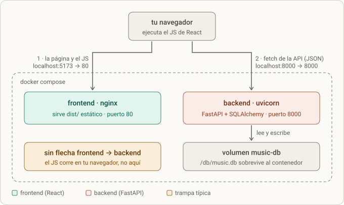
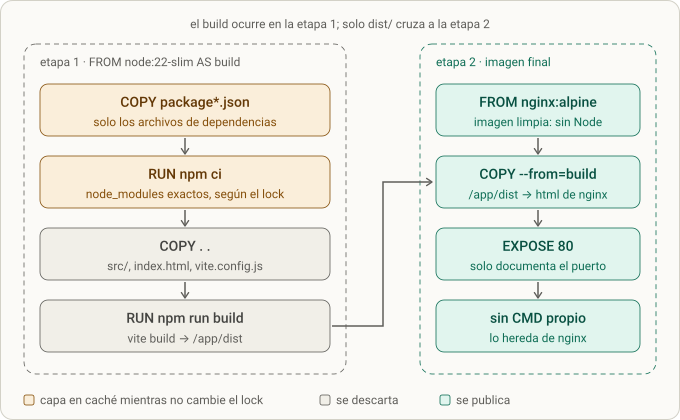
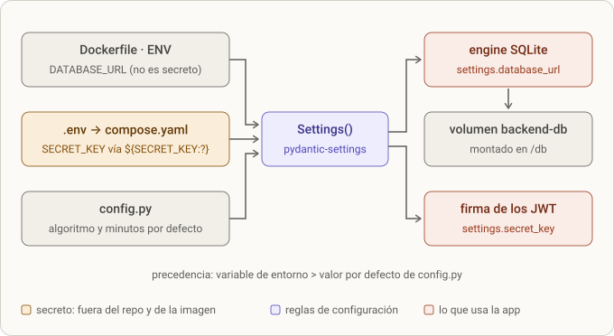

# Lección 7 · Docker: backend, frontend y Compose

> **Objetivo:** empaquetar la API y la interfaz React en dos imágenes y levantar toda la app con **un solo comando** (`docker compose up`). Es el cierre del miniproyecto antes de pasar al diseño de backend (streaming).
>
> **Estado:** la app completa ya levanta con Compose. Faltan por confirmar `scripts/smoke.sh`, el login en el navegador, la persistencia, el README y el commit (ver checklist, sección 8).

## 0. Dónde encaja

- Séptimo y último paso de construcción: entorno ([[lesson-1]]) → contrato ([[lesson-2]]) → modelos ([[lesson-3]]) → autenticación ([[lesson-4]]) → canciones y artistas ([[lesson-5]]) → playlists ([[lesson-6]]) → **Docker**. Las lecciones [[lesson-8]] (pandas/NumPy) y [[lesson-9]] (CORS y React) ya estaban hechas; esta lección las junta en contenedores.
- **Cambio de alcance respecto al README.** El README original decía "un solo Dockerfile al final" y dejaba **Compose fuera de alcance**. A petición tuya lo ampliamos: un Dockerfile para el backend, otro para el frontend y un `compose.yaml`. Por eso hay que actualizar cuatro líneas del README (sección 5).
- Es lo primero que se recortaría si faltara tiempo, pero es de lo que más sale en entrevistas de backend: "¿cómo lo despliegas?".

## 1. Qué se hizo (resumen)

- Antes de empezar se corrigió un detalle de la lección 5: `list_song_rows` ya lleva `.order_by(models.Song.id)` (suite: 153 passed, 1 skipped).
- Se escribió el `backend/Dockerfile` (Python 3.12 slim + uv, sin dependencias de desarrollo, base SQLite en `/db`, siembra y uvicorn en `0.0.0.0`).
- Se escribió el `frontend/Dockerfile` con **build multietapa**: Node construye `dist/`, nginx lo sirve.
- Se escribieron los dos `.dockerignore` y el `compose.yaml` (dos servicios, volumen con nombre, `SECRET_KEY` desde `.env`, healthcheck y `depends_on`).
- Se explicó, línea a línea, la sintaxis de `COPY` (incluido `--from`), `ENV`, `CMD`, la relación entre `mkdir`, `DATABASE_URL` y el volumen, y la interpolación `${SECRET_KEY:?…}`.
- Se encontraron y arreglaron 11 errores reales (sección 4).
- `docker compose up --build` levanta la app completa en tu Mac.



*Figura · los dos contenedores, el volumen y quién habla con quién.*

**Cómo leerlo.**
- El navegador hace **dos** peticiones distintas: primero pide la página y el JavaScript al contenedor `frontend` (puerto 5173 del Mac → 80 del contenedor); después, ya con la página cargada, el JS llama a la API en `localhost:8000`.
- **No hay flecha del frontend al backend.** nginx solo reparte archivos estáticos. El `fetch` lo ejecuta tu navegador, que vive en tu Mac, no dentro de Docker. Por eso la URL de la API sigue siendo `http://localhost:8000` y **no** `http://backend:8000`: ese nombre solo existe dentro de la red de Compose, y el navegador no está en ella.
- La base SQLite vive en un **volumen**, no dentro del contenedor, para que sobreviva a `docker compose down`.

## 2. Paso a paso

### 2.1 Preparación (validada sin Docker)

En el entorno donde preparé la lección no hay demonio de Docker, así que **no pude ejecutar `docker build`**. Para no entregar algo sin probar, simulé cada paso en una copia temporal fuera de tu carpeta:

- instalación del backend sin el grupo dev (`uv sync --frozen --no-dev --no-install-project`);
- semilla idempotente (`python -m app.seed`) y uvicorn en `0.0.0.0`;
- el flujo completo de `curl` (registro, login, `/me`, crear canción, crear playlist, añadir canción, leer playlist);
- `npm ci` y `npm run build` del frontend (`dist/` con `index.html`, un JS y un CSS);
- el healthcheck con `urllib` (`200 {"status":"ok"}`);
- el preflight CORS: desde `http://localhost:5173` responde 200 con `access-control-allow-origin`; desde `http://localhost:8080` responde `400 Disallowed CORS origin`;
- que `compose.yaml` es YAML válido con la estructura esperada.

Lo que **no** pudo comprobarse fue el build real de las imágenes; eso lo confirmaste tú en tu máquina (sección 7).

### 2.2 `backend/Dockerfile`: del esqueleto a la versión final

Esqueleto entregado (4 huecos `???`; en mi primera versión puse `# (n)` al final de línea, y eso **rompe** `COPY` y `CMD`, ver sección 4):

```dockerfile
FROM python:3.12-slim

COPY --from=ghcr.io/astral-sh/uv:latest /uv /bin/uv

ENV UV_COMPILE_BYTECODE=1 \
    UV_LINK_MODE=copy \
    UV_PYTHON_DOWNLOADS=0 \
    PATH="/app/.venv/bin:$PATH" \
    DATABASE_URL=sqlite:////db/music.db

WORKDIR /app

# (1) los dos archivos que definen las dependencias
COPY ??? ./
# (2) instala exactamente lo que dice el lock, sin recalcularlo
RUN uv sync ??? --no-dev --no-install-project

COPY app ./app
COPY data/seed.json ./data/seed.json
# (3) SQLite crea el archivo, no la carpeta
RUN ???

EXPOSE 8000
# (4) el host que escucha en todas las interfaces
CMD ["sh", "-c", "python -m app.seed && exec uvicorn app.main:app --host ??? --port 8000"]
```

**Tu primera versión** acertó el `COPY --from`, el `ENV` y el orden de capas, y se desvió en cuatro puntos:

```dockerfile
DATABASE_URL=sqlite:////app/data/music.db        # base dentro del contenedor
RUN uv sync uv.lock --no-dev --no-install-project  # argumento inválido
RUN uv run python -m app.seed                      # siembra en el build y reinstala dev
CMD [... "--host", "127.0.0.1" ...]                # escucha solo dentro del contenedor
```

**Versión final** (la que funciona):

```dockerfile
FROM python:3.12-slim

COPY --from=ghcr.io/astral-sh/uv:latest /uv /bin/uv

ENV UV_COMPILE_BYTECODE=1 \
    UV_LINK_MODE=copy \
    UV_PYTHON_DOWNLOADS=0 \
    PATH="/app/.venv/bin:$PATH" \
    DATABASE_URL=sqlite:////db/music.db

WORKDIR /app

# archivos que definen las dependencias
COPY pyproject.toml uv.lock ./

# instalación del lock
RUN uv sync --frozen --no-dev --no-install-project

COPY app ./app
COPY data/seed.json ./data/seed.json

RUN mkdir -p /db

EXPOSE 8000

# 0.0.0.0 = escucha en todas las interfaces
CMD ["sh", "-c", "python -m app.seed && exec uvicorn app.main:app --host 0.0.0.0 --port 8000"]
```

`backend/.dockerignore` (creado después de detectar que faltaba):

```
# backend/.dockerignore
.venv
__pycache__/
*.pyc
.pytest_cache/
.ruff_cache/
.DS_Store
.env
data/*.db
tests/
sql/
Dockerfile
.dockerignore
```

Prueba del backend solo, desde la raíz del repo:

```bash
docker build -t music-api ./backend
docker run --rm -p 8000:8000 -e SECRET_KEY=prueba -v music-db:/db music-api
curl localhost:8000/health        # {"status":"ok"}
```

### 2.3 `frontend/Dockerfile`: build multietapa

Esqueleto entregado (3 huecos) y versión final (la tuya, ya funcionando):

```dockerfile
# etapa 1: construir (Node no viajará a la imagen final)
FROM node:22-slim AS build
WORKDIR /app
COPY package.json package-lock.json ./
RUN npm ci
COPY . .
RUN npm run build

# etapa 2: servir solo estáticos
FROM nginx:alpine
COPY --from=build /app/dist /usr/share/nginx/html
EXPOSE 80
```

`frontend/.dockerignore`:

```
# frontend/.dockerignore
node_modules
dist
.DS_Store
Dockerfile
.dockerignore
```



*Figura · build multietapa del frontend.*

**Cómo leerlo.**
- La etapa 1 (izquierda) se llama `build` por el `AS build`. Hace el trabajo pesado y **se descarta**: Node, `node_modules` y el código fuente no llegan a la imagen final.
- Las dos primeras cajas (ámbar) son las capas que Docker reutiliza mientras no cambie `package-lock.json`; por eso se copian **antes** que el código.
- La flecha que cruza es `COPY --from=build /app/dist …`: es lo **único** que pasa de una etapa a la otra. Solo la última etapa se convierte en imagen.
- La etapa 2 no tiene `CMD` propio: hereda de `nginx:alpine` el arranque (`nginx -g 'daemon off;'`). `EXPOSE 80` solo documenta; el mapeo `5173:80` lo hace Compose.

Prueba del frontend solo (desde `frontend/`, el punto final es el contexto):

```bash
docker build -t music-web .
docker run --rm -p 5173:80 music-web
# http://localhost:5173 carga con estilos; la lista de canciones da error porque no hay API: es lo esperado
docker run --rm music-web ls /usr/share/nginx/html   # index.html, assets/, *.svg
```

### 2.4 `compose.yaml`: del esqueleto a la versión final

Esqueleto entregado (5 huecos): `SECRET_KEY: ???`, `- ???:/db`, `- "???:80"`, `condition: ???` y `???:` en `volumes` final.

**Tu primera versión** tenía tres fallos:

```yaml
environment:
  SECRET_KEY: .env.SECRET_KEY     # texto literal, no lee el .env
volumnes:                         # errata (dos veces)
  - backend-db:/db
...
volumnes:                         # y sin declarar backend-db
```

**Versión final** (`compose.yaml` en la raíz):

```yaml
services:
  backend:
    build: ./backend
    ports:
      - "8000:8000"
    environment:
      SECRET_KEY: ${SECRET_KEY:?define SECRET_KEY en el archivo .env}
    volumes:
      - backend-db:/db
    healthcheck:
      test: ["CMD", "python", "-c", "import urllib.request as u; u.urlopen('http://localhost:8000/health')"]
      interval: 5s
      timeout: 3s
      retries: 10

  frontend:
    build: ./frontend
    ports:
      - "5173:80"
    depends_on:
      backend:
        condition: service_healthy

volumes:
  backend-db:
```

`.env` (raíz del repo, ya ignorado por git; solo el nombre de la variable se muestra aquí):

```
SECRET_KEY=<salida de: openssl rand -hex 32>
```

Validación y arranque, desde la raíz:

```bash
grep -c '^SECRET_KEY=' .env      # 1
docker compose config --quiet    # sin salida = archivo válido (no imprime la clave)
docker compose up --build
```

### 2.5 `scripts/smoke.sh` (criterio de "hecho" del README)

Recorre el flujo completo con `curl` contra una API levantada. Guárdalo como `scripts/smoke.sh` en la raíz del repo y dale `chmod +x scripts/smoke.sh`. Probado contra una copia temporal del backend (todos los pasos en `ok`).

```bash
#!/usr/bin/env bash
# Recorre el flujo completo contra una API ya levantada.
# Uso: ./scripts/smoke.sh            (usa http://localhost:8000)
#      BASE=http://localhost:9000 ./scripts/smoke.sh
set -euo pipefail

BASE="${BASE:-http://localhost:8000}"
EMAIL="smoke-$(date +%s)@example.com"
PASSWORD="smoke-password-123"
JSON='Content-Type: application/json'

paso() { echo "ok  $1"; }
falla() { echo "FALLO en '$1': esperaba $2 y llegó $3"; exit 1; }

# status <método> <ruta> <esperado> <paso> [json] [token]  -> deja el cuerpo en $BODY
status() {
  local method=$1 path=$2 esperado=$3 nombre=$4 data=${5:-} token=${6:-}
  local args=(-s -w '\n%{http_code}' -X "$method" "$BASE$path")
  [ -n "$data" ]  && args+=(-H "$JSON" -d "$data")
  [ -n "$token" ] && args+=(-H "Authorization: Bearer $token")
  local out; out=$(curl "${args[@]}")
  local code=${out##*$'\n'}
  BODY=${out%$'\n'*}
  [ "$code" = "$esperado" ] || { echo "$BODY"; falla "$nombre" "$esperado" "$code"; }
  paso "$nombre ($code)"
}

campo() { sed -E "s/.*\"$1\":\"?([^\",}]+)\"?.*/\1/" <<<"$BODY"; }

status GET  /health          200 "health"
status POST /auth/register   201 "registro"       "{\"email\":\"$EMAIL\",\"password\":\"$PASSWORD\"}"
status POST /auth/login      200 "login"          "{\"email\":\"$EMAIL\",\"password\":\"$PASSWORD\"}"
TOKEN=$(campo access_token)

status GET  /me              200 "me"             "" "$TOKEN"
status POST /songs           201 "crear canción"  "{\"title\":\"Smoke $(date +%s)\",\"duration_s\":200,\"genre_id\":1,\"artists\":[{\"artist_id\":1,\"role\":\"main\"}]}" "$TOKEN"
SONG_ID=$(campo id)

status POST /playlists       201 "crear playlist" '{"name":"smoke"}' "$TOKEN"
PLAYLIST_ID=$(campo id)

status POST "/playlists/$PLAYLIST_ID/songs" 201 "añadir canción" "{\"song_id\":$SONG_ID}" "$TOKEN"
status GET  "/playlists/$PLAYLIST_ID"       200 "leer playlist" "" "$TOKEN"

echo "TODO OK: el flujo completo funciona contra $BASE"
```

### 2.6 Verificación final (pendiente de confirmar)

1. `docker compose up --build` y `./scripts/smoke.sh` → debe terminar en `TODO OK`.
2. Registrar un usuario en `http://localhost:8000/docs` (la interfaz solo tiene login) y entrar en `http://localhost:5173`: aparecen las canciones y el login funciona.
3. Persistencia: `docker compose down` y `docker compose up -d`; las canciones creadas siguen ahí. `docker compose down -v` borra también el volumen (empieza de cero desde la semilla). Útil: `docker compose exec backend ls -l /db` y `docker volume ls`.

## 3. Conceptos enseñados

Cada uno empieza por **lo que se rompe sin él**.

### 3.1 Imagen, contenedor y capa

La imagen es una plantilla inmutable hecha de capas; el contenedor es una instancia con una capa escribible encima. *Sin volumen*, todo lo que el contenedor escribe (incluida `music.db`) desaparece al borrarlo.

### 3.2 `FROM` y `slim`

`FROM python:3.12-slim` es la imagen de partida: Debian mínimo con Python 3.12. `slim` omite compiladores y herramientas innecesarias; nos basta porque pandas, numpy y argon2 se instalan desde *wheels* ya compiladas. Todo lo que sigue se apila encima como capas.

### 3.3 `COPY`: la sintaxis

Forma general: `COPY [--from=<origen>] <origen...> <destino>`.

- **Sin `--from`**, copia desde el **contexto de build** (la carpeta que pasas a `docker build`; aquí `./backend` o `./frontend`) a la imagen. No puede salir del contexto (`../algo` no funciona) y el `.dockerignore` filtra lo que se ve.
- **El destino relativo** se resuelve contra el `WORKDIR` (`./` es `/app/`). Con varios orígenes, el destino debe terminar en `/`.
- **Copiar un directorio copia su contenido, no el directorio.** Por eso es `COPY app ./app` (queda `/app/app/main.py`) y no `COPY app ./` (los archivos caerían sueltos en `/app` y `import app` fallaría). El mismo principio explica el error del frontend: `COPY node_modules ./` volcó los paquetes sueltos en `/app`, sin `package-lock.json` (sección 4).
- `COPY data/seed.json ./data/seed.json` copia un archivo suelto y crea `data/` si hace falta.

### 3.4 `COPY --from=ghcr.io/astral-sh/uv:latest /uv /bin/uv`

Con `--from`, el origen deja de ser tu contexto y pasa a ser **otra imagen** o una etapa anterior (en el frontend: `--from=build`). Aquí es la imagen oficial de uv en GitHub Container Registry (`ghcr.io`), que contiene el binario `/uv`. Docker la descarga solo para extraer ese archivo y dejarlo en `/bin/uv`, que ya está en el `PATH`; nuestra imagen no hereda nada más de ella.

- Es una instalación limpia: un solo binario, sin `pip`, en su propia capa cacheada. *Sin esa línea*, `RUN uv sync` falla con `uv: not found`.
- `:latest` cambia con el tiempo; para builds reproducibles se fija el tag de la versión que uses (`uv --version`). Para aprender, `latest` vale.

### 3.5 `ENV` y las variables de uv

`ENV` define variables que existen durante el build y también cuando el contenedor corre. La `\` solo continúa la línea: todo es **una** instrucción y **una** capa.

| Variable | Qué hace | Qué pasa sin ella |
|---|---|---|
| `UV_COMPILE_BYTECODE=1` | uv compila los `.py` a `.pyc` al instalar | Python los compila en la primera importación; como la capa escribible se descarta, se repite en cada arranque |
| `UV_LINK_MODE=copy` | copia los archivos al entorno en vez de crear enlaces duros desde la caché | uv avisa de que no puede enlazar entre sistemas de archivos distintos; aquí es casi cosmético (recomendación de la documentación de uv) |
| `UV_PYTHON_DOWNLOADS=0` | uv no descarga su propio Python; usa el de la imagen | ante un desajuste de versión, descargaría otro Python en silencio y engordaría la imagen |
| `PATH="/app/.venv/bin:$PATH"` | antepone el entorno virtual al `PATH` (`$PATH` se expande al valor anterior) | `python` y `uvicorn` no se encontrarían (el Python del sistema no tiene tus dependencias) y habría que lanzar todo con `uv run` |
| `DATABASE_URL=sqlite:////db/music.db` | `pydantic-settings` la lee y pisa el valor por defecto de `config.py` | la app usaría `sqlite:///./data/music.db`, dentro del contenedor y sin volumen |

Las cuatro barras: `sqlite://` + host vacío + `/` + la ruta. `sqlite:///x.db` es relativa; `sqlite:////db/x.db` es **absoluta** (`/db/x.db`). `DATABASE_URL` se puede escribir en el Dockerfile porque no es secreta; `SECRET_KEY` nunca.

### 3.6 `WORKDIR`

Fija el directorio de trabajo para todo lo que sigue, incluido el `CMD`, y lo crea si no existe. Por eso `./` significa `/app/`.

### 3.7 Orden de capas y caché

Cada instrucción es una capa y Docker reutiliza las que no cambian. *Si haces `COPY . .` antes de instalar*, cada cambio de código reinstala pandas y numpy. Por eso se copian primero solo los archivos de dependencias (`pyproject.toml` + `uv.lock`; `package.json` + `package-lock.json`), se instala, y **luego** el código.

### 3.8 `uv sync` y sus flags; la trampa de `uv run`

- `--frozen`: usa `uv.lock` tal cual, sin recalcularlo. (`uv.lock` **no** es un argumento de `uv sync`: uv lo lee solo.)
- `--no-dev`: salta el grupo de desarrollo (pytest, ruff, httpx2).
- `--no-install-project`: instala solo las dependencias, no tu paquete `backend`. El código aún no está copiado, y así esta capa depende solo de los dos archivos anteriores.
- **`uv run` sincroniza el entorno antes de ejecutar**, incluido el grupo dev. Probado: tras `uv sync --no-dev`, un `uv run python -m app.seed` instaló 9 paquetes y apareció `pytest`. Anula `--no-dev`. Con el `PATH` ya apuntando al venv, basta `python`.

### 3.9 `EXPOSE`

Solo **documenta** que la aplicación usa ese puerto. No abre ni publica nada; lo que publica es `-p 8000:8000` o el `ports:` de Compose.

### 3.10 `RUN` frente a `CMD`

`RUN` se ejecuta **al construir** la imagen y deja una capa. `CMD` es lo que ejecuta el contenedor **al arrancar**; solo vale el último, y se puede sustituir con `docker run imagen otro-comando`.

### 3.11 La sintaxis del `CMD`

```dockerfile
CMD ["sh", "-c", "python -m app.seed && exec uvicorn app.main:app --host 0.0.0.0 --port 8000"]
```

- **La lista con comillas dobles** es la *forma exec*: Docker ejecuta el programa directamente, sin shell, y ese proceso es el PID 1. La alternativa, la *forma shell*, es un texto plano que Docker envuelve en `/bin/sh -c`. En la forma exec no existen `&&`, `$VARIABLES` ni pipes, porque eso lo interpreta un shell.
- **Por qué `sh -c`:** necesitamos encadenar dos comandos. `sh` es el programa, `-c` significa "ejecuta el siguiente texto como comando", y el tercer elemento es ese texto, en **un único** elemento de la lista.
- `python -m app.seed` ejecuta el módulo como script (su bloque `if __name__ == "__main__"`: `create_all` y siembra idempotente). `-m` añade el directorio actual (`/app`) al `sys.path`, y por eso `import app` funciona.
- `&&` ejecuta lo siguiente solo si lo anterior terminó bien: si la siembra falla, el servidor no arranca.
- `exec` **sustituye** el proceso `sh` por uvicorn, que pasa a ser el PID 1. *Sin `exec`*, `sh` suele quedarse de PID 1 sin reenviar la señal de `docker stop`; Docker espera 10 s y mata con SIGKILL.
- `uvicorn app.main:app`: módulo `app.main` (el archivo `app/main.py`), dos puntos, y el objeto `app` (la instancia de FastAPI).
- `--host 0.0.0.0`: escucha en todas las interfaces. *Con `127.0.0.1`*, uvicorn solo escucha dentro del contenedor y el puerto publicado entra en el vacío ("empty reply" / "connection reset"); el log incluso dice `running on http://127.0.0.1:8000`, lo que despista.
- `--port 8000` es el puerto **dentro** del contenedor; el mapeo `8000:8000` lo conecta con tu Mac.
- **Por qué sembrar en el `CMD` y no en un `RUN`:** la base vive en el volumen `/db`, que solo existe cuando el contenedor corre. Una semilla hecha al construir quedaría tapada por el volumen o se perdería. Como la siembra es idempotente, repetirla en cada arranque es seguro.

### 3.12 SQLite, `mkdir` y el volumen: tres piezas distintas

*Pregunta del usuario: "¿cómo hace `RUN mkdir -p /db` que la base quede en un volumen y en la carpeta db?" No lo hace.* Son tres cosas:

| Pieza | Dónde está | Qué hace |
|---|---|---|
| `DATABASE_URL=sqlite:////db/music.db` | `ENV` del Dockerfile | dice **dónde escribe** la app: el archivo `/db/music.db` |
| `RUN mkdir -p /db` | Dockerfile, al construir | crea la **carpeta vacía** `/db` en la imagen (`-p`: sin error si ya existe) |
| `backend-db:/db` | `compose.yaml` (o `docker run -v`) | monta un **volumen** en esa carpeta al arrancar: lo escrito ahí vive fuera del contenedor |

Es como un disco USB enchufado en la carpeta `/db`: la app escribe en `/db/music.db` porque la URL lo dice; si hay un volumen montado, ese archivo cae en el volumen y sobrevive a `docker compose down`; si no lo hay, cae en la capa escribible y se pierde. Por eso el volumen se declara en Compose y no en el Dockerfile: el Dockerfile describe la imagen (inmutable); el volumen es una decisión de cómo ejecutas el contenedor.

**Matiz:** cuando montas un volumen, Docker crea el punto de montaje por su cuenta, así que con Compose el `mkdir` no sería estrictamente necesario. Sirve para que la imagen funcione **también sin volumen** (un `docker run` rápido): SQLite crea el archivo pero **no la carpeta**, y sin `/db` falla con `unable to open database file`. Elegimos `/db` y no `/app/data` para que un volumen no tape `seed.json`.

### 3.13 Secretos y la interpolación `${SECRET_KEY:?…}`

```yaml
environment:
  SECRET_KEY: ${SECRET_KEY:?define SECRET_KEY en el archivo .env}
```

- `environment:` define las variables de entorno del **contenedor**. La izquierda (`SECRET_KEY`) es lo que verá la app: `pydantic-settings` lo convierte en `settings.secret_key`.
- `${…}` es interpolación de Compose: antes de crear el contenedor sustituye por el valor que encuentre en (1) las variables de tu shell y (2) el archivo `.env` junto al `compose.yaml`. **Gana la shell.**
- El nombre dentro de las llaves es el que Compose busca; que coincida con el de la izquierda es una comodidad (`SECRET_KEY: ${JWT_SECRET}` también valdría).

| Sintaxis | Si la variable falta o está vacía |
|---|---|
| `${SECRET_KEY}` | texto vacío y un aviso |
| `${SECRET_KEY:-valor}` | usa `valor` por defecto |
| `${SECRET_KEY:?mensaje}` | **aborta** y muestra el mensaje (`required variable SECRET_KEY is missing a value: …`) |

**Por qué así:** *si escribes `ENV SECRET_KEY=…` en el Dockerfile*, queda grabado en las capas y `docker history` lo muestra; *si lo escribes en `compose.yaml`*, entra al repo; *sin `:?`*, olvidar el `.env` dejaría la app corriendo con una clave vacía sin avisar. Es el factor III de las *12-factor apps* (configuración en el entorno). Sin `${…}` (`SECRET_KEY: .env.SECRET_KEY`) Compose lo toma como **texto literal** y los JWT se firmarían con esa cadena pública.

`docker compose config` imprime el archivo ya sustituido, con tu clave a la vista; usa `--quiet` para validar sin mostrarla.



*Figura · de dónde sale cada valor de `Settings`.*

**Cómo leerlo.**
- Los tres cuadros de la izquierda son las **fuentes**: el `ENV` del Dockerfile (la URL de la base, no secreta), el `.env` que pasa por `compose.yaml` (el secreto, ámbar porque no debe entrar al repo ni a la imagen) y los valores por defecto de `config.py` (algoritmo y minutos del token).
- `Settings()` (violeta) es la capa que junta todo. La regla: **la variable de entorno gana al valor por defecto**; por eso `DATABASE_URL` pisa el `sqlite:///./data/music.db` de `config.py`.
- A la derecha, lo que usa la app: `database_url` abre el motor SQLite, que escribe en `/db` (el volumen); `secret_key` firma los JWT.

### 3.14 `.dockerignore`

*Sin él*, tu `.venv` (156 MB) y tu `node_modules` (87 MB) de macOS viajan al demonio en cada build, y en el frontend `COPY . .` copia ese `node_modules` **encima** del de Linux. Nos funcionó por suerte (el binario nativo de Linux sobrevivió porque tu carpeta no tenía uno con el mismo nombre), pero con otra dependencia podría romperse sin aviso. Se excluye también lo que no debe estar en una imagen (`.env`, `*.db`, cachés, tests).

### 3.15 Build multietapa y el frontend

Para **construir** React hace falta Node y cientos de MB de `node_modules`; para **servir** el resultado basta nginx y unos pocos archivos estáticos. *Sin multietapa*, la imagen final cargaría con Node y todas las herramientas de build: más grande, más lenta de descargar y con más superficie de ataque. Cada `FROM` empieza una imagen nueva; solo el último es la imagen final, y `COPY --from=build` es el puente (ver la figura de la sección 2.3).

- **`npm ci` frente a `npm install`:** `npm ci` borra `node_modules`, instala exactamente lo que dice el lock y **falla** si `package.json` y el lock no coinciden (el equivalente de `uv sync --frozen`). `npm install` puede modificar el lock.
- **`package.json` + `package-lock.json`** son el equivalente de `pyproject.toml` + `uv.lock`.
- **`node:22-slim` y no `alpine`:** Vite 8 exige Node 20.19 o 22.12+, y `22` lo cumple. Se usó `slim` (Debian, glibc) porque es la variante probada. El lock lista los binarios nativos de rolldown para todas las plataformas (gnu y musl, x64 y arm64), así que `npm ci` funciona en cualquiera.
- **Sin `CMD` propio:** la imagen base de nginx ya trae `nginx -g 'daemon off;'` y la nuestra lo hereda. Solo se escribe `CMD` para cambiar el arranque.
- **Lo que queda grabado:** `http://localhost:8000` está escrito en el JS (`const API = …`) y entra en el bundle al construir. Si el frontend se desplegara en otro dominio habría que reconstruir con otra URL (variable de build de Vite); no hace falta ahora.

### 3.16 `docker build`: contexto, `-t` y por qué `docker run` falla con "pull access denied"

- El último argumento de `docker build` es el **contexto** (el `PATH`), una carpeta; el punto es "esta carpeta". Una ruta relativa se busca desde donde estás: dentro de `frontend/`, `frontend` apunta a `frontend/frontend`, que no existe.
- `-t music-web` pone nombre a la imagen. Sin `-t` no se llama `music-web`, y `docker run … music-web` no la encuentra en local; entonces Docker la busca en Docker Hub y responde `pull access denied … repository does not exist`, que **no** es un problema de login.
- Al final de un build correcto aparece `naming to docker.io/library/music-web:latest`; `docker image ls` lo confirma.

### 3.17 Compose: servicios, healthcheck y volúmenes

- **`depends_on` a secas** espera a que el contenedor **arranque**, no a que la API **responda**. Con `condition: service_healthy` el frontend espera al healthcheck del backend (`service_started` solo espera el arranque).
- **El healthcheck usa `python -c "urllib…"`** porque la imagen `python:slim` no trae `curl`.
- **Volumen con nombre:** se usa en el servicio (`backend-db:/db`) **y** se declara al final (`volumes: backend-db:`). El nombre real lleva como prefijo el del proyecto y aparece en `docker volume ls`. `docker compose down` conserva el volumen; `down -v` lo borra.
- **`.env`:** Compose lo lee solo, si está en la misma carpeta que `compose.yaml`; hay que lanzar los comandos desde la raíz.

### 3.18 CORS y el puerto 5173

El backend solo acepta el origen `http://localhost:5173` ([[lesson-9]]), así que el frontend se publica **exactamente** en `5173:80`. En otro puerto, el login falla con un error de CORS en la consola del navegador (probado: el preflight desde `localhost:8080` devuelve `400 Disallowed CORS origin`). Y por eso el JS llama a `localhost:8000` y no a `backend:8000`: se ejecuta en el navegador, que no pertenece a la red de Compose.

### 3.19 Comentarios en un Dockerfile

Un `#` solo es comentario si es lo primero de la línea. Al final de un `COPY` o de un `CMD` en forma JSON se interpreta como argumento y **rompe el build** (en `RUN`, el shell sí lo trata como comentario, pero conviene evitarlo siempre).

## 4. Errores cometidos y diagnóstico

| Síntoma / causa | Diagnóstico | Arreglo |
|---|---|---|
| `uv sync uv.lock --no-dev …` → `error: unexpected argument 'uv.lock' found` | `uv.lock` no es un argumento de `uv sync`; uv lo lee solo | `uv sync --frozen --no-dev --no-install-project` |
| `--host 127.0.0.1` en el `CMD` | el build pasa y el log dice "running on http://127.0.0.1:8000", pero desde el Mac nada responde: escucha solo dentro del contenedor | `--host 0.0.0.0` |
| `RUN uv run python -m app.seed` | `uv run` **sincroniza el entorno antes de ejecutar**, con el grupo dev incluido (probado: 9 paquetes y apareció `pytest`), y además hornea la base en la imagen | borrar el `RUN`; la siembra ya está en el `CMD` |
| `DATABASE_URL=sqlite:////app/data/music.db` | la base queda en la capa escribible: `docker compose down` la borra, y un volumen sobre `/app/data` taparía `seed.json` | `sqlite:////db/music.db` + `RUN mkdir -p /db` + volumen en `/db` |
| `docker build -t music-web` → `requires 1 argument`; `docker build -t music-web frontend` desde dentro de `frontend/` → `path "frontend" not found` | falta la ruta de contexto; una ruta relativa se busca desde donde estás | `docker build -t music-web .` (o, desde la raíz, `./frontend`) |
| `docker build -music-web .` y luego `docker run … music-web` → `pull access denied` | falta el `-t`: la imagen no se llama `music-web`; al no existir en local, Docker la busca en Docker Hub | `docker build -t music-web .` y comprobar con `docker image ls` |
| `COPY node_modules ./` → `npm ci` falla con `EUSAGE` ("only install with an existing package-lock.json") | al copiar un directorio se copia su **contenido**: en `/app` no había `package-lock.json` | `COPY package.json package-lock.json ./` |
| sin `.dockerignore` en `backend/` ni `frontend/` | funcionó por suerte (ver 3.14); además, `load .dockerignore … 2B` y que `COPY node_modules` funcionara delataban que no estaba activo | crear los dos `.dockerignore` (hecho) |
| `volumnes:` (dos veces) | errata: Compose rechaza claves desconocidas | `volumes:` |
| `SECRET_KEY: .env.SECRET_KEY` | sin `${…}` es texto literal: los JWT se habrían firmado con esa cadena pública | `${SECRET_KEY:?mensaje}` |
| `volumes:` final vacío | montar `backend-db:/db` no basta; el volumen debe declararse | `volumes:` / `  backend-db:` al final |
| el archivo se llamaba `dockerfile` | BuildKit lo acepta, pero la convención (y Linux/CI, que distinguen mayúsculas) es `Dockerfile` | `git mv dockerfile Dockerfile` |

**Errores del tutor (míos):**
- En el primer esqueleto del backend puse `# (1)`… al final de las líneas `COPY`, `RUN` y `CMD`: en `COPY` y en `CMD` JSON eso rompe el build. Los comentarios van en línea propia. Además dije "5 huecos" cuando eran 4.
- Presenté `RUN mkdir -p /db` como imprescindible; con un volumen montado Docker crea el punto de montaje solo. Sirve para que la imagen funcione también sin volumen (3.12).

## 5. Cómo se relaciona con el ritme

**Con el README.** Cuatro cambios en el `README.md` del miniproyecto (**hechos**), más una sección «Con Docker» en «Cómo correr», la estructura actualizada y la tabla de rutas reparada (una línea en blanco partía las dos últimas filas):

- Línea 11: quitar `Compose` de "Fuera (por ahora)".
- Línea 19: "un solo Dockerfile al final" → "dos Dockerfile y Compose al final".
- Línea 143: `- [ ] Dockerfile` → tres casillas: `Dockerfile backend`, `Dockerfile frontend`, `compose.yaml` (y marcar también `React`, que sigue sin marcar).
- Línea 148 (criterio de "hecho"): "`docker run` levanta la API" → "`docker compose up` levanta API y frontend".

**Con el resto del proyecto.** Esta lección junta lo anterior: el backend ([[lesson-1]] a [[lesson-6]] y [[lesson-8]]) empaquetado con uv y SQLite, y el frontend de [[lesson-9]] servido por nginx con el CORS que allí se configuró. El criterio de "hecho" del README (tests, `/docs`, script de `curl`, contenedor) se cierra aquí.

**Con la entrevista.** Es la respuesta a "¿cómo lo despliegas?": imágenes pequeñas y reproducibles, configuración por entorno, datos en volúmenes, y un `docker compose up` para levantar todo. Lo que sigue es el diseño backend (plataforma de streaming en AWS/Azure), donde estas mismas ideas reaparecen a escala: almacenamiento fuera del contenedor, secretos en un gestor y servicios desacoplados.

## 6. Preguntas de entrevista

- **¿Imagen frente a contenedor?** La imagen es la plantilla inmutable en capas; el contenedor, una instancia en ejecución con una capa escribible que se pierde al borrarlo.
- **¿Por qué importa el orden de las instrucciones?** Por la caché de capas: lo que cambia poco (dependencias) va antes de lo que cambia mucho (código), para no reinstalar todo en cada cambio.
- **¿Qué es un build multietapa y para qué sirve?** Construir en una imagen pesada (Node) y copiar solo el resultado (`dist/`) a una imagen final mínima (nginx): menos tamaño y menos superficie de ataque.
- **¿Qué hace `COPY --from`?** Copia archivos desde otra etapa del mismo Dockerfile o desde otra imagen, en vez de desde el contexto de build.
- **¿Forma shell o forma exec en `CMD`?** La forma exec (lista JSON) no usa shell y el proceso es el PID 1; para encadenar comandos se usa `sh -c "… && exec …"` y así el proceso final recibe las señales (`docker stop`).
- **¿`EXPOSE` publica el puerto?** No: solo documenta. Se publica con `-p` o con `ports:` en Compose.
- **¿Dónde van los secretos?** En variables de entorno al ejecutar (o en un gestor de secretos), nunca en la imagen ni en el repo: las capas conservan lo que escribas.
- **¿Diferencia entre `depends_on` y un healthcheck?** `depends_on` ordena el arranque; con `service_healthy` además espera a que el servicio esté listo para atender.
- **¿Por qué el frontend llama a `localhost:8000` y no a `backend:8000`?** Porque el JS se ejecuta en el navegador del usuario, fuera de la red de Compose.
- **¿Por qué no meter la base de producción dentro del contenedor?** El contenedor es efímero; los datos necesitan un volumen o, mejor, un servicio gestionado (Postgres), cambiando solo `DATABASE_URL`.
- **¿Compose o Kubernetes?** Compose define y levanta varios servicios en **una** máquina (desarrollo, demos, despliegues pequeños); Kubernetes orquesta en un clúster (escalado, reinicios, despliegues graduales).
- **¿Qué es un volumen con nombre y en qué se diferencia de un bind mount?** El volumen lo gestiona Docker (sobrevive al contenedor y es portable); el bind mount enlaza una carpeta concreta del host.

## 7. Qué se comprobó y qué no

- **Comprobado en una copia temporal (sin Docker):** todo lo listado en 2.1.
- **Confirmado después en tu máquina:** la imagen del frontend se construye y nginx la sirve en el 5173, y `docker compose up --build` levanta la app completa.
- **Pendiente de confirmar:** `smoke.sh` contra el stack, el login en el navegador y la prueba de persistencia (`down` / `up`).
- **Sin comprobar por mi parte:** el build real de las imágenes en Linux/ARM de Docker Desktop; lo verificó tu ejecución.

## 8. Checklist / estado

- [x] Corregir `list_song_rows` con `.order_by(models.Song.id)`
- [x] `backend/Dockerfile`
- [x] `frontend/Dockerfile`
- [x] `backend/.dockerignore` y `frontend/.dockerignore`
- [x] `compose.yaml` y `SECRET_KEY` en `.env`
- [x] `docker compose up --build` sin errores
- [x] `scripts/smoke.sh` creado (ejecutable, idéntico al validado)
- [ ] `./scripts/smoke.sh` termina en `TODO OK` (no deja rastro en el repo: confírmalo)
- [ ] Login en `http://localhost:5173` funciona
- [ ] Los datos sobreviven a `docker compose down` / `up`
- [x] README actualizado (sección 5) y casillas marcadas
- [x] Renombrar `dockerfile` → `Dockerfile` (el repo ya lo versiona con mayúscula)
- [x] Commit con Dockerfiles, `.dockerignore`, `compose.yaml` y `scripts/smoke.sh` (`95715cb`)

## Diagramas de esta lección

-  · *Los dos contenedores, el volumen y quién habla con quién.*
-  · *Etapa de construcción con Node y etapa final con nginx.*
-  · *`ENV`, `.env`, `config.py` y `Settings`.*
