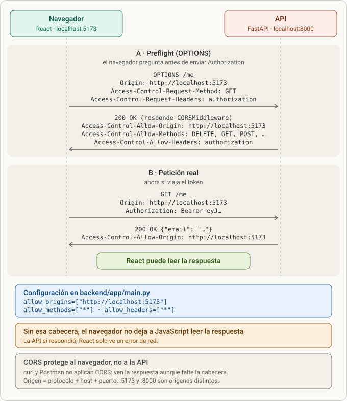
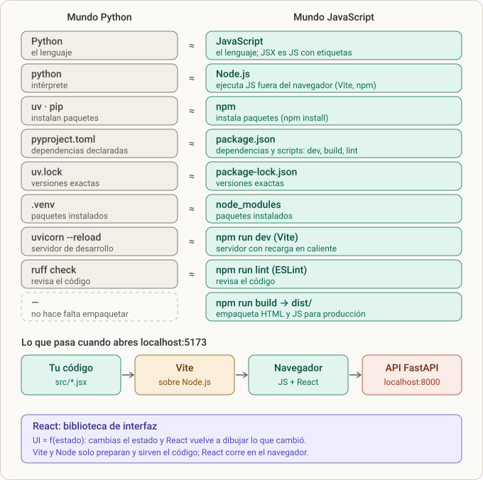
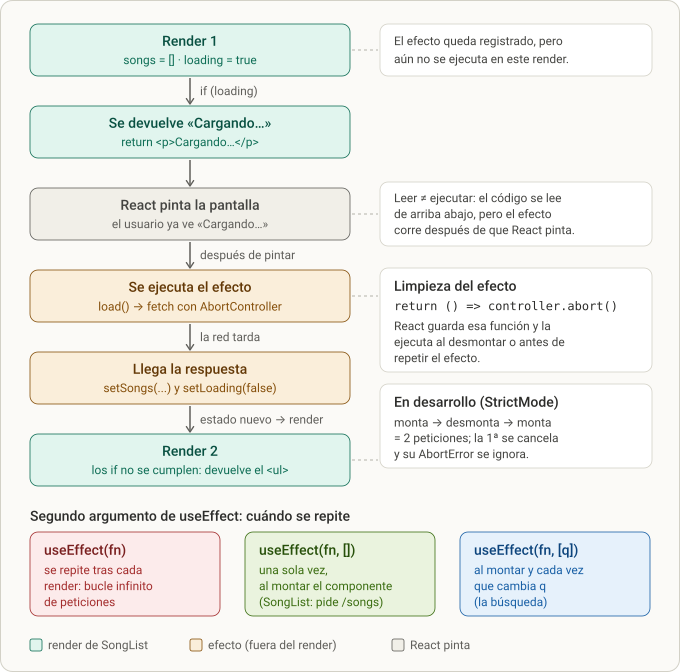
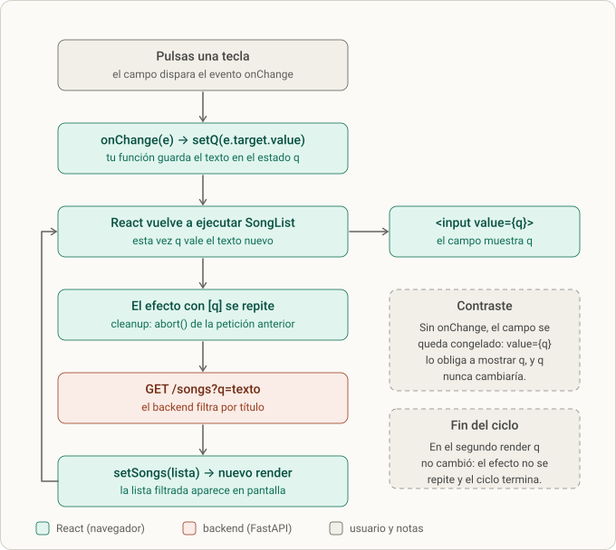
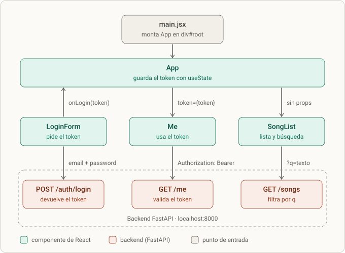
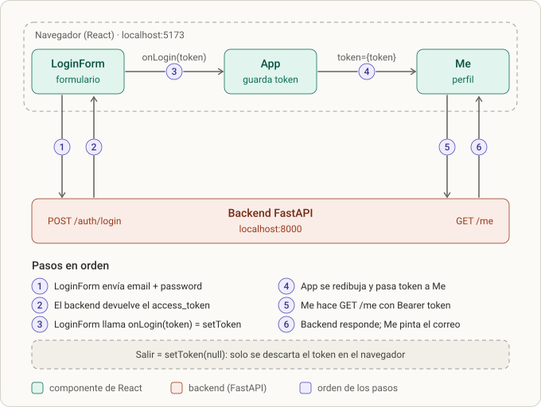

# Lección 9 · CORS y React (Vite, SongList, búsqueda y login)

> **Objetivo:** que el navegador (React en `:5173`) pueda hablar con la API (FastAPI en `:8000`) y construir el frontend mínimo que se pide en la entrevista: una lista de canciones con búsqueda, un login que guarda el token y una llamada autenticada (`GET /me`).
> **Estado al escribir esto (24 oct):** CORS terminado y con tests (4 en verde); proyecto Vite creado; `SongList` con búsqueda por `q`, `LoginForm`, `Me` y `App` con el token en memoria **funcionando** ("tenemos verde y el UI responde"; "estamos ya con el formulario funcionando"). Solo falta marcar el ítem del README y hacer el commit (lo haces tú). En 2.8 tienes la **versión correcta** de `LoginForm.jsx` y `Me.jsx` y una tabla (2.8.1) con las diferencias respecto a tu archivo: erratas que no se vieron en clase y que conviene corregir.

## 0. Dónde encaja

- Es el **octavo bloque** del plan, justo después de [[lesson-8]] (pandas + NumPy) y con el backend ya cerrado: **153 passed, 1 skipped**, ruff limpio y `import app.main` correcto.
- El tutor la llamó **"Lección 9"** (el docstring de `tests/test_cors.py` dice literalmente `"""Lección 9: CORS …"""`). En el diálogo la numeración no coincide con los nombres de archivo de estas notas, por eso aquí es `lesson-9`.
- Cubre dos líneas del README:
  - la del stack: "…**React (Vite)** · un solo Dockerfile al final";
  - la del checklist: `- [ ] React: SongList, LoginForm` (sigue **sin marcar** en el README: los dos componentes ya funcionan y la casilla la marcas tú al hacer el commit).
- Dependencias con otras lecciones:
  - [[lesson-4]] (auth): el `Bearer`, el `POST /auth/login` y el `GET /me` que React llama en los Pasos 4–5 son los de esa lección.
  - [[lesson-5]] (canciones y sobre de errores): la forma de `GET /songs` (con `q` y `limit` = 20 por defecto) y la regla "lista vacía = `200 []`" que React usa para el estado "vacío".
  - [[lesson-6]] (playlists): sus rutas autenticadas **no se consumieron** desde React en este entrenamiento; el backend las tiene listas.
  - [[lesson-7]] (Dockerfile, pendiente): el origen permitido de CORS debería salir de una variable de entorno en el contenedor.
- **"El ritme"** = el README del proyecto, el plan de entrenamiento y la entrevista. El tutor lo remarcó: React "es la parte que más pesa en la entrevista en vivo".

### Plan de la lección (tabla del tutor)

| Paso | Qué | Tiempo | Estado |
|---|---|---|---|
| 0 | CORS en el backend | 10 min | **hecho** (4 tests en verde) |
| 1 | Crear el proyecto Vite y verlo corriendo | 10 min | **hecho** (ambos servidores verificados) |
| 2 | `SongList`: fetch, cargando/error/vacío | 40 min | **hecho** (respuestas dadas a petición tuya) |
| 3 | Búsqueda con `q` (input controlado) | 20 min | **hecho** ("tenemos verde y el UI responde") |
| 4 | `LoginForm` y guardar el token | 40 min | **hecho** (token en memoria, en `App`) |
| 5 | Llamada autenticada con `Bearer` (`Me`) | 20 min | **hecho** ("estamos ya con el formulario funcionando") |

Total estimado por el tutor para React: **~2,5 h**.

## 1. Qué se hizo (resumen)

1. El tutor escribió **antes que el código** `tests/test_cors.py` (4 tests) y lo validó en una copia temporal con una implementación de referencia y dos mutaciones. Sin middleware fallaban 3 de 4.
2. Tú corriste la suite: **3 fallos** (los tres de CORS). Añadiste `CORSMiddleware` en `app/main.py`: `test_cors.py` pasó a **4 passed**.
3. Quedaron "dos errores" más: no eran de CORS, sino **errores de colección** porque los tests de pandas/NumPy ([[lesson-8]]) importan librerías aún no instaladas. Se resolvió con `uv add pandas numpy`.
4. Preguntaste qué hace exactamente el bloque `add_middleware(...)` y si el `"*"` de `allow_methods`/`allow_headers` significa "todo". Decidimos **dejarlo así por ahora** y volver a los middlewares más adelante.
5. Cerrado el backend, se creó el frontend: `npm create vite@latest . -- --template react` (carpeta no vacía → "Ignore files and continue"; linter → **ESLint**), `npm install`, `npm run dev`. Verificaste los dos servidores a la vez.
6. Preguntaste cómo se relacionan **JavaScript, Node.js y React**; después describiste lo que habías visto en la carpeta y el tutor lo corrigió (qué comando crea qué).
7. El tutor dio el **Paso 2**: `SongList.jsx` con huecos (`res.status`, `[]`, `key=`) y los cuatro estados de UI. Como "no estoy muy familiarizado con JavaScript; por ahora solo voy a aprender a cómo utilizarlo", pediste **las respuestas**: el tutor entregó `SongList.jsx` y `App.jsx` completos, con una tabla de erratas de tu versión.
8. Explicaste con tus palabras cómo entendías `SongList` y el tutor te corrigió punto por punto (3.4.0). Siguió una ronda de preguntas sobre sintaxis: `useEffect(() => {}, [])`, funciones flecha frente a `lambda`, la desestructuración de `useState`, qué hace `useEffect` ("¿es un temporizador?"), `export default`, el fragmento `<>…</>` y el `<input>`.
9. **Paso 3:** búsqueda por título con un input controlado, `[q]` como dependencia y `URLSearchParams` (2.7). Resultado: "tenemos verde, y el UI responde".
10. **Pasos 4–5:** `LoginForm` (formulario controlado + `POST /auth/login`), `Me` (`GET /me` con `Authorization: Bearer`) y `App` con el token en `useState` (2.8). Pediste un diagrama de cómo se comunican `App`, `LoginForm` y `Me`; hubo dos rondas sobre por qué el hijo recibe `onLogin` si es el que pide el token (3.8). Al revisar el repo salieron erratas en `Me.jsx` y `LoginForm.jsx` (2.8.1).
11. Limpieza del repo: borraste el código muerto de `list_songs`, `list_artists` y `get_artist_songs` (verificado el 24 oct: sin restos).
12. Se añadieron **seis diagramas SVG** (Figuras 1–6, carpeta `diagramas/`) y se reordenaron los conceptos de React en el orden en que se enseñaron.

## 2. Paso a paso

### 2.0 Prerrequisito: una lista vacía es `200 []`

Antes de empezar React el tutor te pidió limpiar `routers/songs.py`. Había quedado esto (ver [[lesson-5]]):

```python
songs = songs_repo.list_songs(db, genre_id, artist_id, q, limit, offset)
if songs is None or []:
    raise HTTPException(status_code=404, detail="No songs found")   # luego lo cambiaste a 200
return songs
```

Tu pregunta fue si la corrección era cambiar el `404` por `200`. Respuesta del tutor: **no, hay que borrar las dos líneas** (el `if` y el `raise`):

```python
songs = songs_repo.list_songs(db, genre_id, artist_id, q, limit, offset)
return songs
```

Por qué:

- **`raise HTTPException` no es para respuestas buenas.** Con `raise`, FastAPI pasa por el manejador de errores y devolvería el sobre `{"error": {...}}` con código 200: un error mezclado con un éxito.
- **Una lista vacía ya es una respuesta válida.** `return songs` con `[]` da `200 []`, que es lo que dice el contrato y lo que **React espera para pintar "No hay canciones"**.
- **La condición nunca fue "lista vacía".** `songs is None or []` se lee `(songs is None) or []`; el `[]` final siempre es falso, así que equivale a `songs is None`. Como el repositorio siempre devuelve una lista, no se cumplía nunca: código muerto.
- `HTTPException` se sigue importando porque `create_song` la usa.

Estado actual del repo: **ya las borraste**, junto con el resto del código muerto de `list_songs`, `list_artists` y `get_artist_songs` (verificado el 24 oct: no quedan restos de `is None or []`, "No songs found", "No artists found" ni "songs not found" en `routers/*.py`).

### 2.1 Paso 0 — CORS en el backend

#### 2.1.1 Primero los tests (los escribió el tutor)

El tutor dejó escrito y validado `backend/tests/test_cors.py` **antes** de explicarte nada, para que tú solo tuvieras que hacer que pasaran:

```python
"""Lección 9: CORS. El navegador (React en :5173) debe poder llamar a la API (:8000)."""

ORIGIN = "http://localhost:5173"


def test_preflight_allows_frontend_origin_and_headers(client):
    r = client.options(
        "/auth/login",
        headers={
            "Origin": ORIGIN,
            "Access-Control-Request-Method": "POST",
            "Access-Control-Request-Headers": "content-type,authorization",
        },
    )
    assert r.status_code == 200
    assert r.headers["access-control-allow-origin"] == ORIGIN
    allowed = r.headers["access-control-allow-headers"].lower()
    assert "authorization" in allowed and "content-type" in allowed


def test_normal_request_carries_cors_header(client):
    r = client.get("/songs", headers={"Origin": ORIGIN})
    assert r.status_code == 200
    assert r.headers["access-control-allow-origin"] == ORIGIN


def test_error_responses_also_carry_cors_header(client):
    # si el 401 no lleva la cabecera, el navegador lo oculta y React ve un "Network Error"
    r = client.get("/me", headers={"Origin": ORIGIN})
    assert r.status_code == 401
    assert r.headers["access-control-allow-origin"] == ORIGIN


def test_unknown_origin_gets_no_cors_header(client):
    r = client.get("/songs", headers={"Origin": "http://evil.example"})
    assert "access-control-allow-origin" not in r.headers
```

Qué protege cada test:

| Test | Qué simula | Qué falla si el middleware está mal |
|---|---|---|
| `test_preflight_allows_frontend_origin_and_headers` | El `OPTIONS` previo que manda el navegador antes de un `POST /auth/login` con JSON y `Authorization`. | Sin middleware responde **405** (la ruta solo admite `POST`). Con `allow_headers` mal, la respuesta no lista `authorization`. |
| `test_normal_request_carries_cors_header` | La petición real (`GET /songs`) desde React. | No hay cabecera `Access-Control-Allow-Origin` → el navegador no deja a React **leer** la respuesta. |
| `test_error_responses_also_carry_cors_header` | Un `401` (`GET /me` sin token). | Si el error no lleva la cabecera, el navegador lo oculta y React solo ve "Network Error", sin saber que era un 401. |
| `test_unknown_origin_gets_no_cors_header` | Una web que no es la nuestra (`evil.example`). | Con `allow_origins=["*"]` este test falla: se estaría autorizando a cualquiera. |

Detalle importante: **`TestClient` no es un navegador**. No aplica ninguna regla CORS, pero sí deja enviar la cabecera `Origin` a mano. Por eso los tests comprueban lo único que la API controla: **qué cabeceras `Access-Control-*` devuelve**.

#### 2.1.2 Cómo se validaron los tests (sin tocar tu código)

El tutor trabajó en una copia temporal (`rsync` sin `.venv`, caches ni `*.db`), puso la implementación de referencia y probó mutaciones:

| Situación | Resultado real |
|---|---|
| Sin middleware | `3 failed, 1 passed` (`KeyError: 'access-control-allow-origin'` en dos; el preflight falla; pasa solo el de "origen desconocido", porque sin middleware tampoco hay cabecera) |
| Con el middleware de referencia | `4 passed` |
| Mutación: `allow_origins=["*"]` | `4 failed` (la cabecera pasa a ser `*` en vez del origen, y el origen desconocido también la recibe) |
| Mutación: quitar `allow_headers` | `1 failed, 3 passed` (el preflight falla en `assert "authorization" in allowed`: `Authorization` no es una cabecera "simple" y hay que autorizarla) |
| Suite completa con referencia | `119 passed, 1 skipped`; ruff limpio |

Cuentas de la suite: 115 (backend de playlists cerrado) + 4 (CORS) = **119**; luego +34 de pandas/NumPy ([[lesson-8]]) = **153**.

#### 2.1.3 Tu primer resultado: "3 errores"

Pegaste que tenías 3 fallos. El tutor corrió la suite en una copia y salió:

```
E       assert 405 == 200
E        +  where 405 = <Response [405 Method Not Allowed]>.status_code
E       KeyError: 'access-control-allow-origin'
E       KeyError: 'access-control-allow-origin'
FAILED tests/test_cors.py::test_preflight_allows_frontend_origin_and_headers
FAILED tests/test_cors.py::test_normal_request_carries_cors_header - KeyError...
FAILED tests/test_cors.py::test_error_responses_also_carry_cors_header - KeyE...
3 failed, 116 passed, 1 skipped in 5.90s
```

Lectura de la traza:

- **`405 == 200`**: el preflight es un `OPTIONS /auth/login`. Sin middleware, FastAPI busca esa ruta con método `OPTIONS`, no existe y devuelve *405 Method Not Allowed*.
- **`KeyError: 'access-control-allow-origin'`**: el test pide `r.headers["access-control-allow-origin"]` y esa cabecera no está en la respuesta.
- Ruff estaba limpio (`All checks passed!`) y `list_songs` estaba bien; los 3 fallos eran exactamente los 3 tests de CORS: **solo faltaba el middleware**.

#### 2.1.4 El código que se añade a `app/main.py`

El tutor dio el patrón con huecos (`allow_origins=[...]` etc.) y las pistas: "solo el origen del front, **no** `"*"`" y "para métodos y cabeceras basta `["*"]`". La solución:

```python
from fastapi.middleware.cors import CORSMiddleware

app = FastAPI(title="Music-api")

app.add_middleware(
    CORSMiddleware,
    allow_origins=["http://localhost:5173"],
    allow_methods=["*"],
    allow_headers=["*"],
)
```

Así quedó tu `main.py` (estado actual del repo, ya con el router de estadísticas):

```python
from fastapi import FastAPI, Request
from fastapi.middleware.cors import CORSMiddleware
from fastapi.exceptions import RequestValidationError
from fastapi.responses import JSONResponse
from starlette.exceptions import HTTPException as StarletteHTTPException

from app.routers import artists, auth, genres, playlists, songs, users, stats

app = FastAPI(title="Music-api")

app.add_middleware(
    CORSMiddleware,
    allow_origins=["http://localhost:5173"],
    allow_methods=["*"],
    allow_headers=["*"],
)


router_list = [artists, auth, genres, playlists, songs, users, stats]
for r in router_list:
    app.include_router(r.router)
```

Comandos de comprobación:

```bash
uv run pytest tests/test_cors.py -q      # 4 passed
uv run pytest -q                          # 119 passed, 1 skipped (antes de la lección de pandas/NumPy)
uvx ruff check --select F,E9 app tests    # All checks passed!
```

#### 2.1.5 Tu segundo resultado: "aún dos errores" (no eran de CORS)

Tras colocar el middleware, `test_cors.py` daba **4 passed** y ruff limpio. Los "dos errores" venían de ejecutar la suite completa:

```
ERROR tests/test_similarity.py     → ModuleNotFoundError: No module named 'numpy'
ERROR tests/test_stats_service.py  → ModuleNotFoundError: No module named 'pandas'
!!!!!!!!!!!!!!!!!!! Interrupted: 2 errors during collection !!!!!!!!!!!!!!!!!!!!
```

- Son **errores de colección**: pytest importa cada archivo de tests antes de ejecutarlos; si un `import` falla, aborta (*Interrupted: 2 errors during collection*) y no corre nada.
- Esos dos archivos pertenecen a la lección nueva ([[lesson-8]]) e importan `numpy` y `pandas` en su primera línea; todavía no estaban instalados.
- Arreglo:

```bash
cd backend
uv add pandas numpy        # modifica pyproject.toml y uv.lock → hay que commitearlos
```

- Mientras no existiera el código de la lección, para comprobar que lo demás seguía sano:

```bash
uv run pytest -q --ignore=tests/test_stats_service.py --ignore=tests/test_stats_api.py \
  --ignore=tests/test_similarity.py --ignore=tests/test_similar_api.py
# 119 passed, 1 skipped
```

#### 2.1.6 Qué hace cada línea (tu pregunta: "explícame qué hace este código")

Ver el desarrollo conceptual en la sección 3.1. Resumen de la respuesta: el bloque le dice a la API **qué páginas web tienen permiso para llamarla desde el navegador**; es una regla del navegador y no de la API; el middleware contesta solo el preflight sin llegar a tus rutas.

#### 2.1.7 Tu pregunta del asterisco y la decisión final

Preguntaste: "¿ese asterisco significa que todos los métodos son permitidos?". Respuesta: **sí** (`allow_methods=["*"]` permite GET, POST, PUT, PATCH, DELETE, HEAD y OPTIONS; `allow_headers=["*"]` cualquier cabecera), con tres matices (ver 3.1). Tu decisión: **"por ahora dejemos esta parte así; profundizaremos en los middlewares más adelante"**. El tutor lo anotó como tema pendiente (ver sección 8).

### 2.2 Cierre del backend (antes de React)

Con pandas/NumPy en verde, el tutor verificó el conjunto:

```
153 passed, 1 skipped in 6.74s
All checks passed!
import-ok
```

Y dejó tres tareas de README de 5 minutos (detalle en [[lesson-8]]): añadir a la tabla del contrato `GET /stats/top-genres` y `GET /songs/{song_id}/similar`, añadir `GenreStats` y `SimilarSong` a la tabla de schemas, marcar `pandas/NumPy` (y `Playlists` si faltaba) y **commitear incluyendo `pyproject.toml` y `uv.lock`**.

Resumen que dio de "lo que ya puedes explicar en la entrevista": pandas (join multiplica filas, `count`/`size`/`nunique`, cuándo hacerlo en SQL), NumPy (vectores, coseno sin bucles, división por cero, orden estable, tipos NumPy vs Python) y la arquitectura (funciones puras en `services/`, SQL en `repositories/`, HTTP solo en routers).

### 2.3 Paso 1 — Crear el proyecto con Vite

#### Requisito y comandos

Necesitas **Node 20 o superior** (`node -v`; en tu máquina ahora mismo `v22.23.4`, npm `10.9.9`). Desde la raíz del repo:

```bash
cd frontend
npm create vite@latest . -- --template react    # el "." = en esta carpeta; --template react = plantilla React
npm install                                       # descarga las dependencias a node_modules/
npm run dev                                       # servidor de desarrollo en http://localhost:5173
```

En otra terminal, la API:

```bash
cd backend
uv run uvicorn app.main:app --reload              # http://localhost:8000
```

#### Las preguntas que hizo el asistente de `create vite`

| Pregunta | Qué contestaste / qué dijo el tutor | Por qué |
|---|---|---|
| `Current directory is not empty. Please choose how to proceed:` | **Ignore files and continue** | `frontend/` ya contenía un `.gitkeep` (la carpeta existía para versionarla vacía). Vite avisa de que no está vacía; "ignorar" mantiene tus archivos y escribe la plantilla encima. |
| `Which linter to use?` (Oxlint / ESLint) | **ESLint** | Es el estándar en casi todos los proyectos de React y el que verás en la mayoría de bases de código y entrevistas. Oxlint es más rápido pero más nuevo; para este ejercicio no cambia nada. |
| Opciones "experimentales" (Rolldown, compilador de React) | **No** | Fuera de alcance; no aportan a lo que se evalúa. |
| `Install with npm and start now?` | **Yes** (opcional) | Ahorra los dos comandos siguientes (`npm install` + `npm run dev`). |

Salida esperada del servidor de desarrollo: `Local: http://localhost:5173/`.

#### Comprobación de los dos servidores

1. `http://localhost:8000/songs` devuelve JSON (backend vivo).
2. `http://localhost:5173` muestra la página de plantilla de Vite (frontend vivo).

Tu mensaje: "las comprobaciones de los dos servidores para el frontend y para el backend están adecuadas". Paso 1 terminado.

#### Lo que generó la plantilla (y lo que añadiste después)

```
frontend/
  .gitignore            # node_modules, dist, logs, editores…
  .gitkeep              # el de antes
  README.md             # README de la plantilla de Vite (no el del proyecto)
  index.html            # la única página HTML; carga /src/main.jsx
  package.json          # equivale a pyproject.toml
  package-lock.json     # equivale a uv.lock
  eslint.config.js      # reglas de lint
  vite.config.js        # configuración de Vite (plugin de React)
  public/               # archivos estáticos tal cual (favicon.svg, icons.svg)
  src/
    main.jsx            # punto de entrada (equivale a main.py)
    App.jsx             # componente raíz: guarda el token y reparte LoginForm / Me / SongList (2.8)
    SongList.jsx        # lista de canciones + búsqueda (2.6 y 2.7)
    LoginForm.jsx       # formulario de login (2.8)
    Me.jsx              # GET /me con Authorization: Bearer (2.8)
    App.css, index.css
    assets/             # hero.png, react.svg, vite.svg
  node_modules/         # las librerías descargadas (no se commitea)
```

`package.json`:

```json
{
  "name": "frontend",
  "private": true,
  "version": "0.0.0",
  "type": "module",
  "scripts": {
    "dev": "vite",
    "build": "vite build",
    "lint": "eslint .",
    "preview": "vite preview"
  },
  "dependencies": {
    "react": "^19.3.1",
    "react-dom": "^19.3.1"
  },
  "devDependencies": {
    "@eslint/js": "^10.0.1",
    "@types/react": "^19.3.0",
    "@types/react-dom": "^19.3.0",
    "@vitejs/plugin-react": "^6.1.2",
    "eslint": "^10.13.0",
    "eslint-plugin-react-hooks": "^7.1.1",
    "eslint-plugin-react-refresh": "^0.5.7",
    "globals": "^17.13.0",
    "vite": "^8.3.4"
  }
}
```

- `"scripts"` son los comandos que lanzas con `npm run <nombre>` (`dev`, `build`, `lint`, `preview`).
- `"dependencies"` es lo que necesita la app en ejecución (`react`, `react-dom`); `"devDependencies"` es solo herramientas de desarrollo (Vite, ESLint…). Es el equivalente a `uv add` frente a `uv add --dev`.
- `"type": "module"` hace que los `.js` usen `import`/`export` (módulos ES), como en el navegador.

`index.html` (fragmento relevante) y `src/main.jsx`:

```html
<body>
  <div id="root"></div>
  <script type="module" src="/src/main.jsx"></script>
</body>
```

```jsx
import { StrictMode } from 'react'
import { createRoot } from 'react-dom/client'
import './index.css'
import App from './App.jsx'

createRoot(document.getElementById('root')).render(
  <StrictMode>
    <App />
  </StrictMode>,
)
```

Flujo: el navegador pide `index.html` → carga `main.jsx` → React monta `<App />` dentro de `<div id="root">`. Fíjate en `<StrictMode>`: es la razón de que en desarrollo veas el `fetch` dos veces (ver 3.4.6).

`eslint.config.js` activa `js.configs.recommended`, `eslint-plugin-react-hooks` (reglas de hooks, incluida la de dependencias de `useEffect`) y `eslint-plugin-react-refresh`. Se ejecuta con `npm run lint`.

`vite.config.js`: solo registra `@vitejs/plugin-react` (traduce JSX y activa el *hot reload*).

### 2.4 La pregunta: "¿qué diferencia hay entre Node.js y React? ¿qué tienen que ver con JavaScript?"

Ver 3.2 para el desarrollo completo (tabla de equivalencias con Python, diagrama de los dos servidores y puntos de entrevista).

### 2.5 Tu descripción de las carpetas y la corrección

Dijiste, en tus palabras: React "orquesta JavaScript y HTML": el HTML como template/parte visual y JavaScript como lo que mueve las cosas; y que al ejecutar `npm run build` aparecieron `node_modules`, `public`, `src`… "un template general del dev que es estándar en el frontend".

Corrección del tutor ("casi"):

- **Sobre React:** no hay un archivo HTML aparte como plantilla. El "HTML" se escribe **dentro** del JavaScript (JSX) y cada componente es una función que devuelve lo que se ve. La idea central: **la interfaz es una función del estado**.
- **Sobre las carpetas:** salieron de **comandos distintos**, no de `npm run build`:

| Comando | Qué creó | Equivalente en tu backend |
|---|---|---|
| `npm create vite` | la plantilla: `src/`, `public/`, `index.html`, `package.json`, `eslint.config.js` | la estructura inicial de `uv init` |
| `npm install` | `node_modules/` (las librerías descargadas) | `.venv/` (no se commitea) |
| `npm run build` | `dist/`, los archivos finales para producción | no tiene equivalente directo |

- Y sí: es la **plantilla estándar** que da Vite para empezar.
- Otras equivalencias: `package.json` ↔ `pyproject.toml`; `package-lock.json` ↔ `uv.lock`; `src/` ↔ `app/`; `src/main.jsx` ↔ `main.py` (punto de entrada).
- 📝 Nota del repo: hoy no hay carpeta `dist/` en `frontend/`, así que `npm run build` aún no se ha ejecutado (o se borró). Está ignorada en `.gitignore` de todos modos.

### 2.6 Paso 2 — `SongList` (~40 min)

**Enunciado:** crear `src/SongList.jsx`; al montarse pide `GET /songs` y muestra **cuatro estados**: cargando, error, vacío y la lista.

#### Esqueleto que dio el tutor (con tres huecos)

```jsx
import { useEffect, useState } from "react";

const API = "http://localhost:8000";

function formatDuration(totalSeconds) {
  const minutes = Math.floor(totalSeconds / 60);
  const seconds = String(totalSeconds % 60).padStart(2, "0");
  return `${minutes}:${seconds}`;
}

export default function SongList() {
  const [songs, setSongs] = useState([]);
  const [loading, setLoading] = useState(true);
  const [error, setError] = useState(null);

  useEffect(() => {
    const controller = new AbortController();

    async function load() {
      try {
        const res = await fetch(`${API}/songs`, { signal: controller.signal });
        if (!res.ok) throw new Error(`HTTP ${...}`);       // fetch NO lanza error en un 404 o 500
        setSongs(await res.json());
        setLoading(false);
      } catch (err) {
        if (err.name === "AbortError") return;
        setError(err.message);
        setLoading(false);
      }
    }

    load();
    return () => controller.abort();
  }, [...]);                                                 // ¿cuándo debe ejecutarse el efecto?

  if (loading) return <p>Cargando…</p>;
  if (error) return <p role="alert">Error: {error}</p>;
  if (songs.length === 0) return <p>No hay canciones.</p>;

  return (
    <ul>
      {songs.map((song) => (
        <li key={...}>
          <strong>{song.title}</strong> — {song.artists.map((a) => a.name).join(", ")} ·{" "}
          {song.genre.name} · {formatDuration(song.duration_s)}
        </li>
      ))}
    </ul>
  );
}
```

Y reemplazar `src/App.jsx` por:

```jsx
import SongList from "./SongList";

export default function App() {
  return (
    <main>
      <h1>Music</h1>
      <SongList />
    </main>
  );
}
```

#### Los tres huecos (respuestas del tutor)

| Hueco | Respuesta | Razón |
|---|---|---|
| `` `HTTP ${...}` `` | `res.status` | El número del código HTTP (404, 500…). |
| `}, [...]);` | `[]` | Lista vacía = "solo al montarse". Sin ella el efecto se repetiría en cada render. |
| `<li key={...}>` | `song.id` | React necesita un identificador **estable y único** por elemento para saber qué cambió. El id de la canción, no la posición. |

Versión con los huecos rellenados (según lo indicado por el tutor):

```jsx
if (!res.ok) throw new Error(`HTTP ${res.status}`);
// …
}, []);
// …
<li key={song.id}>
```

#### Qué mirar (explicado por el tutor)

- **`res.ok`:** `fetch` solo rechaza la promesa si no hay red. Un 500 llega como respuesta normal, por eso lo compruebas tú.
- **`AbortController`:** cancela la petición si el componente se desmonta. En desarrollo verás la petición **dos veces** porque React ejecuta los efectos doble a propósito (StrictMode); es normal, y por eso el `AbortError` se ignora (`if (err.name === "AbortError") return;`).
- **Los 4 estados** (cargando, error, vacío, datos) son lo que un entrevistador espera ver **siempre** que haya un `fetch`.

#### Comprobación (los 3 chequeos)

Con los dos servidores levantados, abre `http://localhost:5173`:

1. Deben aparecer las canciones con artistas, género y duración (ej. `3:25`). Formato de cada fila: `**Título** — Artista A, Artista B · Género · m:ss`.
2. **Apaga el backend y recarga:** debe salir un mensaje de error, no una pantalla en blanco.
3. En las herramientas del navegador, pestaña **Network**, mira la petición a `/songs`: la respuesta lleva `access-control-allow-origin`. Es tu middleware de CORS funcionando.

Regla de tiempo del tutor: **"si pasas de 40 minutos, pídeme la solución"**.

#### Forma de la respuesta de `GET /songs` (para saber qué pinta React)

`response_model=list[SongsOut]` en el backend:

```python
class SongsArtistOut(BaseModel):
    artist_id: int
    name: str
    role: Literal["main", "featured", "producer", "writer"]

class SongsOut(BaseModel):
    id: int
    title: str
    duration_s: int = Field(gt=0)
    genre: GenreOut          # {id, name, created_at}
    created_at: datetime
    artists: list[SongsArtistOut]
```

Por eso en el componente se usa `song.artists.map((a) => a.name)`, `song.genre.name` y `song.duration_s`.

#### Qué pasó con el Paso 2: pediste las respuestas

Dijiste: *"dame las respuestas ya que no estoy muy familiarizado con JavaScript. Entonces, por ahora solo voy a aprender a cómo utilizarlo"*. El tutor miró tus archivos (`SongList.jsx` tenía el esqueleto con los tres `...` todavía puestos y varios deslices; `App.jsx` conservaba la plantilla de Vite con un segundo `App` añadido) y entregó la versión completa más esta tabla de lo que había que corregir:

| En tu archivo | Problema | Arreglo |
|---|---|---|
| ``new Error(`HTTP` ${...})`` | El backtick cierra antes de la variable, así que `${...}` queda fuera del texto. | `` `HTTP ${res.status}` `` |
| `songs.lenght` | Typo, y **sin error visible**: la condición nunca se cumple, nunca sale "No hay canciones" y se pinta una lista vacía. | `songs.length` |
| `song.duration` | El campo del API se llama `duration_s`; `undefined / 60` es `NaN` y verías `NaN:NaN`. | `song.duration_s` |
| ``song.artists.map(a) => a.name}.join(...)`` | Paréntesis mal colocados. | `{song.artists.map((a) => a.name).join(", ")}` |
| `` `AbortError` `` (backticks) | Funciona, pero lo normal es usar comillas. | `"AbortError"` |
| `App.jsx` con la plantilla de Vite y un segundo `export default function App()` | Dos `App` en el mismo archivo es un **error de compilación** (identificador ya declarado). | Dejar solo la versión de 9 líneas del Paso 2. |

Los tres huecos, ya resueltos, están en la tabla de arriba (`res.status`, `[]`, `song.id`). La versión final de `SongList.jsx` (con la búsqueda del Paso 3) está en 2.7; `App.jsx` cambió después, en 2.8.

Comprobaciones del Paso 2 (con los dos servidores levantados, en `http://localhost:5173`): lista con artistas, género y duración (`3:25`); al apagar el backend y recargar sale `Error: Failed to fetch`, no una pantalla en blanco; en Network la respuesta de `/songs` lleva `access-control-allow-origin`. Verás la petición **dos veces** en desarrollo por `StrictMode` (3.4.6).

### 2.7 Paso 3 — Búsqueda por título (`q`): input controlado

Concepto nuevo del paso: el estado `q` guarda lo que escribe el usuario, el efecto depende de `[q]` y cada cambio pide `GET /songs?q=…`. El tutor entregó el archivo completo (por tu petición de respuestas). Tu `SongList.jsx` coincide con esa versión, salvo la sangría de 4 espacios; este es el **estado actual del repo**:

```jsx
import { useEffect, useState } from "react";

const API = "http://localhost:8000";

function formatDuration(totalSeconds) {
    const minutes = Math.floor(totalSeconds / 60);
    const seconds = String(totalSeconds % 60).padStart(2, "0");
    return `${minutes}:${seconds}`;
}

export default function SongList() {
    const [q, setQ] = useState("");
    const [songs, setSongs] = useState([]);
    const [loading, setLoading] = useState(true);
    const [error, setError] = useState(null);

    useEffect(() => {
        const controller = new AbortController();

        async function load() {
            try {
                const params = new URLSearchParams();
                if (q) params.set("q", q);
                const res = await fetch(`${API}/songs?${params}`, { signal: controller.signal });
                if (!res.ok) throw new Error(`HTTP ${res.status}`);
                setSongs(await res.json());
                setError(null);
                setLoading(false);
            } catch (err) {
                if (err.name === "AbortError") return;
                setError(err.message);
                setLoading(false);
            }
        }

        load();
        return () => controller.abort();
    }, [q]);

    let content;
    if (loading) content = <p>Cargando…</p>;
    else if (error) content = <p role="alert">Error: {error}</p>;
    else if (songs.length === 0) content = <p>No hay canciones.</p>;
    else
        content = (
            <ul>
                {songs.map((song) => (
                    <li key={song.id}>
                        <strong>{song.title}</strong> — {song.artists.map((a) => a.name).join(", ")} ·{" "}
                        {song.genre.name} · {formatDuration(song.duration_s)}
                    </li>
                ))}
            </ul>
        );

    return (
        <>
            <input
                type="search"
                value={q}
                onChange={(e) => setQ(e.target.value)}
                placeholder="Buscar cancion..."
                aria-label="Buscar cancion"
            />
            {content}
        </>
    );
}
```

`App.jsx` no cambia en este paso.

#### Qué hay de nuevo

1. **Input controlado.** `value={q}` hace que el campo muestre siempre el estado `q`; `onChange` lleva cada tecla al estado con `setQ(e.target.value)`. Sin `onChange` el campo no deja escribir (3.7).
2. **`[q]` en vez de `[]`.** Cada vez que `q` cambia, React ejecuta la limpieza del efecto anterior (`abort`) y luego el efecto nuevo, que pide `/songs?q=…`. Aquí el `AbortController` pasa a ser útil de verdad: si escribes rápido, las peticiones viejas se cancelan y una respuesta lenta no pisa a una más reciente (condición de carrera).
3. **Los `return` tempranos se convirtieron en la variable `content`.** Con los `if (…) return <p>…</p>` de antes, un resultado vacío o un error habría devuelto solo un `<p>` y el `<input>` habría **desaparecido** de la pantalla (perdiendo el foco en pleno tecleo). Ahora el `<input>` está siempre en el `return` final y `content` cambia debajo. `<>…</>` es un contenedor invisible para devolver dos elementos.
4. **`URLSearchParams`** arma `?q=…` y codifica los caracteres especiales (espacios, `&`, tildes).

📝 Detalle de diseño del tutor, no comentado en clase: dentro de `load` no se llama a `setLoading(true)`, así que `loading` solo es `true` la primera vez; mientras tecleas se ven los resultados anteriores hasta que llegan los nuevos (sin parpadeo de "Cargando…"), y por eso `setError(null)` va **después** del `fetch` correcto.

#### Qué hace el backend con `q`

`GET /songs` acepta `genre_id`, `artist_id`, `q`, `limit` (por defecto 20, máximo 100) y `offset`. `q` se aplica con `Song.title.ilike(f"%{q}%")`: busca por **título**, sin distinguir mayúsculas. Como `limit` vale 20, **verás 20 canciones y no las 44 sembradas**: no es un bug, el API pagina.

#### Comprobación

1. Escribe parte de un título: la lista se filtra mientras tecleas.
2. Escribe algo que no exista: sale "No hay canciones." y el campo sigue ahí.
3. En Network, cada tecla genera un `GET /songs?q=…` y las anteriores salen como **canceladas**.

### 2.8 Pasos 4 y 5 — `LoginForm`, `Me` y `App` con el token

El tutor entregó tres archivos: `LoginForm.jsx` (nuevo), `Me.jsx` (nuevo) y `App.jsx` (cambia). Para tener un usuario con el que entrar (una sola vez, la base persiste):

```bash
curl -X POST localhost:8000/auth/register -H "Content-Type: application/json" \
  -d '{"email":"demo@example.com","password":"demo12345"}'
```

(Valores de prueba de una app local: la contraseña exige mínimo 8 caracteres, por `UserCreate`.)

Abajo está la **versión correcta** de cada archivo. Tu copia del repo funciona, pero `LoginForm.jsx` y `Me.jsx` tienen erratas que se vieron al leerlas (tabla de 2.8.1): en el código siguiente ya están arregladas.

#### `src/LoginForm.jsx` (versión correcta)

📝 Reconstruido a partir de tu archivo del repo, con las dos erratas de la tabla 2.8.1 corregidas (`LoginForm`, `minLength`); el resto es tal cual lo tienes.

```jsx
import { useState } from "react"

const API = "http://localhost:8000";

export default function LoginForm({onLogin}) {
    const [email, setEmail] = useState("");
    const [password, setPassword] = useState("");
    const [error, setError] = useState(null);
    const [submitting, setSubmitting] = useState(false);

    async function handleSubmit(e) {
        e.preventDefault();
        setError(null);
        setSubmitting(true);
        try {
            const res = await fetch(`${API}/auth/login`, {
                method: "POST",
                headers: {"Content-Type": "application/json"},
                body: JSON.stringify({email, password})
            });
            if (res.status === 401) throw new Error("Correo o contrasena incorrectos");
            if (!res.ok) throw new Error(`HTTP ${res.status}`);
            const data = await res.json();
            onLogin(data.access_token);
        } catch (err) {
            setError(err.message);
        } finally {
            setSubmitting(false);
        }
    }

    return (
        <form onSubmit={handleSubmit}>
            <h2>Iniciar sesion</h2>
            <label>
                Correo
                <input type="email" value={email} onChange={(e) => setEmail(e.target.value)} required />
            </label>
            <label>
                Contraseña
                <input type="password" value={password} onChange={(e) => setPassword(e.target.value)} required minLength={8}/>
            </label>
            <button type="submit" disabled={submitting}>
                {submitting ? "Entrando.." : "Entrar"}
            </button>
            {error && <p role="alert">{error}</p>}
        </form>
    );
}
```

#### `src/Me.jsx` (versión correcta)

📝 Reconstruido igual: tu archivo con las cuatro correcciones de la tabla 2.8.1 (`e.name`, `setError(e.message)`, `Error: {error}`, `<strong>` y "Sesión") y con la sangría normalizada a 4 espacios.

```jsx
import { useEffect, useState } from "react";

const API = "http://localhost:8000";

export default function Me({ token }) {
    const [me, setMe] = useState(null);
    const [error, setError] = useState(null);

    useEffect(() => {
        const controller = new AbortController();

        async function load() {
            try {
                const res = await fetch(`${API}/me`, {
                    headers: { Authorization: `Bearer ${token}` },
                    signal: controller.signal,
                });
                if (!res.ok) throw new Error(`HTTP ${res.status}`);
                setMe(await res.json());
            } catch (e) {
                if (e.name === "AbortError") return;
                setError(e.message);
            }
        }

        load();
        return () => controller.abort();
    }, [token]);

    if (error) return <p role="alert">Error: {error}</p>;
    if (!me) return <p>Cargando perfil...</p>;
    return (
        <p>
            Sesión iniciada como <strong>{me.email}</strong>
        </p>
    );
}
```

#### `src/App.jsx` (estado actual del repo)

```jsx
import { useState } from "react";
import LoginForm from "./LoginForm";
import Me from "./Me";
import SongList from "./SongList";

export default function App() {
    const [token, setToken] = useState(null);

    return (
        <main>
            <h1>Music</h1>
              {token ? (
                  <>
                    <Me token={token} />
                    <button onClick={() => setToken(null)}>Salir</button>
                  </>
                ) : (
                  <LoginForm onLogin={setToken} />
              )}
            <SongList />
        </main>
    );
  }
```

#### Qué hay de nuevo

1. **`e.preventDefault()`.** Un `<form>` envía por defecto la petición y **recarga la página**, y con la recarga pierdes todo el estado de React. Esa línea lo evita para que lo gestione tu función (3.8).
2. **Props con funciones.** `LoginForm({ onLogin })` recibe una función de su padre y, cuando el login funciona, la llama con el token. En `App`, `onLogin={setToken}` entrega el setter directamente (3.8.4).
3. **`cond ? a : b` y `cond && x`:** las dos maneras de decidir qué pintar dentro del JSX (3.8.2–3.8.3).
4. **La cabecera `Authorization: Bearer <token>`.** Es el esquema que el backend espera desde [[lesson-4]]. Como `Authorization` no es una cabecera "simple", el navegador envía antes un `OPTIONS` (el preflight de CORS); tu middleware lo responde gracias a `allow_headers=["*"]` (3.9).
5. **`[token]` en el efecto de `Me`:** la tercera forma de la lista de dependencias; si el token cambia, se vuelve a pedir `/me`.

#### 2.8.1 📝 Diferencias entre tu archivo y la versión correcta

Hallazgos al revisar el repo (no se discutieron en clase). Tu app **ya funciona** en el camino feliz; estas diferencias aparecen en los caminos de error o solo como avisos en la consola, y es justo ahí donde fallan las apps en una entrevista en vivo.

| Archivo y línea | Tu archivo | Versión correcta | Síntoma | Lección |
|---|---|---|---|---|
| `Me.jsx`, línea 21 | `if (error.name === "AbortError") return;` | `if (e.name === "AbortError") return;` | `error` es el **estado** (empieza en `null`); el error capturado es `e`. Leer `null.name` lanza un `TypeError` **dentro del `catch`**. Con un fallo real (red caída, `401`) esa excepción salta antes de `setError`, así que la pantalla se queda en "Cargando perfil…" para siempre. En desarrollo, además, la primera petición, cancelada por `StrictMode`, deja un `TypeError` sin capturar en la consola. | El nombre que sale en `catch (e)` es el que manda: dentro del `catch` usa `e`, no el estado con nombre parecido. Un error dentro del `catch` esconde el error original. |
| `Me.jsx`, línea 22 | `setError(e);` | `setError(e.message);` | Guarda un objeto `Error` en el estado. Hoy no se nota porque la línea 32 no lo pinta; en cuanto se escriba `{error}` en el JSX, React falla con "Objects are not valid as a React child". | En el estado guarda valores sencillos (el texto), como hace `SongList` con `err.message`. |
| `Me.jsx`, línea 32 | `<p role="alert">error</p>` | `<p role="alert">Error: {error}</p>` | Siempre se vería la palabra "error", nunca el mensaje. | Entre etiquetas, el texto es literal; para meter una variable hacen falta llaves `{…}` (3.4.1). |
| `Me.jsx`, línea 36 | `<string>{me.email}</string>` | `<strong>{me.email}</strong>` | `string` no es una etiqueta HTML: el navegador no pone negrita y React avisa en la consola de que la etiqueta no se reconoce. | JSX no valida los nombres de etiquetas en minúscula al compilar: un typo solo se ve en la consola. |
| `Me.jsx`, línea 36 | `Session iniciada como` | `Sesión iniciada como` | Solo texto (mezcla de inglés y español). | Revisa los textos visibles; son lo primero que ve el entrevistador. |
| `LoginForm.jsx`, campo de contraseña | `minLenght={8}` | `minLength={8}` | Con el typo, el navegador no reconoce el atributo: no valida los 8 caracteres antes de enviar y React avisa en la consola de una propiedad desconocida. Una contraseña corta llega al backend, que responde `422` y el formulario enseña "HTTP 422". | Los atributos de JSX van en camelCase exacto (`minLength`, `onChange`); un typo no da error de compilación. |
| `LoginForm.jsx`, nombre de la función | `export default function LoginFrom` | `export default function LoginForm` | Funciona porque el `export default` no depende del nombre (por eso `App` lo importa como `LoginForm`), pero en las DevTools de React y en las trazas de error el componente sale con el nombre mal escrito. | El nombre de la función es el nombre que ven las herramientas de depuración: que coincida con el del archivo. |
| Textos del formulario | `contrasena`, `Iniciar sesion`, `Buscar cancion` | con tilde | Solo estético; no afecta a nada. | — |

**Cómo ver la errata más importante** (la de `Me.jsx`, línea 21): con el camino feliz no se nota, hay que forzar un error. Pon temporalmente `<Me token="abc" />` en `App.jsx` (un token inventado): el backend responde `401`, `Me` hace `throw new Error("HTTP 401")` y cae en el `catch`. Con tu versión, la línea 21 lee `error.name` sobre `null`, lanza `TypeError` y la pantalla se queda en "Cargando perfil…". Con la versión correcta sale `Error: HTTP 401`. Deshaz el cambio después.

#### Comprobaciones del Paso 4–5

1. Entra con una contraseña mala: debe salir "Correo o contrasena incorrectos" (el `401`).
2. Entra con la buena: el formulario se sustituye por "Sesión iniciada como demo@example.com" y aparece el botón "Salir".
3. En Network, `/me` aparece dos veces: un `OPTIONS` (preflight) y luego un `GET` con la cabecera `Authorization`.
4. Pulsa "Salir": vuelve el formulario. Si recargas la página, también (el token vive solo en memoria).
5. La lista de canciones y el buscador funcionan igual con o sin sesión (`SongList` está fuera del ternario).
6. Camino de error de `Me` (con `<Me token="abc" />` de prueba): sale `Error: HTTP 401` y no se queda en "Cargando perfil…".

### 2.9 Cierre del bloque de React

- **Limpieza del backend:** borraste el código muerto de `list_songs`, `list_artists` y `get_artist_songs` (verificado el 24 oct: no quedan restos de `is None or []`, "No songs found", "No artists found" ni "songs not found" en `routers/*.py`). `.gitignore` incluye `secrets.txt`.
- **Pendiente tuyo:** aplicar las correcciones de 2.8.1 en `LoginForm.jsx` y `Me.jsx`, marcar `- [x] React: SongList, LoginForm` en el README, quitar las filas duplicadas de `GenreStats` y `SimilarSong` de la tabla de schemas (líneas 94–97 del README) y hacer el commit (backend con `pyproject.toml` y `uv.lock`; frontend con `package.json` y `package-lock.json`).
- **Pendiente de comprobar:** `npm run lint` (no se ha confirmado que pase; la regla `react-hooks/exhaustive-deps` y los typos de arriba son candidatos a salir).

### 2.10 Chuleta de comandos de esta lección

```bash
# --- backend (carpeta backend/) ---
uv run pytest tests/test_cors.py -q            # 4 passed
uv run pytest -q                                # 153 passed, 1 skipped (con pandas/NumPy)
uvx ruff check --select F,E9 app tests          # ruff limpio
uv add pandas numpy                             # arregla los errores de colección (lección 8)
uv run uvicorn app.main:app --reload            # API en :8000

# --- frontend (carpeta frontend/) ---
node -v                                         # Node >= 20
npm create vite@latest . -- --template react    # plantilla (carpeta no vacía → Ignore files and continue; ESLint)
npm install                                     # crea node_modules/
npm run dev                                     # Vite en :5173
npm run lint                                    # ESLint
npm run build                                   # genera dist/ (estáticos para producción)
```

📝 Para probar el preflight a mano con `curl` (no se ejecutó en clase; `curl` no aplica CORS, pero te deja ver las cabeceras que devuelve el middleware):

```bash
curl -i -X OPTIONS http://localhost:8000/auth/login \
  -H "Origin: http://localhost:5173" \
  -H "Access-Control-Request-Method: POST" \
  -H "Access-Control-Request-Headers: content-type,authorization"
# esperable: 200 con access-control-allow-origin: http://localhost:5173
#            access-control-allow-methods (lista de métodos), access-control-allow-headers (los pedidos)
```

## 3. Conceptos enseñados

### 3.1 CORS (Cross-Origin Resource Sharing)

**Origen** = protocolo + host + puerto. Tu React (`http://localhost:5173`) y tu API (`http://localhost:8000`) son **orígenes distintos** (cambia el puerto). Por seguridad, el navegador deja que React *envíe* la petición, pero **no le deja leer la respuesta** salvo que la API lo autorice con cabeceras especiales. Eso es CORS.

Puntos clave que explicó el tutor:

- **Es una regla del navegador.** `curl`, Postman y `pytest` no la aplican; por eso tu API funcionó en todos los tests sin nada de esto, y por eso hubo que simular el navegador mandando la cabecera `Origin` a mano.
- **`add_middleware(CORSMiddleware, ...)`** envuelve **toda** la app con ese código. Se ejecuta en cada petición, antes y después de tus rutas, sin que ninguna ruta lo pida. Es la diferencia con `Depends`, que se aplica endpoint por endpoint.
- **`allow_origins=["http://localhost:5173"]`** — lista de webs autorizadas; aquí solo tu front. `"*"` significaría "cualquiera".
- **`allow_methods=["*"]`** — métodos HTTP que ese JavaScript puede usar (GET, POST, DELETE…). Sin esto solo se permiten los "simples".
- **`allow_headers=["*"]`** — cabeceras que puede enviar. Importan `Authorization` (tu token) y `Content-Type: application/json`.

#### El preflight, paso a paso

Cuando React hace `POST /auth/login` con JSON, el navegador primero manda una consulta previa:

```
OPTIONS /auth/login
Origin: http://localhost:5173
Access-Control-Request-Method: POST
Access-Control-Request-Headers: content-type
```

El middleware la contesta **él solo, sin llegar a tus rutas**:

```
200
Access-Control-Allow-Origin: http://localhost:5173
Access-Control-Allow-Methods: ...
Access-Control-Allow-Headers: ...
```

Entonces el navegador envía el `POST` real. Esa respuesta también lleva `Access-Control-Allow-Origin`, y solo así deja que React la lea. Los 4 tests de `test_cors.py` comprueban cada una de estas piezas.

| Cabecera | Quién la manda | Significado |
|---|---|---|
| `Origin` | navegador | desde qué web se hace la petición |
| `Access-Control-Request-Method` / `-Headers` | navegador (solo preflight) | "¿puedo usar este método / estas cabeceras?" |
| `Access-Control-Allow-Origin` | API | "este origen puede leer la respuesta" |
| `Access-Control-Allow-Methods` / `-Headers` | API (preflight) | métodos y cabeceras autorizados |



*Figura 1 · CORS: preflight y petición real entre React y FastAPI.*

**Cómo leerlo.**

- El dibujo tiene dos columnas, el navegador (React en `:5173`) y la API (FastAPI en `:8000`), y dos pasos de arriba abajo. Usa `GET /me`; el mecanismo es el mismo que el de `POST /auth/login`.
- **A · Preflight:** antes de enviar la cabecera `Authorization`, el navegador manda un `OPTIONS` con el `Origin` y lo que quiere usar. Lo contesta `CORSMiddleware` por sí solo, sin llegar a tus rutas.
- **B · Petición real:** ahora sí viaja el token. La respuesta lleva `Access-Control-Allow-Origin`, y solo con esa cabecera deja el navegador que JavaScript lea el cuerpo.
- Qué se rompe si falta el middleware: la API sí responde (con `curl` verías la respuesta), pero React solo ve un error de red. Por eso el 401 también debe llevar la cabecera.
- Los recuadros del pie recuerdan que CORS protege al navegador, no a la API, y que un origen es protocolo + host + puerto (`:5173` y `:8000` son distintos).

📝 Ampliación (estándar, no dicho en clase con estas palabras): el preflight solo ocurre en peticiones "no simples": métodos distintos de GET/HEAD/POST, o cabeceras como `Authorization`, o `Content-Type: application/json`. Un `GET /songs` sin cabeceras especiales viaja directamente, sin `OPTIONS` previo — pero igual necesita `Access-Control-Allow-Origin` en la respuesta para que React la lea.

#### Matices de `"*"` (respuesta a tu pregunta del asterisco)

1. **Es un permiso del navegador, no de la API.** `["*"]` no crea rutas ni salta la autenticación. Si React hace `DELETE /playlists/1` sin token, sigues devolviendo **401** como siempre. CORS solo decide si el navegador deja o no hacer la llamada.
2. **Con `Authorization` hay un detalle.** La especificación del navegador dice que un `*` literal **no cubre** esa cabecera y que debe nombrarse explícitamente. **Starlette** (el motor de FastAPI) lo resuelve devolviendo las **cabeceras exactas que el navegador pidió en el preflight**, así que tu login funciona. Si algún día lo haces con otro servidor, comprueba que `Authorization` esté listada.
3. **En producción conviene ser explícito** (principio de mínimo privilegio, y queda más claro para quien lo lea):

```python
allow_methods=["GET", "POST", "DELETE"],
allow_headers=["Authorization", "Content-Type"],
```

Para desarrollo local `["*"]` está bien. En la entrevista puedes decir que usaste `*` por comodidad y que en producción lo restringirías junto con el origen.

#### Para la entrevista (lo que dijo el tutor)

- **CORS protege al usuario, no a tu API.** Un atacante con `curl` no se ve afectado, así que la autenticación sigue siendo necesaria.
- **`"*"` en `allow_origins` solo en APIs públicas sin credenciales.** No se puede combinar con `allow_credentials=True` (cookies). Tu API usa `Bearer` en una cabecera, así que `allow_credentials` no hace falta.
- **En producción el origen sale de una variable de entorno**, no de una cadena fija en el código. (Hoy `allow_origins` está fijo en `main.py` y `app/config.py` no tiene un ajuste de CORS: sería un pequeño cambio futuro, relacionado con [[lesson-7]].)
- **El error también debe llevar la cabecera CORS:** si el `401` no la lleva, el navegador lo oculta y React ve "Network Error" sin saber que era un 401 (de ahí el tercer test).

### 3.2 JavaScript, Node.js, npm, Vite y React: cómo encajan

JavaScript es el lenguaje, Node.js es el programa que lo ejecuta fuera del navegador y React es una librería escrita en JavaScript para construir interfaces.

| Pieza | Qué es | Equivalente en Python |
|---|---|---|
| **JavaScript** | el lenguaje | Python |
| **Node.js** | el entorno que ejecuta JavaScript fuera del navegador | el intérprete `python` |
| **npm** | gestor de paquetes que viene con Node | `pip` / `uv` |
| **Vite** | herramienta de desarrollo: servidor local y empaquetado | `uvicorn --reload` + una herramienta de build |
| **React** | librería para construir interfaces con componentes | una librería como FastAPI o Pydantic: código que usas, no un lenguaje |

**La relación.** JavaScript nació para ejecutarse **solo dentro del navegador**. Node.js sacó ese motor del navegador para correr JavaScript en tu computador, igual que `python archivo.py`; con eso se hicieron herramientas y servidores. React, en cambio, no tiene nada que ver con servidores: es código JavaScript que se ejecuta **en el navegador** y dibuja la pantalla.

**Lo que pasa en tu proyecto:**

```
npm run dev
   └─ Node.js ejecuta Vite ──► sirve tus archivos en localhost:5173
                                   │
                                   ▼
                           el NAVEGADOR descarga y ejecuta tu código React
                                   │  fetch("http://localhost:8000/songs")
                                   ▼
                           uvicorn (Python) ejecuta tu FastAPI
```

Por eso hay **dos servidores**: Node (vía Vite) entrega la página y Python entrega los datos. Node solo hace de herramienta durante el desarrollo. Cuando despliegues, `npm run build` genera archivos estáticos (HTML, CSS y JS) y ya **no necesitas Node en ejecución**. La excepción son frameworks como **Next.js**, que renderizan en el servidor.


*Figura 2 · Node, npm, Vite y React frente al mundo Python.*

**Cómo leerlo.**

- Cada fila empareja una pieza de tu backend con su equivalente del frontend (`≈` = cumple el mismo papel): `python` ≈ Node.js, `uv`/`pip` ≈ npm, `pyproject.toml` ≈ `package.json`, `uv.lock` ≈ `package-lock.json`, `.venv` ≈ `node_modules`, `uvicorn --reload` ≈ `npm run dev` y `ruff check` ≈ `npm run lint`.
- La última fila no tiene pareja: `npm run build` genera `dist/`, que en Python no existe porque no hace falta empaquetar.
- La cadena de abajo es lo que ocurre al abrir `localhost:5173`: tu código (`src/*.jsx`) pasa por Vite, que corre sobre Node.js; el navegador ejecuta JS + React y, desde ahí, hace `fetch` a la API FastAPI.
- Idea para recordar: Vite y Node solo preparan y sirven el código; **React corre en el navegador**.

**Para la entrevista:**

- React **no es un lenguaje ni un framework completo**: es una librería de interfaces. No trae rutas ni peticiones HTTP, y por eso usas `fetch` aparte.
- Los componentes de React son **funciones de JavaScript** que devuelven **JSX** (HTML dentro del código). Vite traduce el JSX a JavaScript normal antes de que el navegador lo vea.
- Frase para recordar: *"React corre en el navegador; Node lo uso para el tooling."*

### 3.3 React: la idea central

- **UI = f(estado).** La interfaz es una función del estado. Cuando el estado cambia (por ejemplo, llega la lista de canciones), React vuelve a ejecutar la función del componente y actualiza **solo lo que cambió** en la pantalla.
- **Componente** = función de JavaScript que devuelve JSX. Se usa como una etiqueta: `<SongList />`.
- **JSX** = HTML escrito dentro del JavaScript (con `{...}` para meter expresiones). No existe una plantilla HTML aparte: tu matiz de "HTML como template" se corrigió así.
- **Punto de entrada:** `index.html` → `main.jsx` → `<App />` (ver 3.8.5).
- **Dos vías para los datos:** hacia abajo, props con valores; hacia arriba, props que son funciones (3.8.4). Todo lo demás de esta lección son variaciones de esas dos ideas.

### 3.4 Los conceptos de `SongList` (en el orden en que se enseñaron)

#### 3.4.0 Tu primera explicación del archivo y qué se corrigió

Cuando tuviste `SongList` funcionando lo explicaste con tus palabras ("para ver si entendí"). El tutor separó lo correcto de lo que había que afinar:

| Dijiste | Corrección |
|---|---|
| "JSX es básicamente HTML embebido en JavaScript" | Correcto (3.4.1). |
| "Si HTML es cómo pinto la UI, JavaScript es cómo se ejecutan" | Casi: HTML describe la estructura, CSS el aspecto y JavaScript el comportamiento y los datos. En React, `SongList` es una función de JavaScript que **devuelve** la descripción de la pantalla. |
| "Primero definimos el API que SongList va a consumir, que es una función" | `API` no es una función: es una **constante** con la dirección del backend (`"http://localhost:8000"`). |
| "useEffect es una librería para hacer efectos" | Es un **hook**: una función que React ofrece para ejecutar código *después de dibujar* (3.4.3). |
| "useState es una clase de estado básico, de estado por defecto" | No es una clase: es una función que devuelve un **par** `[valor, función para cambiarlo]`; su argumento es el valor inicial (3.4.2). |
| "Definimos tres funciones: setSongs, setLoading y setError" | Son tres **estados** (`songs`, `loading`, `error`) con sus tres *setters*. |
| "formatDuration es una función matemática… que con fetch sacamos de la canción" | No tiene relación con `fetch`: el API ya manda `duration_s` en segundos (205) y la función solo lo convierte a `3:25` (3.4.8). |
| "useEffect va a mapear una lista vacía a un efecto" | La lista es la **condición de repetición** del efecto, no algo que se "mapee" (3.4.4). |
| "AbortController genera una señal que le dice al servidor del frontend que se cargó la respuesta" | Al revés: es un **control remoto de cancelación** desde el navegador; no avisa de que algo salió bien (3.4.6). |
| "Return … controller.abort: no lo entiendo" y "retornamos nada" | El efecto devuelve una **función de limpieza** que React ejecuta más tarde (3.4.6). |
| "Aclárame por qué usamos la etiqueta `<p>`" y "vamos regresando unos headers" | Etiquetas semánticas, y los `if … return` son **retornos tempranos**, no cabeceras (3.4.11). |

#### 3.4.1 JSX, y la analogía HTML / CSS / JavaScript

Sin JSX tendrías que construir la pantalla con llamadas a funciones (`createElement("ul", null, …)`). JSX permite escribirla con forma de HTML dentro del JavaScript, y **lo que va entre `{}` es JavaScript normal** (una variable, una función, un cálculo). El plugin de React de Vite traduce el JSX a esas llamadas antes de que el navegador lo vea.

Tu analogía, afinada: HTML = estructura (qué hay en pantalla), CSS = aspecto, JavaScript = comportamiento y datos (cuándo y con qué datos se dibuja). En React, `SongList` es una función de JavaScript que **devuelve** la descripción de la pantalla; no hay un HTML separado.

#### 3.4.2 `useState` y la desestructuración

**Qué se rompe sin él.** Con una variable normal (`let songs = []`) pasan dos cosas: se reinicia cada vez que React vuelve a llamar la función, y aunque la cambies, React no se entera de que tiene que redibujar. `useState` aporta (1) memoria que sobrevive entre renders y (2) un *setter* que además avisa a React de que redibuje.

```jsx
const [songs, setSongs] = useState([]);
```

- `useState([])` devuelve un **arreglo de dos elementos**, `[valor actual, función para cambiarlo]`, y la sintaxis `const [a, b] = …` los **desempaqueta** a la vez. Es el mismo gesto que desempaquetar una tupla en Python: `songs, set_songs = use_state([])`.
- El argumento (`[]`) es el **valor inicial**: solo se usa en el primer render. Después React recuerda el valor actual.
- Los nombres los eliges tú (`[pepe, setPepe]` funcionaría); la convención es `setX` para el setter.
- **Roles:** `songs` se **lee**; `setSongs(x)` se **escribe**. No es que `songs` reciba el valor de `setSongs`, ni que `setSongs` ponga el valor por defecto (eso lo hace el argumento de `useState`).
- **¿Por qué `const`?** Porque nunca reasignas la variable tú. `setSongs(x)` no cambia el `songs` de *esa* ejecución: le pide a React que vuelva a llamar a `SongList`, y en esa nueva llamada `songs` ya vale `x`. Cada render ve su propia "foto" del estado.
- En `SongList` hay tres estados: `songs` (datos), `loading` (empieza en `true`) y `error` (empieza en `null`).

#### 3.4.3 `useEffect`: qué es, qué hace y qué **no** es

**Qué se rompe sin él.** React llama a tu componente muchas veces solo para calcular qué dibujar; esa función debe ser rápida y sin efectos. Pedir datos a la red es un efecto secundario. Si pusieras el `fetch` directamente en el cuerpo, se ejecutaría en cada render; y como termina en `setSongs`, que provoca otro render, que haría otro `fetch`… un bucle infinito. `useEffect(función, [dependencias])` dice: "**después de dibujar**, ejecuta esto, y vuélvelo a ejecutar solo si cambia algo de la lista".

**La secuencia real** (nota que el efecto *no* corre al mismo tiempo que el primer dibujo):

1. React llama a `SongList`: se crean los tres estados con sus valores iniciales y el efecto queda **registrado** (sin ejecutarse todavía).
2. La función llega a sus `if` y devuelve `<p>Cargando…</p>` porque `loading` es `true`. Eso es lo primero que se ve.
3. Con eso ya en pantalla, React **ejecuta el efecto**: `load()` lanza el `fetch`.
4. Llega la respuesta: `setSongs(...)` y `setLoading(false)` cambian el estado, y React llama a `SongList` **otra vez**. Esta vez ningún `if` se cumple y devuelve el `<ul>` con las canciones.

Es decir, la función se ejecuta **dos veces** y devuelve algo distinto cada vez, según el estado.



*Figura 3 · Ciclo de render y efecto en `SongList`.*

**Cómo leerlo.**

- La secuencia principal es el orden **de ejecución**, no el de lectura del archivo: render 1 (`loading` es `true`, devuelve "Cargando…") → React pinta → se ejecuta el efecto (`load()` hace el `fetch`) → llega la respuesta (`setSongs` y `setLoading(false)`) → render 2, donde ningún `if` se cumple y se devuelve el `<ul>`.
- Dos tipos de recuadro distinguen lo que ocurre dentro del render (la función de `SongList`) de lo que ocurre fuera de él (el efecto y la red).
- A la derecha, dos notas: la función de limpieza (`return () => controller.abort()`) la guarda React y la ejecuta al desmontar o antes de repetir el efecto, y en desarrollo `StrictMode` monta → desmonta → monta, por eso ves dos peticiones.
- Abajo están las tres formas del segundo argumento: sin lista (tras cada render, bucle de peticiones), `[]` (una vez, al montar) y `[q]` (al montar y cada vez que cambia `q`).

**No es un temporizador.** Tu hipótesis era que se ejecutaba "cada cierto tiempo" para refrescar la API. No hay ningún reloj por debajo:

- Con `[]` el efecto corre **una sola vez**, justo después de que el componente aparece en pantalla.
- **Recargar la página (F5)** reinicia toda la aplicación de React desde cero: `songs` vuelve a `[]`, `loading` a `true`, el componente se monta otra vez y el efecto corre otra vez. Por eso reaparece "Cargando…".
- En desarrollo, `StrictMode` lo ejecuta **dos veces** a propósito (3.4.6).
- Si alguien añade una canción en el backend mientras tienes la página abierta, no la verás hasta recargar.
- Para refrescar cada N segundos tendrías que escribirlo tú con `setInterval` dentro del efecto y limpiarlo en la función de limpieza:

```js
useEffect(() => {
  const id = setInterval(load, 10000);   // pide los datos cada 10 s
  return () => clearInterval(id);        // al irse, detén el temporizador
}, []);
```

(No hace falta ahora; muestra que `useEffect` decide cuándo repetirse **respecto a los renders**, no por tiempo.)

#### 3.4.4 La lista de dependencias: tres formas

El segundo argumento es la **condición de repetición** del efecto:

| Forma | Cuándo se ejecuta el efecto |
|---|---|
| sin lista (`useEffect(fn)`) | después de **cada** render |
| `[]` | una sola vez, al montar |
| `[q]` | al montar y cada vez que `q` cambia |

**La pregunta: "¿qué pasaría si quito el `[]`? ¿Se quedaría cargando eternamente?"** No: la pantalla no se queda en "Cargando…". Lo que no para son las **peticiones**:

1. El primer `fetch` termina y se llama a `setSongs(...)` y `setLoading(false)`.
2. `res.json()` crea una lista **nueva** cada vez, y React la trata como un valor distinto aunque el contenido sea igual, así que `setSongs` provoca otro render.
3. Ese render vuelve a lanzar el efecto (no hay lista que lo frene): otro `fetch`, otro `setSongs`, y así sin parar.

`loading` ya es `false` desde el primer ciclo, así que ves la lista normal. Pero en Network y en el log de uvicorn se acumulan `GET /songs` sin cesar. Es un bug **silencioso**: la UI se ve bien mientras el backend recibe una avalancha. Puedes comprobarlo quitando temporalmente el `[]` y mirando Network (luego vuélvelo a poner).

Y aquí `[]` es correcto porque el efecto solo usa `API`, una constante fuera del componente (la regla de ESLint `react-hooks/exhaustive-deps` lo comprueba).

#### 3.4.5 La sintaxis `useEffect(() => {…}, [])` pieza por pieza

Lo raro es que **se pasa una función como argumento sin llamarla**. Ya lo haces en tu backend: `Depends(get_db)` entrega la función `get_db` sin ejecutarla, y FastAPI la llama cuando le toca. Con `useEffect` es igual: le das a React la tarea y React decide cuándo ejecutarla (después de dibujar). Si escribieras el código del `fetch` directo en el componente, se ejecutaría ya, en pleno render.

Es una llamada normal con dos argumentos, como `suma(2, 3)`:

```js
useEffect( argumento1 , argumento2 )
```

Primero con una función con nombre, como en Python:

```js
function miTarea() {
  console.log("hola");
}
useEffect(miTarea, []);      // argumento 1: la función  |  argumento 2: una lista
```

Y la misma función escrita dentro de la llamada, sin nombre (función flecha):

```js
useEffect(() => { console.log("hola"); }, []);
```

| Trozo | Qué es |
|---|---|
| `useEffect(` | abre la llamada |
| `()` | parámetros de la función; vacíos, no recibe nada |
| `=>` | la flecha: separa los parámetros del cuerpo |
| `{ … }` | el cuerpo: lo que hace la función |
| `,` | separa el argumento 1 del argumento 2 |
| `[]` | argumento 2: la lista de dependencias, vacía |
| `)` | cierra la llamada |

Por eso tu código termina en `}, []);`: `}` cierra el cuerpo de la flecha, `, []` es el segundo argumento, `)` cierra `useEffect(` y `;` termina la instrucción. Con saltos de línea:

```jsx
useEffect(
  () => {        // argumento 1: la tarea (qué hacer)
    // …tu fetch…
  },
  []             // argumento 2: cuándo repetirla
);
```

**Función flecha frente a `lambda`.** `(a) => a.name` equivale a `lambda a: a.name`. Tres detalles:

1. **Paréntesis de los parámetros:** con uno solo pueden omitirse (`a => a.name`); con cero o varios son obligatorios (`() =>`, `(a, b) =>`). En `useEffect` siempre es `() =>`.
2. **Con y sin llaves:** sin llaves devuelve la expresión automáticamente, como un `lambda`; con llaves `{ … }` es un bloque que puede tener varias líneas, pero si quieres devolver algo necesitas `return` explícito.
3. **Límite de Python:** un `lambda` solo admite **una** expresión. Tu efecto tiene `try/catch`, `await` y varias líneas, así que el equivalente real en Python no sería un `lambda`, sino una función con nombre:

```python
def tarea():
    ...   # tu fetch, try/except, etc.

use_effect(tarea, [])
```

Un caso simple que ya tienes en tu código: `song.artists.map((a) => a.name)` ≈ `[a.name for a in song.artists]` (o `map(lambda a: a.name, song.artists)`). Ojo: en JavaScript `.map` es un **método del arreglo**; en Python `map` es una función que recibe el arreglo como segundo argumento.

#### 3.4.6 `AbortController`, la función de limpieza y `StrictMode`

**Qué se rompe sin ello.** La petición tarda. Si el usuario se va de la pantalla antes de que llegue la respuesta, esta llamaría a `setSongs` en un componente que ya no existe, y las peticiones viejas se acumularían. Hace falta poder **cancelar**.

- `AbortController` es un **control remoto de cancelación**: le pasas `controller.signal` al `fetch`, y si llamas a `controller.abort()`, el `fetch` se interrumpe con un error `AbortError`. No avisa de nada "correcto"; sirve para cancelar desde el navegador (tu hipótesis era justo la contraria).
- La línea clave: `return () => controller.abort();`. **No llama a `abort` ahora**: devuelve una función (sin nombre, una flecha) que React guarda y ejecuta **más tarde**, al desmontar el componente o antes de repetir el efecto. Es una nota que dice "al irte, cancela la petición". Se devuelve **siempre**, haya o no respuesta; si para entonces la petición ya terminó, cancelar no hace nada.
- `load();` simplemente ejecuta la función. Está aparte porque el callback de `useEffect` **no puede ser `async`**: debe devolver nada o una función de limpieza, y una función `async` devuelve una promesa.
- `}, []);` cierra la función del efecto y pasa la lista de dependencias (3.4.5).
- **`StrictMode`** (el envoltorio de `main.jsx`) en **desarrollo** monta → ejecuta el efecto → desmonta (ejecuta la limpieza: `abort`) → monta otra vez. Por eso ves **dos peticiones** `/songs`, y la primera sale cancelada. Esa cancelación llega al `catch` como `AbortError`, y el `if (err.name === "AbortError") return;` evita mostrarla como error. En producción no ocurre.

#### 3.4.7 `fetch`, `res.ok`, `async/await`

`fetch(url)` devuelve una promesa que **solo se rechaza si no hay red** (CORS bloqueado también aparece como rechazo). Un 404 o un 500 llegan como respuesta "normal". Por eso:

```js
if (!res.ok) throw new Error(`HTTP ${res.status}`);
```

`res.ok` es `true` para 200–299 y `res.status` es el número. `await res.json()` parsea el cuerpo (también es asíncrono, por eso lleva `await`). `await` pausa **esa función** hasta que llegue la respuesta, sin congelar la página. El `try/catch` recoge tanto los fallos de red como el `throw` propio.

Tu lectura del flujo (fetch → comprobar `ok` → `json` → `setSongs` → `setLoading(false)`, y lo mismo con los errores en el `catch`) era correcta. La función `load` es una función `async` definida **dentro** del efecto porque el callback del efecto no puede serlo.

#### 3.4.8 `formatDuration`

No tiene relación con `fetch`. El API manda `duration_s` en segundos (por ejemplo 205) y la función lo convierte a `m:ss`:

- `Math.floor(205 / 60)` → `3` minutos; `205 % 60` → `25` segundos.
- `String(n).padStart(2, "0")` rellena con ceros a la izquierda: `5` segundos se ven como `05` (`65` → `1:05`).
- Si el campo no existiera (`song.duration`), `undefined / 60` es `NaN` y verías `NaN:NaN`.

#### 3.4.9 Orden de lectura frente a orden de ejecución

El archivo se lee de arriba abajo, pero el programa funciona como en 3.4.3. Tu segundo resumen del archivo (definición del API, helper, estados, `useEffect` que "coordina", `load` que hace la request, y el HTML) era un buen mapa. Se afinó en tres puntos:

1. **Roles de `songs` y `setSongs`:** `songs` es el valor actual (lectura); `setSongs` la función que lo cambia (escritura); el valor por defecto lo pone el argumento de `useState([])`.
2. **`useEffect` y `load` tienen trabajos distintos:** `useEffect` decide **cuándo** se ejecuta algo (después de dibujar y una sola vez por el `[]`); `load` es **qué** se hace (pedir los datos, comprobar `res.ok`, guardar resultado o error). "Coordinar" te servía, afinado así.
3. **El `return` del efecto no devuelve "cero":** devuelve la función de limpieza (3.4.6).

Y el HTML final no se pinta *después* de `load` en un solo paso: el primer render devuelve "Cargando…" y el segundo, tras el cambio de estado, devuelve la lista.

#### 3.4.10 Componentes y `export` / `import`

`SongList` es un **componente**: una función cuyo nombre empieza con **mayúscula** y que devuelve JSX. El archivo `SongList.jsx` solo es donde vive. La mayúscula importa: en JSX, `<SongList />` se interpreta como un componente tuyo, mientras que `<songlist />` en minúscula se tomaría por una etiqueta HTML desconocida.

**Qué se rompe sin `export`.** En Python todo lo que defines en un módulo se puede importar; en JavaScript es al revés: lo que escribes en un archivo es **privado** salvo que lo exportes. Sin `export`, en `App.jsx` fallaría `import SongList from "./SongList"`.

| Código | Visible desde fuera | Cómo se importa |
|---|---|---|
| `export default function SongList()` | sí | `import SongList from "./SongList"` (sin llaves, nombre libre) |
| `function formatDuration()` (sin `export`) | no: privada del archivo | no se puede importar |
| `export function formatDuration()` | sí, con nombre | `import { formatDuration } from "./SongList"` (llaves y nombre exacto) |

`default` significa "lo principal que ofrece este archivo"; solo puede haber uno por archivo. `import { useEffect, useState } from "react"` es el otro caso: dos exportaciones **con nombre** de React. El resultado es un árbol de componentes donde cada eslabón importa al siguiente: `main.jsx → <App /> → <SongList />`. `export` no convierte a `SongList` en componente (un componente sin `export` funcionaría igual dentro de su archivo): se necesita porque `App.jsx` es otro archivo.

#### 3.4.11 Etiquetas semánticas y retornos tempranos

Se elige la etiqueta por su **significado**:

- `<p>` es un párrafo, para mensajes sueltos como "Cargando…".
- `<ul>` con `<li>` es una lista (las canciones lo son).
- `<strong>` resalta el título.
- `<main>` marca el contenido principal de la página (no tiene relación con `main.jsx`).
- `role="alert"` hace que un lector de pantalla anuncie el error.

Un lector de pantalla o un buscador distingue estas etiquetas; un montón de `<div>` no les dice nada. Los `if (…) return <p>…</p>` no son cabeceras: son **retornos tempranos**. El componente devuelve una cosa distinta según el estado (cargando, error, vacío o lista), y cada vez que un estado cambia React vuelve a llamarlo y dibuja lo nuevo.

#### 3.4.12 La prop `key`

En una lista (`songs.map(...)`) cada elemento necesita `key` **estable y único** (el `id` de la canción). React la usa para saber qué elemento cambió, se movió o desapareció. Usar el índice del arreglo causa errores sutiles si la lista se reordena o filtra.

#### 3.4.13 Los cuatro estados de UI

| Estado | Condición | Qué se pinta |
|---|---|---|
| Cargando | `loading === true` | `<p>Cargando…</p>` |
| Error | `error !== null` | `<p role="alert">Error: …</p>` |
| Vacío | `songs.length === 0` | `<p>No hay canciones.</p>` |
| Datos | el resto | `<ul>` con un `<li key={song.id}>` por canción |

En la versión del Paso 2 se resuelven con **retornos tempranos** en ese orden; en la del Paso 3 con la variable `content` (2.7). El estado "vacío" depende de que el backend devuelva `200 []` (ver 2.0). Son lo que un entrevistador espera ver **siempre** que haya un `fetch`.

#### 3.4.14 Pequeñas piezas de JavaScript usadas

- Plantillas de texto: `` `${API}/songs` `` (equivalente a una f-string).
- `Math.floor`, `%` y `padStart` (3.4.8).
- `songs.map(fn)` crea un arreglo de elementos JSX; `array.join(", ")` une los nombres de artistas.
- `export default function SongList()` / `import SongList from "./SongList"` (3.4.10).

### 3.5 Middleware frente a dependencia (comparación pedida al hilo de CORS)

| | Middleware (`add_middleware`) | Dependencia (`Depends`) |
|---|---|---|
| Alcance | **toda la app**, toda petición | un endpoint o un router concreto |
| Cuándo actúa | antes y después de las rutas, también en errores y en rutas que no existen | dentro del endpoint, después del enrutado |
| Ve la ruta/parámetros ya resueltos | no | sí (inyecta valores) |
| Ejemplos en el proyecto | CORS | `get_db`, `current_user`, `owned_playlist` |

Por eso CORS es middleware: el preflight (`OPTIONS`) se contesta **sin llegar a ninguna ruta**, y debe actuar también en los errores 401/404.

### 3.6 Técnica: tests escritos antes y validados con mutaciones

Patrón de todo el entrenamiento, aplicado también aquí: el tutor valida los tests con una implementación de referencia y luego **rompe el código a propósito** (mutaciones) para comprobar que los tests lo detectan (`allow_origins=["*"]` → 4 fallos; sin `allow_headers` → 1 fallo). Si una mutación sobrevive, el test es demasiado débil.

### 3.7 El `<input>`, el fragmento `<>…</>` y el input controlado

#### 3.7.1 `<input>` no es un componente tuyo ni una clase: es una etiqueta HTML

Tu pregunta fue si `input` es "una clase de componente de HTML" y por qué se le pueden pasar valores de JavaScript como `"search"`. Dos cosas distintas:

- **`<input>` es una etiqueta HTML nativa** (un *elemento* del navegador). Un componente tuyo (`SongList`, `LoginForm`) es una función que **tú** escribes y que empieza con mayúscula. La minúscula le dice a JSX "esto es una etiqueta HTML normal".
- **`"search"` no es JavaScript**: es un texto entre comillas que se le pasa como valor al atributo `type`. Los atributos de una etiqueta JSX son como las claves de un objeto: `<input type="search" value={q} />` equivale a "crea un `input` con `type` igual a `"search"` y `value` igual a lo que valga `q`".

La regla que lo ordena todo:

| Escribes | Qué es el valor | Ejemplo |
|---|---|---|
| `atributo="..."` (comillas) | un **texto literal** | `type="search"`, `placeholder="Buscar cancion..."` |
| `atributo={...}` (llaves) | una **expresión de JavaScript** (variable, función, cálculo) | `value={q}`, `onChange={(e) => setQ(e.target.value)}`, `disabled={submitting}` |

Los atributos del `<input>` de `SongList`:

| Atributo | Para qué sirve |
|---|---|
| `type="search"` | campo de búsqueda: el navegador lo trata como tal (según el navegador, ofrece borrar el texto con una "x"). Con `type="email"` y `type="password"` en `LoginForm` el navegador valida el formato del correo y oculta las letras. |
| `value={q}` | lo que muestra el campo: siempre el estado `q` (3.7.3). |
| `onChange={...}` | la función que React llama en cada tecla. |
| `placeholder` | el texto gris de ayuda cuando el campo está vacío. |
| `aria-label` | nombre del campo para lectores de pantalla (el campo no tiene `<label>` visible). |

📝 Ampliación (estándar, no dicha en clase con estas palabras): algunos atributos HTML se escriben distinto porque `class` y `for` son palabras reservadas de JavaScript (`className`, `htmlFor`), y los eventos van en camelCase (`onChange`, `onSubmit`, `onClick`). Un typo no da error de compilación (2.8.1).

#### 3.7.2 El fragmento `<>…</>`

Un componente solo puede devolver **un** elemento raíz. `SongList` necesita devolver dos cosas hermanas, el `<input>` y el `{content}`. Envolverlas en un `<div>` añadiría un nodo inútil al HTML; el fragmento `<>…</>` las agrupa **sin añadir nada** a la página (es la forma corta de `<React.Fragment>…</React.Fragment>`).

```jsx
return (
    <>
        <input ... />
        {content}
    </>
);
```

Sin el fragmento, el compilador falla con "Adjacent JSX elements must be wrapped in an enclosing tag". También lo usa `App` dentro de la rama del ternario para devolver `<Me />` y el botón "Salir" juntos (3.8.2).

#### 3.7.3 Input controlado: qué se rompe sin él y cómo funciona

**Qué se rompe sin él.** En HTML normal el campo guarda su propio texto y tu código tendría que ir a "preguntarle" cuando lo necesite. En React se prefiere que **el estado sea la única fuente de verdad**: el texto vive en `q`, y el campo solo lo muestra. Si dejas `value={q}` pero te olvidas de `onChange`, el campo se queda **congelado**: React lo obliga a mostrar `q`, y `q` nunca cambia, así que no puedes escribir.

El ciclo, tecla a tecla:

1. Pulsas una tecla: el navegador dispara el evento `change` y React llama a tu `onChange`.
2. `setQ(e.target.value)` guarda el texto nuevo en el estado.
3. React vuelve a ejecutar `SongList`; ahora `q` vale el texto y el `<input value={q}>` lo muestra.
4. Como `q` cambió, el efecto con `[q]` se repite: primero la limpieza (`abort()` de la petición anterior) y luego un `fetch` nuevo a `/songs?q=…`.
5. Llega la respuesta, `setSongs(...)` cambia el estado y hay otro render con la lista filtrada. En ese render `q` no cambió, así que el efecto **no** se repite y el ciclo termina.



*Figura 4 · Input controlado y búsqueda con `useEffect` y `[q]`.*

**Cómo leerlo.**

- El dibujo sigue una sola tecla: `onChange` → `setQ` → render de `SongList` → efecto con `[q]` → `GET /songs?q=texto` → `setSongs` → render con la lista filtrada.
- El recuadro "Contraste" resume lo que falla sin `onChange`: el campo queda congelado porque `value={q}` lo obliga a mostrar un `q` que nadie cambia.
- El recuadro "Fin del ciclo" explica por qué no hay bucle: en el segundo render `q` no cambió, así que el efecto no se repite.
- La leyenda distingue lo que corre en el navegador (React), lo que contesta el backend (FastAPI) y las notas; la única conversación con FastAPI es el `GET`.

#### 3.7.4 `e.target.value` y la función flecha del evento

`onChange={(e) => setQ(e.target.value)}` es la misma función flecha de 3.4.5, con un parámetro:

- `e` es el **objeto del evento** que React pasa a tu función.
- `e.target` es el elemento que lo originó (el `<input>`).
- `e.target.value` es el texto que contiene en ese momento.

Equivalente en Python (si existiera): `on_change=lambda e: set_q(e.target.value)`. La función se **entrega** a React; React la llama cuando ocurre el evento.

#### 3.7.5 `URLSearchParams`

```js
const params = new URLSearchParams();
if (q) params.set("q", q);
fetch(`${API}/songs?${params}`, { signal: controller.signal });
```

`URLSearchParams` construye la parte `?q=…` y **codifica** los caracteres especiales (espacios, `&`, tildes) por ti; sin él, escribir `rock & roll` rompería la URL. El `if (q)` evita mandar `?q=` vacío cuando el campo está en blanco: la URL queda como `/songs?`, y el backend aplica los valores por defecto.

#### 3.7.6 Por qué `content` y no `return` temprano en la búsqueda

Con los `return` tempranos de 3.4.13, un resultado vacío o un error devolvía solo un `<p>`, y el `<input>` **desaparecía** de la pantalla en mitad del tecleo (y con él el foco). La solución es dejar el `<input>` siempre en el `return` final y calcular qué mostrar debajo en la variable `content`, con una cadena `if / else if` que va asignando una sola vez.

### 3.8 Formularios, componentes con props y el token

#### 3.8.0 El mapa: quién habla con quién

Antes de los detalles, pediste "un diagrama de cómo se relacionan `App` y `LoginForm`". Este es el mapa completo del frontend y de los tres endpoints que usa:



*Figura 5 · Árbol de componentes de React y el endpoint que llama cada uno.*

**Cómo leerlo.**

- `main.jsx` monta `App` dentro del `<div id="root">`; `App` es la raíz del árbol y de él cuelgan `LoginForm`, `Me` y `SongList`.
- Las flechas entre componentes son **datos entre componentes**: `App` le da a `Me` el token (`token={token}`), y `LoginForm` le avisa a `App` con `onLogin(token)`. `SongList` no recibe nada.
- Las flechas que bajan al recuadro del backend son **peticiones HTTP**: `LoginForm` hace `POST /auth/login` (devuelve el token), `Me` hace `GET /me` (valida el token) y `SongList` hace `GET /songs` (filtra por `q`).
- Lo que importa: los componentes **no se llaman entre sí** para hablar con el backend; cada uno pide lo suyo. Lo único que comparten es el token, y por eso vive en el padre común.

| Componente | Estado propio | Props que recibe | Endpoint |
|---|---|---|---|
| `App` | `token` | ninguna | ninguno |
| `LoginForm` | `email`, `password`, `error`, `submitting` | `onLogin` (función) | `POST /auth/login` |
| `Me` | `me`, `error` | `token` (texto) | `GET /me` |
| `SongList` | `q`, `songs`, `loading`, `error` | ninguna | `GET /songs` |

#### 3.8.1 `<form onSubmit>` y `e.preventDefault()`

**Qué se rompe sin ello.** Un `<form>` HTML, al enviarse (clic en el botón o Enter), hace **su propio envío**: recarga la página. En una aplicación de React eso borra todo el estado (el correo escrito, los errores) y tu `fetch` ni llega a verse. `e.preventDefault()` cancela ese comportamiento por defecto para que la gestión sea solo la de tu función `handleSubmit`.

- 📝 Ampliación estándar: se usa `onSubmit` en el `<form>`, no `onClick` en el botón, para que también funcione al pulsar Enter dentro de un campo.
- El botón es `type="submit"`: es el que dispara el envío.
- El cuerpo de `handleSubmit` sigue siempre el mismo patrón: limpiar el error → marcar "enviando" → `try { fetch … } catch { setError } finally { setSubmitting(false) }`. `finally` se ejecuta tanto si salió bien como si falló, para que el botón nunca se quede bloqueado.
- Cada campo es un input controlado (3.7.3): `email` y `password` viven en el estado de `LoginForm`.

#### 3.8.2 `disabled={submitting}` y el ternario `cond ? a : b`

Tu duda fue la línea del botón:

```jsx
<button type="submit" disabled={submitting}>
    {submitting ? "Entrando.." : "Entrar"}
</button>
```

- `disabled={submitting}`: llaves porque es una expresión; el botón está desactivado mientras `submitting` sea `true`. Evita que un doble clic mande dos logins.
- `{submitting ? "Entrando.." : "Entrar"}` es el **ternario** de JavaScript; en Python sería `"Entrando.." if submitting else "Entrar"`. La forma es `condición ? valor_si_verdadero : valor_si_falso`.
- Los ternarios sirven para **elegir qué pintar** dentro del JSX. En `App`, el mismo recurso decide entre dos ramas enteras:

```jsx
{token ? (
    <>
        <Me token={token} />
        <button onClick={() => setToken(null)}>Salir</button>
    </>
) : (
    <LoginForm onLogin={setToken} />
)}
```

Con `token` distinto de `null` se pinta el perfil y el botón "Salir" (dos elementos, de ahí el fragmento); con `null`, el formulario. Un `if` normal no se puede escribir **dentro** del JSX (solo expresiones), por eso se usa el ternario.

#### 3.8.3 `cond && x`

```jsx
{error && <p role="alert">{error}</p>}
```

Si `error` es `null` (o un texto vacío), la expresión vale "falso" y **no se pinta nada**; si tiene texto, se pinta el párrafo. Es la forma corta del ternario cuando la rama "falsa" es "nada". Se parece al `and` de Python. 📝 Ampliación estándar: tiene una trampa: si el valor de la izquierda es el número `0`, React pinta un `0` en pantalla; por eso con números se compara explícitamente (`n > 0 && …`).

#### 3.8.4 Props y callbacks: "hacia abajo valores, hacia arriba funciones"

Esta fue la parte que pidió dos rondas. El problema de partida: el token lo **consigue** `LoginForm` (al hacer el login) pero lo **necesita** `Me` (para llamar a `/me`). Dos componentes hermanos no se pueden pasar datos entre ellos; hay que **subir el estado** al padre común, `App`, y repartir desde ahí:

- **Hacia abajo, valores:** `App` guarda `token` con `useState(null)` y se lo da a `Me` como prop: `<Me token={token} />`.
- **Hacia arriba, funciones:** un hijo no puede "devolverle" nada a su padre. Lo que hace `App` es **prestarle** a `LoginForm` una función suya: `<LoginForm onLogin={setToken} />`. `LoginForm` la guarda en su parámetro `{ onLogin }` y la **llama más tarde**, cuando el login funciona: `onLogin(data.access_token)`. Eso ejecuta `setToken(...)` en `App`, que cambia su estado y redibuja.



*Figura 6 · Viaje del token: del login a `GET /me`.*

**Cómo leerlo.**

- Los números 1 a 6 dan el orden; la lista "Pasos en orden" repite cada paso en una línea.
- Pasos 1–2: `LoginForm` hace `POST /auth/login` con el correo y la contraseña, y el backend devuelve el `access_token`.
- Pasos 3–4: `LoginForm` llama a `onLogin(token)` (que es `setToken` de `App`) y `App`, ya redibujada, le pasa el token a `Me` por la prop `token`.
- Pasos 5–6: `Me` hace `GET /me` con la cabecera `Authorization: Bearer …` y el backend responde con el usuario, cuyo correo se pinta.
- La nota del pie: "Salir" es `setToken(null)`; solo descarta el token en el navegador.

**La duda: "si `LoginForm` se activa al hacer clic, ¿por qué se le da `onLogin` otra vez como argumento?"** Porque `LoginForm` **no conoce `setToken`**: el estado es de `App`. La función se le entrega **por adelantado, al dibujarlo**, y solo se **usa** después, al terminar el login. `onLogin={setToken}` **no llama** a `setToken`; pasa la función sin ejecutarla (igual que `Depends(get_db)`).

**Correcciones a tu lectura del código:**

| Dijiste | Corrección |
|---|---|
| "`onLogin` se ejecuta al dibujar el formulario" | No: se **pasa** al dibujar y se **llama** después, tras el `POST` correcto. |
| "al `LoginForm` se le dice que su argumento es `onLogin` y que la función es `setToken`" | Casi: `onLogin` es el **nombre de la prop** (el nombre con que `LoginForm` la recibe) y `setToken` es el **valor** que se le entrega. Cada nombre vive en su archivo. |
| "`setToken` es una función de desempaquetar" | No: `setToken` es el *setter* que devuelve `useState`. Lo que se desempaqueta es el par `[token, setToken]` en la línea del `useState` (3.4.2). |
| "el hijo le devuelve el token al padre" | Un hijo no devuelve nada a su padre: **llama a una función que el padre le prestó**. |
| "`token` empieza en `false`" | Empieza en `null`: significa "no hay token". Es lo que el ternario `token ? … : …` evalúa como falso. |
| "`App` comprueba que el token sea válido" | `App` solo lo guarda. Quien lo envía es `Me` y quien lo valida es el **backend**: si es inválido o está caducado, `GET /me` responde `401`. |

#### 3.8.5 `main.jsx`: dónde empieza todo

```jsx
createRoot(document.getElementById('root')).render(
  <StrictMode>
    <App />
  </StrictMode>,
)
```

`document.getElementById('root')` es el `<div id="root">` de `index.html`. `createRoot(...)` le dice a React "esta es tu zona de la página" y `.render(...)` dibuja ahí el árbol. `<StrictMode>` es un envoltorio de desarrollo (3.4.6) y `<App />` es la raíz de todos tus componentes. Desde ahí, cada componente importa al siguiente (Figura 5).

### 3.9 Llamada autenticada: `Authorization`, preflight, "Salir" y dónde guardar el token

#### 3.9.1 La cabecera `Authorization: Bearer` y por qué aparece un `OPTIONS`

`Me` envía el token en cada petición al backend:

```js
fetch(`${API}/me`, {
    headers: { Authorization: `Bearer ${token}` },
    signal: controller.signal,
});
```

`Bearer <token>` es el formato que el backend espera desde [[lesson-4]] (el JWT, el `POST /auth/login` y `GET /me` son los de esa lección). El navegador no considera `Authorization` una cabecera "simple", así que **antes** del `GET` real envía un `OPTIONS` (preflight, 3.1) y solo si `CORSMiddleware` responde bien, manda el `GET` con el token. En la pestaña **Network** verás las dos filas para `/me`: la figura 1 es exactamente esa secuencia.

#### 3.9.2 `[token]` en las dependencias

El efecto de `Me` usa `token`, así que debe declararlo: `}, [token]);`. Si el token cambia, React ejecuta la limpieza (aborta la petición anterior) y repite el efecto con el valor nuevo. Es la tercera forma de la lista de 3.4.4 aplicada a un valor que llega por **prop**, no por estado propio.

#### 3.9.3 "Salir" = `setToken(null)`

`<button onClick={() => setToken(null)}>Salir</button>` pone el token a `null`. Entonces:

1. `App` se redibuja y el ternario elige `<LoginForm />`.
2. `Me` desaparece del árbol: React ejecuta su limpieza (`abort()`) y descarta su estado.
3. El **backend no se entera**. El JWT no tiene estado en el servidor (por eso `DELETE /auth/logout` sigue siendo un stub `501`, [[lesson-4]]): "cerrar sesión" es solo olvidar el token en el cliente. El token sigue siendo válido hasta que caduque (`access_token_minutes = 60`).

Y si recargas la página (F5), el token también se pierde: vive solo en la memoria de React.

#### 3.9.4 ¿Dónde guardar el token? (decisión y riesgos)

| Opción | Cómo funciona | Riesgo / coste |
|---|---|---|
| **Memoria** (`useState`), lo que hiciste | No persiste ni es visible desde otras pestañas. | Se pierde al recargar. Es el menos expuesto a robo por XSS. |
| **`localStorage`** | Persiste entre recargas; es lo más simple. | **Cualquier JavaScript de la página lo puede leer**: un XSS roba el token. |
| **Cookie `HttpOnly`** | JavaScript no puede leerla. | Obliga a cambiar el backend: `allow_credentials=True` con origen explícito (no `"*"`), `SameSite` y protección contra CSRF. |

Para el ejercicio, la memoria es suficiente y fácil de defender en la entrevista: "lo guardé en memoria; en producción valoraría una cookie `HttpOnly`".

#### 3.9.5 Qué pasa con un `401`

Si el token es inválido o caducó, `GET /me` responde `401` y `Me` muestra `Error: HTTP 401` (en la versión correcta). 📝 Una app completa devolvería al usuario al formulario (por ejemplo, llamando a `setToken(null)` al detectar un `401`); en este entrenamiento no se implementó.

## 4. Errores cometidos y diagnóstico

| Síntoma / traza | Causa | Arreglo | Lección |
|---|---|---|---|
| `if songs is None or []: raise HTTPException(status_code=200, …)` | `raise` para un caso bueno; `or []` siempre falso; la lista vacía no es un error | Borrar las dos líneas (`return songs`) | Una lista vacía es `200 []`; no se lanza `HTTPException` para éxitos |
| `3 failed, 116 passed` en `test_cors.py`: `assert 405 == 200` y `KeyError: 'access-control-allow-origin'` | Falta `CORSMiddleware`: el `OPTIONS` no existe como ruta (405) y las respuestas no llevan la cabecera | `app.add_middleware(CORSMiddleware, allow_origins=[…], allow_methods=["*"], allow_headers=["*"])` | El preflight lo contesta el middleware, no una ruta |
| `Interrupted: 2 errors during collection` → `ModuleNotFoundError: No module named 'numpy'` / `'pandas'` | Los tests de la lección 8 importan librerías no instaladas; no es fallo de CORS | `uv add pandas numpy` (y commitear `pyproject.toml` + `uv.lock`); mientras tanto `--ignore=` de esos 4 archivos | Un `import` roto en un test aborta la colección entera |
| Duda: "¿qué comando creó `node_modules`, `public`, `src`?" (atribuidas a `npm run build`) | Mezcla de tres comandos distintos | `create vite` → plantilla; `npm install` → `node_modules/`; `npm run build` → `dist/` | Ver tabla de 2.5 |
| Idea: "React orquesta JavaScript y HTML, el HTML es el template" | Matiz: no hay plantilla HTML aparte; el HTML vive dentro del JS como JSX | UI = f(estado); componentes = funciones que devuelven JSX | 3.3 |
| `Current directory is not empty` en `npm create vite` | `frontend/` tenía un `.gitkeep` | "Ignore files and continue" | La plantilla se escribe sobre la carpeta |
| Pregunta de linter (Oxlint vs ESLint) | Decisión de herramienta | ESLint (estándar de la industria) | Elegir lo que verás en la entrevista |
| ``throw new Error(`HTTP` ${res.status})`` (tu `SongList` del Paso 2) | El backtick se cierra antes de la variable, y `${...}` queda fuera de la plantilla | `` `HTTP ${res.status}` `` | `${}` solo funciona **dentro** de una plantilla con backticks (3.4.14) |
| Nunca sale "No hay canciones"; con la lista vacía se pinta una lista en blanco (`songs.lenght`) | Typo: JavaScript no da error al leer una propiedad inexistente, devuelve `undefined`, y `undefined === 0` es falso | `songs.length` | JS no avisa de los typos en propiedades; los ves en el resultado (2.6) |
| `NaN:NaN` en la duración (`song.duration`) | El campo del API se llama `duration_s` | `song.duration_s` | Mira el esquema `SongsOut` antes de usar un campo (3.4.8) |
| Error de compilación en `App.jsx` (dos `export default function App`) | La plantilla de Vite seguía en el archivo y se pegó otro `App` debajo | Dejar solo la versión de `App` que importa `SongList` | Un identificador no se puede declarar dos veces en el mismo archivo |
| Duda: "si quito el `[]`, ¿se queda cargando eternamente?" | No: la pantalla muestra la lista, pero el efecto se repite en cada render y el backend recibe un `GET /songs` tras otro (`res.json()` crea una lista nueva cada vez) | Volver a poner la lista de dependencias | Sin lista, `useEffect` se repite tras cada render (3.4.4, Figura 3) |
| Idea: "`useEffect` es un temporizador / refresca la API cada cierto tiempo" | No hay reloj: se repite según los renders y las dependencias; F5 reinicia toda la app | Si hace falta refrescar, escribir un `setInterval` y limpiarlo | 3.4.3 |
| Idea: "`AbortController` avisa de que la respuesta se cargó" | Es al revés: es un control remoto para **cancelar** | `controller.abort()` en la función de limpieza | 3.4.6 |
| Pantalla fija en "Cargando perfil…" cuando `/me` falla (`Me.jsx`) | `if (error.name === ...)`: `error` es el estado (`null`), no la excepción; el `TypeError` impide llegar a `setError` | `if (e.name === "AbortError") return;` | Dentro del `catch` usa `e`; un error dentro del `catch` esconde el original (2.8.1) |
| Aviso en consola: "The tag `<string>` is unrecognized in this browser" | `<string>` en vez de `<strong>` | `<strong>{me.email}</strong>` | JSX no valida los nombres de etiquetas en minúscula al compilar (2.8.1) |
| Aviso en consola: React no reconoce la propiedad `minLenght` | Typo en un atributo | `minLength={8}` | Los atributos de JSX van en camelCase exacto; el typo no rompe la compilación (2.8.1) |
| Se ven 20 canciones y no las 44 sembradas | No es un bug: `limit` vale 20 por defecto y el API pagina | `?limit=…` (máximo 100) o paginar | Contrato de `GET /songs` ([[lesson-5]]) |
| Duda: "si `LoginForm` pide el token, ¿por qué se le da `onLogin` como argumento?" | El estado vive en `App`; el hijo no conoce `setToken` | `App` le **presta** la función por adelantado; el hijo la llama al terminar el login | "Hacia abajo valores, hacia arriba funciones" (3.8.4, Figura 6) |
| Al recargar la página (F5) desaparece la sesión | El token vive solo en memoria (`useState`) | Es una decisión: `localStorage` o cookie `HttpOnly` serían las alternativas, con sus riesgos | 3.9.4 |

## 5. Cómo se relaciona con el ritme

**Con el README:**

- Cubre el ítem `- [ ] React: SongList, LoginForm`: `SongList` (con búsqueda) y `LoginForm` (más `Me` y `App`) **ya funcionan**; la casilla sigue sin marcar en el README (línea 143) y la marcas tú al hacer el commit.
- Cumple la parte del stack "React (Vite)" y alimenta la parte del criterio de "hecho": *"un script con `curl` recorre el flujo completo… y `docker run` levanta la API"* (el front no está en ese criterio, pero sí en el objetivo del proyecto).
- El contrato de la API (tabla de rutas) es exactamente lo que React consume: `GET /songs` (con `q`), `POST /auth/login` y `GET /me`. Las rutas de playlists siguen sin consumirse desde React.
- 📝 Limpieza pendiente en el README: las filas de `GenreStats` y `SimilarSong` en la tabla de schemas aparecen duplicadas (líneas 94–95 y 96–97).
- Árbol del README: `backend/ … frontend/` — ahora `frontend/` tiene el proyecto Vite con `SongList.jsx`, `LoginForm.jsx`, `Me.jsx` y `App.jsx`.

**Con el resto del proyecto:**

- CORS depende de la [[lesson-4]] (token en `Authorization: Bearer`) y se apoya en el sobre de errores de [[lesson-5]] para que el `401` llegue legible a React.
- `SongList` consume `GET /songs` ([[lesson-5]]): `q` y `limit` por defecto 20; "lista vacía = `200 []`" es lo que pinta "No hay canciones".
- `Me` y el "Salir" dependen de que el JWT no tenga estado en el servidor ([[lesson-4]]).
- El Dockerfile ([[lesson-7]]) tendrá que decidir el origen permitido (variable de entorno) y, en producción, quién sirve el front (`dist/` estático, sin Node).

**Con la entrevista:** la prueba incluye "un componente de React en vivo" y "preguntas básicas de backend/frontend". Lo practicado aquí es el esqueleto de cualquier componente de datos: estado + efecto + `fetch` + los 4 estados + `key`; más un buscador (input controlado), un formulario (`onSubmit` + `preventDefault`) y una llamada autenticada (`Authorization: Bearer`). Si te piden "explica cómo se comunican el frontend y el backend", la respuesta es la Figura 5 y la Figura 6.

## 6. Preguntas de entrevista

1. **¿Qué es CORS y qué problema resuelve?** Una política del navegador: una página de un origen no puede leer respuestas de otro origen salvo que el servidor lo autorice con cabeceras `Access-Control-*`. Protege al usuario, no al servidor.
2. **¿Qué es un preflight?** Un `OPTIONS` automático que el navegador envía antes de peticiones "no simples" (JSON, `Authorization`, métodos como DELETE) para preguntar si están permitidas. En FastAPI lo contesta `CORSMiddleware` sin llegar a las rutas.
3. **¿Protege CORS a tu API?** No. `curl` o un script lo ignoran. La autenticación sigue siendo necesaria.
4. **¿Por qué no `allow_origins=["*"]` siempre?** Autoriza a cualquier web; no se puede combinar con credenciales (`allow_credentials=True`); solo se justifica en APIs públicas sin credenciales. En producción: lista explícita desde una variable de entorno.
5. **¿Diferencia entre middleware y `Depends`?** Middleware envuelve toda la app (CORS, logging); `Depends` se aplica por endpoint e inyecta valores (sesión, usuario).
6. **¿Cómo pruebas CORS sin navegador?** Con `TestClient` enviando la cabecera `Origin` (y `Access-Control-Request-*` para el preflight) y comprobando las cabeceras `Access-Control-*` de la respuesta.
7. **¿Por qué las respuestas de error también deben llevar la cabecera CORS?** Si no, el navegador oculta el 401 y el front solo ve "Network Error".
8. **¿Qué diferencia hay entre JavaScript, Node.js y React?** Lenguaje, entorno de ejecución fuera del navegador, y librería de UI que corre en el navegador.
9. **¿Qué hace `useEffect(() => {…}, [])`? ¿Y si quito el `[]`?** Ejecuta el efecto una vez al montar; sin el arreglo se ejecuta tras cada render (con un `fetch` + `setState` sería un bucle de peticiones).
10. **¿Por qué `res.ok`?** `fetch` solo rechaza ante fallos de red; los 4xx/5xx llegan como respuesta normal y hay que comprobarlos.
11. **¿Para qué el `AbortController`? ¿Por qué veo dos peticiones en desarrollo?** Cancela la petición al desmontar (evita actualizar estado de un componente que ya no existe); StrictMode monta dos veces en desarrollo.
12. **¿Para qué sirve `key` y por qué no el índice?** Identifica elementos entre renders para reconciliar eficientemente; con índices, reordenar/filtrar puede asignar estado al elemento equivocado.
13. **¿Qué estados debe manejar un componente que carga datos?** Cargando, error, vacío y datos.
14. **¿Qué despliegas de un front con Vite?** El contenido de `dist/` (HTML, CSS, JS estáticos); Node no hace falta en producción.
15. **¿Qué hace `useState` y por qué no una variable normal?** Devuelve `[valor, setter]`; el valor sobrevive entre renders y el setter avisa a React de que redibuje. Una variable normal se reinicia en cada llamada y cambiarla no redibuja.
16. **¿Qué es un input controlado?** Un campo cuyo `value` viene del estado y cuyo `onChange` lo actualiza: React es la única fuente de verdad del texto. Sin `onChange`, el campo queda congelado.
17. **¿Por qué `e.preventDefault()` en el `onSubmit` de un formulario?** Porque el envío por defecto de un `<form>` recarga la página y borra el estado de React; así lo gestiona tu función.
18. **¿Cómo se comunica un hijo con su padre en React?** El padre le pasa una función por props (un *callback*, como `onLogin={setToken}`) y el hijo la llama; el estado se "sube" al padre común. Regla: hacia abajo valores, hacia arriba funciones.
19. **¿Dónde guardarías el token JWT en un front?** Memoria (menos expuesto a XSS, se pierde al recargar), `localStorage` (cómodo pero legible por cualquier script) o cookie `HttpOnly` (JavaScript no la lee, pero exige `SameSite`, CSRF y `allow_credentials` con origen explícito).
20. **¿Cómo haces logout con JWT sin estado?** En el cliente, olvidando el token (`setToken(null)`); el servidor no lo invalida y sigue siendo válido hasta que caduca (por eso se usan caducidades cortas, o una lista de revocación si se necesita invalidar de verdad).
21. **Escribir en el buscador lanza una petición por tecla. ¿Cómo lo mejoras?** Con `AbortController` en la limpieza (que una respuesta lenta no pise a otra más reciente) y, opcionalmente, un *debounce* para esperar unos ms tras la última tecla.
22. **¿Qué es `<>…</>`?** Un fragmento: agrupa varios elementos hermanos sin añadir un nodo al HTML.
23. **¿Qué diferencia hay entre `atributo="texto"` y `atributo={expresión}` en JSX?** Comillas = texto literal; llaves = expresión de JavaScript (una variable, una función, un cálculo).
24. **¿Por qué ves "Cargando…" otra vez tras recargar?** Recargar reinicia toda la aplicación de React: el estado vuelve a sus valores iniciales y el efecto se ejecuta de nuevo.

## 7. Qué sigue y mejoras opcionales

> Esta sección es un **plan**, no historia de clase. Los Pasos 2 a 5 del tutorial de React están hechos; lo que queda es pulir y cerrar el bloque.

### Mejoras opcionales (📝 ideas, no enseñadas)

- **Aplicar las correcciones de 2.8.1** en `LoginForm.jsx` y `Me.jsx` y volver a pasar los 6 chequeos.
- **`npm run lint`** debe pasar sin errores (la regla `react-hooks/exhaustive-deps` es la que explica por qué `[]` y `[q]` son correctos).
- **Un `401` debería devolver al login:** en `Me`, al detectar `HTTP 401`, llamar a una función `onExpired` (otro callback) que haga `setToken(null)`.
- **Debounce** en el buscador (esperar 300 ms tras la última tecla).
- **`setLoading(true)` al buscar**, si prefieres que parpadee "Cargando…" en cada búsqueda (hoy se ven los resultados anteriores hasta que llegan los nuevos).
- **La URL del API a una variable de entorno de Vite** (`import.meta.env.VITE_API_URL`) en lugar de la constante `API` repetida en tres archivos; igual que el origen permitido de CORS en el backend.
- **Consumir las rutas de playlists** (autenticadas) desde React.

### Después de React

- Marcar `React: SongList, LoginForm` en el README, quitar las filas duplicadas de la tabla de schemas y **commitear** (`frontend/` incluye `package.json` y `package-lock.json`; `node_modules/` y `dist/` ya están ignorados).
- **Pregunta de diseño pendiente (tu respuesta):** *"Una plataforma de música y vídeo permite que los artistas suban su contenido y que millones de usuarios lo reproduzcan. Diséñala sobre AWS o Azure: qué componentes tiene, cómo fluye un archivo desde que el artista lo sube hasta que alguien lo escucha, y qué guardarías en la base de datos y qué no."* Piezas esperadas: subida → almacenamiento → transcodificación → CDN → ABR/HLS.
- **Narrativa de tu experiencia** (~45 min), **simulacro de 90 minutos** y, si hay tiempo, el Dockerfile ([[lesson-7]], ~30 min, se puede recortar).
- **Profundizar en middlewares** (aplazado a petición tuya): orden de ejecución, escribir uno propio, `BaseHTTPMiddleware` frente a ASGI puro.

## 8. Checklist / estado (verificado el 24 oct)

- [x] Tests de CORS escritos y validados (4 tests, 2 mutaciones)
- [x] `CORSMiddleware` añadido en `app/main.py` (`test_cors.py`: 4 passed)
- [x] Entendido: origen, preflight, middleware vs `Depends`, `"*"`, CORS protege al navegador
- [x] Suite del backend completa: 153 passed, 1 skipped
- [x] Proyecto Vite creado (React + ESLint) y `npm run dev` verificado junto con la API
- [x] Entendido: JS vs Node vs npm vs Vite vs React; qué crea cada comando
- [x] Código muerto borrado en `list_songs`, `list_artists` y `get_artist_songs` (sin restos en `routers/*.py`); `secrets.txt` en `.gitignore`
- [x] `SongList.jsx` y `App.jsx` (Paso 2) funcionando; entendidos hooks, `useEffect`, `AbortController` y `export`/`import`
- [x] Búsqueda con `q` (Paso 3): input controlado, `[q]`, `URLSearchParams`
- [x] `LoginForm` + token en memoria (Paso 4): formulario, `preventDefault`, props y callbacks
- [x] `Me` con `Authorization: Bearer` (Paso 5) y botón "Salir"
- [ ] 📝 Corregir las erratas de 2.8.1 en `Me.jsx` y `LoginForm.jsx`
- [ ] `npm run lint` sin errores (no confirmado)
- [ ] Marcar `React: SongList, LoginForm` en el README y quitar las filas duplicadas de schemas (líneas 94–97)
- [ ] Commit del backend (con `pyproject.toml` y `uv.lock`) y del frontend
- [ ] **Profundizar en middlewares** (tema aplazado a petición tuya): orden de ejecución, escribir uno propio, `BaseHTTPMiddleware` frente a ASGI puro, interacción con los manejadores de excepciones
- [ ] Pasar el origen permitido de CORS a una variable de entorno (lo ideal antes del Dockerfile)
- [ ] Dockerfile ([[lesson-7]])
- [ ] Responder la pregunta de diseño del sistema de streaming

## Diagramas de esta lección

Los SVG están en `diagramas/` (carpeta `tutorial-docs/diagramas/`):

1. Figura 1 · CORS: preflight y petición real (3.1) — `diagramas/cors-preflight.svg`
2. Figura 2 · Node, npm, Vite y React frente al mundo Python (3.2) — `diagramas/node-npm-vite-react.svg`
3. Figura 3 · Ciclo de render y efecto en `SongList` (3.4.3) — `diagramas/ciclo-render-useeffect.svg`
4. Figura 4 · Input controlado y búsqueda con `[q]` (3.7.3) — `diagramas/input-controlado.svg`
5. Figura 5 · Árbol de componentes y endpoints (3.8.0) — `diagramas/react-arbol-y-backend.svg`
6. Figura 6 · Viaje del token, del login a `GET /me` (3.8.4) — `diagramas/flujo-del-token.svg`
